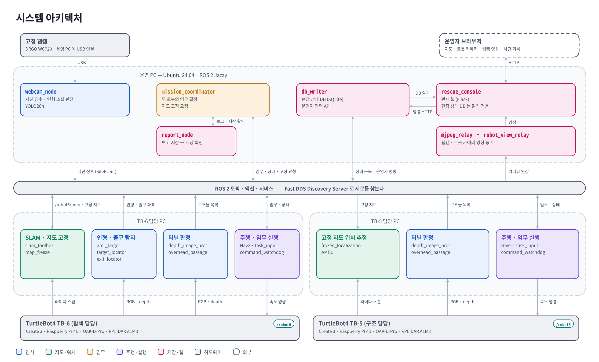
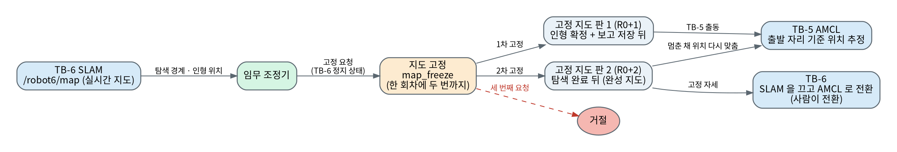
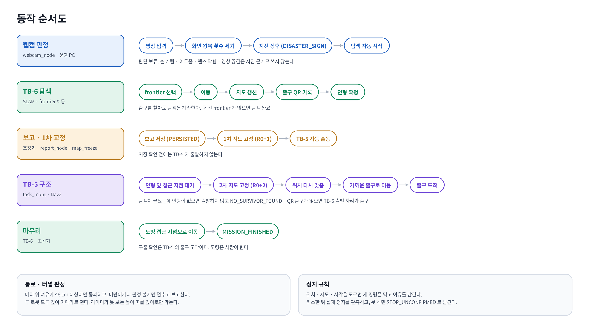
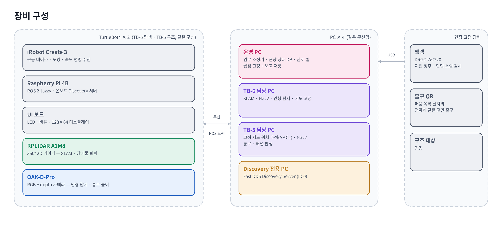
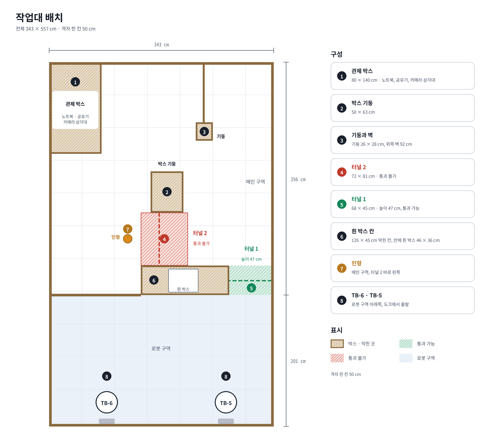

# ROKEY-7 — 지진 재난 현장 AMR 2대 수색·구조 지원 시스템

## 0. 프로젝트 개요

- **목표**: 지진이 난 실내에 로봇 두 대가 먼저 들어가 지도를 만들고 구조 대상(인형)을 찾는다. 찾으면 다른 한 대가 대상 앞까지 가서 구조대원을 출구로 안내한다.
- **주요 기능**
  - 고정 웹캠이 지진 흔들림을 잡으면 TB-6 탐색이 자동으로 시작된다.
  - TB-6가 SLAM으로 지도를 만들면서 인형과 출구 QR을 찾는다.
  - 인형을 찾으면 보고를 저장하고 지도를 고정한 뒤 TB-5가 출동한다.
  - 터널은 깊이 카메라로 높이를 재서 46 cm 이상일 때만 지나간다.
  - 관제 웹에서 지도, 로봇 카메라, 웹캠 영상, 사건 기록을 본다.
- **사용 장비**: TurtleBot4 2대, 웹캠 DRGO WC720, PC 4대
- **개발 환경**: Ubuntu 24.04 LTS, ROS 2 Jazzy, Python 3.12
- **주요 기술 스택**: ROS 2, Nav2, slam_toolbox, AMCL, Fast DDS Discovery Server, YOLO26n, OpenCV, Flask, SQLite
- **기간**: 2026.10.08 ~ 2026.10.16

## 1. 시스템 설계



- 로봇마다 `task_input`만 Nav2 목표를 보내고, `command_watchdog`만 속도 명령을 보낸다.
- 임무는 `mission_coordinator` 하나가 정한다. 관제 웹은 운영자 명령을 전달만 한다.
- RGB·깊이 영상은 로봇 담당 PC만 받는다. 운영 PC에는 판정 결과와 작은 미리보기만 간다.

### 1.1 통신 인터페이스

```text
Topic     /rescue/site_events (SiteEvent)                       웹캠 → 조정기, db_writer
          /rescue/observations (TargetObservation)              인형 관측 → target_locator
          /rescue/target_locations · /rescue/exit_location      인형·출구 지도 좌표 → 조정기
          /robot6/map (OccupancyGrid)                           TB-6 실시간 SLAM 지도
          /rescue/map/frozen · /rescue/map/frozen_revision      고정 지도, 판 번호
          /rescue/robots/<id>/status · pose · map_state         실행기 → 조정기, db_writer
          /rescue/system_state (SystemState)                    임무 상태
          /rescue/reports (RescueReport) → /rescue/report_receipts (ReportReceipt)
          /rescue/robots/<id>/overhead_passages (JSON)          터널 판정 목록
          /rescue/cameras/cam_fixed/debug_image/compressed      웹캠 판정 화면
Action    /rescue/robots/<id>/execute_task (ExecuteTask)        조정기 → 로봇 실행기
Service   /rescue/operator_command (SubmitOperatorCommand)      db_writer → 조정기
HTTP      운영 PC   POST /api/operator-commands · GET·POST /api/webcam
          관제 웹   rescue_console (Flask), 현장 상태 DB는 읽기만
```

- 로봇 ID는 `robot_a`(TB-6, `/robot6`), `robot_b`(TB-5, `/robot5`)다.
- 메시지 정의는 [rescue_interfaces](src/rescue_interfaces/README.md), 계약은 [contracts.md](docs/design/contracts.md)에 있다.

### 1.2 네트워크 구성


PC와 로봇은 같은 무선망에 있고, Fast DDS Discovery Server로 서로를 찾는다.
2026-10-15부터 모든 PC가 Discovery 전용 PC의 서버(ID 0, UDP 11811)에 붙는다. 로봇 Pi의 서버(TB-5 ID 5, TB-6 ID 6)는 그대로 둔다.
운영 방법은 [Discovery 전용 PC 운영 안내](docs/process/discovery-host.md)에 있다.

### 1.3 PC별 실행

| PC | launch | 하는 일 |
| --- | --- | --- |
| 운영 PC | `operations.launch.py` | 현장 상태 DB, 명령 API, 보고 저장, 웹캠 판정, 영상 중계 |
| 운영 PC | `coordinator.launch.py` | 두 로봇의 임무 결정, 지도 고정 요청 |
| 운영 PC | `python3 -m rescue_console` | 관제 웹 |
| TB-6 담당 PC | `tb6_slam` · `robot` · `map_freeze` | SLAM, Nav2, 정지 감시, 임무 실행, 지도 고정 |
| TB-6 담당 PC | `amr_perception` · `passage_points` · `overhead_passage` | 인형·출구 QR 탐지, 터널 판정 |
| TB-5 담당 PC | `frozen_localization` · `robot` | 고정 지도 위 AMCL, Nav2, 정지 감시, 임무 실행 |
| TB-5 담당 PC | `passage_points` · `overhead_passage` | 터널 판정 |
| Discovery 전용 PC | `fastdds discovery --server-id 0` | ROS 2 발견 서버 |

### 1.4 지도 고정

기준 지도는 따로 없다. TB-6의 SLAM 지도를 두 로봇이 같이 쓰고, 한 회차에 두 번까지 복사해서 고정한다.



### 1.5 인식 방식

| 대상 | 방식 | 한계 |
| --- | --- | --- |
| 지진 징후 | 웹캠 화면 전체의 왕복 횟수를 센다. 손 가림, 어두움, 영상 끊김은 판단 보류 | 판정 값은 현장에서 잰 ROI와 임계값에 따라 달라진다 |
| 인형 | OAK-D 영상에서 YOLO26n으로 찾고(`assets/models/best.pt`), 깊이로 거리를 구해 지도 좌표로 바꾼다 | 먼 거리에서 confidence가 낮았다 |
| 인형 소실 | 웹캠 영상에 YOLO26n(`assets/models/webcam-yolo26n-best.pt`) | 소실 후보만으로 구출 완료로 보지 않는다 |
| 출구 | QR을 읽어 허용 목록 글자(`EXIT-1`, `EXIT-2` …)와 같을 때만 출구로 기록한다 | QR이 없으면 TB-5 출발 자리가 출구다 |
| 터널 | 깊이 영상을 점구름으로 바꿔 머리 위 여유를 잰다 | 라이다가 못 보는 높이는 깊이로만 막는다 |

## 2. 플로우 차트

### 2.1 명령 처리 시퀀스


임무가 끝나거나 취소되면 항상 정지를 확인한다. 확인하지 못하면 `STOP_UNCONFIRMED`로 남기고 새 임무를 막는다.

### 2.2 동작 순서도



| 상황 | 처리 |
| --- | --- |
| 위치·지도·시각을 모름 | 새 명령을 막고 이유를 남긴다 |
| 두 로봇이 너무 가까움 | 새 명령을 막는다. TB-5가 먼저 가고 TB-6는 비킨다 |
| 지도 고정 세 번째 요청 | 거절 |
| 탐색이 끝났는데 인형이 없음 | TB-5는 출발하지 않고 `NO_SURVIVOR_FOUND` |
| 정지를 확인하지 못함 | `STOP_UNCONFIRMED`, 현장에서 사람이 직접 정지 |

## 3. 운영체제 환경

| 항목 | 값 |
| --- | --- |
| OS | Ubuntu 24.04 LTS |
| ROS 배포판 | ROS 2 Jazzy |
| Python | 3.12 (CI는 3.10 ~ 3.12) |
| 빌드 | colcon |
| DB | SQLite |
| 통신 | Fast DDS (`rmw_fastrtps_cpp`), Discovery Server |

### 개발 PC (2026-10-15 확인)

| 항목 | 값 |
| --- | --- |
| PC | MSI Pulse 16 AI C1VGKG (노트북) |
| CPU | Intel Core Ultra 9 185H, 22스레드 |
| 메모리 | 31 GiB |
| GPU | NVIDIA GeForce RTX 4070 Laptop (드라이버 580.178.04), Intel Arc Graphics |
| 저장장치 | WD PC SN560 NVMe 1 TB |
| OS | Ubuntu 24.04.5 LTS, 커널 7.0.0-38-generic |
| ROS 2 | Jazzy (`ros-jazzy-desktop` 0.11.0, `navigation2` 1.3.13, `slam-toolbox` 2.8.5) |
| Python | 3.12.3 |

### 워크스페이스 배치

```text
ROKEY-7/
├── src/                     # ROS 2 패키지
│   ├── rescue_contracts/    # 공통 오류·ID·시각·임무 수락 계약 (ROS 없음)
│   ├── rescue_interfaces/   # msg, srv, action 정의
│   ├── rescue_mapping/      # 3D 좌표, 변환 검증, 지도 revision
│   ├── rescue_perception/   # RGB-D 관측, 탐지, 웹캠 판정, 출구 QR
│   ├── rescue_robot/        # 임무 실행, Nav2 어댑터, 정지 판정, 지도 고정
│   ├── rescue_coordination/ # 임무 배정, 접근 확인, 통로 점유, 임무 조정기
│   ├── rescue_operations/   # 보고 장부, 현장 상태 DB, db_writer, report_node
│   ├── rescue_console/      # 관제 웹 (Flask)
│   ├── rescue_bringup/      # launch, 배포 프로파일 검사, 합성 리허설
│   └── vendor/              # 외부 패키지 (m-explore-ros2, turtlebot4)
├── config/                  # 배포 프로파일, 로봇·현장 설정, Nav2 설정
├── assets/
│   ├── models/              # YOLO26n 가중치 (best.pt, webcam-yolo26n-best.pt)
│   └── manifest/            # 모델·지도 출처와 해시
├── scripts/                 # 검사 도구, 현장 도구 (preflight, wiring_check, stop_robot.sh)
├── tools/                   # 탐지 평가, bag 재생, depth 보정, diagrams/(그림 소스)
├── tests/                   # 단위·통합 시험
└── docs/                    # 요구, 설계, 구현, 현장 기록, diagrams/(README 그림)
```

## 4. 사용한 장비 목록

### 4.1 로봇 · 센서 · 카메라



| 장비 | 모델 | 비고 |
| --- | --- | --- |
| 로봇 ×2 | TurtleBot4 (Create 3 + Raspberry Pi 4B) | TB-6 탐색(`robot_a`, `/robot6`), TB-5 구조(`robot_b`, `/robot5`) |
| 로봇 카메라 | OAK-D-Pro | RGB + depth. 인형 탐지와 터널 높이 판정에 쓴다 |
| 라이다 | RPLIDAR A1M8 | 360° 2D 스캔. SLAM과 장애물 회피 |
| 고정 웹캠 | DRGO WC720 | 지진 징후 판정, 인형 소실 감시. 운영 PC에 USB로 연결 |
| 출구 표시 | QR 코드 | 허용 목록 글자와 같을 때만 출구 |
| 구조 대상 | 인형 | |
| PC ×4 | 운영 PC, TB-6 담당 PC, TB-5 담당 PC, Discovery 전용 PC | 시험 중에는 TB-6·TB-5 담당 PC를 한 PC에서 돌리기도 한다 |

- 로봇은 한 번에 한 사람만 움직인다. 언도크, 도킹, 이동 전후에 팀에 알린다.
- 로봇에는 패키지를 설치하거나 업그레이드하지 않는다. 설정을 바꿀 때는 백업과 되돌리는 방법을 남기고 승인을 받는다.

### 4.2 작업대 · 작업물



작업대 전체는 343 × 557 cm이고 메인 구역(343 × 356 cm)과 로봇 구역(343 × 201 cm)으로 나뉜다. 치수 원본은 [arena_map_source.svg](docs/diagrams/arena_map_source.svg)다.

| 번호 | 구성 | 크기 | 비고 |
| --- | --- | --- | --- |
| 1 | 관제 박스 | 80 × 140 cm | 노트북, 공유기, 카메라 삼각대 |
| 2 | 박스 기둥 | 50 × 63 cm | |
| 3 | 기둥과 벽 | 기둥 26 × 28 cm, 벽 92 cm | |
| 4 | 터널 2 | 72 × 81 cm | 통과 불가 |
| 5 | 터널 1 | 68 × 45 cm | 높이 47 cm, 통과 가능 |
| 6 | 흰 박스 칸 | 135 × 45 cm | 막힌 칸, 안에 흰 박스(46 × 36 cm) |
| 7 | 인형 | | 메인 구역, 터널 2 바로 왼쪽 |
| 8 | TB-6, TB-5 | 지름 약 34 cm | 로봇 구역 아래쪽 도크 |

## 5. 의존성

### 5.1 ROS 2 (apt)

```bash
sudo apt install ros-jazzy-desktop ros-jazzy-navigation2 ros-jazzy-nav2-bringup \
  ros-jazzy-slam-toolbox ros-jazzy-robot-localization ros-jazzy-depth-image-proc \
  ros-jazzy-image-proc ros-jazzy-cv-bridge ros-jazzy-irobot-create-msgs \
  ros-jazzy-rmw-fastrtps-cpp
```

| 패키지 | 주요 의존 (`package.xml`) |
| --- | --- |
| `rescue_interfaces` | `rosidl_default_generators`, `action_msgs`, `geometry_msgs`, `nav_msgs` |
| `rescue_robot` | `rclpy`, `nav2_msgs`, `irobot_create_msgs`, `tf2_ros`, `rescue_interfaces` |
| `rescue_perception` | `rclpy`, `cv_bridge`, `message_filters`, `tf2_ros`, `python3-opencv`, `rescue_interfaces` (ultralytics, torch는 pip) |
| `rescue_bringup` | `launch_ros`, `nav2_amcl`, `slam_toolbox`, `turtlebot4_navigation`, `turtlebot4_viz` |

`turtlebot4_*`는 `src/vendor/turtlebot4`, `src/vendor/turtlebot4_desktop`을 같이 빌드한다.
`rescue_contracts`, `rescue_mapping`, `rescue_console`은 ROS 없이 import된다.

### 5.2 Python (pip)

버전을 고정한 파일은 없다. 아래는 개발 PC에 깔린 버전이고, CI에서 고정하는 건 `flask==3.1.3`뿐이다.

```text
ultralytics 8.4.170 · torch 2.14.1 · torchvision 0.29.1
opencv-python 4.9.0.80 · numpy 1.26.4 · scipy 1.11.4 · Pillow 10.2.0
Flask 3.1.3 · pydantic 1.10.14 · PyYAML 6.0.1
pytest 9.1.1
```

### 5.3 관제 웹

관제 웹(`rescue_console`)은 Flask가 HTML을 그려서 보내는 방식이다. 프론트엔드 빌드와 npm 의존성은 없다.

```text
Flask 3.1.3 (pip)
```

## 6. 실행 순서

자세한 명령은 [rescue_bringup README](src/rescue_bringup/README.md)의 「현장 실행 순서」에 있다.

### 0. 빌드와 환경 (모든 PC, 처음 한 번)

```bash
colcon build --packages-up-to rescue_bringup
source install/setup.bash
export ROS_DOMAIN_ID=<프로파일 domain_id>
export ROS_DISCOVERY_SERVER='<Discovery 전용 PC>:11811'
python3 scripts/field/preflight_role.py --role <host id>   # 전부 PASSED여야 다음으로
```

### 1. Discovery 전용 PC

```bash
/usr/bin/fastdds discovery --server-id 0 --ip-address <DISCOVERY_HOST_IP> --port 11811
```

ROS를 source한 셸에서는 `fastdds` 대신 `/usr/bin/fastdds`를 쓴다.

### 2. 운영 PC

```bash
ros2 launch rescue_bringup operations.launch.py profile_path:=<profile.json> ...
python3 -m rescue_console --accounts <계정 DB> --site-state <site_state.sqlite3> \
  --operations http://127.0.0.1:<api 포트> --camera <launch 로그의 값>
ros2 launch rescue_bringup coordinator.launch.py profile_path:=<profile.json> ...
```

조정기는 로봇 launch를 띄운 PC와 다른 PC에서 띄운다.

### 3. TB-6 담당 PC · TB-5 담당 PC

```bash
# TB-6 담당 PC (robot_a)
ros2 launch rescue_bringup tb6_slam.launch.py profile_path:=<profile.json> field_path:=$F robot_id:=robot_a
ros2 launch rescue_bringup passage_points.launch.py ... robot_id:=robot_a
ros2 launch rescue_bringup overhead_passage.launch.py ... robot_id:=robot_a
ros2 launch rescue_bringup robot.launch.py ... robot_id:=robot_a
ros2 launch rescue_bringup map_freeze.launch.py ... output_dir:=<회차마다 새 절대 경로>   # TB-6가 움직이기 전에

# TB-5 담당 PC (robot_b)
ros2 launch rescue_bringup passage_points.launch.py ... robot_id:=robot_b
ros2 launch rescue_bringup overhead_passage.launch.py ... robot_id:=robot_b
ros2 launch rescue_bringup frozen_localization.launch.py ... robot_id:=robot_b
ros2 launch rescue_bringup robot.launch.py ... robot_id:=robot_b
```

### 4. 배선 점검과 실행

```bash
ros2 daemon stop && ros2 daemon start
python3 scripts/field/wiring_check.py ...    # 전부 PASSED여야 로봇을 움직인다
```

두 로봇을 arm하고 웹캠 앞에서 흔들림을 만들면 TB-6 탐색이 시작된다.
인형을 찾으면 1차 고정과 함께 TB-5가 출동한다. 탐색이 끝나면 2차 고정을 하고, TB-6는 `tb6_slam`을 끈 뒤 `frozen_localization.launch.py robot_id:=robot_a`를 띄운다.
TB-5가 출구에 도착하면 끝난다.

### 정지

```bash
bash scripts/field/stop_robot.sh /robot6      # TB-5는 /robot5
```

그래도 움직이면 사람이 로봇을 들어 올린다. 정지 수단은 웹 연결에 의존하지 않는다.

### 로컬 검사 (로봇 없이)

```bash
python3 -I scripts/run_tests.py
python3 -I scripts/check_docs.py
PYTHONPATH=src/rescue_bringup python3 -m rescue_bringup config/deployment.example.json
```

`STATIC CONFIG VALID`는 설정 파일 검사만 통과했다는 뜻이다. 로봇이나 ROS 그래프를 확인한 건 아니다.
