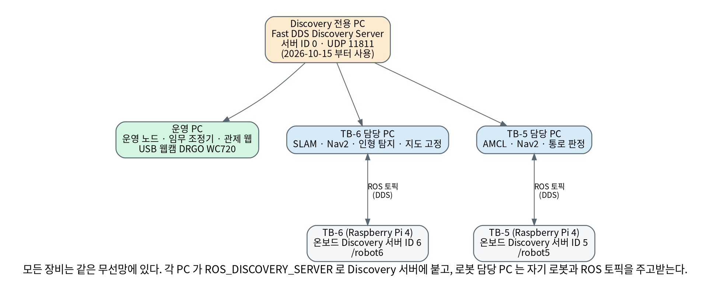
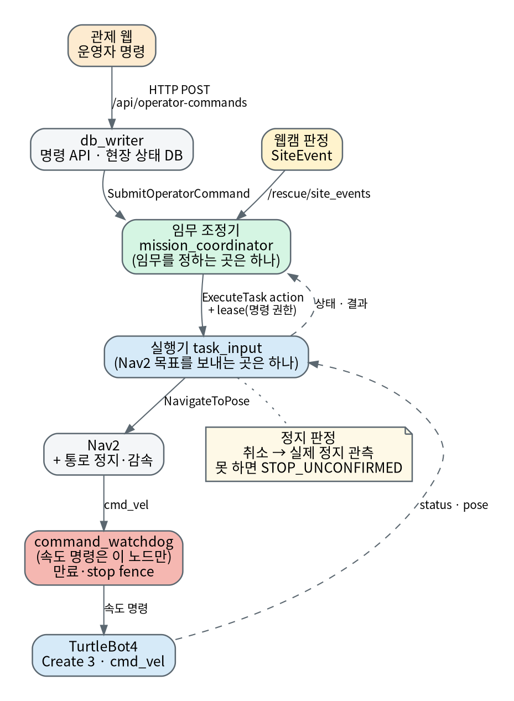
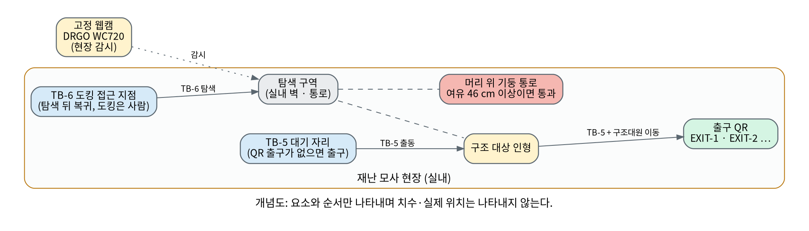

# ROKEY-7 — 지진 재난 현장 AMR 2대 협업 수색·구조 지원 시스템

## 0. 프로젝트 개요

- **목표**: 지진이 난 실내에서 사람이 들어가기 전에 로봇 두 대가 먼저 현장을 파악하고 구조 대상자까지 길을 연다.
  한 대는 지도를 만들며 대상자를 찾고, 다른 한 대는 대상자 앞까지 가서 구조대원을 출구로 이끈다.
- **주요 기능**: 고정 웹캠이 지진 징후를 판정하면 운영자 버튼 없이 탐색이 시작된다.
  `TB-6` SLAM 탐색 → 인형(구조 대상) 발견 → 보고 저장 → 지도 고정 → `TB-5` 자동 출동 → 탐색 완료 →
  가장 가까운 출구로 이동. 머리 위 여유가 46 cm 미만인 통로·터널은 깊이 카메라로 재서 멈추고 보고한다.
  운영자는 관제 웹에서 지도·로봇 카메라·웹캠 영상·사건 기록을 본다.
- **사용 장비**: TurtleBot4 ×2 (Create 3 + Raspberry Pi 4B, OAK-D-Pro, RPLIDAR A1M8), 고정 웹캠 DRGO WC720, PC 4대 (운영 · TB-6 담당 · TB-5 담당 · Discovery 전용)
- **개발 환경**: Ubuntu 24.04 LTS, ROS 2 Jazzy, Python 3.12
- **주요 기술 스택**: ROS 2, Nav2, slam_toolbox · AMCL, Fast DDS Discovery Server, YOLO26n (ultralytics), OpenCV, Flask (관제 웹), SQLite
- **기간**: 2026.10.08 ~ 2026.10.16

## 1. 시스템 설계


로봇을 움직이는 곳은 하나다. 로봇마다 실행기(`task_input`)만 Nav2 목표를 보내고, 속도 명령은 감시 노드(`command_watchdog`)만 로봇에 보낸다.
임무를 정하는 곳도 하나(임무 조정기)이고, 관제 웹은 ROS 노드가 아니라 운영자 명령을 전달만 한다.
무거운 RGB·깊이 영상은 로봇 담당 PC 만 받고, 운영 PC 에는 판정 결과와 작은 미리보기 영상만 보낸다.

### 1.1 통신 인터페이스

```text
Topic     /rescue/site_events (SiteEvent)                       웹캠 → 조정기 · db_writer
          /rescue/observations (TargetObservation)              인형 관측 → target_locator
          /rescue/target_locations · /rescue/exit_location      인형·출구 지도 좌표 → 조정기
          /robot6/map (OccupancyGrid)                           TB-6 실시간 SLAM 지도
          /rescue/map/frozen · /rescue/map/frozen_revision      고정 지도와 판 번호
          /rescue/robots/<id>/status · pose · map_state         실행기 → 조정기 · db_writer
          /rescue/system_state (SystemState)                    임무 상태
          /rescue/reports (RescueReport) → /rescue/report_receipts (ReportReceipt)
          /rescue/robots/<id>/overhead_passages (JSON)          터널 판정 목록
          /rescue/cameras/cam_fixed/debug_image/compressed      웹캠 판정 화면
Action    /rescue/robots/<id>/execute_task (ExecuteTask)        조정기 → 각 로봇 실행기
Service   /rescue/operator_command (SubmitOperatorCommand)      db_writer → 조정기
HTTP      운영 PC  POST /api/operator-commands · GET·POST /api/webcam
          관제 웹   rescue_console (Flask) — 현장 상태 DB 는 읽기 전용
```

- 로봇 ID 는 `robot_a`(TB-6, 네임스페이스 `/robot6`), `robot_b`(TB-5, `/robot5`)다.
- 메시지·서비스·액션 정의는 [rescue_interfaces](src/rescue_interfaces/README.md), 계약은 [contracts.md](docs/design/contracts.md)에 있다.

### 1.2 네트워크 구성



PC 와 로봇은 같은 무선망에 있고, 노드 발견은 Fast DDS Discovery Server 로 한다.
2026-10-15 부터 모든 PC 가 Discovery 전용 PC 의 서버(ID 0, UDP 11811)에 붙는다. 로봇 Pi 의 온보드 서버(TB-5 ID 5, TB-6 ID 6)는 바꾸지 않았다.
자세한 운영은 [Discovery 전용 PC 운영 안내](docs/process/discovery-host.md)를 따른다.

### 1.3 PC 별로 도는 것

| PC | launch | 하는 일 |
| --- | --- | --- |
| 운영 PC | `operations.launch.py` | 현장 상태 DB 기록·명령 API, 보고 저장, 웹캠 지진·소실 판정, 영상 중계, 실시간 지도 파일 저장 |
| 운영 PC | `coordinator.launch.py` | 두 로봇의 임무 결정, 지도 고정 요청 |
| 운영 PC | `python3 -m rescue_console` | 관제 웹 |
| TB-6 담당 PC | `tb6_slam.launch.py` · `robot.launch.py` · `map_freeze.launch.py` | 탐색 중 SLAM, Nav2·정지 감시·임무 실행, 지도 고정 |
| TB-6 담당 PC | `amr_perception.launch.py` · `passage_points` · `overhead_passage` | 인형 탐지·출구 QR·지도 좌표 변환, 통로·터널 판정 |
| TB-5 담당 PC | `frozen_localization.launch.py` · `robot.launch.py` | 고정 지도 위에서 AMCL, Nav2·정지 감시·임무 실행 |
| TB-5 담당 PC | `passage_points` · `overhead_passage` | 통로·터널 판정 |
| Discovery 전용 PC | (`fastdds discovery --server-id 0`) | ROS 2 발견 서버 |

### 1.4 지도 고정

기준 지도는 없다. TB-6 의 SLAM 지도가 두 로봇의 공통 지도이고, 한 회차에 두 번까지 복사해 고정한다.


### 1.5 인식 방식

| 대상 | 방식 | 한계 |
| --- | --- | --- |
| 지진 징후 | 고정 웹캠 화면 전체의 왕복(방향 전환) 횟수를 센다. 손 가림·어두움·렌즈 막힘·영상 끊김은 지진 근거가 아니라 판단 보류로 둔다 | 판정 값은 현장에서 잰 ROI·임계에 의존한다 |
| 인형(구조 대상) | OAK-D 영상에서 YOLO26n 으로 탐지(`assets/models/best.pt`, survivor v2), 깊이로 거리를 얻어 지도 좌표로 바꾼다 | 원거리 confidence 가 낮았다. 사람 오탐 재평가는 남아 있다 |
| 인형 소실 감시 | 웹캠 영상에 YOLO26n (`assets/models/webcam-yolo26n-best.pt`) | 소실 후보만으로 구출 완료로 처리하지 않는다 |
| 출구 | 탐색 중 QR 을 읽고, 허용 목록 글자와 정확히 같을 때만 출구로 기록한다 (예 `EXIT-1`, `EXIT-2`) | QR 이 없으면 TB-5 출발 자리가 출구다 |
| 통로·터널 | 깊이 영상을 점구름으로 바꿔 머리 위 여유를 잰다. 46 cm 이상이면 통과, 미만이거나 판정 불가면 멈추고 보고 | 라이다가 못 보는 높이 띠를 깊이로만 막는다 |

## 2. 플로우 차트

### 2.1 명령 처리 시퀀스



임무가 끝나거나 취소되면 반드시 정지 관문을 거친다. 취소한 뒤 실제 정지를 관측하지 못하면 `STOP_UNCONFIRMED` 로 남기고 새 임무를 막는다.

### 2.2 동작 순서도


| 실패 지점 | 처리 |
| --- | --- |
| 위치·지도·시각을 모름, 계약 시계 만료 | 새 명령을 막고 이유를 남긴다. 값을 지어내지 않는다 |
| 두 로봇이 최소 간격보다 가까움 | 새 명령을 막는다. TB-5 가 우선이고, TB-6 는 목표를 취소하고 경로 밖으로 비킨다 |
| 지도 고정 세 번째 요청 | 거절 |
| 탐색이 끝났는데 인형이 없음 | TB-5 는 출발하지 않고 `NO_SURVIVOR_FOUND` |
| 정지를 확인하지 못함 | `STOP_UNCONFIRMED`, 현장 물리 정지 수단 사용 |

## 3. 운영체제 환경

| 항목 | 값 |
| --- | --- |
| OS | Ubuntu 24.04 LTS |
| ROS 배포판 | ROS 2 Jazzy |
| Python | 3.12 (CI 는 3.10 ~ 3.12) |
| 빌드 | colcon (ROS 2 패키지) |
| DB | SQLite (운영 장부 · 현장 상태 · 웹 계정 · 송신 대기열) |
| 통신 | Fast DDS (`rmw_fastrtps_cpp`), Discovery Server |

### 개발 PC 실측값 (2026-10-15)

| 항목 | 값 | 읽은 방법 |
| --- | --- | --- |
| PC | MSI Pulse 16 AI C1VGKG (노트북) | `/sys/class/dmi/id/product_name` |
| CPU | Intel Core Ultra 9 185H, 22 스레드 | `lscpu` |
| 메모리 | 31 GiB | `free -h` |
| GPU | NVIDIA GeForce RTX 4070 Laptop (드라이버 580.178.04), 내장 Intel Arc Graphics | `nvidia-smi`, `lspci` |
| 저장장치 | WD PC SN560 NVMe 1 TB | `lsblk` |
| OS | Ubuntu 24.04.5 LTS, 커널 7.0.0-38-generic | `/etc/os-release`, `uname -r` |
| ROS 2 | Jazzy (`ros-jazzy-desktop` 0.11.0, `navigation2` 1.3.13, `slam-toolbox` 2.8.5) | `dpkg -l` |
| Python | 3.12.3 | `python3 --version` |

이 값은 개발에 쓴 PC 한 대의 것이다.

### 워크스페이스 배치

```text
ROKEY-7/
├── src/                     # ROS 2 패키지
│   ├── rescue_contracts/    # 공통 오류·ID·정수 시각·임무 수락 계약 (ROS 없음)
│   ├── rescue_interfaces/   # msg · srv · action 정의 (ament_cmake)
│   ├── rescue_mapping/      # 3D 좌표·변환 유효성·지도 revision
│   ├── rescue_perception/   # RGB-D 관측·탐지·웹캠 판정·출구 QR
│   ├── rescue_robot/        # 로봇별 임무 실행·Nav2 어댑터·정지 판정·지도 고정
│   ├── rescue_coordination/ # 임무 배정·접근 확인·통로 점유·임무 조정기
│   ├── rescue_operations/   # 보고 장부·현장 상태 DB·db_writer·report_node
│   ├── rescue_console/      # 관제 웹 (Flask, 읽기 전용 + 명령 전달)
│   ├── rescue_bringup/      # launch·배포 프로파일 검사·합성 리허설
│   └── vendor/              # 외부 패키지 (m-explore-ros2)
├── config/                  # 배포 프로파일·로봇·현장 파일·Nav2 설정
├── assets/
│   ├── models/              # 학습한 YOLO26n 가중치 (best.pt, webcam-yolo26n-best.pt)
│   └── manifest/            # 모델·지도·보정의 출처·해시·취득 절차
├── scripts/                 # 검사·현장 도구 (preflight, wiring_check, stop_robot.sh)
├── tools/                   # 탐지 평가·bag 재생·depth 보정 도구, diagrams/ (README 그림 원본)
├── tests/                   # 단위·통합 시험
└── docs/                    # 요구·설계·구현·현장 기록, diagrams/ (README 그림)
```

## 4. 사용한 장비 목록

### 4.1 로봇 · 센서 · 카메라


| 장비 | 모델 | 비고 |
| --- | --- | --- |
| 로봇 ×2 | TurtleBot4 (iRobot Create 3 + Raspberry Pi 4B) | TB-6 탐색 담당(`robot_a`, `/robot6`), TB-5 구조 담당(`robot_b`, `/robot5`). Discovery 서버 ID 는 각각 6, 5 |
| 로봇 카메라 | OAK-D-Pro | RGB + depth. 인형 탐지·통로 높이 판정에 쓴다 |
| 라이다 | RPLIDAR A1M8 | 360° 2D 스캔. SLAM·Nav2 장애물 |
| 고정 웹캠 | DRGO(디알고) WC720 | 지진 징후 판정·인형 소실 감시. 운영 PC 에 USB 로 연결 |
| 출구 표시 | QR 코드 | 허용 목록 글자(`EXIT-1`, `EXIT-2` …)와 정확히 같을 때만 출구 |
| 구조 대상 | 인형 | 사람 대신 쓰는 대상 |
| PC ×4 | 운영 PC · TB-6 담당 PC · TB-5 담당 PC · Discovery 전용 PC | 시험 중에는 TB-6·TB-5 담당 PC 를 한 PC 에서 돌리기도 한다 |

- 로봇 한 대는 한 번에 한 사람·한 세션만 움직인다. 언도크·도킹·이동 전후에 팀에 알린다.
- 로봇에 패키지를 설치하거나 업그레이드하지 않는다. 로봇 설정 변경은 사용자 승인과 백업·해시·되돌리는 방법 기록을 거친다.

### 4.2 작업대 · 작업물



| 구성 | 내용 |
| --- | --- |
| 고정 웹캠 | 한 대가 현장을 보며 지진 흔들림과 인형 소실을 본다 |
| 인형 | 구조 대상. 시연 때 배치하고, 구조대원이 출구 쪽으로 옮기면 웹캠에서 사라진다 |
| 출구 QR | 허용 목록 글자(`EXIT-1`, `EXIT-2` …)와 정확히 같은 것만 출구로 쓴다. 없으면 TB-5 출발 자리가 출구다 |
| 머리 위 구조물 | 머리 위에 비스듬히 걸친 기둥 통로. 라이다가 못 보는 높이라 깊이 카메라로 46 cm 여유를 재서 통과를 판정한다 |
| 로봇 자리 | TB-5 는 대기 자리(출발 자리)에서 출동한다. TB-6 는 탐색을 마치면 도킹 접근 지점으로 간다(도킹은 사람) |

## 5. 의존성

### 5.1 ROS 2 (apt)

```bash
sudo apt install ros-jazzy-desktop ros-jazzy-navigation2 ros-jazzy-nav2-bringup \
  ros-jazzy-slam-toolbox ros-jazzy-robot-localization ros-jazzy-depth-image-proc \
  ros-jazzy-image-proc ros-jazzy-cv-bridge ros-jazzy-irobot-create-msgs \
  ros-jazzy-rmw-fastrtps-cpp   # 개발 PC 에 설치된 패키지 목록(2026-10-15)
```

| 패키지 | 주요 의존 (`package.xml`) |
| --- | --- |
| `rescue_interfaces` | `rosidl_default_generators`, `action_msgs`, `geometry_msgs`, `nav_msgs` |
| `rescue_robot` | `rclpy`, `nav2_msgs`, `irobot_create_msgs`, `tf2_ros`, `rescue_interfaces` |
| `rescue_perception` | `rclpy`, `cv_bridge`, `message_filters`, `tf2_ros`, `python3-opencv`, `rescue_interfaces` (+ ultralytics·torch 는 pip) |
| `rescue_bringup` | `launch_ros`, `nav2_amcl`, `slam_toolbox`, `turtlebot4_navigation`, `turtlebot4_viz` |

`turtlebot4_*` 패키지는 `src/vendor/turtlebot4`, `src/vendor/turtlebot4_desktop` 소스로 함께 빌드한다.
`rescue_contracts`·`rescue_mapping`·`rescue_console` 은 ROS 없이 import 된다.

### 5.2 Python (pip)

이 저장소에는 패키지 버전을 고정한 파일이 없다. 아래는 개발 PC 에 설치된 버전이고(2026-10-15), CI 가 고정하는 것은 `flask==3.1.3` 하나다.

```text
ultralytics 8.4.170 · torch 2.14.1 · torchvision 0.29.1
opencv-python 4.9.0.80 · numpy 1.26.4 · scipy 1.11.4 · Pillow 10.2.0
Flask 3.1.3 · pydantic 1.10.14 · PyYAML 6.0.1
pytest 9.1.1
```

### 5.3 관제 웹

관제 웹(`rescue_console`)은 Flask 가 HTML 을 직접 그려 보내는 서버 렌더링이다. 별도 프론트엔드 빌드와 npm 의존성은 없다.

```text
Flask 3.1.3 (pip) · 브라우저는 표준 HTML 만 사용
```

## 6. 실행 순서

현장 명령은 [rescue_bringup README](src/rescue_bringup/README.md)의 「현장 실행 순서」가 기준이다. 아래는 순서 요약이다.

### 0. 빌드와 환경 (모든 PC, 최초 1회)

```bash
colcon build --packages-up-to rescue_bringup
source install/setup.bash
export ROS_DOMAIN_ID=<프로파일 domain_id>
export ROS_DISCOVERY_SERVER='<Discovery 전용 PC>:11811'   # 프로파일 hosts[<host id>].network 와 같게
python3 scripts/field/preflight_role.py --role <host id>   # 모두 PASSED 여야 다음으로
```

### 1. Discovery 전용 PC

```bash
/usr/bin/fastdds discovery --server-id 0 --ip-address <DISCOVERY_HOST_IP> --port 11811
```

ROS 를 source 한 셸에서는 `/usr/bin/fastdds` 를 전체 경로로 쓴다. 그냥 `fastdds` 를 치면 실패한다.

### 2. 운영 PC

```bash
ros2 launch rescue_bringup operations.launch.py profile_path:=<profile.json> ...
python3 -m rescue_console --accounts <계정 DB> --site-state <site_state.sqlite3> \
  --operations http://127.0.0.1:<api 포트> --camera <launch 로그의 값>
ros2 launch rescue_bringup coordinator.launch.py profile_path:=<profile.json> ...
```

조정기는 로봇 launch 를 띄운 PC 와 다른 PC 에서 띄운다.

### 3. TB-6 담당 PC · TB-5 담당 PC

```bash
# TB-6 담당 PC (robot_a)
ros2 launch rescue_bringup tb6_slam.launch.py profile_path:=<profile.json> field_path:=$F robot_id:=robot_a
ros2 launch rescue_bringup passage_points.launch.py ... robot_id:=robot_a
ros2 launch rescue_bringup overhead_passage.launch.py ... robot_id:=robot_a
ros2 launch rescue_bringup robot.launch.py ... robot_id:=robot_a
ros2 launch rescue_bringup map_freeze.launch.py ... output_dir:=<회차마다 새 절대 경로>   # TB-6 이 움직이기 전에

# TB-5 담당 PC (robot_b)
ros2 launch rescue_bringup passage_points.launch.py ... robot_id:=robot_b
ros2 launch rescue_bringup overhead_passage.launch.py ... robot_id:=robot_b
ros2 launch rescue_bringup frozen_localization.launch.py ... robot_id:=robot_b
ros2 launch rescue_bringup robot.launch.py ... robot_id:=robot_b
```

### 4. 배선 점검과 실행

```bash
ros2 daemon stop && ros2 daemon start
python3 scripts/field/wiring_check.py ...    # 모든 연결이 PASSED 여야 로봇을 움직인다
```

두 로봇을 arm 한 뒤 웹캠 앞에서 흔들림을 만들면 TB-6 탐색이 저절로 시작된다.
인형 발견 → 1차 고정(TB-5 자동 출동) → 탐색 완료 → 2차 고정(TB-6 은 `tb6_slam` 을 끄고 `frozen_localization.launch.py robot_id:=robot_a`)
→ TB-5 가 출구에 도착하면 끝난다.

### 정지

```bash
bash scripts/field/stop_robot.sh /robot6      # TB-5 는 /robot5
```

그래도 움직이면 사람이 로봇을 들어 올린다. 현장 정지 수단은 웹 연결에 의존하지 않는다.

### 로컬 검사 (로봇 없이)

```bash
python3 -I scripts/run_tests.py
python3 -I scripts/check_docs.py
PYTHONPATH=src/rescue_bringup python3 -m rescue_bringup config/deployment.example.json
```

`STATIC CONFIG VALID` 는 정적 파일 검사 성공이다. 로봇·ROS 그래프·실제 시계·주행 준비를 검증한 결과가 아니다.
