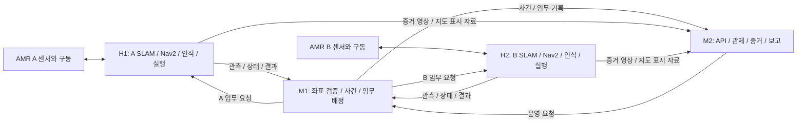

# 두 AMR 재난 수색 시스템의 구조와 배포 제안

이 문서는 [범위](scope.md)의 AMR 2대·PC 4대 요구를 구현할 책임과 의존성을 정한다. **고사양 PC를 로봇별 처리에, 중간 사양 PC를 협업 제어와 관제에 배치하는 안을 제안한다.** 실제 장비·ROS 배포판·네트워크·정지 기능은 미확인이다. 이 문서의 구조는 실행 성능이나 실기 안전 검증 결과가 아니다.

원본 근거는 [선별표](source-selection.md)의 고정 SHA를 따른다. 패키지 이름과 아래 흐름은 신규 설계 제안이다. 상세 메시지·상태 전이·수치·시험 계약은 계획 PR 3에서 정하고, [알고리즘 결정](algorithm-decisions.md)의 실험 관문을 통과한 구성만 실행 기본값으로 승격한다.

## 배포 후보와 책임

| 배치 후보 | 실행 책임 | 다른 호스트에 전달할 것 | 확인할 전제 |
| --- | --- | --- | --- |
| 고사양 H1 | A 센서 입력, A SLAM·Nav2, A 인식, A 임무 실행기 | 관측·지도/위치 메타데이터·로봇 상태·명령 결과 | A 센서 전송량, CPU/GPU·메모리, 지연, A와의 연결 |
| 고사양 H2 | B 센서 입력, B SLAM·Nav2, B 인식, B 임무 실행기 | H1과 같은 계약의 B 데이터 | 두 고사양 PC가 동일 성능이라는 가정 없이 각각 측정 |
| 중간 사양 M1 | 사건 목록, 수색·접근 배정, 공통 좌표 정렬/검증, 임무 기록 | 로봇별 임무 요청, 정렬 버전, 배정·처리 결과 | 공통 좌표 계산·상태 처리 부하, 재시작 시 중복 배정 차단 |
| 중간 사양 M2 | 관제 API·화면·증거 저장·보고 내보내기 | 운영 요청, 저장 확인, 관제 조회 | 데이터 저장 용량, 사진 전송 지연, 기록 복구 |
| 로봇 A/B 내장 장치 | 제조사 드라이버, odometry, 센서, 실제 구동과 장치 측 정지 | 로봇별 센서/상태와 명령 응답 | 모델별 구성 확인. 내장 컴퓨터를 마스터 PC 4대에 포함하지 않음 |

H1/H2는 각 로봇에 대한 계산 담당 후보이고, 단절에도 정지하는 최종 장치를 뜻하지 않는다. 원격 PC가 끊겨도 명령이 계속 유지되지 않도록 로봇 측 timeout/watchdog 또는 제조사 정지 경로를 먼저 확인한다. 그 경로를 검증하지 못한 구성은 자율 주행 관문을 통과하지 못한다. 프로파일은 물리 호스트 4대·등급 2+2·로봇 2대·유일한 명령 담당을 명시하고, 부하 측정 뒤 프로세스 배치를 바꿀 수 있게 한다.



대용량 RGB/Depth는 필요한 로봇 담당 PC에서 처리하고, 중앙에는 결과와 제한된 표시 자료·사건 증거를 보낸다. 모든 PC가 모든 원본 영상에 구독하는 구성을 기본값으로 만들지 않는다. 실험 기록은 필요한 호스트에서 수집하고 공통 실행 ID로 묶는다. 실제 DDS domain, discovery, QoS, 압축 방식과 시간 동기화 수단은 환경 확인 후 배포 프로파일에 고정한다.

## 저장소와 패키지 경계

```text
src/
  rescue_interfaces/     # 공통 msg/action/service; 계약 확정 후 생성
  rescue_robot/          # 로봇별 임무 실행·준비 판정·Nav2 adapter
  rescue_perception/     # 영상·탐지·깊이·센서 좌표 관측
  rescue_coordination/   # 수색·사건 연결·배정·접근 후보 정책
  rescue_mapping/        # SLAM adapter·관측 변환·공통 좌표·revision
  rescue_operations/     # API·저장·화면·보고
  rescue_bringup/        # 로봇/호스트 설정·launch·사전 점검
docs/                    # 범위·선별·설계·계약·실험 기록
```

일반 Python 패키지는 `<package>/domain/`에 ROS 없이 시험할 판단·기하 함수를, `<package>/adapters/`에 ROS·DB·HTTP 입출력을 두는 것을 제안한다. `test/`는 해당 책임의 시험을 둔다. 작은 패키지에 빈 계층을 강제로 늘리지 않는다. `rescue_interfaces`는 ROS 인터페이스 생성용 패키지이며 나머지 여섯 패키지의 Python 구조와 구분한다. launch/config는 `rescue_bringup`이 조합하고 각 패키지가 서로의 노드를 몰래 기동하지 않는다.

| 패키지 | 판단·쓰기 책임 | 받는 입력 / 내보내는 결과 | 경계 |
| --- | --- | --- | --- |
| `rescue_interfaces` | 공통 계약·오류/결과 의미 | 메시지 정의 | 정책·모델·장비 상수 미포함 |
| `rescue_robot` | 로봇별 임무 세대, Nav2 목표/취소, 준비·정지 확인 | 임무 요청 / 수락·거절·진행·정지·종료 | 로봇별 Nav2·선택적 도킹 액션의 단독 호출자 |
| `rescue_perception` | 센서 시각·class·깊이 유효성·로컬 추적 | RGB/Depth/CameraInfo / 원본 관측 | 구동 명령을 보내지 않음; 임상 상태를 추정하지 않음 |
| `rescue_mapping` | 좌표 변환, 정렬 유효성, 지도/변환 revision | SLAM·TF·기준점·관측 / 버전 있는 위치·무효화 | SLAM 라이브러리 내부 알고리즘은 표준 구성요소에 맡김 |
| `rescue_coordination` | 다중 사건 보존, 수색·확인·접근 배정 | 유효 위치·관측·경로 평가 / 임무 요청 | 직접 `cmd_vel`·Nav2 액션 호출 금지 |
| `rescue_operations` | 사건/보고 영속 저장·표시·운영 요청 | 상태·결과·증거 / 저장 확인·조회 | 화면 갱신 시각을 관측 시각으로 바꾸지 않음 |
| `rescue_bringup` | 프로파일 로드·검증·컴포넌트 조합 | 장비/호스트 설정 / launch·사전 점검 결과 | 원본 robot ID·도크 좌표·개인 경로 승계 금지 |

`rescue_mapping`의 로봇별 SLAM/TF adapter는 H1/H2에, 공통 정렬 registry는 M1에 둘 수 있다. 패키지 하나가 호스트 하나를 의미하지 않는다. M1의 임무 상태와 M2의 보고 DB는 서로 다른 책임이며 공유 파일로 합치지 않는다. M2의 DB는 M2의 단일 서비스가 쓰고 다른 PC는 API/메시지로 접근한다. 임무·보고 ID의 재전송은 동일 사건을 중복 생성하지 않게 하며, 영속 저장 확인을 받기 전에는 `보고 완료`로 표시하지 않는다.

## 좌표와 지도 소유권

기본 검증 후보는 **독립 SLAM 두 개 + 측정한 공통 기준점**이다. A/B의 로컬 지도는 각각 주행에 사용하고, 교환하는 관측·목표만 공통 `mission` 기준으로 변환한다. 이 `mission`은 프로젝트의 좌표 계약 제안이며 두 occupancy grid를 하나로 자동 합쳤다는 뜻이 아니다. 정렬되지 않은 지도는 관제에서 별도 화면으로 보여 주고 교차 로봇 접근 배정은 제한한다.

개념 경로는 `mission → robot_a/map → robot_a/odom → robot_a/base_link → robot_a/camera_optical_frame`와 `robot_b`의 대응 경로다. 실제 장비 frame과 이 계약 이름의 대응은 프로파일에 명시한다. `odom → base`는 장비 odometry 제공자가, `map → odom`은 활성 SLAM 제공자 한 곳이 담당한다. `mission → map`은 정렬 검증을 통과한 mapping adapter만 발행하거나 좌표 변환 API에서 관리한다. REP-105가 설명하는 것처럼 odom은 연속성과 drift, map은 전역 보정과 위치 점프의 성격이 다르므로 두 값을 같은 안정성 기준으로 평가하지 않는다. [REP-105](https://github.com/ros-infrastructure/rep/blob/master/rep-0105.rst)

토픽 namespace만 붙여도 모든 TF frame ID가 분리된다고 가정하지 않는다. 실제 장비가 frame prefix를 지원하면 고유 frame을 쓰고, 지원하지 않으면 로봇별 TF topic/buffer를 분리한 뒤 명시적으로 변환·내보낸다. 전역 TF에 서로 다른 두 `map → odom`을 같은 이름으로 흘리지 않는다. TurtleBot 4 공식 문서의 namespaced 실행은 참고 사례이며 아직 이 프로젝트 장비 모델을 확정하는 근거가 아니다. [공식 다중 로봇 문서](https://turtlebot.github.io/turtlebot4-user-manual/tutorials/multiple_robots.html)

| 값 | 담당/변경 의미 | 적용 규칙 |
| --- | --- | --- |
| `map_session_id` | mapping: SLAM 재기동·리셋으로 좌표 세션 변경 | 이전 세션 위치를 새 세션 goal로 자동 사용하지 않음 |
| `map_revision` | mapping: 보정이 저장 관측의 좌표 의미를 바꿈 | 영향을 받는 관측·접근 목표를 무효화하거나 검증된 방식으로 재투영 |
| `transform_revision` | mapping: 로컬 지도와 `mission` 정렬의 의미 변경 | 정렬에 의존하는 위치·경로 평가·목표를 다시 검증 |
| 일반 TF 갱신 / 새 지도 셀 | 정상 시간 진행·관측 누적 | 모든 TF tick을 위 revision 증가로 해석하지 않음 |

원본 관측은 센서 frame의 위치·관측 시각·소스/부팅 ID·증거 참조와 함께 불변 보존한다. 파생 지도 위치에는 사용한 revision을 기록한다. **과거 시각의 TF 조회만으로 SLAM 보정 이후 과거 대상 위치가 자동 교정되지는 않는다.** backend가 관측과 posegraph node의 관계 및 최적화된 자세를 제공하는 경우에만 검증된 재투영을 한다. 그렇지 않으면 위치를 무효화하고 재관측한다. 초기 기준점 정렬을 한 번 수행한 사실도 이후 loop closure나 지도 변형의 정확성을 보장하지 않는다.

보정 감지·대상 영향 범위를 확신할 수 없으면 해당 지도의 접근 임무 전체를 보수적으로 보류한다. 새 배정 중지 → 기존 goal 취소 → 별도 정지 관측 → 정렬 재확인/재관측 → 새 임무 세대의 순서를 사용한다. 정확한 메시지·정지 시한·재개 권한은 PR 3에서 정한다.

## 명령·정지 경계

`rescue_robot`의 단독 명령 권한은 **임무/액션을 시작하는 책임**을 뜻한다. Nav2 controller, 선택한 smoother, 충돌 감시기는 명시된 속도 처리 연결 안에서 각자 발행한다. 인식·협업·관제의 임의 속도 발행을 허용하지 않는다. 수동 조작을 넣는 경우도 명령 중재와 마지막 정지 경로를 통과하게 한다. 도킹은 이번 파이널의 필수 기능이 아니며 필요할 때만 제조사 경로와 충돌 감시 적용 범위를 따로 확인한다.

Collision Monitor를 사용하는 구성에서는 모든 일반 속도 경로를 그 입력으로 모으고 최종 속도 출력을 구동 입력에 연결한다. 공식 문서도 velocity 처리의 마지막 링크로 두도록 설명한다. 센서가 오래되었을 때의 정지 설정과 장치 측 명령 timeout은 별도로 시험한다. 이 소프트웨어 구성만으로 장치의 실제 정지나 인증된 안전 기능을 주장하지 않는다. [Nav2 연결 지침](https://docs.nav2.org/jazzy/tutorials/general_tutorials/using_collision_monitor/using_collision_monitor/)

| 상황 | 담당과 동작 제안 | 유지할 정보 |
| --- | --- | --- |
| 협업 PC/링크 단절 | 실행기의 임무 lease 만료와 장치 측 watchdog 경로로 취소·정지·보류 | 활성 task ID/세대, 마지막 수락, 단절 이유 |
| 관측·TF·위치 품질 불충분 | 새 접근 제한; 진행 중 접근은 취소·정지 후 재확인 | 발견 사건·원본 시각·마지막 검증 상태 |
| 명령 수락/취소 응답 지연 | 늦은 수락 처리, 정지 관측 전 새 이동 금지 | 액션 요청/응답과 물리 정지 결과를 분리 |
| 관제/저장 PC 단절 | 데이터 수집·전송을 제한된 queue/outbox로 재시도, 저장 전 보고 완료 금지 | 사건과 증거의 유실/대기 상태, 저장 실패 이유 |
| PC·로봇 재기동 | boot/session 식별자 변경, 과거 명령 재실행 차단, 수동/정책 재개 조건 재검증 | 복구 전후 경계와 미완료 임무 |

시간 비교는 관측 source time, 처리 시각, 각 수신자의 local monotonic elapsed time을 구분한다. 서로 다른 PC의 monotonic 수치를 직접 빼지 않는다. source clock의 오차가 계약 범위를 넘으면 위치 변환·접근에 쓰지 않고 명시적으로 품질 저하를 보고한다. 이 경로는 관제 화면의 온라인 표시와 별개로 로봇 실행기에서 적용한다.

## 구현 전에 통과할 관문

| 관문 | 확인할 결과 | 막는 후속 작업 |
| --- | --- | --- |
| A0 장비·실행 계약 | 실제 로봇/센서, 4 PC, OS/ROS/패키지 버전, frame/topic, 명령·정지 경로 기록 | 실제 장비 launch·주행 |
| A1 두 대 독립 주행 | 동시 SLAM/Nav2, frame/명령 무혼선, 취소·정지·센서/링크 장애 처리 | 교차 로봇 접근 |
| A2 좌표 교환 | 공통 물리점 오차, 기준점 이동/loop closure/재기동 이후 무효화·재확인 | 자동 발견 인계·공통 지도 표시 |
| A3 인식·접근 입력 | 실제 대상/센서에서 시각·깊이·class·불확실성 검증, 경로 있는 정지점 생성 | 사람 발견 기반 자동 접근 |
| A4 네 PC 통합 | 두 로봇 협업, 추가/제거 장애물, 장애 주입, 보고 저장과 동일 사건 추적 | 종합 완료 판정 |

각 관문의 수치·시험 횟수·로그 항목은 PR 3에서 시험 전에 정한다. A0~A4는 문서 승인이나 mock 시험으로 자동 통과하지 않는다. 원본 코드를 실행하지 않았고 위 관문의 실기 통과 증거도 아직 없다. 계획 PR 4의 구조·설정 검증은 이 계약을 준비하는 작업이며 A1 이후 실기를 대신하지 않는다.
