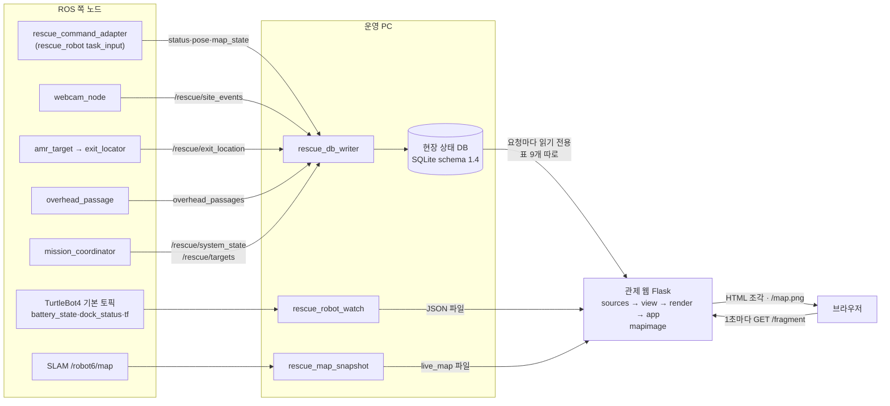
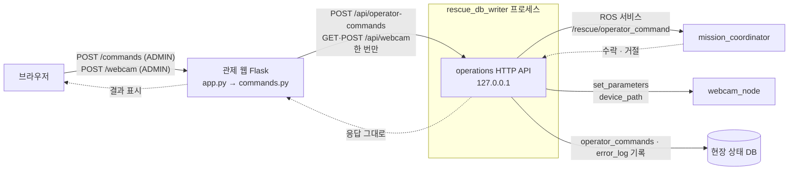
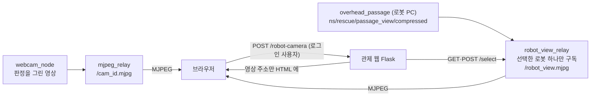

# 관제 웹 아키텍처

> 기준 상태는 main `cba6c9e`(2026-10-14, PR #284 머지 뒤)다. 관제 웹 코드는 `4163a25` 와 같고 README 만 다르다. 줄 번호는 이 상태를 기준으로 한다.
> 이 문서는 「관제 웹 데이터 흐름」(`console-dataflow.md`)의 이름을 바꾸고, 구성 요소, 클래스, 설계 판단, 알려진 한계를 더한 것이다. 처리 규칙, 화면 문구, 오류의 자세한 내용은 [관제 웹 설계 명세](console-spec.md)에 있다.
> 코드를 읽고 적었다(E1). 로봇과 ROS 를 띄워 토픽을 확인하지는 않았다(NOT_RUN).

## 0. 한 줄 요약

관제 웹(`rescue_console`)은 **ROS 노드가 아니다.** 토픽을 구독하지도 발행하지도 않는다. ROS 쪽 값은 운영 PC 의 노드들이 **파일, SQLite, HTTP** 로 바꿔 내놓고, 웹은 요청이 올 때마다 그 값을 **읽기만** 한다. 웹이 밖으로 내보내는 것은 네 가지다. 브라우저에 주는 HTTP 응답, operations HTTP API 로 보내는 요청(운영자 명령 POST, 웹캠 목록 GET, 웹캠 변경 POST), 로봇 카메라 중계(`robot_view_relay`)로 보내는 `/select` 요청(GET·POST), 그리고 웹이 가진 계정 DB 에 쓰는 것이다.

- 확인한 방법: `grep -rn -E "import rclpy|from rclpy" src/rescue_console` 의 결과는 0건이다. 밖으로 나가는 HTTP 요청은 모두 `post_json`(`commands.py:116-139`) 안의 `urllib.request.urlopen` 한 곳(`commands.py:123`)을 거치고, 재시도하지 않는다. 데이터를 쓰는 SQL 은 계정 DB(`accounts.py:150`, `:152`, `:242`, `:282`, `:297`)에만 쓴다.

## 1. 구성 요소와 경계

| 실행 단위 | 실행 위치 | 하는 일 | 쓰기 대상 |
| --- | --- | --- | --- |
| 관제 웹 `rescue_console`(Flask, ROS 노드 아님) | 운영 PC | 요청이 올 때마다 DB 와 파일을 읽어 화면을 만든다. 운영자 명령은 operations API 로 한 번만 넘긴다 | 계정 DB 만 |
| `rescue_db_writer`(rescue_operations `db_writer`) | 운영 PC | ① 토픽을 구독해 현장 상태 DB 에 쓴다. ② 같은 프로세스 안의 스레드에서 operations HTTP API(`/api/operator-commands`, `/api/webcam`)를 연다. 주소는 `127.0.0.1` 이다(`rescue_bringup/operations_launch.py:26`) | 현장 상태 DB(이 DB 에 쓰는 유일한 프로세스) |
| `rescue_map_snapshot`(rescue_operations `map_snapshot`) | 운영 PC | SLAM 지도 토픽을 구독해 `live_map.yaml`, PGM, `live_map.alive` 파일로 쓴다 | 지도 파일 |
| `rescue_robot_watch`(rescue_operations `robot_watch`) | 운영 PC | 로봇 기본 토픽을 구독만 하고, 받은 값을 JSON 파일로 쓴다 | 직접 관측 파일 |
| `mjpeg_relay`(rescue_perception) | 운영 PC | 웹캠 판정 영상을 MJPEG HTTP 로 중계한다 | — |
| `robot_view_relay`(rescue_perception) | 운영 PC | 선택된 로봇 한 대의 터널 판정 영상을 MJPEG HTTP 로 중계한다. 로봇 선택은 `/select` 로 받는다 | — |
| `mission_coordinator`(rescue_coordination) | ROS 쪽 | 명령을 수락하거나 거절하고, 임무 상태와 대상을 발행한다 | — |
| 브라우저 | 운영자 PC | 1초마다 `/fragment` 를 요청한다. 영상은 중계 노드에서 직접 받는다 | — |

헷갈리기 쉬운 점:

- 조정기는 영상을 내보내지 않는다. `src/rescue_coordination` 에서 이미지를 발행하는 코드는 0건이다. 영상은 인식 노드에서 운영 PC 의 중계 노드를 거쳐 브라우저로 간다(2절 ③).
- operations API 는 웹이 아니라 `rescue_db_writer` 프로세스 안에 있다(`rescue_operations/ros_node.py:300-305`. `make_server` 로 만든 서버를 `serve_forever` 스레드에서 돌린다).
- 1초마다 요청을 보내는 쪽은 브라우저의 JS 다. Flask 는 요청이 올 때 DB 를 연다.
- 지도 파일과 직접 관측 파일을 읽는 것은 Flask 뿐이다. 브라우저는 `/map.png` 를 받는다.
- 현장 상태 DB 의 표 9개는 표마다 따로 읽으므로 같은 시점에 읽은 값이 아니다(8절).

## 2. 흐름 그림

### ① 상태와 조회

### ② 명령과 웹캠 변경 — 응답은 요청과 같은 경로로 돌아온다

### ③ 영상 — 웹 서버를 거치지 않는다

## 3. 들어오는 것 ① — ROS 토픽 → 현장 상태 DB → 웹

운영 PC 에서 도는 `rescue_db_writer`(`rescue_operations` 패키지의 `db_writer`)가 토픽을 구독해 현장 상태 DB 에 쓴다. 구독 연결 코드는 `rescue_operations/ros_node.py:214-246` 에 있고, 토픽 이름은 `rescue_bringup/operations_launch.py:17-24` 와 `:59-79` 에서 정한다. 웹은 `sources.py` 의 `load_site_state`(`sources.py:75-99`)에서 읽기 함수 9개를 불러 이 DB 를 **읽기 전용**(`mode=ro`, `query_only`)으로 읽는다.

경로는 이렇게 적는다. 웹 밖의 파일은 `<패키지>/<파일>:줄` 형식으로 적고, 실제 위치는 `src/<패키지>/<패키지>/<파일>` 이다(예: `rescue_operations/site_state.py` 는 `src/rescue_operations/rescue_operations/site_state.py`). 웹 파일은 파일 이름만 적으며, 위치는 `src/rescue_console/rescue_console/<파일>` 이다.

| # | 발행 노드 (패키지 · 실행 파일 · 발행 줄) | 토픽 · 메시지 | db_writer 처리 → DB 표 | 웹 읽기 (`sources.py` 키) | 웹 처리 (`view.py`) | 화면 |
| --- | --- | --- | --- | --- | --- | --- |
| A1 | `rescue_command_adapter` (rescue_robot · `task_input` · `rescue_robot/task_server.py:100`) | `/rescue/robots/<robot_id>/status` · `RobotStatus` | `on_robot_status`(`rescue_operations/ros_ingest.py:209`) → `robot_status`(`record_robot_status`, `rescue_operations/site_state.py:378`) | `read_robot_status`(`rescue_operations/site_state.py:603`) → `robot_status` | `_robots`(`view.py:237`)가 역할·주행·준비·배터리·작업을 정리. 5초가 지나면 오래된(stale) 상태로 판정 | 로봇 카드(`render.py:327`) |
| A2 | `rescue_command_adapter` (rescue_robot · `task_input` · `rescue_robot/live_pose.py:131`) | `/rescue/robots/<robot_id>/pose` · `RobotPose` | `on_robot_pose`(`rescue_operations/ros_ingest.py:197`) → `robot_status` 행의 위치만 갱신(`record_robot_pose`, `rescue_operations/site_state.py:401`) | A1 과 같은 함수로 읽음 | `_robots` 의 `pose` | 로봇 카드의 「위치」, 지도의 로봇 화살표 |
| A3 | `webcam_node` (rescue_perception · `webcam_node` · `rescue_perception/webcam_node.py:253`) | `/rescue/site_events` · `SiteEvent` | `on_site_event`(`rescue_operations/ros_ingest.py:221`) → `site_events`(`record_site_event`, `rescue_operations/site_state.py:420`) | `read_site_events`(`rescue_operations/site_state.py:611`, 최대 1000건, 오래된 순) → `site_events` | `_site_events`(`view.py:285`). 소실 후보는 `_latest_candidates`(`view.py:161`), 사건 목록은 `_events`(`view.py:300`), 지진 사건은 `_mission`(`view.py:466`) | 사건 목록, 대상 단계, 임무 배너 |
| A4 | `mission_coordinator` (rescue_coordination · `mission_coordinator` · `rescue_coordination/ros_node.py:2289`) | `/rescue/system_state` · `SystemState` | `on_system_state`(`rescue_operations/ros_ingest.py:229`) → `mission_state` 1행(`record_mission_state`, `rescue_operations/site_state.py:546`) | `read_mission_state`(`rescue_operations/site_state.py:640`) → `mission_state` | `_mission_row`(`view.py:350`). 사유 문구는 `mission_reason`(`view.py:438`), 버튼 활성 판정은 `command_gates`(`view.py:598`) | 임무 배너와 사유, 명령 버튼의 켜짐/꺼짐 |
| A5 | `mission_coordinator` (`rescue_coordination/ros_node.py:2310`) | `/rescue/targets` · `TargetSnapshot` | `on_target_snapshot`(`rescue_operations/ros_ingest.py:263`) → `target_states`(`record_target_state`, `rescue_operations/site_state.py:435`) | `read_target_states`(`rescue_operations/site_state.py:622`) → `target_states` | `_targets`(`view.py:174`). 대상의 4단계는 `compose_stage`(`view.py:99`)가 계산 | 대상 목록, 지도의 대상 마커, 출동 승인 선택지 |
| A6 | `amr_target` → `/rescue/exit_observations` → `exit_locator` (rescue_perception · `target_locator` · `rescue_perception/target_locator.py:113`) | `/rescue/exit_location` · `TargetLocation` | `on_exit_location`(`rescue_operations/ros_ingest.py:237`, VALID 인 것만) → `exit_locations`(`record_exit_location`, `rescue_operations/site_state.py:489`) | `read_exit_locations`(`rescue_operations/site_state.py:670`, 최신 1행) → `exit_locations` | `_exit`(`view.py:650`) | 지도의 출구(QR) 사각형 |
| A7 | `overhead_passage` (rescue_perception · `overhead_passage` · `rescue_perception/overhead.py:348`) | `/rescue/robots/<robot_id>/overhead_passages` · `std_msgs/String`(JSON) | `on_overhead_passages`(`rescue_operations/ros_ingest.py:245`) → `overhead_passage_lists`·`overhead_passages`(`record_overhead_passages`, `rescue_operations/site_state.py:506`) | `read_overhead_passages`(`rescue_operations/site_state.py:681`) → `overhead_passages` | `_passages`(`view.py:629`) | 지도의 터널 ∏ 마커(초록·빨강·회색) |
| A8 | `rescue_command_adapter` (rescue_robot · `task_input` · `rescue_robot/live_pose.py:132`). SLAM 로봇(SCOUT)의 것만 구독 | `/rescue/robots/<SCOUT>/map_state` · `MapState` | `on_map_state`(`rescue_operations/ros_ingest.py:254`) → `current_map` 1행(`record_current_map`, `rescue_operations/site_state.py:529`) | A7 과 같은 함수가 읽는 `current_map` | `_passages` 의 `current`(현재 지도와 revision 이 같은지 여부) | 현재 지도의 터널은 진하게, 이전 revision 의 터널은 흐리게 |

다음 표들은 토픽에서 오지 않고 operations 가 직접 쓴다.

| 표 | 누가 언제 쓰나 | 웹 읽기 | 웹 처리 · 화면 |
| --- | --- | --- | --- |
| `metadata.allowed_robot_ids` | db_writer 가 기동할 때 파라미터 `allowed_robot_ids`(배치 프로파일의 로봇) 값을 씀(`rescue_operations/site_state.py:373-375`) | `read_allowed_robot_ids`(`rescue_operations/site_state.py:595`) → `allowed_robots` | `build_view` 가 이 값으로 로봇 카드 목록을 만듦(`view.py:713-716`). 상태를 아직 보내지 않은 로봇도 카드가 생긴다 |
| `operator_commands` | 명령 API 가 명령마다 접수 또는 거절을 기록(`rescue_operations/command_api.py:147`, `:158`) | `read_operator_commands`(`rescue_operations/site_state.py:648`, 최근 30건) | `_history`(`view.py:499`) → 명령 이력 표 |
| `error_log` | 명령 API 의 실패(`rescue_operations/command_api.py:165`)와 db_writer 가 거절한 메시지(`rescue_operations/ros_ingest.py:291`)를 기록 | `read_error_log`(`rescue_operations/site_state.py:629`, 최근 30건) | `_history` → 이력 표의 오류 줄 |
| `map_snapshots` | — | 웹은 읽지 않는다 | — |

## 4. 들어오는 것 ② — DB 를 거치지 않는 것

| # | 출발 | 중간 노드 · 산출물 | 웹 인자 · 읽는 곳 | 웹 처리 · 화면 |
| --- | --- | --- | --- | --- |
| B1 | SLAM 지도 `OccupancyGrid`(launch 인자 `map_topic`, 예: `/robot6/map`) | `rescue_map_snapshot`(rescue_operations · `map_snapshot`, 구독은 `rescue_operations/map_snapshot.py:139`)이 `live_map.yaml` 과 `map_<해시12>.pgm` 을 씀(임시 파일에 쓴 뒤 rename). 발행자가 있는 동안 `live_map.alive` 를 2초마다 갱신(`rescue_operations/map_snapshot.py:142-148`) | `--live-map` 과 `--live-map-stale-s` → `LiveMap.current`(`mapimage.py:233`) | PGM 을 PNG 로 변환(`load_map`, `mapimage.py:156`)해 `GET /map.png`(`app.py:363-374`)로 제공. 지도가 오래되면 안내 |
| B2 | 로봇 기본 토픽 `<ns>/battery_state`·`<ns>/dock_status`·`<ns>/tf`·`<ns>/tf_static`(TurtleBot4 쪽 토픽이며 우리 코드가 아님) | `rescue_robot_watch`(rescue_operations · `robot_watch`, 구독만 함 `rescue_operations/robot_watch.py:103-106`)가 JSON 파일을 씀(`robot_watch/1`, 1초마다, 로봇별 `last_seen_ns`·`battery_percent`·`docked`·`pose`·`pose_seen_ns`, `rescue_operations/robot_watch.py:108-125`) | `--robot-watch` 와 `--robot-watch-stale-s` → `load_robot_watch`(`sources.py:57-72`) | `_apply_watch`(`view.py:660-689`)가 카드에 직접 관측 줄을 붙임(`render.py:316`). 프로젝트 상태가 없는 로봇은 오래되지 않은 직접 관측 위치를 지도에 표시 |
| B3 | 웹캠 판정 영상 `CompressedImage`(`rescue_perception/webcam_node.py:258`) | `mjpeg_relay`(rescue_perception · `mjpeg_relay`, 구독은 `rescue_perception/mjpeg_relay.py:191`)가 HTTP `/<camera_id>.mjpg` 로 내보냄(`rescue_bringup/operations_launch.py:172`) | `--camera ID=URL`. 웹은 주소만 HTML 에 넣음(`render.py:1170-1187`) | **브라우저가 영상을 직접 받는다**(웹 서버는 영상을 중계하지 않는다). 새 프레임이 끊기면 JS 가 다시 연결(`render.py:1141-1167`) |
| B4 | 예전 보고 장부(`ReportLedger`, `LEDGER` 인자) | 현재 이 파일을 쓰는 운영 코드는 없다. `rescue_report_node` 는 형식이 다른 별도 저장소(`rescue_reports` 표)에 쓰며, 웹은 이 표를 읽지 않는다([README](../../src/rescue_console/README.md) 의 `<운영 장부>` 설명) | `load_ledger`(`sources.py:26-31`) | 장부가 없으면 「보고 장부 입력 없음」 경고를 내고 보고 행과 건수를 그리지 않음 |
| B5 | 기준 지도 파일 | 없음(저장소의 map_server YAML·PGM) | `--map` → `load_map`(`mapimage.py:156`), 기동할 때 한 번 | B1 과 같은 방식으로 그림. `--live-map` 과 함께 쓸 수 없음(`app.py:146-147`) |
| B6 | 로봇 PC 의 터널 판정 영상 `<ns>/rescue/passage_view/compressed`(`CompressedImage`, `rescue_perception/overhead.py:352`) | 운영 PC 의 `robot_view_relay`(rescue_perception · `robot_view_relay`. 선택한 로봇 하나만 구독하고 나머지는 구독 해제 `rescue_perception/robot_view_relay.py:113-123`)가 HTTP `/robot_view.mjpg` 로 내보냄(포트 = `video_port` + 1, `rescue_bringup/operations_launch.py:203-224`) | `--robot-camera URL`. 웹은 주소만 HTML 에 넣음(`render.py:1208-1231`). 선택할 수 있는 로봇과 현재 로봇은 페이지를 그릴 때마다 같은 host:port 의 `GET /select` 로 조회(`commands.py:196-205`) | 로봇 카메라 칸. 브라우저가 영상을 직접 받고, 영상이 끊기면 「카메라 영상 낡음」 표시 |
| B7 | operations 의 웹캠 목록 `GET /api/webcam`(연결된 `/dev/v4l/by-id` 카메라와 현재 장치, `rescue_operations/command_api.py:185-190`) | db_writer 프로세스 안의 `WebcamSwitch`(`rescue_operations/command_api.py:168-221`) | `--camera` 와 `--operations` 가 주어지고 사용자가 ADMIN 이면 페이지를 그릴 때마다 한 번 조회(`app.py:308-310`, `commands.py:184-193`, 제한 시간 1초) | 웹캠 칸 아래의 카메라 선택(목록을 받지 못하면 「카메라 목록을 못 받음」) |
| B8 | 브라우저 | 없음 | HTTP 경로 13개(`app.py:259-468`) | 5절 참고 |

## 5. 나가는 것

| 받는 쪽 | 무엇을 | 어디서 | 언제 |
| --- | --- | --- | --- |
| 브라우저 | 로그인 화면과 관제 화면 HTML(`GET /login`, `GET /`) | `render_login`(`render.py:1280`), `render_page`(`render.py:1258`) | 접속할 때 |
| 브라우저 | 화면 조각 HTML(`GET /fragment`) | `render_fragment`(`render.py:506`) | 1초마다(JS `setInterval(poll, POLL_MS)`, `render.py:1096`. 주기 값은 `POLL_INTERVAL_MS`) |
| 브라우저 | 화면 모델 JSON(`GET /api/view`) | `app.py:357-361` | 요청이 올 때(시험·디버그용) |
| 브라우저 | 지도 PNG(`GET /map.png`) | `app.py:363-374` | 지도가 바뀔 때(`?v=` 해시로 구분) |
| 브라우저 | 명령 결과 JSON(`POST /commands`) | `app.py:377-409` | ADMIN 이 확인 창에서 버튼을 누를 때 |
| 브라우저 | 웹캠·로봇 카메라를 선택한 뒤 302 로 `/` 에 돌려보냄(결과는 다음 화면의 알림으로 표시) | `POST /webcam`(`app.py:338-349`, ADMIN 만), `POST /robot-camera`(`app.py:325-336`, 모든 로그인 사용자) | 선택할 때 |
| operations 명령 API | `POST http://127.0.0.1:<api_port>/api/operator-commands` 로 JSON 한 건. 필드는 `command_id`(UUID), `kind`, `operator_id`(로그인 계정), 명령별 필드 | `build_request`(`commands.py:92-113`) → `send_command`(`commands.py:171-178`) → `post_json`(`commands.py:116-139`) | 명령 하나에 **정확히 한 번** 보냄. 재시도 없음, 제한 시간 5초(`commands.py:23`) |
| operations 웹캠 API | `GET /api/webcam`(목록), `POST /api/webcam` `{device, operator_id}`(변경) | `webcam_state`(`commands.py:184-193`), `switch_webcam`(`commands.py:222-235`) | 목록은 ADMIN 페이지를 그릴 때마다 조회(제한 시간 1초). 변경은 ADMIN 이 확인 창에서 선택할 때 한 번(제한 시간 5초, 재시도 없음) |
| `robot_view_relay` | `GET /select`(선택할 수 있는 로봇과 현재 로봇), `POST /select` `{robot}` | `robot_camera_state`(`commands.py:196-205`), `select_robot_camera`(`commands.py:208-219`) | 목록은 페이지를 그릴 때마다 조회(제한 시간 1초). 변경은 사용자가 선택할 때 한 번(제한 시간 1초, 보기 설정이라 확인 창 없음) |
| 계정 DB(웹이 따로 쓰는 SQLite) | 계정 추가·수정·삭제, 로그인 시각 | `accounts.py` 의 `AccountStore`(`accounts.py:119`) | 로그인할 때, 계정 관리 화면에서 |
| ROS | **없음** | — | — |

웹 밖에서 명령은 이렇게 처리된다. 명령 API(`rescue_operations/command_api.py:241` 의 `do_POST` → `CommandGate.handle`, `rescue_operations/command_api.py:108`)가 명령을 `operator_commands` 에 기록하고 ROS 서비스 `/rescue/operator_command`(`SubmitOperatorCommand`)를 호출한다(`rescue_operations/ros_node.py:247-266`). 이 서비스를 받는 쪽은 `mission_coordinator`(`rescue_coordination/ros_node.py:2485`)다. 조정기가 명령을 수락하면 그다음에 오는 `/rescue/system_state`·`/rescue/targets` 가 바뀌고(A4·A5), 웹은 다음 폴링에서 그 결과를 읽는다. 웹은 명령 결과를 추측해 화면 상태를 바꾸지 않는다.

웹캠 변경도 웹 밖에서 이렇게 처리된다. `POST /api/webcam`(`rescue_operations/command_api.py:241-250`)을 받으면 `WebcamSwitch.switch`(`rescue_operations/command_api.py:192-218`)가 요청한 장치가 연결된 카메라인지 확인하고 `webcam_node` 의 파라미터 서비스(`/webcam_node/set_parameters`, `device_path`)를 호출한다(`rescue_operations/ros_node.py:271-298`). 결과는 `error_log` 에 `CAMERA_SWITCHED` 또는 `CAMERA_SWITCH_REFUSED` 로 남고, 웹은 이를 명령·오류 기록에 표시한다. 웹캠을 바꾸면 지진 판정이 처음부터 다시 시작되고 출구 감시가 해제된다. 그래서 웹은 확인 창을 띄운다. 로봇 카메라 선택은 운영 명령이 아니라 보기 설정이므로 장부에 남지 않는다.

## 6. 웹 파일마다 받는 것 · 하는 것 · 내보내는 것

아래 파일은 모두 `src/rescue_console/rescue_console/` 에 있다.

| 파일 | 받는 것 | 하는 것 | 내보내는 것 | 참고할 함수(줄) |
| --- | --- | --- | --- | --- |
| `__main__.py` | 명령행 인자, 환경 변수 `RESCUE_CONSOLE_SECRET` | 인자 조합 검사(`--live-map`↔`--live-map-stale-s`, `--robot-watch`↔`--robot-watch-stale-s` 는 함께 줘야 함, 장부나 `--site-state` 중 하나는 있어야 함), `create_app` 호출, 서버 기동 | 실패하면 stderr 에 `CONSOLE FAILED: …` 를 쓰고 종료코드 2 로 끝냄(서버를 띄우지 않음) | `main`(`__main__.py:17-98`) |
| `app.py` | HTTP 요청(쿠키 세션, 폼), 기동 설정 | 라우트 13개 처리, 로그인·세션 무효화·CSRF·보안 헤더, 폴링마다 `current_view` 로 화면 모델을 새로 만듦, 명령을 중계하기 전에 권한 검사, 페이지를 그릴 때 웹캠 목록과 로봇 카메라 상태 조회 | HTTP 응답(HTML·JSON·PNG), 로그 | `current_view`(`app.py:52-84`), `create_app`(`app.py:121-470`), `GET /`(`app.py:303-323`), `POST /commands`(`app.py:377-409`), `POST /webcam`(`app.py:338-349`), `POST /robot-camera`(`app.py:325-336`) |
| `sources.py` | 현장 상태 DB, 픽스처 JSON(`--status`), 예전 장부, robot_watch 파일 | 읽기 전용으로 읽어 딕셔너리 하나로 모음. 하나라도 읽지 못하면 `STORAGE_ERROR` 를 내고 그 요청은 503 으로 응답 | 입력 딕셔너리(어디에도 쓰지 않음) | `load_site_state`(`sources.py:75-99`), `load_robot_watch`(`sources.py:57-72`) |
| `view.py` | `sources.py` 의 입력, 기동 설정(로봇 이름, `--support-dispatch`, `--search-start`) | 화면 모델을 만든다. 대상 4단계, 로봇 상태가 오래됐는지 판정(5초), 직접 관측 덧붙이기, 임무 사유 문구, 명령 버튼 활성 판정, 터널·출구 행, 빠진 입력이 있으면 경고 | 화면 모델 딕셔너리(`/api/view` 의 JSON 과 같음) | `build_view`(`view.py:692-790`), `_gate`(`view.py:530-595`), `command_gates`(`view.py:598-623`), `_apply_watch`(`view.py:660-689`), `_passages`(`view.py:629-647`) |
| `mapimage.py` | 지도 YAML·PGM, `live_map.alive` | PGM 을 PNG 로 변환, 실시간 지도를 다시 읽고 오래됐는지 판정, 월드 좌표를 픽셀로 변환, frame 이 다르거나 지도 밖인 것은 그리지 않고 목록에 올림 | PNG 바이트, 지도 위 마커 목록 | `load_map`(`mapimage.py:156-207`), `LiveMap.current`(`mapimage.py:233-270`), `map_overlay`(`mapimage.py:291-325`) |
| `render.py` | 화면 모델, 웹캠 목록과 로봇 카메라 상태 | HTML 조각과 전체 페이지 생성, 1초 폴링 JS, 명령 확인 창 JS, 영상이 끊기면 다시 연결하는 JS, 웹캠 선택(확인 창 포함)과 로봇 카메라 칸 | HTML 문자열(브라우저로 보냄) | `render_fragment`(`render.py:506`), `_robots`(`render.py:327-365`), `_map`(`render.py:211-295`), `_commands`(`render.py:514`), 폴링 JS(`render.py:895`, `:1096`), `_webcam_picker`(`render.py:1190-1205`), `_robot_camera`(`render.py:1208-1231`) |
| `commands.py` | `POST /commands`·`/webcam`·`/robot-camera` 폼, 로그인 계정 | 폼을 요청 JSON 으로 변환(허용 필드만, 숫자 검사)하고 한 번 보낸 뒤 응답 형식 검사. 웹캠 목록과 로봇 카메라 상태 조회 | operations 와 `robot_view_relay` 에 보내는 HTTP 요청(각 한 번), 결과 딕셔너리와 문구 | `build_request`(`commands.py:92-113`), `post_json`(`commands.py:116-139`), `read_reply`(`commands.py:146-168`), `send_command`(`commands.py:171-178`), `webcam_state`(`commands.py:184-193`), `switch_webcam`(`commands.py:222-235`), `robot_camera_state`(`commands.py:196-205`), `select_robot_camera`(`commands.py:208-219`) |
| `accounts.py` | 계정 DB 경로, 로그인·계정 관리 폼 | PBKDF2 해시(200000회 반복), 역할 ADMIN·CUSTOMER 구분, 마지막 ADMIN 삭제 방지, `init` 하위 명령 | 계정 DB 쓰기 | `AccountStore`(`accounts.py:119`), `authenticate`(`accounts.py:209`), `main`(`accounts.py:353`) |
| `throttle.py` | 로그인 실패(계정명·접속 주소) | 300초 안에 5번 실패하면 60초 동안 잠금(메모리에만 보관) | 남은 잠금 시간 | `LoginThrottle`(`throttle.py:21-73`) |
| `labels.py` | 상태 코드 | 코드를 한국어 표시 문구로 바꾸는 표 | 표시 문구 | `label`(`labels.py:59-67`) |

## 7. 핵심 클래스와 함수

이 절의 파일 경로는 `src/rescue_console/rescue_console/` 아래를 기준으로 적는다. 클래스는 7개뿐이다. 화면 판단은 모두 `view.py` 의 순수 함수(I/O와 시계를 쓰지 않는 함수)로 되어 있어서, ROS나 Flask 없이 import 해서 시험할 수 있다([AGENTS.md](../../AGENTS.md) 8절). Flask 앱도 클래스가 아니라 `create_app` 이 만든 객체이고, 라우트는 그 안에 정의한 함수다.

### 7.1 클래스

| 클래스 | 위치 | 역할 |
| --- | --- | --- |
| `ConsoleError` | `view.py:82-91` | 웹에서 나는 오류 하나를 나타낸다. 오류 코드(`INVALID_INPUT`·`STORAGE_ERROR`·`CONFIG_MISSING` …)와 설명을 담는다. 요청 처리 중에 나면 `failed`(`app.py:243-256`)가 503 응답으로 바꾸고, 기동 중에 나면 `CONSOLE FAILED` 를 출력하고 종료한다 |
| `CommandSendError` | `commands.py:47-54` | 명령 전송 실패를 나타낸다. `delivery` 값은 `NOT_SENT`(확실히 전달되지 않음) 또는 `UNKNOWN`(전달됐을 수도 있음)이다 |
| `MapImage` | `mapimage.py:139-146` | 변하지 않는 지도 한 장이다(frozen dataclass). PNG 바이트와 화면 모델에 넣을 `meta` 를 담는다 |
| `LiveMap` | `mapimage.py:210-270` | SLAM 지도 파일이 바뀌었을 때만 다시 읽고, 지도 상태(`OK`·`STALE`·`ERROR`·`MISSING`)를 판정한다 |
| `AccountStore` | `accounts.py:119-304` | 계정 DB(웹이 쓰기를 하는 유일한 파일)를 읽고 쓴다 |
| `_Transaction` | `accounts.py:307-350` | 계정 DB 쓰기를 `BEGIN IMMEDIATE` … `COMMIT`/`ROLLBACK` 으로 감싼다. `with` 블록으로 쓴다 |
| `LoginThrottle` | `throttle.py:21-73` | (계정명, 접속 IP) 쌍마다 로그인 실패를 세어, 정해진 횟수에 이르면 로그인을 잠근다 |

### 7.2 핵심 함수

| 함수 | 위치 | 입력 → 출력 | 규칙과 이유 | 시험 |
| --- | --- | --- | --- | --- |
| `main` | `__main__.py:17-98` | 명령행 인자, 환경 변수 → 서버 기동, 또는 `CONSOLE FAILED` 와 종료코드 2 | 세션 비밀값은 프로세스 목록에 드러나지 않도록 환경 변수로만 받는다. 오래된(stale) 상태 판정 기준 시간은 해당 입력 인자와 함께 줘야 하고(둘 다 주거나 둘 다 생략), 기본값이 없다. 설정이 잘못되면 첫 요청 때가 아니라 기동 때 멈춘다 | — |
| `create_app` | `app.py:121-470` | 기동 설정 → 라우트 13개를 붙인 Flask 앱 | 기동 때 카메라 끊김 시간, 비밀값이 16자 이상인지, 입력 조합, 계정 DB, 기준 지도, operations 주소를 확인한다. 현장 상태 DB·장부·픽스처는 기동 때 열지 않고 요청마다 읽는다. 세션 쿠키는 HttpOnly, SameSite=Lax 로 설정한다 | `test_console_web.py` |
| `current_view` | `app.py:52-84` | 입력 경로, 시계 → 화면 모델 하나 | 캐시 없이 매번 새로 읽는다. 시계는 `clock()` 으로 한 번만 읽어 `built_at_ns` 로 넘긴다. 그래서 `build_view` 를 시계 없이 시험할 수 있다 | `test_console_view.py` |
| `load_site_state` | `sources.py:75-99` | 현장 상태 DB 경로 → 키 9개짜리 딕셔너리(픽스처와 같은 형식) | 읽기 함수 9개가 각자 `mode=ro` + `query_only` 로 연결하고 role 과 schema 를 확인한다(`rescue_operations/site_state.py:572-592`). 하나라도 실패하면 `STORAGE_ERROR` 가 나고 응답은 503 이 된다. 일부만 채운 화면은 내보내지 않는다 | `test_console_view.py`, `test_console_history.py` |
| `build_view` | `view.py:692-790` | 장부, 상태, `built_at_ns`, 기동 설정 → 화면 모델(= `/api/view`) | I/O와 시계를 쓰지 않는 순수 함수라서 입력이 같으면 항상 같은 결과를 낸다. 빠진 입력은 빈 목록으로 두지 않고 「○○ 입력 없음」 경고로 남긴다. 그래서 「데이터 없음」과 「정상인데 0건」을 구별할 수 있다. 형식이 틀리면 `INVALID_INPUT` 을 내고 화면 전체를 실패로 처리한다 | `test_console_view.py` |
| `compose_stage`, `STAGE_RULES` | `view.py:99-119`, `:27-33` | 확정 여부와 구조·지원·접근 결과 → (단계, 규칙 ID, 경고) | R1 ~ R5 를 위에서부터 차례로 보고, 처음 맞는 규칙을 적용한다. `detection_confirmed` 는 정확히 bool 이어야 한다. 입력이 서로 모순되면 R1 에 경고를 붙이고 위 단계로 올리지 않는다. 계약 어휘를 늘리지 않으려고 단계를 화면 쪽에서 합성한다(scope.md Q-20) | `test_rule_table_rows_are_each_reachable` |
| `_robots` | `view.py:237-282` | 배치 로봇, 로봇 상태 → 로봇 카드 행 | 상태가 없는 배치 로봇도 빼지 않고 행을 만든다. 오래된 상태인지는 로봇 시각이 아니라 operations 의 수신 시각으로 판정한다(5초). 그래서 로봇이 재부팅해 시계가 되돌아가도 판정을 믿을 수 있다 | `test_console_view.py` |
| `_gate`, `command_gates` | `view.py:530-595`, `:598-623` | 임무 상태, 대상, AUTO 설정 → 명령마다 (켜짐, 사유, 보낼 값, 선택할 대상) | 검사 순서는 보류 명령 → 임무 상태 없음 → 재난 모드 아님 → 명령별 조건이고, 처음 걸린 조건이 사유로 나온다. 이 결과는 조정기의 수락 조건(`rescue_coordination.mission`)을 화면 쪽에서 미리 따라 계산한 버튼 활성 판정이다. 안내용이고 권한 확인이 아니다 | `test_console_commands.py`(`:237` 부터) |
| `mission_reason` | `view.py:438-463` | `SystemState.reason` → {code, text, level, scope} | 모르는 코드는 그대로 표시한다. 로봇 이름을 모르면 이름을 임의 값으로 채우지 않고 역할 코드(SUPPORT/SCOUT)를 쓴다 | `test_console_reasons.py` |
| `_passages`, `_apply_watch` | `view.py:629-647`, `:660-689` | 터널 판정 / 직접 관측 → 지도 행 / 카드 줄 | 터널: (세션, revision)이 현재 지도와 같으면 진하게 그린다. 현재 지도를 모르면 전부 진하게 그리고 경고를 붙인다. 직접 관측: 프로젝트 상태를 우선하고, 상태가 없는 로봇에만 오래되지 않은 직접 관측 위치를 쓴다 | `test_console_tunnel_map.py`, `test_console_robot_watch.py` |
| `LiveMap.current` | `mapimage.py:233-270` | 지도 파일 → (지도, 상태) | (수정 시각, 크기)가 바뀔 때만 다시 읽는다. `ERROR` 를 `STALE` 보다 먼저 판정한다. 읽기에 실패해도 마지막 정상 지도는 계속 표시하되 상태는 `ERROR` 로 알린다. 오래된 상태인지는 지도 수정 시각과 `live_map.alive` 중 늦은 쪽으로 판정한다. 그래서 바뀌지 않는 고정 지도를 오래된 상태로 보지 않는다 | `test_console_live_map.py` |
| `map_overlay`, `world_to_pixel` | `mapimage.py:291-325`, `:273-285` | 화면 모델 행 → 지도 마커 | frame 이 `map` 이 아니면 `frame_mismatch`, 지도 밖이면 `off_map`, 위치가 없는 로봇은 `no_pose` 로 분류하고, 이런 항목을 지도 가장자리에 붙여 그리지 않는다. 부동소수점 오차 때문에 경계 검사 전에 1/100 픽셀 단위로 반올림한다 | `test_console_map.py` |
| `command`(`POST /commands`) | `app.py:379-409` | 폼 → 결과 JSON | 처리 순서는 CSRF → `command_access` → `build_request` → `send_command` 다. 화면 JS 가 JSON 응답을 기다리므로 `admin_required` 대신 `login_required` 를 쓰고, 권한 실패도 `{sent:false}` 로 돌려준다(CUSTOMER 는 403, operations 주소 없이 띄웠으면 503). 거절 응답도 통신은 정상이므로 200 을 돌려주고, 응답이 없으면 502 를 돌려준다 | `test_console_commands.py` |
| `build_request` | `commands.py:92-113` | 폼, 로그인 계정, 서버 UUID → 요청 JSON | 명령마다 정해진 필드만 받는다(`COMMAND_FIELDS`). `operator_id` 는 세션에서 가져오고, `command_id` 는 서버가 넣는다. 숫자 값은 ASCII 숫자만 받는다. 그래서 변조한 요청으로 로봇 ID, 다른 운영자의 ID, 임의 값을 끼워 넣을 수 없다 | `test_fields_match_the_coordinator_gate` |
| `post_json` | `commands.py:116-139` | URL, JSON → (status, body) / `CommandSendError` | 웹 서버가 밖으로 보내는 HTTP 요청은 모두 이 함수의 `urlopen`(`:123`)을 거친다. 재시도하지 않는다. 연결 거부와 DNS 실패만 `NOT_SENT` 로 본다. 시간 초과 등은 operations 가 이미 받았을 수 있으므로 `UNKNOWN` 으로 본다. HTTP 오류 응답이어도 본문(거절 사유)을 읽는다 | `test_slow_operations_times_out_once_and_delivery_is_unknown` |
| `read_reply`, `send_command` | `commands.py:146-168`, `:171-178` | 응답 → 결과 딕셔너리 | `accepted` 는 정확히 bool 이어야 하고, 거절이면 `reason` 이 있어야 하며, 상태 코드가 2xx 가 아니면서 수락인 응답은 허용하지 않는다. 형식이 틀린 응답은 「거절」이 아니라 「실패」로 처리한다. 화면은 `NOT_SENT` 를 「전달 안 됨」으로, `UNKNOWN` 을 「전달됐는지 모름 — command_id … 로 명령 기록을 확인」으로 표시한다(`render.py:1038-1044`) | `test_a_failure_is_reported_and_never_retried` |
| `render_page`, `render_fragment` | `render.py:1258-1277`, `:506-509` | 화면 모델 → HTML | 페이지는 고정 틀(상단, 카메라, 명령 패널)과 `div#live` 로 나뉘고, 폴링은 `div#live` 만 교체한다. 영상 `` 는 이 조각 밖에 있으므로 폴링이 영상을 끊지 않는다. JS `poll()`(`:893`)은 401 이나 리다이렉트를 받으면 로그인 페이지로 보내고, 요청이 실패하면 기존 화면을 그대로 두고 「갱신 끊김」을 표시한다 | `test_console_web.py` |
| `label` | `labels.py:59-67` | (종류, 코드) → 표시 문구 | 모르는 코드는 그대로 돌려주고, `None` 은 `None` 으로 돌려준다. 없는 종류를 주면 `KeyError` 를 낸다. 프로그램 실수를 숨기지 않기 위해서다 | `test_console_labels.py` |
| `user`, `login` | `app.py:182-196`, `:267-293` | 세션 / 로그인 폼 → 계정 / 리다이렉트 | 세션에는 `account_id` 와 `auth_version` 만 저장하고, 요청마다 계정 DB 와 대조한다. 로그인 검사 순서는 CSRF → 잠금 → 비밀번호이고, 성공하면 세션을 새로 만든다. 실패 문구는 한 가지뿐이다 | `test_console_web.py` |
| `AccountStore`, `hash_password` | `accounts.py:119-304`, `:63-90` | 계정 폼 → 계정 DB | metadata 의 role 이 `console-accounts` 인 파일만 연다. 쓰기는 `BEGIN IMMEDIATE` 안에서 조건을 확인한 뒤에 한다(마지막 ADMIN 보호). 비밀번호·역할·상태가 바뀌면 `auth_version` 을 1 올려 이전 세션을 끊는다. 없는 계정도 더미 해시를 계산해 있는 계정과 같은 시간이 걸리게 한다. 해시는 PBKDF2-SHA256 200000회와 16바이트 솔트로 만들고, 비교는 `hmac.compare_digest` 로 한다 | `test_console_accounts.py` |
| `LoginThrottle` | `throttle.py:21-73` | 로그인 실패 → 남은 잠금 시간 | (계정명, IP) 쌍마다 300초 안에 5회 실패하면 60초 동안 잠근다. `time.monotonic` 을 쓰므로 시스템 시계가 바뀌어도 영향을 받지 않는다. 기록은 메모리에만 두고, 키는 최대 10000개다 | `test_console_throttle.py` |

### 7.3 주요 상수

숫자 값은 코드 곳곳에 흩어 두지 않고 모듈 맨 위의 상수로 둔다([AGENTS.md](../../AGENTS.md) 8절). 대부분의 상수에는 누가 언제 정했는지가 주석으로 적혀 있다.

| 상수 | 값 | 위치 | 뜻 |
| --- | --- | --- | --- |
| `POLL_INTERVAL_MS` | 1000 | `render.py:14` | 브라우저 폴링 간격이다. KPI-04 예산 3초 중 남는 2초는 기록과 조회에 쓴다 |
| `KPI04_BUDGET_S` | 3.0 | `render.py:16` | 사건 발생부터 화면 표시까지의 시간 예산 |
| `STATUS_STALE_S` | 5.0 | `view.py:75` | 로봇 상태를 오래된 상태로 판정하는 기준. 수신 시각으로 잰다 |
| `COMMAND_TIMEOUT_S` | 5.0 | `commands.py:23` | 명령 응답을 기다리는 시간 |
| `COMMAND_FIELDS` | 명령 5종 × 필드 | `commands.py:27-33` | 보낼 수 있는 명령과 그 필드. 조정기가 받는 필드와 같은지 시험으로 확인한다 |
| `HELD_COMMANDS` | PAUSE·RESUME·CANCEL·STOP_ROBOT | `view.py:58-63` | 항상 꺼 두는 명령과 그 이유 |
| `STAGE_RULES` | R1 ~ R5 | `view.py:27-33` | 대상의 4단계를 정하는 규칙표 |
| `EVENT_ROWS` / `HISTORY_ROWS` | 50 / 30 | `view.py:68`, `:70` | 화면에 표시하는 사건 / 명령·오류 기록의 행 수 |
| `SITE_EVENT_READ_LIMIT` | 1000 | `sources.py:20` | 한 번에 읽는 사건 수의 상한(11절) |
| `MAP_FRAME` | `'map'` | `mapimage.py:20` | 이 frame 의 좌표만 지도에 그린다 |
| `LOGIN_MAX_FAILURES` · `LOGIN_WINDOW_S` · `LOGIN_LOCK_S` | 5 · 300 · 60 | `throttle.py:14-16` | 로그인 잠금 기준 |
| `_ITERATIONS` | 200000 | `accounts.py:39` | PBKDF2 반복 횟수 |
| `SECURITY_HEADERS` | 4개 | `app.py:30-35` | nosniff, iframe 삽입 금지, referrer 보내지 않음, CSP 일부 |

## 8. 폴링 한 번의 처리 순서 (1초마다)

1. 브라우저 JS 가 `fetch('fragment')`(`render.py:895`)로 요청을 보낸다. 1초 간격은 `setInterval(poll, POLL_MS)`(`render.py:1096`)가 만든다.
2. `GET /fragment`(`app.py:351-355`)는 로그인과 세션을 확인한 뒤 `view()`(`app.py:174-179`)를 거쳐 `current_view`(`app.py:52-84`)를 부른다.
3. `current_view` 는 현장 상태 DB(읽기 9개, `load_site_state`, `sources.py:75-99`) 또는 픽스처, 예전 장부(있을 때), robot_watch 파일(있을 때)을 캐시 없이 새로 읽는다. 읽기 함수 9개는 표마다 따로 연결하므로, 읽은 값이 모두 같은 시점의 값은 아니다. 읽는 도중에 기록이 들어오면 같은 폴링 안에서 표끼리 잠깐 어긋날 수 있고, 이 어긋남은 다음 폴링에서 맞춰진다(`sources.py:76-83` docstring). 조정기는 명령을 받을 때 자기 상태로 다시 검사하므로, 이 어긋남 때문에 잘못된 명령이 실행되지는 않는다.
4. `build_view`(`view.py:692-790`)가 화면 모델을 만든다. 만드는 순서는 대상 행과 4단계 → 사건 목록 → 임무 → 로봇 카드 → 직접 관측 반영(`view.py:753`) → 사유 문구 → 명령 이력 → 출구·터널 → 버튼 활성 판정(반환 값 안의 `command_gates`)이다.
5. 지도가 있으면 `map_overlay`(`mapimage.py:291-325`)가 로봇·대상·출구·터널의 좌표를 픽셀 좌표로 바꾼다. 그리지 못한 항목은 경고로 남긴다(`app.py:75-78`).
6. `render_fragment`(`render.py:506`)가 화면 모델을 HTML 로 만들어 응답한다. JS 는 `div#live` 를 통째로 교체한다.
7. 읽기에 실패하거나 형식 검사에 실패하면 그 요청만 503 으로 응답하고, 다음 폴링에서 다시 읽는다. 빈 화면이나 임의 값으로 채운 화면은 표시하지 않는다.

## 9. 명령 한 번의 처리 순서

1. ADMIN 이 버튼을 누르면 확인 창이 열린다. 확인하면 JS 가 `fetch('commands', {method: 'POST'})`(`render.py:1068`)로 요청을 보낸다.
2. `POST /commands`(`app.py:377-409`)는 CSRF 를 확인하고, 역할과 연결을 확인한 뒤(`command_access`), `build_request` 로 요청을 만든다. `operator_id` 는 폼 값이 아니라 로그인 계정에서 가져오고, `command_id` 는 누를 때마다 새 UUID 로 만든다.
3. `send_command`(`commands.py:171-178`)가 operations 로 **한 번만** POST 한다. 실패하면 결과에 `delivery`(`NOT_SENT`/`UNKNOWN`)를 붙여 돌려주고, 다시 보내지 않는다.
4. 요청은 operations 명령 API → `/rescue/operator_command` → `mission_coordinator`(5절) 순서로 전달된다. 응답(`accepted`, `reason_code` …)은 같은 경로로 돌아와 브라우저에 그대로 표시되고, operations 는 그 응답을 `operator_commands` 에 기록한다.
5. 명령으로 바뀐 상태는 명령 응답이 아니라 다음 폴링(8절)에서 읽은 `mission_state`·`target_states`·`operator_commands` 로 표시된다.

웹캠과 로봇 카메라 선택은 JS 요청이 아니라 일반 폼 제출로 처리한다. 흐름은 `POST /webcam`(ADMIN 전용, 브라우저 확인 창을 거침) 또는 `POST /robot-camera`(모든 로그인 사용자, 선택하면 바로 제출) → CSRF 확인 → 한 번 전송 → flash 로 문구를 남기고 302 로 `/` 이동 → 다시 그린 페이지에 알림 표시 순서다. 웹캠 변경은 결과 문구를 항상 남기고, 로봇 카메라 선택은 실패했을 때만 남긴다(`app.py:325-349`). 영상은 다시 그린 페이지의 `` 가 새로 연결한다.

## 10. 설계 판단

| 판단 | 이유 | 근거 |
| --- | --- | --- |
| 화면 조회는 현장 상태 DB 를 읽기 전용으로 직접 읽고, operations 에는 명령만 보낸다 | 현장 상태 DB 에 쓰는 프로세스는 operations 하나로 정했다. 표시만 하려고 HTTP 프로세스를 하나 더 두지 않는다 | `sources.py:75-99`, `rescue_operations/site_state.py:572-592` |
| 웹은 토픽을 구독하거나 발행하지 않는다 | ROS 입출력은 경계 모듈(operations)에 모은다. 그래서 웹은 ROS 없이 시험할 수 있다 | `src/rescue_console` 에 rclpy 0건, [AGENTS.md](../../AGENTS.md) 8절 |
| 명령은 한 번만 보내고 다시 보내지 않는다 | 조정기가 이미 받았을 수 있으므로, 다시 보내면 같은 명령이 두 번 실행될 수 있다. 실패하면 `delivery` 로 전달 여부를 표시한다 | `commands.py:1-7`, `post_json` |
| 버튼의 켜짐/꺼짐은 안내용 버튼 활성 판정이다 | 실제 수락 여부는 조정기가 정한다. 켜진 버튼의 명령도 조정기가 거절할 수 있고, 웹은 그 사유를 그대로 표시한다 | `view.py:598-601` |
| 정지 버튼은 항상 꺼져 있다 | 현장 정지 수단을 웹 연결에 맡기지 않는다. 위험하면 현장의 비상 정지 장치를 쓴다 | `view.py:58-63`, [AGENTS.md](../../AGENTS.md) 7절 |
| 1초 간격 폴링을 쓴다(WebSocket 이 아니다) | 표준 라이브러리와 Flask 만으로 구현할 수 있고, 연결이 끊겨도 다음 폴링에서 복구된다. KPI-04 예산 3초 안에 든다 | `render.py:14` |
| 영상은 웹 서버를 거치지 않는다 | 브라우저가 중계 노드에서 영상을 직접 받는다. 영상 `` 는 폴링으로 바꾸는 조각 밖에 있으므로 폴링이 영상을 끊지 않는다 | `render.py:1170-1187`, `:1258-1277` |
| 모르는 값은 임의 값으로 채우지 않는다 | 오래된 상태, 위치 미확정, 입력 없음을 경고로 표시한다. 지도 밖 좌표와 다른 frame 의 좌표는 그리지 않고 목록에 올린다 | `build_view`, `map_overlay` |
| 오래된 상태 판정 기준 시간에는 기본값이 없다 | 알맞은 값이 현장마다 다르다. 함께 줘야 하는 인자 중 하나만 주면 기동하지 않는다 | `__main__.py:76-79`, `render.py:1126-1134` |
| 웹캠 변경은 ADMIN 만 할 수 있고 확인 창을 거친다. 로봇 카메라 선택은 모든 로그인 사용자가 확인 없이 할 수 있다 | 웹캠을 바꾸면 지진 판정이 처음부터 다시 시작되고 출구 감시가 풀린다. 로봇 카메라 선택은 화면 보기 설정이라 로봇에 아무것도 보내지 않는다 | `app.py:325-349` |
| 자동 출동과 자동 수색 시작 설정은 기동 인자(`--support-dispatch`, `--search-start`)로 받는다 | IDL 을 바꾸지 않으려고 조정기는 `SystemState` 에 이 방식을 싣지 않는다 | [README](../../src/rescue_console/README.md) 「실행 (로봇 없이, E2)」 |
| 직접 관측(`--robot-watch`) 입력을 둔다 | 로봇 PC 에 프로젝트 노드가 아직 없어도 로봇을 표시하기 위해서다. 프로젝트 상태가 있으면 그쪽을 우선한다 | `view.py:660-689` |

## 11. 알려진 한계

아래 한계는 코드에서 아직 고치지 않았다. 일부는 [README](../../src/rescue_console/README.md) 「하지 않는 것 / 후속」과 [설계 명세](console-spec.md) 9절에도 적혀 있다.

| 한계 | 결과 | 위치 | 근거 |
| --- | --- | --- | --- |
| `--robot-camera` 만 주고 `--camera-stale-s` 를 주지 않은 경우 | 기동은 되지만 `GET /` 가 매번 503 `CONFIG_MISSING` 으로 실패한다 | `app.py:135`, `render.py:1264` | [측정] |
| `--robot-watch-stale-s` 값을 검사하지 않음 | 값이 `nan` 이면 오래된 상태 표시가 영영 뜨지 않고, 위치도 쓰지 않는다. 0 이나 음수면 항상 오래된 상태가 된다 | `__main__.py:54-55`, `view.py:672` | 코드 읽기 |
| 계정 DB 의 sqlite 오류 처리 | `exc_type is sqlite3.Error` 로 타입이 정확히 같은지만 비교하므로, 하위 클래스 오류는 503 이 아니라 500 이 된다 | `accounts.py:348` | 코드 읽기 |
| 1초 폴링이 앞 요청이 끝나기를 기다리지 않음 | 서버가 느리면 늦게 도착한 이전 화면이 새 화면을 덮을 수 있다(다음 폴링에서 바로잡힌다) | `render.py:1096` | 코드 읽기 |
| CSRF 비교의 기본값 `'-'` | 세션에 토큰이 없으면 폼 값 `csrf=-` 가 검사를 통과한다. 이 문제는 로그인 전 세션에만 해당하므로 `/login`·`/logout` 이 영향을 받는다. 명령과 계정 관리는 로그인 때 토큰이 생기므로 해당하지 않는다 | `app.py:208`, `:391` | 코드 읽기 |
| 예전 보고 장부에 기록하는 운영 코드가 없음 | 현장에서는 보고 칸에 항상 「보고 장부 입력 없음」이 표시된다 | `sources.py:26-31` | README |
| 현장 사건이 1000건을 넘는 경우 | 오래된 순으로 1000건만 읽으므로 최신 사건이 빠진다 | `sources.py:16-20` | 코드 읽기 |
| 기동 로그에 git SHA 가 없음 | 팀 규칙(노드는 기동할 때 git SHA 를 로그에 남긴다)과 다르다. 다만 웹은 ROS 노드가 아니다 | `__main__.py` | 코드 검색 |

## 12. 이 문서가 확인하지 않은 것

- 토픽 이름은 launch 코드의 상수와 예시 설정에서 읽었다. 현장에서 `ros2 topic list` 로 확인한 값이 아니다(NOT_RUN).
- QoS 는 이 문서에 적지 않았다. 각 구독을 만드는 코드(`rescue_operations/ros_node.py:214-246`)와 [계약](contracts.md)을 기준으로 본다.
- 직접 관측(B2)과 터널 판정(A7·A8)의 처리 규칙과 문구는 [관제 웹 설계 명세](console-spec.md) 7.4.7·7.4.8·7.9·7.10·I-2·I-5 에 있고, 웹캠 선택(B7)과 로봇 카메라 칸(B6)은 7.12·I-6·I-7 에 있다.
- 알려진 한계는 11절에 모았다.
- 2절의 흐름 그림 세 장이 mermaid 11.4.1 로 그려지는 것을 확인했다 [측정, 2026-10-14].
- 웹 시험 `tests/test_console_*.py` 는 14개 파일, 235개가 OK 였다(skip 0) [측정, 2026-10-13, main `4163a25` 합친 뒤, Python 3.13, Flask 3.1.3]. 이 문서가 설명한 흐름을 처음부터 끝까지 잇는 시험(ROS 발행 → 장부 → 화면)은 없다(NOT_RUN).
