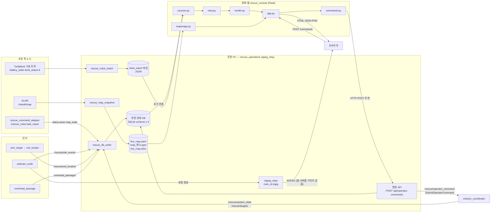

# 관제 웹 데이터 흐름

> 기준: main `ede7f8b`(2026-10-13). 줄 번호는 이 커밋 기준이다. 처리 규칙·문구·오류의 자세한 내용은 [관제 웹 설계 명세](console-spec.md), 리뷰 순서는 [관제 웹 코드 리뷰 준비](../process/console-code-review.md)에 있다.
> 이 문서는 코드를 읽어 적었다(E1). 로봇·ROS 를 띄워 토픽을 확인하지 않았다(NOT_RUN).

## 0. 먼저 한 줄

관제 웹(`rescue_console`)은 **ROS 노드가 아니다.** 토픽을 구독하지도 발행하지도 않는다. ROS 쪽 값은 운영 PC 의 노드들이 **파일·SQLite·HTTP** 로 바꿔 두고, 웹은 그것을 **요청마다 읽기만** 한다. 웹이 밖으로 내보내는 것은 브라우저에 주는 HTTP 응답과, 운영자 명령 한 건당 operations 로 보내는 HTTP POST 한 번, 그리고 자기 계정 DB 쓰기뿐이다.

- 확인한 방법: `grep -rn -E "import rclpy|from rclpy" src/rescue_console` → 0건. 밖으로 나가는 호출은 `urllib.request.urlopen` 한 곳(`commands.py:120`), 쓰는 SQL 은 계정 DB(`accounts.py:150`, `:152`, `:242`, `:282`)뿐이다.

## 1. 전체 그림

## 2. 들어오는 것 ① — ROS 토픽 → 현장 상태 DB → 웹

`rescue_db_writer`(`rescue_operations` `db_writer`, 운영 PC)가 토픽을 받아 현장 상태 DB 에 쓴다. 구독 연결은 `rescue_operations/ros_node.py:199-218`, 토픽 이름은 `rescue_bringup/operations_launch.py:17-24`, `:59-77` 이 정한다. 웹은 `sources.py` `load_site_state`(`sources.py:75-99`)에서 읽기 함수 9개로 이 DB 를 **읽기 전용**(`mode=ro`, `query_only`)으로 읽는다.

경로 표기: 웹 밖 파일은 `<패키지>/<파일>:줄` 이고 실제 위치는 `src/<패키지>/<패키지>/<파일>` 이다(예: `rescue_operations/site_state.py` = `src/rescue_operations/rescue_operations/site_state.py`). 웹 파일은 파일 이름만 적고 위치는 `src/rescue_console/rescue_console/<파일>` 이다.

| # | 발행 노드 (패키지 · 실행 파일 · 발행 줄) | 토픽 · 메시지 | db_writer 처리 → DB 표 | 웹 읽기 (`sources.py` 키) | 웹 처리 (`view.py`) | 화면 |
| --- | --- | --- | --- | --- | --- | --- |
| A1 | `rescue_command_adapter` (rescue_robot · `task_input` · `rescue_robot/task_server.py:100`) | `/rescue/robots/<robot_id>/status` · `RobotStatus` | `on_robot_status`(`rescue_operations/ros_ingest.py:209`) → `robot_status`(`record_robot_status`, `rescue_operations/site_state.py:378`) | `read_robot_status`(`rescue_operations/site_state.py:603`) → `robot_status` | `_robots`(`view.py:237`): 역할·주행·준비·배터리·작업, 5 s 넘으면 낡음 | 로봇 카드(`render.py:327`) |
| A2 | `rescue_command_adapter` (rescue_robot · `task_input` · `rescue_robot/live_pose.py:131`) | `/rescue/robots/<robot_id>/pose` · `RobotPose` | `on_robot_pose`(`rescue_operations/ros_ingest.py:197`) → `robot_status` 행의 위치만 고침(`record_robot_pose`, `rescue_operations/site_state.py:401`) | A1 과 같은 읽기 | `_robots` 의 `pose` | 카드 「위치」, 지도 로봇 화살표 |
| A3 | `webcam_node` (rescue_perception · `webcam_node` · `rescue_perception/webcam_node.py:241`) | `/rescue/site_events` · `SiteEvent` | `on_site_event`(`rescue_operations/ros_ingest.py:221`) → `site_events`(`record_site_event`, `rescue_operations/site_state.py:420`) | `read_site_events`(`rescue_operations/site_state.py:611`, 최대 1000, 오래된 순) → `site_events` | `_site_events`(`view.py:285`), 소실 후보 `_latest_candidates`(`view.py:161`), 사건 목록 `_events`(`view.py:300`), 지진 사건 `_mission`(`view.py:466`) | 사건 목록, 대상 단계, 임무 띠 |
| A4 | `mission_coordinator` (rescue_coordination · `mission_coordinator` · `rescue_coordination/ros_node.py:2289`) | `/rescue/system_state` · `SystemState` | `on_system_state`(`rescue_operations/ros_ingest.py:229`) → `mission_state` 1행(`record_mission_state`, `rescue_operations/site_state.py:546`) | `read_mission_state`(`rescue_operations/site_state.py:640`) → `mission_state` | `_mission_row`(`view.py:350`), 사유 문구 `mission_reason`(`view.py:438`), 버튼 관문 거울 `command_gates`(`view.py:598`) | 임무 띠·사유, 명령 버튼 켜짐/꺼짐 |
| A5 | `mission_coordinator` (`rescue_coordination/ros_node.py:2310`) | `/rescue/targets` · `TargetSnapshot` | `on_target_snapshot`(`rescue_operations/ros_ingest.py:263`) → `target_states`(`record_target_state`, `rescue_operations/site_state.py:435`) | `read_target_states`(`rescue_operations/site_state.py:622`) → `target_states` | `_targets`(`view.py:174`), 4단계 `compose_stage`(`view.py:99`) | 대상 목록, 지도 대상 표식, 출동 승인 선택지 |
| A6 | `amr_target` → `/rescue/exit_observations` → `exit_locator` (rescue_perception · `target_locator` · `rescue_perception/target_locator.py:113`) | `/rescue/exit_location` · `TargetLocation` | `on_exit_location`(`rescue_operations/ros_ingest.py:237`, VALID 만) → `exit_locations`(`record_exit_location`, `rescue_operations/site_state.py:489`) | `read_exit_locations`(`rescue_operations/site_state.py:670`, 최신 1행) → `exit_locations` | `_exit`(`view.py:650`) | 지도 출구(QR) 네모 |
| A7 | `overhead_passage` (rescue_perception · `overhead_passage` · `rescue_perception/overhead.py:348`) | `/rescue/robots/<robot_id>/overhead_passages` · `std_msgs/String`(JSON) | `on_overhead_passages`(`rescue_operations/ros_ingest.py:245`) → `overhead_passage_lists`·`overhead_passages`(`record_overhead_passages`, `rescue_operations/site_state.py:506`) | `read_overhead_passages`(`rescue_operations/site_state.py:681`) → `overhead_passages` | `_passages`(`view.py:629`) | 지도 터널 ∏ 표시(초록·빨강·회색) |
| A8 | `rescue_command_adapter` (rescue_robot · `task_input` · `rescue_robot/live_pose.py:132`), SLAM 로봇(SCOUT) 것만 구독 | `/rescue/robots/<SCOUT>/map_state` · `MapState` | `on_map_state`(`rescue_operations/ros_ingest.py:254`) → `current_map` 1행(`record_current_map`, `rescue_operations/site_state.py:529`) | A7 과 같은 읽기의 `current_map` | `_passages` 의 `current`(지금 지도와 같은 revision 인가) | 지금 지도 터널 진하게, 이전 revision 흐리게 |

토픽이 아니라 operations 가 스스로 쓰는 표:

| 표 | 누가 언제 쓰나 | 웹 읽기 | 웹 처리 · 화면 |
| --- | --- | --- | --- |
| `metadata.allowed_robot_ids` | db_writer 가 기동 때 파라미터 `allowed_robot_ids`(배치 프로파일의 로봇)로 씀(`rescue_operations/site_state.py:373-375`) | `read_allowed_robot_ids`(`rescue_operations/site_state.py:595`) → `allowed_robots` | `build_view` 가 로봇 카드 목록으로 씀(`view.py:713-716`). 상태를 아직 안 보낸 로봇도 카드가 있다 |
| `operator_commands` | 명령 API 가 명령마다 접수·거절을 씀(`rescue_operations/command_api.py:146`, `:157`) | `read_operator_commands`(`rescue_operations/site_state.py:648`, 최근 30) | `_history`(`view.py:499`) → 명령 이력 표 |
| `error_log` | 명령 API 의 실패(`rescue_operations/command_api.py:164`), db_writer 가 거절한 메시지(`rescue_operations/ros_ingest.py:291`) | `read_error_log`(`rescue_operations/site_state.py:629`, 최근 30) | `_history` → 이력 표의 오류 줄 |
| `map_snapshots` | — | 웹은 읽지 않는다 | — |

## 3. 들어오는 것 ② — DB 를 거치지 않는 것

| # | 출발 | 중간 노드 · 산출물 | 웹 인자 · 읽는 곳 | 웹 처리 · 화면 |
| --- | --- | --- | --- | --- |
| B1 | SLAM 지도 `OccupancyGrid`(launch 인자 `map_topic`, 예 `/robot6/map`) | `rescue_map_snapshot`(rescue_operations · `map_snapshot`, 구독 `rescue_operations/map_snapshot.py:139`) → `live_map.yaml` + `map_<해시12>.pgm`(임시 파일 + rename), 발행자가 있는 동안 `live_map.alive` 를 2 s 마다 갱신(`rescue_operations/map_snapshot.py:142-148`) | `--live-map` + `--live-map-stale-s` → `LiveMap.current`(`mapimage.py:233`) | PGM → PNG(`load_map`, `mapimage.py:156`), `GET /map.png`(`app.py:310-321`), 낡음 안내 |
| B2 | 로봇 기본 토픽 `<ns>/battery_state`·`<ns>/dock_status`·`<ns>/tf`·`<ns>/tf_static`(TurtleBot4 쪽, 우리 코드 아님) | `rescue_robot_watch`(rescue_operations · `robot_watch`, 구독만 `rescue_operations/robot_watch.py:103-106`) → JSON 파일(`robot_watch/1`, 1 s 마다, 로봇별 `last_seen_ns`·`battery_percent`·`docked`·`pose`·`pose_seen_ns`, `rescue_operations/robot_watch.py:108-125`) | `--robot-watch` + `--robot-watch-stale-s` → `load_robot_watch`(`sources.py:57-72`) | `_apply_watch`(`view.py:660-689`): 카드에 직접 관측 줄(`render.py:316`), 프로젝트 상태가 없는 로봇은 낡지 않은 직접 관측 위치를 지도에 씀 |
| B3 | 웹캠 판정 영상 `CompressedImage`(`rescue_perception/webcam_node.py:246`) | `mjpeg_relay`(rescue_perception · `mjpeg_relay`, 구독 `rescue_perception/mjpeg_relay.py:158`) → HTTP `/<camera_id>.mjpg`(`rescue_bringup/operations_launch.py:170`) | `--camera ID=URL` → 웹은 주소만 HTML 에 적음(`render.py:1170-1187`) | **브라우저가 영상을 직접 받는다**(웹 서버는 영상을 중계하지 않음). 새 프레임이 끊기면 JS 가 다시 연결(`render.py:1141-1167`) |
| B4 | 옛 보고 장부(`ReportLedger`, `LEDGER` 인자) | 지금 이 파일을 쓰는 운영 코드는 없다. `rescue_report_node` 는 다른 형식의 별도 저장소(`rescue_reports` 표)를 쓰고 웹은 그것을 읽지 않는다([README](../../src/rescue_console/README.md) `<운영 장부>` 설명) | `load_ledger`(`sources.py:26-31`) | 없으면 「보고 장부 입력 없음」 경고, 보고 행·건수를 그리지 않음 |
| B5 | 기준 지도 파일 | 없음(저장소의 map_server YAML·PGM) | `--map` → `load_map`(`mapimage.py:156`), 기동 때 한 번 | B1 과 같은 그림. `--live-map` 과 함께 쓸 수 없음(`app.py:135-136`) |
| B6 | 브라우저 | 없음 | 11개 HTTP 경로(`app.py:246-415`) | 4절 |

## 4. 나가는 것

| 받는 쪽 | 무엇을 | 어디서 | 언제 |
| --- | --- | --- | --- |
| 브라우저 | 로그인 화면·관제 화면 HTML(`GET /login`, `GET /`) | `render_login`(`render.py:1234`), `render_page`(`render.py:1214`) | 접속할 때 |
| 브라우저 | 화면 조각 HTML(`GET /fragment`) | `render_fragment`(`render.py:506`) | 1초마다(JS `setInterval(poll, POLL_MS)`, `render.py:1096`, 값은 `POLL_INTERVAL_MS`) |
| 브라우저 | 화면 모델 JSON(`GET /api/view`) | `app.py:304-308` | 요청할 때(시험·디버그) |
| 브라우저 | 지도 PNG(`GET /map.png`) | `app.py:310-321` | 지도가 바뀔 때(`?v=` 해시) |
| 브라우저 | 명령 결과 JSON(`POST /commands`) | `app.py:324-356` | ADMIN 이 확인 칸에서 누를 때 |
| operations 명령 API | `POST http://127.0.0.1:<api_port>/api/operator-commands` JSON 한 건: `command_id`(UUID), `kind`, `operator_id`(로그인 계정), 명령별 필드 | `build_request`(`commands.py:91-112`) → `send_command`(`commands.py:168-175`) → `post_json`(`commands.py:115-136`) | 명령 한 번에 **정확히 한 번**, 재시도 없음, 5 s 제한(`commands.py:22`) |
| 계정 DB(웹 자신의 SQLite) | 계정 추가·수정·삭제, 로그인 시각 | `accounts.py` `AccountStore`(`accounts.py:119`) | 로그인·계정 관리 화면 |
| ROS | **없음** | — | — |

명령의 그 뒤(웹 밖): 명령 API(`rescue_operations/command_api.py:179` `do_POST` → `CommandGate.handle` `rescue_operations/command_api.py:107`)가 `operator_commands` 에 적고 ROS 서비스 `/rescue/operator_command`(`SubmitOperatorCommand`)를 부른다(`rescue_operations/ros_node.py:219-238`). 받는 쪽은 `mission_coordinator`(`rescue_coordination/ros_node.py:2485`)다. 조정기가 받아들이면 다음 `/rescue/system_state`·`/rescue/targets` 가 바뀌고(A4·A5), 웹은 다음 폴링에서 그 결과를 본다. 웹은 명령 결과를 화면 상태로 추측하지 않는다.

## 5. 웹 파일마다 받는 것 · 하는 것 · 내보내는 것

경로는 `src/rescue_console/rescue_console/` 아래다.

| 파일 | 받는 것 | 하는 것 | 내보내는 것 | 리뷰 때 볼 곳 |
| --- | --- | --- | --- | --- |
| `__main__.py` | 명령행 인자, 환경 변수 `RESCUE_CONSOLE_SECRET` | 인자끼리 맞는지 검사(`--live-map`↔`--live-map-stale-s`, `--robot-watch`↔`--robot-watch-stale-s`, 장부 또는 `--site-state`), `create_app` 호출, 서버 기동 | 실패하면 stderr `CONSOLE FAILED: …` + 종료코드 2(서버를 띄우지 않음) | `main`(`:17-94`) |
| `app.py` | HTTP 요청(쿠키 세션, 폼), 기동 설정 | 라우트 11개, 로그인·세션 무효화·CSRF·보안 헤더, 폴링마다 `current_view` 로 화면 모델을 새로 만듦, 명령 중계 전 권한 검사 | HTTP 응답(HTML·JSON·PNG), 로그 | `current_view`(`:50-82`), `create_app`(`:111-417`), `POST /commands`(`:324-356`) |
| `sources.py` | 현장 상태 DB, 픽스처 JSON(`--status`), 옛 장부, robot_watch 파일 | 읽기 전용으로 읽어 딕셔너리로 모음. 하나라도 실패하면 `STORAGE_ERROR`(그 요청 503) | 입력 딕셔너리(쓰기 없음) | `load_site_state`(`:75-99`), `load_robot_watch`(`:57-72`) |
| `view.py` | `sources.py` 의 입력, 기동 설정(로봇 이름, `--support-dispatch`, `--search-start`) | 화면 모델 합성: 대상 4단계, 로봇 낡음(5 s), 직접 관측 붙이기, 임무 사유 문구, 명령 버튼 관문 거울, 터널·출구 행, 빠진 입력은 경고 | 화면 모델 딕셔너리(= `/api/view` JSON) | `build_view`(`:692-790`), `_gate`(`:530-595`), `command_gates`(`:598-623`), `_apply_watch`(`:660-689`), `_passages`(`:629-647`) |
| `mapimage.py` | 지도 YAML·PGM, `live_map.alive` | PGM → PNG, 실시간 지도 다시 읽기·낡음 판정, 월드 좌표 → 픽셀, frame 이 다르거나 지도 밖이면 그리지 않고 목록에 올림 | PNG 바이트, 지도 위 표식 목록 | `load_map`(`:156-207`), `LiveMap.current`(`:233-270`), `map_overlay`(`:291-325`) |
| `render.py` | 화면 모델 | HTML 조각·전체 페이지, 1초 폴링 JS, 명령 확인 칸 JS, 영상 끊김 재연결 JS | HTML 문자열(브라우저로) | `render_fragment`(`:506`), `_robots`(`:327-365`), `_map`(`:211-295`), `_commands`(`:514`), 폴링 JS(`:895`, `:1096`) |
| `commands.py` | `POST /commands` 폼, 로그인 계정 | 폼 → 요청 JSON(허용 필드만, 숫자 검사), operations 로 한 번 POST, 답 모양 검사 | operations 로 HTTP POST 한 번, 결과 딕셔너리(`sent`, `accepted`, `delivery` …) | `build_request`(`:91-112`), `send_command`(`:168-175`), `read_reply`(`:143-165`) |
| `accounts.py` | 계정 DB 경로, 로그인·계정 관리 폼 | PBKDF2 해시(200000회), 역할 ADMIN·CUSTOMER, 마지막 ADMIN 지우기 막기, `init` 하위 명령 | 계정 DB 쓰기 | `AccountStore`(`:119`), `authenticate`(`:209`), `main`(`:353`) |
| `throttle.py` | 로그인 실패(계정명·주소) | 300 s 안에 5번 실패하면 60 s 잠금(메모리) | 잠금 남은 시간 | `LoginThrottle`(`:21-73`) |
| `labels.py` | 상태 코드 | 코드 → 한국어 낱말 표 | 낱말 | `label`(`:59-67`) |

## 6. 한 번의 폴링 (1초마다)

1. 브라우저 JS 가 `fetch('fragment')`(`render.py:895`)를 보낸다. 1초 간격은 `setInterval(poll, POLL_MS)`(`render.py:1096`).
2. `GET /fragment`(`app.py:298-302`): 로그인·세션 확인 뒤 `view()`(`app.py:161-166`) → `current_view`(`app.py:50-82`).
3. `current_view`: 현장 상태 DB 읽기 9개(`load_site_state`, `sources.py:75-99`) 또는 픽스처, 옛 장부(있으면), robot_watch 파일(있으면)을 캐시 없이 새로 읽는다.
4. `build_view`(`view.py:692-790`)가 화면 모델을 만든다. 순서: 대상 행·4단계 → 사건 목록 → 임무 → 로봇 카드 → 직접 관측 붙이기(`view.py:753`) → 사유 문구 → 명령 이력 → 출구·터널 → 버튼 관문 거울(반환 값 안의 `command_gates`).
5. 지도가 있으면 `map_overlay`(`mapimage.py:291-325`)가 로봇·대상·출구·터널을 픽셀로 바꾼다. 못 그린 것은 경고(`app.py:73-76`).
6. `render_fragment`(`render.py:506`)가 HTML 로 바꿔 응답한다. JS 가 `div#live` 를 통째로 바꾼다.
7. 실패: 읽기 실패·모양 실패는 그 요청만 503 이고, 다음 폴링에서 다시 읽는다(빈 화면이나 지어낸 값을 보이지 않는다).

## 7. 한 번의 명령

1. ADMIN 이 버튼을 누르면 확인 칸이 열리고, 확인하면 JS 가 `fetch('commands', {method: 'POST'})`(`render.py:1068`)를 보낸다.
2. `POST /commands`(`app.py:324-356`): CSRF → 역할·연결 확인(`command_access`) → `build_request` 로 요청을 만든다. `operator_id` 는 폼이 아니라 로그인 계정이고, `command_id` 는 누를 때마다 새 UUID 다.
3. `send_command`(`commands.py:168-175`)가 operations 로 **한 번** POST 한다. 실패하면 `delivery`(`NOT_SENT`/`UNKNOWN`)를 붙여 돌려주고 다시 보내지 않는다.
4. operations 명령 API → `/rescue/operator_command` → `mission_coordinator`(4절). 답(`accepted`, `reason_code` …)을 그대로 브라우저에 돌려준다.
5. 바뀐 상태는 명령 응답이 아니라 다음 폴링(6절)의 `mission_state`·`target_states`·`operator_commands` 로 보인다.

## 8. 이 문서가 확인하지 않은 것

- 토픽 이름은 launch 코드의 상수와 예시 설정에서 읽었다. 현장에서 `ros2 topic list` 로 본 값이 아니다(NOT_RUN).
- QoS 는 적지 않았다. 각 구독 줄(`rescue_operations/ros_node.py:199-218`)과 [계약](contracts.md)이 기준이다.
- 직접 관측(B2)과 터널 판정(A7·A8)의 처리 규칙·문구는 [관제 웹 설계 명세](console-spec.md) 7.4.7·7.4.8·7.9·7.10·I-2·I-5 에 있다.
- 웹 시험 `tests/test_console_*.py` 12 파일 223 OK(skip 0) [측정, 2026-10-13, main `ede7f8b`, Python 3.13, Flask 3.1.3]. 이 문서의 사슬을 끝에서 끝까지 잇는 시험(ROS 발행 → 장부 → 화면)은 없다(NOT_RUN).
