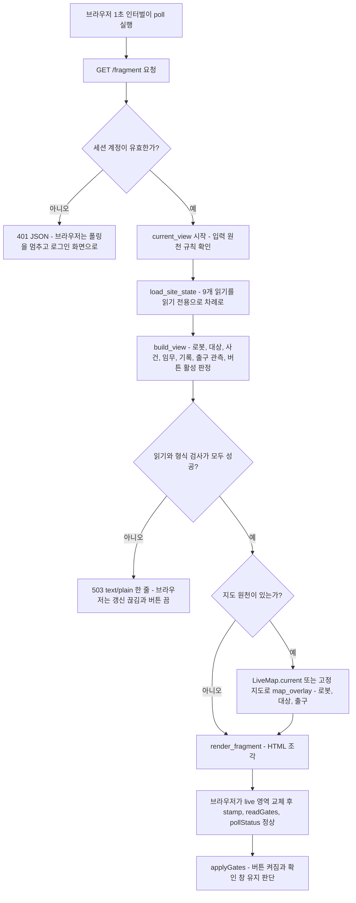
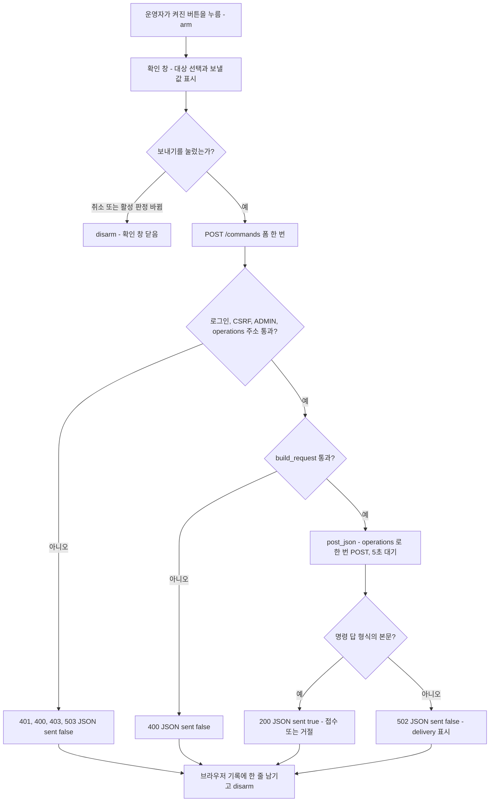

# 관제 웹(rescue_console) 설계 명세

> 구성 요소·흐름 그림·핵심 함수 요약은 [관제 웹 아키텍처](console-architecture.md)에, 화면 예시와 시험 기록은 [관제 웹 화면·시험 기록](../evidence/console-2026-10-13/README.md)에 있다.

이 문서는 관제 웹 `rescue_console`(Flask 웹 서비스이며 ROS 노드가 아니다)을 **이 명세만 보고도 같은 동작으로 다시 만들 수 있게** 적는다. 코드를 옮겨 적지 않고, 규칙·조건·문구·순서를 문장과 표로 적는다. 처음에는 `bd4bfa5` 를 보고 썼고 `32e8ee1` 에서 다시 확인했다. 2026-10-13 에는 main `ede7f8b` 에서 그 뒤에 들어온 로봇 직접 관측(`--robot-watch`)과 터널 판정 표시를 추가했고(7.4.7·7.4.8·I-5), 이어서 main `4163a25` 의 웹캠 선택과 로봇 카메라 칸을 추가했다(7.12·I-6·I-7). **모든 줄 표기는 `4163a25` 기준이다.** 옛 표기가 가리키던 줄(웹·`rescue_operations/site_state.py`·`rescue_operations/ros_ingest.py` 는 `32e8ee1`, 그 밖은 `bd4bfa5` 기준)을 diff 로 먼저 `ede7f8b` 에 맞추고, 다시 `4163a25` 에 맞춰 옮겼다. 옛 줄과 새 줄의 글자가 크게 다른 줄 범위 끝점은 직접 열어 확인했다(달라진 것은 주석 문장뿐이었고, 구조가 바뀐 3곳은 고쳤다). 노드·토픽에서 웹 화면까지 이어지는 사슬과 파일별 입출력 요약은 [관제 웹 아키텍처](console-architecture.md)에 있다. 줄 표기 규칙은 다음과 같다. 접두어가 없는 `app.py:…`·`view.py:…` 등은 `src/rescue_console/rescue_console/` 아래 파일이고, `rescue_operations/…` 는 `src/rescue_operations/rescue_operations/`, `rescue_bringup/…` 는 `src/rescue_bringup/rescue_bringup/`, `launch/…` 는 `src/rescue_bringup/launch/`, `README:…` 는 `src/rescue_console/README.md` 다. operations 쪽 노드(db_writer·report_node·map_snapshot)의 내부는 다루지 않는다. 마지막 「웹이 의존하는 외부 인터페이스」 절에는 웹이 의존하는 인터페이스 규칙(명령 API, 현장 상태 DB 에서 쓰는 열, `live_map.yaml`)만 적는다. 값의 출처 태그는 팀 `AGENTS.md` 5절을 따른다.

## rescue-console — 현장 상태 DB 를 읽기 전용으로 읽어 한 화면에 표시하고, ADMIN 의 운영자 명령을 operations HTTP API 로 한 번 전달하는 로그인 웹

### 1. 책임과 경계

하는 일
- 요청이 올 때마다 operations 의 현장 상태 DB(`operations-site-state` schema 1.4)를 **읽기 전용**으로 읽는다. 옛 보고 장부(`operations-ledger` 1.0)가 주어졌으면 그것도 읽는다. 읽은 내용을 화면 모델 하나로 합쳐 HTML·JSON 으로 응답한다(`app.py:52-84`, `sources.py:75-99`, `view.py:692-790`).
- 화면 쪽에서 구조 상태 4단계(Q-20), 임무 배너, 조정기 사유 문구, 명령 버튼의 **활성 판정**을 계산한다. 이 판정은 화면 안내용이고 실제 수락 여부는 조정기가 정한다. 그래서 켜진 버튼도 조정기가 거절할 수 있고, 웹은 그 응답을 그대로 표시한다(`view.py:598-601`).
- ADMIN 이 누른 명령 한 건을 operations 의 `POST /api/operator-commands` 로 **한 번** 보내고, 받은 응답(또는 실패)을 그대로 돌려준다(`app.py:377-409`, `commands.py:171-178`).
- ADMIN 의 웹캠 변경 요청은 operations 의 `POST /api/webcam` 으로, 모든 로그인 사용자의 로봇 카메라 선택 요청은 `robot_view_relay` 의 `POST /select` 로 **한 번** 보낸다. 페이지를 그릴 때는 각각의 목록을 `GET` 으로 조회한다(7.12).
- 로그인·세션·CSRF·계정을 관리한다. 콘솔이 쓰는 파일은 콘솔이 소유한 계정 DB 하나뿐이다(`accounts.py:1-12`).
- 지도(map_server 의 고정 지도 `--map` 또는 map_snapshot 이 쓰는 실시간 SLAM 지도 `--live-map`)를 PNG 로 변환하고, 그 위에 로봇·요구조자·출구(QR) 관측·터널 판정 마커를 SVG 로 겹쳐 그린다(`mapimage.py`, `render.py:211-295`). 웹캠 MJPEG 주소는 `` 요소로 넣는다(`render.py:1170-1187`). `--robot-watch` 를 주면 operations 의 robot_watch 노드가 쓴 로봇 직접 관측 파일을 읽어 로봇 카드에 함께 표시한다(7.4.7).

하지 않는 일(다른 쪽 책임)
- 운영 장부나 현장 상태 DB 에 쓰거나 파일을 만들지 않는다(`sources.py:1-3`). 쓰기는 operations 의 `db_writer` 하나만 한다.
- ROS 구독·발행·서비스 호출을 하지 않는다. 명령의 수락 여부를 정하지 않는다(조정기가 정한다). 명령을 다시 보내지 않는다(`commands.py:1-7`).
- 영상을 중계하지 않는다. 브라우저가 카메라 PC 의 MJPEG 서버에 직접 접속한다(`render.py:1171-1174`). 중계는 perception 의 `mjpeg_relay` 가 맡는다.
- 현장 정지 수단이 아니다. `STOP_ROBOT` 버튼은 항상 꺼 두고(`view.py:58-63`), 명령 칸과 실패 페이지에는 「현장 비상 정지 장치를 쓰세요」 문구를 항상 표시한다(`render.py:545-546`, `render.py:1254-1255`; 팀 AGENTS 7절).
- 지도를 만들거나 고치지 않는다(map_snapshot 이 맡는다). 모르는 값은 임의 값으로 채우지 않는다. 없는 값은 None 으로 두고 화면에는 「—」로 표시한다(`view.py:1-5`).

### 2. 실행 단위

- 패키지는 `rescue_console` 이고, 실행 파일 `rescue-console` 은 `rescue_console.__main__:main` 을 가리킨다(`src/rescue_console/setup.py:22`). `python3 -m rescue_console` 로도 실행된다. Flask 는 선택 의존성이다(`extras_require web`, `src/rescue_console/setup.py:14-15`). Flask 가 없으면 기동이 `DEPENDENCY_MISSING` 으로 끝난다(`app.py:136-140`).
- launch 파일은 없다. `operations.launch.py` 는 콘솔을 띄우지 않고, 콘솔에 줄 인자만 문서와 로그로 알려 준다(`launch/operations.launch.py:18-20`, `:71`, `:76`).
- ROS 노드 이름과 namespace 는 없다. ROS 를 import 하지 않기 때문이다(`app.py:8-22`).
- 계정 초기화는 별도 명령 `python3 -m rescue_console.accounts init` 으로 한다(`accounts.py:353-374`).
- 서버는 Werkzeug 개발 서버로 돈다. Flask `app.run` 을 디버그를 끈 채 호스트·포트를 넘겨 호출하기 때문이다(`__main__.py:97`). 요청마다 스레드를 하나씩 쓴다 [문서: Flask 1.0 이후 `app.run` 의 threaded 기본값 참; `throttle.py:4-6` 주석도 같은 전제]. 서버 쪽 타이머나 백그라운드 스레드는 없고, 모든 계산은 요청을 처리하는 과정 안에서 한다.
- 잠금으로는 로그인 제한 기록에 `threading.Lock`(`throttle.py:33`)을, 실시간 지도 캐시에 `threading.Lock`(`mapimage.py:231`)을 쓴다. 계정 DB 는 호출마다 새 SQLite 연결을 열고 `BEGIN IMMEDIATE` 로 시작한다(`accounts.py:179-191`, `:316-328`). 현장 상태 DB 는 읽기 함수마다 새 읽기 전용 연결을 연다(`rescue_operations/site_state.py:572-592`).
- 브라우저 쪽 타이머는 다음과 같다. 조각 폴링 간격은 1000 ms 다(`render.py:1096`, `render.py:14`). 카메라 감시 `setInterval` 의 주기는 max(100, min(500, 끊김 기준 ms ÷ 2)) ms 다(`render.py:1163`). 실패 페이지의 `meta refresh` 는 5초다(`render.py:1249-1250`, `render.py:69`).

### 3. 파라미터

ROS 파라미터 대신 명령행 인자를 쓴다. 「현장 값」 칸에 출처가 없으면 [미확인] 이다.

| 이름 | 타입 | 단위 | 현장 값(출처) | 필수 여부·기본값 | 기동 시 검사 규칙 | 뜻 |
| --- | --- | --- | --- | --- | --- | --- |
| `LEDGER`(위치 인자) | 경로 | — | 생략 [측정 2026-10-13, `docs/evidence/field-2026-10-13-operations-host.md:25`, `:165`] | 선택, 기본값 없음. 단 `--site-state` 가 없으면 필수 | 둘 다 없으면 `INVALID_INPUT` 오류(`__main__.py:73-74`, `app.py:48-49`). 기동 때는 열지 않고 요청마다 `read_reports` 로 연다. 열기에 실패하면 그 요청이 503 으로 끝난다 | 옛 `ReportLedger` 파일(`operations-ledger` 1.0). report_node 의 `rescue-report-store` 파일은 역할이 달라 이 인자로 열리지 않는다 |
| `--accounts` | 경로 | — | 저장소 밖 설정 폴더, 권한 600 [측정 2026-10-10, `docs/process/ops-db-tables.md:42`] | **필수** | 파일이 없으면 `STORAGE_ERROR`, `metadata` 가 다르면 `POLICY_MISMATCH` 오류(`app.py:144`, `accounts.py:160-177`) | 계정 DB |
| `--site-state` | 경로 | — | launch 의 `db_path` 와 같은 파일(`launch/operations.launch.py:19`) | 선택, 기본값 없음. `--status` 와 함께 쓸 수 없다 | argparse 상호 배타 그룹(`__main__.py:27-29`)과 `app.py:44-45` 에서 검사한다. 기동 때는 열지 않는다 | 현장 상태 DB |
| `--status` | 경로 | — | 현장에서는 쓰지 않는다(E2 전용) | 선택. `--site-state` 와 함께 쓸 수 없고, `LEDGER` 가 있어야 한다 | 요청마다 JSON 을 읽는다. 최상위 키가 `STATUS_KEYS` 의 부분집합이어야 한다(`sources.py:34-54`) | 픽스처 JSON |
| `--camera ID=URL`(반복 가능) | 문자열 | — | launch 로그에 나오는 값 `cam_fixed=http://<video_bind_host>:<video_port>/cam_fixed.mjpg`(`rescue_bringup/operations_launch.py:242-244`, `launch/operations.launch.py:71`) | 선택, 기본값은 빈 목록 | 첫 `=` 앞의 ID 가 비어 있지 않고 URL 이 `http://` 또는 `https://` 로 시작해야 한다(`app.py:105-110`). 아니면 `INVALID_INPUT` 오류 | 웹캠 MJPEG 주소 |
| `--camera-stale-s` | float | s | [미확인] | `--camera` 가 있으면 필수, 기본값 없음 | 없으면 `CONFIG_MISSING`, float 이 아니거나 유한한 양수가 아니면 `INVALID_INPUT` 오류(`render.py:1126-1134`, 호출 위치 `app.py:135`). 카메라가 없으면 이 값을 확인하지 않는다 | 새 프레임 없이 이 시간이 지나면 「영상 끊김」을 표시하고 다시 연결한다 |
| `--robot-name ID=NAME`(반복 가능) | 문자열 | — | `robot_a=TB-6`, `robot_b=TB-5` [사용자 결정 2026-10-13, `README:48`] | 선택 | `=` 가 있어야 하고, 앞뒤 공백을 뺀 ID·이름이 비어 있지 않아야 한다(`app.py:87-92`). 같은 ID 를 두 번 주면 `INVALID_INPUT` 오류(`app.py:95-102`) | 화면에 표시할 이름. 없으면 robot_id 를 표시한다 |
| `--support-dispatch` | `AUTO` 또는 `OPERATOR` | — | `AUTO` [소유자 결정 2026-10-13, `rescue_coordination/ros_node.py:20`]. 조정기에 있는 같은 이름의 값과 같아야 한다 | 선택, 기본값 없음(이때는 버튼) | argparse choices(`__main__.py:35-37`)로 검사하고, 요청마다 `view.py:707-708` 에서 다시 검사한다 | AUTO 면 출동 승인 버튼 대신 「자동 출동」 상태를 표시한다 |
| `--search-start` | `AUTO` 또는 `OPERATOR` | — | `AUTO` [소유자 결정 2026-10-13, OPS-136, `config/field/search_area.field.json:3`, `:52`]. 조정기의 `search_start` 와 같아야 한다(`README:50`) | 선택, 기본값 없음(이때는 버튼) | argparse choices(`__main__.py:38-40`)로 검사하고, 요청마다 `view.py:709` 에서 다시 검사한다 | AUTO 면 수색 시작 버튼 대신 「{정찰 이름} 자동 출발」 상태를 표시한다(7.5) |
| `--map` | 경로 | — | `assets/maps/pre_quake/map.yaml`(`README:159`) | 선택 | 기동 때 `load_map` 으로 한 번 읽고, 실패하면 기동이 실패한다(`app.py:145`) | 고정 지도 |
| `--live-map` | 경로 | — | `<map_dir>/live_map.yaml`(`launch/operations.launch.py:76`) | 선택. `--map` 과 함께 쓸 수 없고(`app.py:146-147`), `--live-map-stale-s` 와 함께 줘야 한다(`__main__.py:78-79`) | 파일이 아직 없어도 된다 | 실시간 SLAM 지도 |
| `--live-map-stale-s` | float | s | [미확인]. map_snapshot 의 alive 주기 2초보다 커야 한다(`rescue_operations/map_snapshot.py:24`) | `--live-map` 과 함께 줘야 한다. 기본값 없음 | 유한한 양수여야 한다(`mapimage.py:226-227`). 아니면 `INVALID_INPUT` 오류 | 지도를 오래된(stale) 상태로 판정하는 기준 |
| `--robot-watch` | 경로 | — | 운영 launch 의 인자 `robot_watch_path`(노드 `rescue_robot_watch`, `launch/operations.launch.py:88-90`) | 선택, 기본값 없음. `--robot-watch-stale-s` 와 함께 줘야 한다(`__main__.py:76-77`) | 기동 때는 열지 않는다. 파일이 아직 없어도 된다(요청마다 읽고, 없으면 경고한다) | 로봇 기본 토픽을 직접 관측한 JSON(I-5) |
| `--robot-watch-stale-s` | float | s | [미확인]. robot_watch 의 쓰기 주기 1초(`rescue_operations/robot_watch.py:19`)보다 커야 한다 | `--robot-watch` 와 함께 줘야 한다. 기본값 없음 | argparse 의 float 변환만 한다. 유한·양수 검사가 **없다**(`--live-map-stale-s` 와 다르다) [관찰, 코드 읽기]. 9절 참고 | 이 시간보다 오래 아무것도 받지 못하면 「직접 관측 낡음」을 표시한다 |
| `--robot-camera URL` | 문자열 | — | launch 로그에 나오는 `http://<video_bind_host>:<video_port + 1>/robot_view.mjpg`(인자 `robot_views`, `rescue_bringup/operations_launch.py:203-224`) | 선택, 기본값 없음 | scheme 이 http·https 이고 host 가 있어야 한다. 아니면 `INVALID_INPUT` 오류(`app.py:113-118`). 카메라 선택 요청 주소는 같은 host:port 의 `/select` 다(`app.py:152-153`). `--camera-stale-s` 가 필요하지만 **기동 때 확인하지 않는다**. 그래서 `--camera` 없이 주면 `GET /` 가 매번 503 으로 끝난다(9절) [측정] | 로봇 카메라 칸(7.12) |
| `--operations URL` | 문자열 | — | `http://127.0.0.1:<api_port>`(`launch/operations.launch.py:19`, `rescue_bringup/operations_launch.py:26`) | 선택. 없으면 명령 버튼이 꺼지고 표준 오류에 한 줄을 남긴다(`__main__.py:93-95`) | scheme 이 http·https 이고, host 가 있고, query·fragment 가 없어야 한다. 아니면 `INVALID_INPUT` 오류. 끝의 `/` 는 제거한다(`commands.py:61-66`) | operations API 의 기준 주소 |
| `--secret-env` | 문자열 | — | 기본값 그대로 쓴다 | 기본값 `RESCUE_CONSOLE_SECRET` | 그 환경 변수가 없거나 비어 있으면 `CONFIG_MISSING`(`__main__.py:69-71`), 값이 16자 미만이어도 `CONFIG_MISSING` 오류(`app.py:141-142`) | 세션 서명용 비밀값이 든 환경 변수의 이름 |
| `--host` | 문자열 | — | 운영 PC 의 접속 주소는 프로파일에 있는 값을 쓴다 [`README:55`] | 기본값 `127.0.0.1` | 없음 | 바인드 주소 |
| `--port` | int | — | 8080 [측정 2026-10-10, `docs/process/ops-host-record.md:54`] | 기본값 8080 | argparse 의 int 변환 | 포트 |

환경 변수로는 `RESCUE_CONSOLE_SECRET`(세션 서명용 비밀값, 16자 이상)과 `RESCUE_CONSOLE_ADMIN_PASSWORD`(계정 초기화용, 없으면 프롬프트로 입력받음, `accounts.py:364-367`)를 쓴다.

코드 상수(현장에서 바꾸지 않는 값)

| 이름 | 값 | 단위 | 근거 | 누가·언제 | 뜻 |
| --- | --- | --- | --- | --- | --- |
| `POLL_INTERVAL_MS` | 1000 | ms | `render.py:14` | [제안] 관제·화면 2026-10-08 | 조각 폴링 주기(KPI-04 의 3초 예산 중 1초) |
| `KPI04_BUDGET_S` | 3.0 | s | `render.py:16` | BRD v0.1 KPI-04 | 표시 지연 예산 |
| `FAILURE_RETRY_S` | 5 | s | `render.py:69` | — | 실패 페이지의 자동 새로고침 간격 |
| `SHORT_ID` | 8 | 글자 | `render.py:55` | — | UUID 를 화면에 줄여 표시할 때 남기는 앞 글자 수(9자 이하면 줄이지 않는다) |
| `BATTERY_LOW`, `BATTERY_WARN` | 25, 50 | % | `render.py:57` | [제안] 2026-10-10 | 배터리 막대의 빨강·노랑 표시 경계 |
| `GRID_M` | 1.0 | m | `render.py:59` | — | 지도 격자 간격 |
| `ROBOT_MARK_PX`, `HEADING_PX`, `TARGET_MARK_PX` | 2.6, 4.8, 2.0 | 지도 px | `render.py:20` | [제안] 2026-10-10 | 마커 크기 |
| `FRESH_MS`(JS) | 3000 | ms | `render.py:795` | — | 새 사건 행을 노랗게 강조하는 시간 |
| `LOG_ROWS`(JS) | 6 | 행 | `render.py:926` | — | 명령 칸 아래에 표시하는 이 페이지의 명령 기록 길이 |
| `STATUS_STALE_S` | 5.0 | s | `view.py:75` | [제안] 관제·화면 2026-10-10 | 로봇 상태를 오래된 것으로 표시하는 기준(표시 전용이며 준비 판정이 아니다, C-05) |
| `EVENT_ROWS` | 50 | 행 | `view.py:68` | [제안] 2026-10-08 | 사건 기록 표의 최대 행 수 |
| `HISTORY_ROWS` | 30 | 행 | `view.py:70` | [제안] 작전 2026-10-12 | 명령·오류 기록의 최대 행 수(읽기 한도로도 쓴다) |
| `COMMAND_TIMEOUT_S` | 5.0 | s | `commands.py:23` | [제안] 관제·화면 2026-10-12 | operations 응답 대기 시간(요청 한 번) |
| `MAX_ID` | 128 | 글자 | `commands.py:42` | — | 폼 `target_id` 의 최대 길이 |
| `LEDGER_READ_LIMIT`, `SITE_EVENT_READ_LIMIT` | 1000, 1000 | 행 | `sources.py:17`, `sources.py:20` | 읽기 함수의 상한 | 장부·현장 사건을 한 번에 읽는 행 수 |
| `LOGIN_MAX_FAILURES`, `LOGIN_WINDOW_S`, `LOGIN_LOCK_S`, `LOGIN_MAX_KEYS` | 5, 300, 60, 10000 | 회, s, s, 쌍 | `throttle.py:14-18` | [제안] 관제·화면 2026-10-10 | 로그인 실패가 반복될 때의 잠금 |
| `_ITERATIONS` | 200000 | 회 | `accounts.py:39` | — | PBKDF2 반복 횟수 |
| `MIN_PASSWORD` | 8 | 글자 | `accounts.py:33` | — | 비밀번호 최소 길이(최대 길이 제한은 없다) |
| 솔트(salt) 길이 | 16 | byte | `accounts.py:71` | — | PBKDF2 솔트 |
| `MAP_FRAME` | `map` | — | `mapimage.py:20` | Q-09 후보 | 이 frame 의 좌표만 지도에 그린다 |
| `ALIVE_FILE` | `live_map.alive` | — | `mapimage.py:22` | map_snapshot 과 같은 이름 | 지도 발행자의 생존 확인 파일(heartbeat) |
| `EXIT_NAME` | `출구(QR)` | — | `mapimage.py:288` | — | 지도 위 출구 관측 마커의 ID 이자 이름표의 앞부분 |
| `PASSAGE_WORDS` | PASSABLE 통과 가능, BLOCKED 통과 불가, UNKNOWN 판정 불가 | — | `view.py:626` | OPS-196 | 터널 판정 표시 문구(지도·카메라 공통) |

### 4. 내부 상태

서버 쪽

| 이름 | 타입(자료구조) | 초기값 | 바뀌는 시점(함수) | 의미 |
| --- | --- | --- | --- | --- |
| Flask 세션 쿠키 | 서명된 쿠키(키: `account_id`, `auth_version`, `csrf`, Flask 의 flash 목록) | 비어 있음 | `csrf_token`(`app.py:198-202`)이 처음 필요할 때 `csrf` 를 만든다. 로그인에 성공하면 비운 뒤 `account_id`·`auth_version`·새 `csrf` 를 저장한다(`app.py:289-292`). 로그아웃하거나 계정이 무효이면 비운다(`app.py:194`, `app.py:299`) | 누가 로그인했는지 나타낸다. 서버에는 세션 저장소가 없다 |
| `throttle._entries` | dict: (소문자로 바꾸고 앞뒤 공백을 뺀 이름, 접속 주소) → {실패 시각 목록, 잠금 종료 시각} | 비어 있음 | `failed`·`succeeded`(`throttle.py:52-73`) | 프로세스 메모리에만 있고 재시작하면 사라진다 |
| `LiveMap.image`, `_key`, `_error` | MapImage 또는 None, (mtime_ns, size) 또는 None, 오류 문구 또는 None | 모두 None | `LiveMap.current`(`mapimage.py:233-270`) | 마지막으로 읽기에 성공한 실시간 지도와 그 파일의 키 |
| `map_image` | MapImage 또는 None | `--map` 을 주면 기동할 때 읽은 지도 | 바뀌지 않음(`app.py:145`) | 고정 지도 |
| `_DUMMY` | 해시 문자열 하나를 담는 목록 | 비어 있음 | 없는 아이디로 처음 로그인을 시도할 때(`accounts.py:56-60`) | 없는 아이디로 로그인해도 같은 계산 비용이 들게 하는 가짜 해시 |
| `accounts`, `operations`, `transport`, `cameras`, `robot_names`, `support_dispatch`, `search_start`, `robot_watch_path`, `robot_watch_stale_s`, `robot_camera`, `robot_select` | 설정 값 | 기동할 때 정해짐 | 바뀌지 않음(`app.py:134-160`, `:174-179`) | — |

화면 모델은 요청마다 새로 만들고 버리며 서버에 캐시하지 않는다. 필드는 6.1 절의 `/api/view` 표에 있다.

브라우저 쪽(페이지 스크립트, `render.py:789-1097`, `render.py:1141-1167`)

| 이름 | 타입 | 초기값 | 바뀌는 시점 | 의미 |
| --- | --- | --- | --- | --- |
| `firstSeen` | Map: 사건 ref_id → 처음 그린 시각(ms) | 비어 있음 | `stamp`(`render.py:814-835`) | KPI-04 의 표시 시각 |
| `window.kpi04` | 배열 | 빈 배열 | `stamp` 가 새 행마다 하나씩 추가한다 | 지연 기록 |
| `loaded` | bool | 거짓 | 첫 `stamp` 가 끝날 때 참이 된다 | 참이 된 뒤에 처음 나타난 행만 실시간(`live`)으로 기록한다 |
| `lastOk` | 시각 ms | 페이지 로드 시각 | 폴링에 성공할 때 | 끊김 문구의 「n 전 값」에 쓴다 |
| `timer` | 인터벌 ID | 1000 ms 마다 `poll` 을 부르는 인터벌 | 401 을 받거나 재지정될 때 해제한다 | 폴링 |
| `gates` | 객체: 명령 → {enabled, reason, args, choices} | 페이지의 `#gates` | 폴링할 때마다 `readGates`(`render.py:932-935`)가 갱신한다 | 최신 버튼 활성 판정 |
| `armed` | null 또는 {kind, name, args(JSON 문자열), choices} | null | `arm`/`disarm` | 확인 창이 열려 있는 명령 |
| `sending` | bool | 거짓 | `send` 가 시작할 때와 끝날 때 | 전송 중인지 여부 |
| `screenLost` | bool | 거짓 | `pollStatus`(`render.py:875-888`) | 참이면 화면이 최신 상태가 아니다 |
| 카메라 칸마다 `last`, `retried` | 시각 ms | 로드 시각 | 프레임이 load 될 때 `last`, 재연결할 때 `retried` 를 갱신한다 | 끊김 판단에 쓴다 |

상태 기계 1 — 로그인 세션(서버)

| 현재 상태 | 사건/조건 | 다음 상태 | 부수 효과 |
| --- | --- | --- | --- |
| 익명 | `GET /login` | 익명(csrf 발급됨) | 세션에 `csrf` 를 만든다 |
| 익명 | `POST /login` 이고, CSRF 가 맞고, 잠금 상태가 아니고, 비밀번호가 맞고, 계정이 ACTIVE | 로그인됨 | 실패 기록을 지운다. 세션을 비운 뒤 `account_id`·`auth_version`·새 `csrf` 를 저장하고 302 `/` 로 보낸다 |
| 익명 | `POST /login` 실패(잠금 상태이거나 인증 실패) | 익명 | 인증 실패이면 실패 기록을 1 늘린다. 두 경우 모두 flash 를 남기고 302 `/login` 으로 보낸다 |
| 로그인됨 | 요청 시점에 계정 행이 없거나, `status` ≠ ACTIVE 이거나, `auth_version` 이 다름 | 익명 | 세션을 비운다. 데이터 경로는 401, 페이지는 302 `/login` 으로 응답한다 |
| 로그인됨 | `POST /logout`(CSRF 가 맞음) | 익명 | 세션을 비우고 302 `/login` 으로 보낸다 |

상태 기계 2 — 명령 칸(브라우저, `render.py:918-1089`)

| 현재 상태 | 사건/조건 | 다음 상태 | 부수 효과 |
| --- | --- | --- | --- |
| 대기 | 켜진 버튼 클릭(ADMIN 이고, operations 주소가 있고, 버튼 활성 판정이 켜져 있고, 끊김 상태가 아니고, 전송 중이 아닐 때) | 확인 중 | 확인 창을 연다(어떤 명령인지, 대상 선택, 보낼 값). 모든 명령 버튼을 끄고 「보내기」에 초점을 둔다 |
| 확인 중 | 「취소」 또는 Escape | 대기 | 확인 창을 닫는다 |
| 확인 중 | 폴링 결과 그 명령의 버튼 활성 판정이 꺼지거나, `args` 가 바뀌거나, 선택한 대상이 선택지에서 빠짐. 또는 갱신이 끊김 | 대기 | 기록에 info 로 「상태가 바뀌어 {명령} 확인을 취소했습니다. 다시 누르세요.」를 남긴다 |
| 확인 중 | 「보내기」 클릭 | 보내는 중 | 「보내기」 버튼 글자를 「보내는 중…」으로 바꾸고 보내기·취소 버튼을 끈다. `POST commands` 를 한 번 보낸다 |
| 보내는 중 | 응답 또는 실패 도착 | 대기 | 기록에 한 줄(accepted·rejected·failed)을 남기고 확인 창을 닫는다. 보내는 중에는 버튼 활성 판정이 바뀌어도 취소하지 않는다(`render.py:966`) |

상태 기계 3 — 갱신 표시(브라우저): 처음에는 서버가 그린 초기값 「연결 중」(`#poll.wait`)을 표시한다. 스크립트가 시작되면 바로 「정상」(`render.py:1095`)으로 바뀐다. 그 뒤 폴링에 성공하면 「정상: 실시간 갱신 HH:MM:SS」, 실패하면 「끊김: 갱신 끊김: {이유}, {n} 전 값을 보는 중」을 표시한다. 401 을 받거나 다른 주소로 재지정되면 「종료」를 표시하고, 인터벌을 해제한 뒤 이동한다. 정상과 끊김은 폴링 결과에 따라 매번 오간다.

상태 기계 4 — 실시간 지도(`LiveMap.current`, 서버, 요청마다 계산): MISSING(파일이 없고 한 번도 읽지 못함) / ERROR(파일 stat 이 실패했거나 최신 파일을 읽지 못함. 마지막으로 정상으로 읽은 지도는 유지) / STALE(지도 수정 시각과 alive 파일 시각 중 늦은 쪽도 `stale_s` 보다 오래됨) / OK. 상태 전이는 파일 상태만으로 정해지며 따로 기록하지 않는다.

상태 기계 5 — 카메라 칸(브라우저): 정상과 끊김 두 상태를 오간다. `onerror` 가 나면 즉시, 또는 마지막 프레임 load 뒤 `stale` ms 이상 지나면 끊김이 된다. 다음 프레임이 load 되면 정상으로 돌아온다. 끊김 동안에는 `stale` ms 마다 한 번 재연결한다.

### 5. 입력

#### 5.1 HTTP 경로(브라우저 → 콘솔)

모든 응답에 보안 헤더 4개(`X-Content-Type-Options: nosniff`, `X-Frame-Options: DENY`, `Referrer-Policy: no-referrer`, `Content-Security-Policy: frame-ancestors 'none'; base-uri 'none'; form-action 'self'; object-src 'none'`)를 붙이고, 응답이 따로 정하지 않았으면 `Cache-Control: no-store` 도 붙인다(`app.py:30-35`, `app.py:162-172`). 로그인하지 않은 상태에서 경로가 `/api/` 로 시작하거나 `/fragment`·`/map.png`·`/commands` 중 하나이면 401 JSON `{"error": "login required"}` 를 돌려주고, 그 밖의 경로는 302 `/login` 으로 보낸다(`app.py:26`, `app.py:211-227`). 등록되지 않은 경로는 Flask 기본 404, 허용하지 않는 메서드는 405 로 응답한다.

| 메서드·경로 | 로그인 | 역할 | 입력 | 성공 응답 | 실패 응답 | 근거 |
| --- | --- | --- | --- | --- | --- | --- |
| `GET /login` | 불필요 | — | 없음 | 이미 로그인했으면 302 `/`. 아니면 200 HTML 로그인 페이지(flash 표시, 숨은 csrf 필드) | — | `app.py:259-264` |
| `POST /login` | 불필요 | — | 폼 `csrf`, `username`, `password` | 302 `/` | CSRF 가 틀리면 400(Flask 기본 HTML). 잠금 상태이면 비밀번호를 확인하기 전에 flash danger 「로그인을 너무 많이 틀렸습니다. {n}초 뒤에 다시 하세요.」+ 302 `/login`. 인증에 실패하면 flash danger 「아이디 또는 비밀번호가 틀립니다.」+ 302 `/login` | `app.py:266-293` |
| `POST /logout` | 불필요 | — | 폼 `csrf` | 302 `/login`(세션을 비움) | CSRF 가 틀리면 400. `GET /logout` 은 405 | `app.py:295-300` |
| `GET /` | 필요(없으면 302) | 모두 | 없음 | 200 HTML 전체 페이지. 페이지를 그리기 전에, ADMIN 이고 `--camera`·`--operations` 가 모두 있으면 웹캠 목록을, `--robot-camera` 가 있으면 로봇 카메라 상태를 한 번씩 조회한다(7.12) | 입력 읽기에 실패하면 503 HTML 실패 페이지 | `app.py:303-323`, `app.py:251-252` |
| `POST /robot-camera` | 필요(없으면 302) | 모두 | 폼 `csrf`, `robot` | 302 `/`(실패하면 flash 「로봇 카메라 …」) | CSRF 가 틀리면 400. `--robot-camera` 가 없으면 404 | `app.py:325-336` |
| `POST /webcam` | 필요(없으면 302) | ADMIN(아니면 403) | 폼 `csrf`, `device` | 302 `/` + flash(성공·실패 모두 문구를 남김) | CSRF 가 틀리면 400. `--operations` 가 없으면 503 | `app.py:338-349` |
| `GET /fragment` | 필요(없으면 401) | 모두 | 없음 | 200 `text/html` 조각 | 503 `text/plain` 한 줄 `{코드}: {확인할 것} ({원문})` | `app.py:351-355`, `app.py:256` |
| `GET /api/view` | 필요(없으면 401) | 모두 | 없음 | 200 JSON 화면 모델 | 503 JSON `{error, message, hint}` | `app.py:357-361`, `app.py:253-255` |
| `GET /map.png` | 필요(없으면 401) | 모두 | 쿼리 `v` 는 무시한다(캐시 키 역할만 함) | 200 `image/png`, `Cache-Control: private, max-age=3600` | 지도가 없으면 404 | `app.py:363-374` |
| `POST /commands` | 필요(없으면 401 JSON) | ADMIN | 폼 `csrf`, `kind`, 명령별 필드(5.2) | 200 JSON `sent: true` | 400·403·503·502 JSON `sent: false`(7.6 절) | `app.py:377-409` |
| `GET /admin/accounts` | 필요(없으면 302) | ADMIN(아니면 403) | 없음 | 200 HTML 계정 관리 페이지 | — | `app.py:418-421`, `app.py:229-240` |
| `POST /admin/accounts` | 필요(없으면 302) | ADMIN(아니면 403) | 폼 `csrf`, `username`, `password`, `role`(없으면 CUSTOMER), `display_name`, `email` | 303 `/admin/accounts` + flash success 「계정 {아이디} 추가」 | CSRF 가 틀리면 400. 검사에 실패하면 flash danger 「추가 실패: {코드}: {문구}」+ 303 | `app.py:423-441` |
| `POST /admin/accounts/{username}` | 필요(없으면 302) | ADMIN(아니면 403) | 폼 `csrf`, `_action`(`delete` 또는 `update`). update 일 때는 `display_name`, `email`, `role`, `status`, `password`(빈 값이면 바꾸지 않음)도 받는다 | 303 + flash 「계정 {아이디} 삭제」(info) 또는 「계정 {아이디} 저장」(success) | CSRF 가 틀리면 400. `_action` 이 그 밖의 값이면 400. 검사에 실패하면 flash danger 「변경 실패: …」+ 303 | `app.py:443-468` |

#### 5.2 폼 필드 검사

| 폼 | 필드 | 타입 | 검사 |
| --- | --- | --- | --- |
| 로그인 | `username` | 문자열 | 계정 DB 의 `username` 과 정확히 같아야 한다(대소문자 구분). 잠금 키에는 소문자로 바꾸고 앞뒤 공백을 뺀 값을 쓴다(`throttle.py:40-42`) |
| 로그인 | `password` | 문자열 | PBKDF2 로 비교한다(7.7) |
| 계정 추가·수정 | `username` | 문자열 | 정규식 검사. 소문자로 시작하고, 그 뒤에 소문자·숫자·`_` `.` `-` 가 2 ~ 31자 온다. 전체 3 ~ 32자(`accounts.py:30`, `:93-96`) |
| 계정 추가·수정 | `password` | 문자열 | 8자 이상(`accounts.py:63-70`). 수정할 때 빈 값이면 바꾸지 않는다(`app.py:462`) |
| 계정 추가·수정 | `role` | 문자열 | ADMIN 또는 CUSTOMER(`accounts.py:28`) |
| 계정 수정 | `status` | 문자열 | ACTIVE 또는 INACTIVE(`accounts.py:29`) |
| 계정 추가·수정 | `display_name` | 문자열 | 128자 이하, 줄바꿈 없음. 빈 값이면 아이디로 채운다(`accounts.py:99-101`, `:234`, `:273-274`) |
| 계정 추가·수정 | `email` | 문자열 | 128자 이하, 줄바꿈 없음. 빈 값이거나 `이름@호스트.최상위` 형태(`accounts.py:32`, `:104-107`) |
| 명령 | `kind` | 문자열 | `COMMAND_FIELDS` 의 다섯 종류 중 하나(`commands.py:27-33`, `:98-100`) |
| 명령 | 그 밖의 키 | — | `csrf`·`kind`·해당 종류의 필드 외에 다른 키가 하나라도 있으면 거절한다(`commands.py:101-104`) |
| 명령 | `target_id` | 문자열 | 1 ~ 128자, 출력 가능한 문자, 공백 없음(`commands.py:78-81`). UUID 인지는 operations 가 검사한다 |
| 명령 | `target_revision`, `route_revision`, `segment_index` | 10진 숫자 문자열 | ASCII 숫자만 허용하고(음수·소수 불가) 정수로 바꾼다(`commands.py:84-89`). 상한은 operations 가 검사한다 |

#### 5.3 파일 입력

| 입력 | 여는 방식 | 이 웹의 사용 방법·검사 | 근거 |
| --- | --- | --- | --- |
| 현장 상태 DB(`--site-state`) | 요청마다 읽기 함수 9개를 아래 순서로 하나씩 따로 연다. 배치 로봇 목록, 로봇 상태, 현장 사건(최대 1000건, 오래된 순), 대상 상태, 임무 상태, 운영자 명령(최근 30건), 오류 기록(최근 30건), 출구(QR) 관측(`read_exit_locations(limit=1)`, 가장 최근 관측 1행), 터널 판정(`read_overhead_passages`, 로봇별 목록 + `current_map`). 각 읽기는 `mode=ro` + `query_only` 로 열며, 하나의 트랜잭션으로 묶지 않는다. 하나가 실패하면 그 뒤의 읽기는 하지 않는다 | 읽기 실패(파일이 없음, 잠김, 역할이 다름, schema 가 1.4 가 아님)는 모두 `STORAGE_ERROR` 「site-state read failed: …」로 바꾼다. 이 웹이 쓰는 열은 「웹이 의존하는 외부 인터페이스」 I-2 에 있다 | `sources.py:75-99`, 출구 `sources.py:93`, 터널 `sources.py:94` |
| 옛 보고 장부(`LEDGER`) | 요청마다 `read_reports(limit=1000)` 를 호출한다 | 실패하면 `STORAGE_ERROR` 「ledger read failed: …」가 된다. 쓰는 필드는 I-4 에 있다 | `sources.py:26-31` |
| 픽스처(`--status`) | 요청마다 UTF-8 JSON 으로 읽는다 | 파일을 읽지 못하거나 JSON 이 틀리면 `INVALID_INPUT` 「status fixture unreadable: …」. 최상위가 객체가 아니거나, `allowed_robots`·`robot_status`·`site_events`·`target_states`·`mission_state`·`operator_commands`·`error_log`·`exit_locations`·`overhead_passages` 이외의 키가 있으면 `INVALID_INPUT`. 빠진 키는 채우지 않고 키마다 이렇게 처리한다. `robot_status`·`site_events`·`target_states`·`mission_state` 는 「{키} 입력 없음」 경고를 낸다. `allowed_robots` 는 7.4 3번의 대체 목록을 쓴다. 명령·오류는 기록 칸에 「입력 없음」을 표시한다. `exit_locations` 는 경고 없이 출구 없음으로, `overhead_passages` 는 경고 없이 터널 없음으로 처리한다(7.4) | `sources.py:22-23`, `:34-54` |
| 계정 DB(`--accounts`) | 기동할 때 파일이 있는지와 메타 정보를 확인하고, 그 뒤에는 호출마다 새로 연결한다 | 7.7 | `accounts.py:160-191` |
| 고정 지도 YAML + PGM(`--map`) | 기동할 때 한 번 읽는다 | 7.9 `load_map` | `mapimage.py:156-207` |
| 로봇 직접 관측 JSON(`--robot-watch`) | 요청마다 UTF-8 로 읽는다(쓰는 쪽이 임시 파일에 쓴 뒤 rename 하므로 반쯤 쓴 파일은 읽지 않는다) | 파일이 없거나, 읽지 못하거나, 형식이 틀리면 요청을 실패시키지 않는다. 대신 (None, 이유)를 돌려주고 경고로 표시한다. 경고 문구는 「로봇 직접 관측 파일 없음」, 「로봇 직접 관측 파일 읽기 실패: {사유}」, 「… 읽기 실패: 모양이 다름」(최상위가 객체가 아니거나, `robots` 가 객체가 아니거나, `written_at_ns` 가 int 가 아닐 때)이다. 처리는 7.4.7, 파일 계약은 I-5 에 있다 | `sources.py:57-72` |
| 실시간 지도 YAML + PGM + `live_map.alive`(`--live-map`) | 요청마다 stat 하고, 수정 시각이나 크기가 바뀌었을 때만 다시 읽는다 | 7.9 `LiveMap.current`. 파일 계약은 I-3 에 있다 | `mapimage.py:210-270` |

#### 5.4 operations 의 응답(명령 전송 뒤)

`POST {operations}/api/operator-commands` 가 돌려주는 HTTP 상태와 본문이다(`commands.py:146-168`). 상태 코드와 상관없이 본문을 읽는다.

| 필드 | 타입 | 검사 |
| --- | --- | --- |
| `accepted` | bool | 반드시 bool 이어야 한다(정수 1·0 은 허용하지 않음) |
| `request_id`, `reason`, `request_state`, `created_task_id` | 문자열 또는 null | 키가 없거나, null 이거나, 빈 문자열이 아닌 문자열이어야 한다 |
| 관계 | — | `accepted` 가 거짓이면 `reason` 이 있어야 한다. `accepted` 가 참인데 HTTP 상태가 2xx 가 아니면 형식 위반이다 |

#### 5.5 웹캠 MJPEG(브라우저가 직접 받음)

`` 의 `error` 이벤트와 영상 중계기의 `GET /health`(`{age_s, stale_s}`, CORS 허용)를 쓴다. 예전의 프레임별 `load` 이벤트는 Firefox 에서만 프레임마다 나고 Chrome 은 첫 프레임에 한 번만 낸다 [측정 2026-10-15, Chromium: 8초 40장에 load 1번]. 그래서 2026-10-15 에 `/health` 로 바꿨다.

### 6. 출력

출력 시점은 다음과 같다. 서버는 요청 없이 스스로 아무것도 내보내지 않는다. 모든 HTTP 응답은 요청이 올 때 한 번 나간다(브라우저가 1초마다 `/fragment` 를 호출한다). operations 로 가는 명령 POST 는 ADMIN 이 「보내기」를 누를 때 한 번, 웹캠 변경 POST 는 ADMIN 이 확인 창에서 선택할 때 한 번, 로봇 카메라 `/select` POST 는 누군가 선택할 때 한 번 보낸다. 웹캠 목록·로봇 카메라 상태 GET 은 **전체 페이지(`GET /`)를 그릴 때마다** 한 번씩 보내고, 1초 폴링에서는 보내지 않는다. 계정 DB 쓰기는 ADMIN 이 계정 폼을 제출할 때 한 번이다. 재시도나 주기적 발행은 없다.

#### 6.1 `/api/view` JSON = 화면 모델(`view.py:770-790`)

| 필드 | 타입 | 값을 만드는 규칙 |
| --- | --- | --- |
| `built_at_ns` | int | 서버의 현재 시각(ns, 요청 시각). 모든 경과 시간 계산의 기준 |
| `evidence_policy` | 문자열 또는 null | 장부의 `evidence_policy` 값. 장부가 없으면 null |
| `mission` | 객체 | 7.4.4 |
| `robots` | 배열 | 7.4.1. 행 키: `robot_id`, `name`, `has_status`, `role`, `pose`{x,y,yaw,frame_id}, `motion_state`, `readiness`, `battery_percent`, `battery_age_s`, `active_task_id`, `stamp_ns`, `age_s`, `received_age_s`, `stale`, `watch`(직접 관측이 없으면 null, 있으면 {namespace, age_s, stale, battery_percent, docked, pose}, 7.4.7) |
| `targets` | 배열 | 7.4.2. 행 키: `target_id`, `target_revision`, `persisted_report_id`, `stage`, `stage_label`, `rule`, `position`{x,y,frame_id,map_revision,source}, `detection_confirmed`, `approach_result`, `rescue_state`, `rescue_reasons`, `support_state`, `support_robot_id`, `report_id`, `report_count`, `receipt_status`, `observed_at_ns`, `disappeared_candidate`{event_id,observed_at_ns,camera_id}, `warnings` |
| `stage_counts` | 객체 | 네 단계(UNCONFIRMED·NOT_RESCUED·SUPPORTING·RESCUED)별 대상 수. 0 인 단계도 포함 |
| `exit_count` | int 또는 null | 현장 사건 읽기 결과의 `exit_pass_count` 를 그대로 쓴다(다시 세지 않음). 화면에는 그리지 않는다(`view.py:742-746`) |
| `exit` | 객체 또는 null | 가장 최근의 출구(QR) 관측 하나. 키는 `location_id`, `x`, `y`, `frame_id`(= DB 의 `mission_frame`), `observed_at_ns`, `map_revision`. `exit_locations` 절이 없거나 비어 있으면 null 이고 경고는 내지 않는다. 조정기가 등록한 출구가 아니라 관측값이다(`view.py:650-657`) |
| `passages` | 배열 | 7.4.8. 행 키: `id`, `robot_id`, `state`, `label`, `x`, `y`, `frame_id`, `map_revision`, `last_seen_ns`, `current`. 표가 없으면 빈 배열 |
| `events` | 배열(최대 50) | 7.4.3 |
| `event_total` | int | 자르기 전의 전체 사건 수 |
| `map` | 객체 | 지도가 없으면 `{available: false, note: "지도 스냅샷 미연결 — 로봇·지도 제공 뒤 연결"}`. 있으면 7.9 `map_overlay` 결과(지도 meta + `robots`, `targets`, `exits`, `passages`, `off_map`, `frame_mismatch`, `no_pose`, `note`). 실시간 지도이면 `live`{state, received_at_ns, age_s, message} 를 추가한다 |
| `commands` | 배열(9) | 7.5. 행 키: `name`, `label`, `group`, `enabled`, `reason`, `args`, `choices`. AUTO 행(출동 승인·수색 시작)에만 `auto: true` 가 붙는다 |
| `support_dispatch` | 문자열 또는 null | 실행 인자 값 그대로 |
| `search_start` | 문자열 또는 null | 실행 인자 값 그대로 |
| `history` | 객체 또는 null | 7.4.5 |
| `warnings` | 문자열 배열 | 각 절에서 붙인 「확인할 것」 항목 |

#### 6.2 `POST /commands` 응답 JSON(`app.py:387-409`, `commands.py:171-178`)

| 경우 | HTTP | 본문 |
| --- | --- | --- |
| 보냈고 응답을 받음 | 200 | `sent: true`, `command_id`, `kind`, `accepted`, `request_id`, `reason`, `request_state`, `created_task_id`, `reason_label`(`reply` 표시 문구 표로 바꾼 `reason`. 표에 없는 코드는 그대로, null 은 null) |
| 보냈지만 실패 | 502 | `sent: false`, `command_id`, `kind`, `error`(TIMEOUT·UNREACHABLE·SEND_FAILED·BAD_RESPONSE·HTTP_ERROR), `message`, `delivery`(NOT_SENT 또는 UNKNOWN) |
| CSRF 가 틀림 | 400 | `sent: false`, `error: "CSRF"`, `message: "csrf token mismatch — reload the page"` |
| CUSTOMER 계정 | 403 | `sent: false`, `error: "NOT_AUTHORIZED"`, `message: "보기 전용 계정 — 명령은 ADMIN 만 보냅니다"` |
| ADMIN 이지만 operations 주소가 없음 | 503 | `sent: false`, `error: "NOT_CONNECTED"`, `message: "operations 주소 없음 — 실행할 때 --operations 로 주면 켜집니다"` |
| 폼 검사 실패 | 400 | `sent: false`, `error: "INVALID_INPUT"`, `message`(7.6) |

#### 6.3 operations 로 보내는 요청(명령 한 건당 정확히 한 번)

- `POST {--operations}/api/operator-commands` 로 보낸다. 헤더는 `Content-Type: application/json`, `Accept: application/json` 이고, 응답 대기 시간은 5.0 s 다(`commands.py:116-121`, `commands.py:19-23`). 본문에는 아래 키만 넣는다.

| 필드 | 타입 | 값 |
| --- | --- | --- |
| `command_id` | 문자열 | 누를 때마다 새로 만든 UUID4(`app.py:401`). 같은 명령을 다시 눌러도 새 ID 를 쓴다 |
| `kind` | 문자열 | 폼의 `kind` |
| `operator_id` | 문자열 | 로그인 계정의 `username`(`app.py:401`). 폼에서 받지 않는다 |
| `target_id` | 문자열 | DISPATCH_SUPPORT·CONTINUE_SEGMENT·REQUEST_RECHECK 에만 넣는다. 운영자가 화면에서 본 값이다 |
| `target_revision` | 정수 | DISPATCH_SUPPORT·CONTINUE_SEGMENT 에만 넣는다 |
| `route_revision`, `segment_index` | 정수 | CONTINUE_SEGMENT 에만 넣는다 |

#### 6.3a 웹캠·로봇 카메라 요청

| 요청 | 본문 | 대기 시간 | 근거 |
| --- | --- | --- | --- |
| `GET {--operations}/api/webcam` | 없음 | 1.0 s(`WEBCAM_LIST_TIMEOUT_S`) | `commands.py:181`, `:184-193` |
| `POST {--operations}/api/webcam` | `{device: 고른 이름, operator_id: 로그인 계정}` | 5.0 s | `commands.py:222-235` |
| `GET {robot_select}`(`--robot-camera` 의 host:port 에 `/select` 를 붙인 주소) | 없음 | 1.0 s | `commands.py:196-205` |
| `POST {robot_select}` | `{robot: 고른 robot_id}` | 1.0 s | `commands.py:208-219` |

네 요청 모두 `post_json`(본문이 None 이면 GET)을 한 번 호출하고 다시 보내지 않는다(`commands.py:116-139`). 응답 계약은 I-6·I-7 에 있다.

#### 6.4 계정 DB 쓰기

계정 추가·수정·삭제와 `init` 때 계정 DB 에 쓴다. 표 정의는 7.7 에 있다. 다른 DB 에는 쓰지 않는다.

#### 6.5 로그

| 시점 | 출력 위치 | 문구 |
| --- | --- | --- |
| 기동 실패 | 표준 오류, 종료코드 2 | `CONSOLE FAILED: {코드}: {문구}`(`__main__.py:90-92`) |
| `--operations` 가 없음 | 표준 오류 | `operations 주소 없음: 명령 비활성 (--operations URL 로 켬)`(`__main__.py:93-95`) |
| 명령을 보내기 전에 거절함 | Flask logger warning | `command refused before sending: {코드} {문구} ({아이디})`(`app.py:388`) |
| 웹캠 변경 | 성공하면 info, 실패하면 warning | `webcam switch by {아이디}: {문구}`(`app.py:347`) |
| 로봇 카메라 선택 실패 | warning | `robot camera pick by {아이디}: {문구}`(`app.py:334`) |
| 명령을 보냄 | 성공하면 info, 실패하면 warning | `operator command {kind} {command_id} by {아이디} -> {나머지 결과}`(`app.py:405-407`) |
| 계정 init | 성공하면 표준 출력, 실패하면 표준 오류(종료코드 2) | `created {파일} with ADMIN {아이디}` 또는 `ACCOUNTS FAILED: …`(`accounts.py:368-374`) |

기동할 때 git SHA 를 남기는 코드는 없다. 찾은 방법은 `grep -nwi "git" src/rescue_console/rescue_console/*.py` 와, 같은 파일들을 대상으로 한 `grep -n "rev-parse\|subprocess"` 이고, 둘 다 결과가 없었다. 단어 경계 없이 `grep -n "git"` 으로 찾으면 `commands.py` 의 「digit」 주석이 걸린다.

#### 6.6 화면 배치(칸 단위)

페이지는 외부 자원을 하나도 불러오지 않는다(CSS·JS 모두 인라인, `render.py:1100-1104`, `render.py:1268-1277`). HTML 뼈대는 다음과 같다(`render.py:1258-1277`, `render.py:506-509`).

| 순서 | 요소 | 내용 | 갱신 |
| --- | --- | --- | --- |
| 1 | `main.console` | 아래 요소 3개 | — |
| 1.1 | `section#topbar` | `p#poll`(처음에는 「연결 중」), 사용하지 않는 `div#poll-error`(숨김), `div.kpi`(`p#kpi` + 「지연 기록 저장」 버튼), `nav.who`(표시 이름(역할), ADMIN 이면 「계정 관리」 링크, 로그아웃 폼) | 페이지와 함께 고정되고 스크립트가 글자만 바꾼다 |
| 1.2 | `aside#side` | 이 순서로 `section#cameras`(웹캠 + ADMIN 용 카메라 선택), `section#robot-camera`(`--robot-camera` 를 줬을 때), `section#commands`(명령 칸) | 페이지와 함께 고정(폴링으로 다시 그리지 않음) |
| 1.3 | `div#live`(`display: contents`) | 조각: `section#mission`, `section#warnings`, `section#map`, `div#middle`(`section#robots`, `section#targets`), `section#events`, `section#history`, 숨은 `div#gates`(버튼 활성 판정 JSON) | 1초마다 통째로 바꾼다 |
| 2 | `script` | 폴링·KPI·명령 칸 스크립트. 카메라가 있으면 카메라 감시 스크립트도 들어간다 | — |

격자(`render.py` `_STYLE` 「관제 화면 격자」)의 열은 300 ~ 350px · 가변(최소 0) · 400 ~ 470px 이고, 행은 지휘 바 · 확인할 것 · 남는 높이 · 최대 230px(내용에 맞춤)이다. 2026-10-15 사용자 지시(「지진 재난 감지·대응 시스템 Web UI 개선」)로 자리만 바꿨다: 지도를 가운데 큰 칸으로, 로봇·요구조자·명령 기록을 왼쪽 상황판으로, 시스템 이름·임무 배너·위쪽 막대를 한 줄 지휘 바로. 칸·ID·내용은 그대로다.

| 칸 | grid-area | 넓은 화면에서의 위치 | 내용 |
| --- | --- | --- | --- |
| 시스템 이름 `#masthead` | head | 1행, 왼쪽 열 | 「지진 재난 현장 대응형 실내 탐색 로봇」(`SYSTEM_NAME`, BRD Part I 제목)과 「구조 관제」 |
| 임무 배너 `#mission` | band | 1행, 가운데 열 | 모드 표시 문구(큰 글씨), 사실 줄(트리거·경과·진동 감지 건수·단계·구간·사유), 모드 설명, 오른쪽 끝의 「서버 집계 HH:MM:SS.mmm」. 모드 낱말은 칩, 재난이면 빨간 칩과 붉은 경보 띠 |
| 위쪽 막대 `#topbar` | top | 1행, 오른쪽 열 | 갱신 상태, KPI-04 요약·저장, 사용자 |
| 확인할 것 `#warnings` | warn | 2행, 세 열 전체 | 경고가 없으면 숨긴다. 「확인할 것 {n}」 뒤에 경고들을 「／」로 이어 한 줄로 표시 |
| 옆 칸 `#side` | side | 3 ~ 4행, 오른쪽 열 | 위에 웹캠, 가운데에 로봇 카메라, 아래에 명령 칸 |
| 지도 `#map` | map | 3행, 가운데 열 | 제목·범례(지도 위쪽 띠), SVG 지도(요구조자·출구(QR) 관측·로봇 마커), 지도 설명 줄, 「지도에 그리지 못한 위치」 목록 |
| 상황판 `#middle` | middle | 3행, 왼쪽 열 | 위에 로봇 카드(넘치면 칸 안에서 스크롤), 아래에 요구조자(최소 240px) |
| 사건 기록 `#events` | log | 4행, 가운데 열 | 사건 표(칸 안에서 스크롤) |
| 명령·오류 기록 `#history` | hist | 4행, 왼쪽 열 | 기록 표(칸 안에서 스크롤) |

- 창 폭이 1400px 이상이고 높이가 820px 이상이면 격자가 창 높이에 고정되고 페이지는 스크롤되지 않는다(`render.py:576`). 폭이 1399px 이하이면 칸들이 한 열로 쌓이며, 순서는 시스템 이름 → 위쪽 막대 → 임무 배너 → 확인할 것 → 지도 → 옆 칸 → 가운데 → 사건 기록 → 명령·오류 기록이다(`render.py:577-580`). 폭이 1400px 이상이고 높이가 820px 미만이면 세 열을 그대로 유지하고 페이지가 세로로 스크롤된다.
- 색은 의미를 나타낼 때만 쓴다. 신호 빨강은 재난·정지·실패, 구조 주황은 미구조, 안내 파랑은 지원 중·SUPPORT 로봇·승인 버튼·자동 상태 줄, 안전 초록은 구출 완료·출구(QR) 관측, 회색 점선은 미확정, 경고 노랑은 오래된(stale) 상태·끊김·확인할 것을 나타낸다(`render.py:550-555`, `:614`, `:641`, `README:109-116`).

칸별 내용 규칙은 7.10 절에 있다.

### 7. 처리 명세

#### 7.1 `main` (`__main__.py:17-98`) — 명령행 인자 처리와 서버 기동

1. 3절 표에 따라 인자를 읽는다. argparse 오류는 argparse 기본 동작대로 처리한다(사용법을 출력하고 종료코드 2 로 끝낸다).
2. `--secret-env` 가 가리키는 환경 변수를 읽는다. 변수가 없거나 빈 문자열이면 `CONFIG_MISSING` 「set {변수} to a random string of 16+ characters」 오류를 낸다.
3. `LEDGER` 와 `--site-state` 가 둘 다 없으면 `INVALID_INPUT` 오류를 낸다.
4. `--robot-watch` 와 `--robot-watch-stale-s`, `--live-map` 과 `--live-map-stale-s` 는 각각 둘 중 하나만 주면 `INVALID_INPUT` 오류를 낸다(`__main__.py:76-79`).
5. `--camera` 값마다 `parse_camera` 를 적용하고, `--robot-name` 값마다 `parse_robot_name` 을 적용한 뒤 중복을 검사한다.
6. `create_app` 을 호출한다(7.2).
7. 2 ~ 6 단계에서 `ConsoleError` 가 나면 표준 오류에 `CONSOLE FAILED: …` 를 쓰고 2 를 반환한다. 서버는 띄우지 않는다.
8. `--operations` 가 없으면 표준 오류에 안내 한 줄을 쓴다.
9. Flask 개발 서버를 디버그 모드를 끈 채 `--host`·`--port` 로 띄운다. 서버가 끝나면 0 을 반환한다.

#### 7.2 `create_app` (`app.py:121-470`) — 설정 검사와 라우트 등록

기동할 때 아래 순서로 검사한다. 앞 단계에서 실패하면 뒤 단계는 하지 않는다.
1. 카메라 끊김 시간을 검사한다(`camera_stale_ms`). 이 검사는 Flask 를 import 하기 전에 한다.
2. Flask 를 import 한다. 실패하면 `DEPENDENCY_MISSING` 「Flask is required for the web console: python3 -m pip install flask」 오류를 낸다.
3. 비밀 키가 16자 이상의 문자열인지 확인한다. 아니면 `CONFIG_MISSING` 오류를 낸다.
4. 입력 원천을 검사한다. `--site-state` 와 `--status` 를 함께 주면 `INVALID_INPUT` 오류를 내고, 장부와 현장 상태가 둘 다 없어도 `INVALID_INPUT` 오류를 낸다(`app.py:38-49`).
5. `AccountStore.open` 을 호출한다(7.7).
6. `--map` 이 있으면 `load_map` 을 호출한다. 여기서 실패하면 기동도 실패한다.
7. `--map` 과 `--live-map` 을 함께 주면 `INVALID_INPUT` 「--map and --live-map are exclusive: one map panel」 오류를 낸다.
8. `--live-map` 이 있으면 `LiveMap` 을 만든다. 이때 지도 파일은 아직 없어도 된다.
9. `--operations` 가 있으면 `parse_operations_url` 을 호출한다.
10. Flask 앱을 만들고 비밀 키를 설정하며, 세션 쿠키에 `HttpOnly`·`SameSite=Lax` 를 켠다(`app.py:154-159`). http 로 운영하므로 `Secure` 는 켜지 않는다. 세션은 브라우저 세션 쿠키다 [문서: Flask 기본값, `permanent` 를 쓰지 않음].
11. 장부·현장 상태·픽스처 파일은 여기서 열지 않는다. 이 파일들의 실패는 첫 요청에서 드러난다.

인증 규칙:
- `user()`(`app.py:182-196`): 세션에 `account_id` 가 없으면 익명으로 본다. 있으면 그 ID 로 계정 행을 찾는다. 행이 없거나, `status` 가 ACTIVE 가 아니거나, 행의 `auth_version` 이 세션의 `auth_version` 과 다르면 세션을 비우고 익명으로 본다. 그래서 계정을 삭제한 뒤 같은 이름으로 다시 만들거나(새 `account_id` 가 생긴다), 비밀번호·역할·상태가 바뀌면(`auth_version` 이 1 늘어난다) 이전 쿠키는 서버에서 거절된다.
- `login_required`: 익명이면 5.1 의 401/302 규칙을 따른다. `admin_required`: 먼저 로그인을 요구하고, 역할이 ADMIN 이 아니면 403 「admin only」 로 거절한다.
- CSRF: 세션마다 토큰을 하나 둔다. 토큰은 `secrets.token_urlsafe` 로 만든 32바이트 난수이고, 처음 필요할 때 만들며 로그인에 성공하면 새로 만든다. 검사할 때는 폼의 `csrf` 와 세션의 `csrf` 를 상수 시간으로 비교한다. 세션에 토큰이 없으면 비교 대상이 `-` 이므로 빈 폼은 항상 실패한다(`app.py:204-209`). 검사에 실패하면 `/login`·`/logout`·`/admin/*` 는 400 으로 요청을 끊고, `/commands` 는 JSON 400 으로 응답한다.
- `ConsoleError` 처리기(`app.py:242-256`): 요청 경로가 `/` 이면 503 HTML 실패 페이지로, `/api/` 로 시작하면 503 JSON 으로 응답한다(`hint` 에는 코드별로 확인할 것을 담는다). 그 밖의 경로(`/fragment`, `/map.png` 등)에는 503 `text/plain` 한 줄로 응답한다. 어느 경우에도 빈 정상 화면처럼 보이지 않는다.

#### 7.3 `current_view` (`app.py:52-84`) + `load_site_state` (`sources.py:75-99`) — 폴링 한 번의 입력 읽기

1. 입력 원천 규칙을 다시 확인한다(`_check_sources`).
2. 상태는 `--site-state` 가 있으면 `load_site_state` 로 읽고, 없으면 `load_status` 로 픽스처를 읽는다(픽스처 경로가 없으면 빈 객체).
3. 장부 경로가 있으면 `load_ledger` 로 읽고, 없으면 None 으로 둔다. `--robot-watch` 가 있으면 `load_robot_watch` 가 돌려준 (data, problem) 에 `stale_s` 를 붙인 객체를 만들고, 없으면 None 으로 둔다(`app.py:65-66`).
4. `build_view` 에 장부, 상태, 서버의 현재 시각 ns(`built_at_ns`), 표시 이름, `--support-dispatch`·`--search-start` 값, 직접 관측 객체를 넘겨 화면 모델을 만든다(7.4, `app.py:67-68`).
5. `--live-map` 이 있으면 `LiveMap.current` 로 (지도, live 상태)를 얻는다.
6. 지도가 있으면 `map` 을 `map_overlay`(지도 meta, 로봇 행, 대상 행, 화면 모델의 `exit`, 화면 모델의 `passages`)의 결과로 바꾼다(`app.py:73`). 지도와 frame 이 다른 좌표마다 경고 「지도에 안 그림: {robot·target·exit·passage} {ID} frame '{frame}' ≠ 지도 frame」를 붙이고, 지도 밖 좌표마다 경고 「지도 밖 좌표: {kind} {ID} ({x}, {y})」를 붙인다(좌표는 소수 둘째 자리까지). 출구는 ID 자리에 「출구(QR)」를 쓴다.
7. live 상태가 있으면 `map.live` 로 붙인다. 그 `message` 가 비어 있지 않으면 경고에도 붙인다.
- `load_site_state` 는 읽기 9개를 하나씩 따로 열어 차례로 실행한다(5.3). 그래서 한 번의 폴링 안에서도 표끼리 한 행씩 어긋날 수 있고, 이 어긋남은 다음 폴링에서 맞춰진다(`sources.py:78-82`). 읽기 중 하나라도 `OperationsError` 를 내면 전체가 `STORAGE_ERROR` 가 된다. 역할이나 스키마가 다른 DB(`POLICY_MISMATCH`)도 화면에는 `STORAGE_ERROR` 로 표시된다.
- 폴링 한 번에 드는 비용은 현장 상태 DB 연결 9번 + (장부 1번) + (직접 관측 파일 읽기 1번) + 계정 DB 연결 1번(`user()`) + 실시간 지도 stat 1 ~ 2번이다.

#### 7.4 `build_view` (`view.py:692-790`) — 입력에서 화면 모델 만들기

1. `built_at_ns` 가 0 이상의 정수가 아니면 `INVALID_INPUT` 오류를 낸다. `support_dispatch`·`search_start` 의 값이 각각 None·AUTO·OPERATOR 중 하나가 아니면 `INVALID_INPUT` 오류를 낸다(`view.py:705-709`).
2. 절마다 형식을 검사한다(`_section`, `view.py:122-133`). 절이 있으면 객체여야 하고, `schema_version` 은 문자열, 목록 키는 배열이어야 한다. 아니면 `INVALID_INPUT` 「{키} must be a read API result」 오류를 낸다. 없는 절은 None 으로 둔다.
3. 배치 로봇 목록을 정한다(`view.py:713-723`).
   - 장부가 없고 `allowed_robots` 절이 있으면 그 목록(정렬된 값)을 쓰고, 경고 「보고 장부 입력 없음 — 구조 보고 행·건수를 표시하지 않음」을 붙인다.
   - 장부도 목록 절도 없으면(픽스처) 상태가 들어온 로봇 ID 를 정렬한 목록을 쓰고, 경고 「보고 장부 입력 없음 — 구조 보고 행·건수를 표시하지 않음, 로봇 목록은 상태가 들어온 로봇만」을 붙인다.
   - 장부가 있으면 **장부의** `allowed_robot_ids` 를 쓴다. 현장 상태 DB 의 목록은 쓰지 않는다.
4. `robot_status`·`site_events`·`target_states`·`mission_state` 절 가운데 없는 절마다 「{키} 입력 없음」 경고를 붙인다. 임무 절이 있고 행만 None 이면 경고하지 않는다. `exit_locations`·`overhead_passages` 절이 없을 때도 경고하지 않는다(17번).
5. 대상 상태를 `target_id` 기준으로 묶는다. 같은 ID 가 두 번 나오면 `INVALID_INPUT` 「duplicate target state {ID}」 오류를 낸다.
6. 현장 사건을 계약의 `SiteEvent` 로 다시 만든다. 계약을 어기면 `INVALID_INPUT` 「site event: …」 오류를 낸다(`view.py:285-297`).
7. 소실 후보는 종류가 `TARGET_DISAPPEARED_CANDIDATE` 인 사건 중에서 대상마다 (`observed_at_ns`, `event_id`)가 가장 큰 사건 하나다(`view.py:161-171`).
8. 대상 행을 만든다(7.4.2). 소실 후보가 가리키는 대상이 목록에 없으면 경고 「소실 후보의 대상이 목록에 없음: {ID}」를 붙인다.
9. `exit_count` 는 현장 사건 절의 `exit_pass_count` 값이다. 이 값이 0 이상의 정수가 아니면 `INVALID_INPUT` 오류를 내고, 절이 없으면 None 이다.
10. `stage_counts`, 사건 행(7.4.3), 임무(7.4.4), 로봇 행(7.4.1)을 만들고, 그 로봇 행에 직접 관측을 붙인다(7.4.7, `view.py:753`). 직접 관측이 상태 없는 로봇의 `pose` 를 채울 수 있으므로, 이 단계는 12번의 역할 집계보다 먼저 한다. 직접 관측은 역할을 바꾸지 않는다.
11. 로봇 행마다 `name` 을 `--robot-name` 에서 준 이름으로 정하고, 이름이 없으면 robot_id 를 쓴다.
12. 지원 이름은 역할이 SUPPORT 인 로봇 행이 **정확히 하나**일 때 그 행의 `name` 이고, 아니면 None 이다. 정찰 이름도 SCOUT 역할로 같은 방식으로 정한다. 역할은 상태에서 오므로 상태가 아직 없는 로봇은 집계에 들어가지 않는다.
13. 명령 표시 문구를 정한다. 지원 이름이 있으면 DISPATCH_SUPPORT 의 표시 문구는 「{지원 이름} 출동 승인」이고, 없으면 「SUPPORT 출동 승인」이다(`view.py:491-496`).
14. `mission.reason_view` 는 `mission_reason` 에 사유, 지원 이름, 정찰 이름을 넘긴 결과다(7.4.6).
15. `history` 를 만든다(7.4.5).
16. 자동 수색 불일치를 경고한다(`view.py:763-767`). 사유 목록은 `history` 행들의 `reason` 과 임무 행의 `reason` 을 합친 것이다(기록이 None 이면 기록 쪽은 빈 목록이고, 오류 행의 사유는 None 이다). `search_start` 가 AUTO 가 아니고(OPERATOR 이거나 지정하지 않음) 이 목록에 `AUTO_SEARCH_ENABLED` 가 있으면 경고 「조정기는 자동 수색(search_start AUTO) — 관제 웹을 --search-start AUTO 로 다시 띄우세요」를 붙인다. 이 경고는 그 거절 명령이 최근 30행에 남아 있는 동안 계속 표시된다. 반대 경우(콘솔은 AUTO, 조정기는 OPERATOR)는 조정기가 수색 시작 방식을 SystemState 에 싣지 않으므로 화면이 알 수 없다(`README:50`).
17. `exit` 는 `_exit` 의 결과다(`view.py:650-657`, `:768`). `exit_locations` 절(형식 검사는 2번에서 하고, 목록 키는 `exits`)이 없거나 목록이 비어 있으면 None 이다. 아니면 첫 행(읽기 결과는 최신 순 1행이다)에서 {location_id, x, y, frame_id = `mission_frame`, observed_at_ns, map_revision} 을 만든다. 행 값은 다시 검사하지 않는다. `passages` 는 `_passages` 의 결과다(7.4.8, `view.py:769`).
18. `commands` 는 `command_gates`(7.5)에 지원 이름, 정찰 이름, `support_dispatch`·`search_start` 를 넘긴 결과다. `map` 의 기본값은 「지도 스냅샷 미연결」이고, `support_dispatch`·`search_start` 는 인자를 그대로 싣는다.

##### 7.4.1 로봇 행 `_robots` (`view.py:237-282`)
1. 상태 행의 robot_id 가 배치 목록에 없으면 경고 「배치 밖 로봇 상태 무시: '{ID}'」를 붙이고 그 행을 버린다. 같은 ID 가 두 번 나오면 `INVALID_INPUT` 오류를 낸다.
2. 배치 목록 순서대로 로봇마다 한 행을 만든다. 상태가 없는 로봇은 `has_status` 를 거짓, 나머지 값을 None, `stale` 을 참으로 둔다.
3. 상태가 있으면 경과 시간을 계산한다. `age_s` 는 (`built_at_ns` − `stamp_ns`) ÷ 1e9 이고, 로봇 시계와 이 PC 시계가 맞을 때만 의미가 있다(C-03). `battery_age_s` 는 (`built_at_ns` − `battery_stamp_ns`) ÷ 1e9 이다. `received_age_s` 는 (`built_at_ns` − `received_at_ns`) ÷ 1e9 이다(operations 의 수신 시각 기준이라 같은 PC 시계로 잰다).
4. `stale` 은 `received_age_s` 가 None 이거나 `received_age_s` > `STATUS_STALE_S`(5.0)일 때 참이다.
5. `dock_state`·`segment_index`·`generation` 은 화면 모델에 넣지 않는다.

##### 7.4.2 대상 행 `_targets` (`view.py:174-234`) + `compose_stage` (`view.py:99-119`)
1. 대상 ID 목록은 장부 보고의 `target_id` 들과 대상 상태 ID 들의 합집합을 정렬한 것이다.
2. 대상마다 (`reported_at_ns`, `received_at_ns`, `report_id`)가 가장 큰 보고를 최신 보고로 삼고, 그 대상의 보고 수를 센다(`view.py:136-150`).
3. 대상 상태가 있으면 확정 여부는 상태의 `detection_confirmed` 를, 위치는 상태의 `position` 을 쓴다(출처 `target_state`). 이 확정 여부가 보고의 확정 여부(`confirmation_result == CONFIRMED`)와 다르면 경고 「장부 보고와 대상 상태의 확정 여부가 다름 — 대상 상태를 따름」을 붙인다.
4. 대상 상태가 없으면 확정 여부는 보고의 확정 여부를, 위치는 보고의 `position` 을 쓰고(출처 `report`), 경고 「구조 상태 입력 없음」을 붙인다.
5. `target_revision` 은 상태의 선택 키이고, 없으면 None 이다. 값이 있는데 0 이상의 정수가 아니면 `INVALID_INPUT` 「target_revision」 오류를 낸다. `persisted_report_id` 도 상태의 선택 키다. 값이 있는데 빈 문자열이거나 문자열이 아니면 `INVALID_INPUT` 오류를 낸다. 이 값을 장부의 영수증 상태로 대신 추정하지 않는다.
6. 장부가 있는데 그 대상의 보고가 없으면 경고 「장부에 보고가 없는 대상」을 붙인다.
7. 단계는 아래 표를 위에서부터 보아 처음 맞는 줄로 정한다. 미확정인데 구출 완료이거나 지원 상태가 ASSIGNED·ARRIVED 이면 경고 「미확정 대상에 구출/지원 상태가 있음 — 입력 불일치」를 붙인다. `rescue_state` 가 계약의 `RESCUE_STATES` 에 없거나 `support_state` 가 NONE·ASSIGNED·ARRIVED·FAILED 중 하나가 아니면 `INVALID_INPUT` 오류를 낸다. 확정 여부가 bool 이 아니어도 `INVALID_INPUT` 오류를 낸다. 그래서 상태도 보고도 없는 대상은 만들어지지 않는다.

| 규칙 | 조건 | 단계 | 표시 문구 |
| --- | --- | --- | --- |
| R1 | 확정 여부가 거짓 | UNCONFIRMED | 미확정 |
| R2 | `rescue_state` = RESCUE_CONFIRMED | RESCUED | 구출 완료 |
| R3 | `support_state` ∈ {ASSIGNED, ARRIVED} | SUPPORTING | 지원 중 |
| R4 | `support_state` 가 None(대상 상태가 없거나, 있어도 값이 null)이고 최신 보고의 `approach_result` = APPROACH_COMPLETE | SUPPORTING | 지원 중 |
| R5 | 그 밖의 경우 | NOT_RESCUED | 미구조 |

8. 행 값은 다음과 같다. `report_count` 는 장부가 없으면 0 이 아니라 None 이다. `receipt_status` 는 최신 보고의 영수증 상태다. `rescue_reasons` 는 상태의 목록이고, 없으면 빈 목록이다. `warnings` 는 규칙 경고에 위의 경고를 더한 것이다.

##### 7.4.3 사건 행 `_events` (`view.py:300-343`)
1. 장부 보고마다 행을 하나 만든다. 시각은 `observed_at_ns`, `received_at_ns` 는 장부 수신 시각, 종류는 REPORT, 출처는 `source_robot`, 대상은 `target_id` 이고, 확정·접근·영수증 상태를 싣는다. 시계는 `clock_domain_id`, ref 는 `report_id` 다.
2. 현장 사건마다 행을 하나 만든다. 시각은 `observed_at_ns` 이고, `received_at_ns` 는 읽기 함수가 주지 않으므로 None 이다. 종류는 사건 종류, 출처는 `camera_id`, 대상은 `target_id`(소실 후보에만 있음)이다. 그 밖에 신뢰도, 메모 `detail`(빈 값은 None), 시계를 싣고, ref 는 `event_id` 다.
3. (시각, ref) 내림차순으로 정렬하고 앞의 50행만 남긴다. `event_total` 은 자르기 전의 전체 행 수다.

##### 7.4.4 임무 `_mission` (`view.py:466-484`) + `_mission_row` (`view.py:350-359`)
1. 임무 절이 있으면 객체여야 하고, `schema_version` 은 문자열이어야 하며, `mission` 키가 있어야 한다. 행이 있으면 `mode`·`phase`·`trigger_event_id`·`started_at_ns`·`updated_at_ns`·`reason` 과 출동 키 6개가 모두 있어야 한다. 아니면 `INVALID_INPUT` 오류를 낸다.
2. 행이 있든 없든 `sign_count` 는 DISASTER_SIGN 사건 수다.
3. 행이 있으면 `mode` 를 싣고, `label` 은 모드 표시 문구, `source` 는 `mission_state` 로 둔다. 트리거 ID와 시각(`started_at_ns`), `phase`, `reason` 도 싣는다. `dispatch` 는 `target_id` 가 None 이면 None 이고, 아니면 출동 키 6개(target_id, target_revision, route_revision, segment_index, segment_count, segment_phase)다. `updated_at_ns` 도 싣는다.
4. 행이 없고 현장 사건 절도 없으면 `mode` 는 None, `label` 은 「모름」, `source` 는 None 이다.
5. 행이 없고 현장 사건이 있으면 모드를 추정한다. DISASTER_SIGN 이 하나라도 있으면 DISASTER, 없으면 NORMAL 이다(`source` 는 `site_events` 이고 추정값이다). 트리거는 가장 이른 DISASTER_SIGN 이다.

##### 7.4.5 명령·오류 기록 `_history` (`view.py:499-521`)
1. `operator_commands`·`error_log` 절이 둘 다 없으면 None 이다(픽스처).
2. 명령 행의 시각은 `requested_at_ns`, ref 는 `command_id`, 무엇은 명령 표시 문구다(7.4 13번의 문구, 모르는 종류는 코드 그대로). 그 밖에 `accepted`, `result`, `reason`, `target_id`, `operator_id` 를 싣는다.
3. 오류 행의 시각은 `at_ns`, ref 는 `seq` 를 문자열로 바꾼 값, 무엇은 `code` 이고, `detail` 을 싣는다.
4. (시각, 종류, ref) 내림차순으로 정렬하고 앞의 30행만 남긴다. `missing` 은 없는 절 이름의 목록이다.

##### 7.4.6 `mission_reason` (`view.py:438-463`) — 조정기 사유 코드를 문구로 변환
1. 코드가 None 이면 None 을 반환한다.
2. 이름 자리: {S} 는 지원 이름이고, 없으면 「SUPPORT」를 쓴다. {C} 는 정찰 이름이고, 없으면 「SCOUT」를 쓴다(일반 명칭을 쓰지 않는다).
3. 범위(scope)를 정한다. 코드가 아래 「지원 코드 7개」에 들거나 `APPROACH_FAILED_` 로 시작하면 `support` 다. 그렇지 않으면 `SUPPORT_` 로 시작할 때 `support`, `SCOUT_` 로 시작할 때 `scout`, `RECHECK_NEEDED_` 로 시작할 때 `target` 이고, 그 밖은 None 이다. 지원 코드 7개는 APPROACH_FAILED, MODE_NOT_DISASTER, ALREADY_DISPATCHED, UNKNOWN_TARGET, TARGET_NOT_CONFIRMED, TARGET_REVISION_STALE, TARGET_ALREADY_JUDGED 이다(`view.py:434-435`). 그래서 아래 표 끝의 코드 9개와 `PATROL_ROUND_{n}` 가운데 범위가 있는 것은 `SUPPORT_` 접두어가 붙은 SUPPORT_EXIT_UNREGISTERED(`support`) 하나뿐이다. 나머지는 범위가 None 이므로, {C} 가 들어가는 SEARCH_GOAL_NOT_SELECTED·START_POSE_*·PATROL_* 도 정찰 카드에는 표시되지 않는다.
4. 문구는 아래 규칙 가운데 처음 맞는 것으로 정한다.
   - 코드 전체가 `SUPPORT_EXIT_IN_{정수}S` 이면 「{S} 출구 출발까지 {정수}초」, 등급 info 다. 정수는 int 로 읽으므로 앞자리 0 이 빠진다(`view.py:423`, `:447-449`).
   - 코드 전체가 `PATROL_ROUND_{정수}` 이면 「{C} 순찰 {정수}바퀴째」, 등급 info 다. 정수는 int 로 읽으므로 앞자리 0 이 빠진다(`view.py:424`, `:450-451`).
   - `APPROACH_FAILED_{이유}` 형태이면 「{S} 접근 실패: {이유 낱말} — 다시 보내지 않음」, 등급 alert 다. 이유가 이유 표시 문구 표에 없으면 이유 코드를 그대로 쓴다.
   - `RECHECK_NEEDED_{이유}` 형태이면 「재확인 필요: {이유 낱말}」, 등급 caution 이다. 이유가 표에 없으면 이유 코드를 그대로 쓴다.
   - 아래 표에 있는 코드이면 표의 문구(이름 자리를 치환한 것)와 등급을 쓴다.
   - 그 밖의 코드는 코드를 그대로 문구로 쓰고 등급은 None 이다.
5. 결과는 {code, text, level, scope} 다. 화면은 문구 옆에 코드를 함께 표시하고, 문구와 코드가 같으면 한 번만 표시한다.

| 코드 | 문구 | 등급 |
| --- | --- | --- |
| SUPPORT_EXITING | {S} 출구로 이동 중 | info |
| SUPPORT_AT_EXIT | {S} 출구 도착 | info |
| SUPPORT_EXIT_CANCELED | {S} 출구 이동 취소(판정 종료·재난 해제) | info |
| SUPPORT_EXIT_FAILED | {S} 출구 이동 실패 — 다시 보내지 않음 | alert |
| SUPPORT_POSE_UNKNOWN | {S} 위치 모름 | caution |
| SUPPORT_POSE_BASIS_MISMATCH | {S} 위치의 지도 기준이 다름 — 자동 출동 보류 | caution |
| SUPPORT_AT_TARGET | {S} 가 이미 대상 바로 옆 — 접근 지점을 정할 수 없음 | caution |
| SUPPORT_NOT_READY | {S} 준비 안 됨 — arm 필요 | caution |
| APPROACH_FAILED | {S} 대상 접근 실패 — 다시 보내지 않음 | alert |
| MODE_NOT_DISASTER | 재난 모드가 아님 — {S} 출동 안 함 | info |
| ALREADY_DISPATCHED | {S} 이미 출동함 | info |
| UNKNOWN_TARGET | 모르는 대상 — {S} 출동 안 함 | caution |
| TARGET_NOT_CONFIRMED | 대상 미확정 — {S} 출동 대기 | caution |
| TARGET_REVISION_STALE | 대상 정보가 바뀜 — {S} 출동 다시 판단 | caution |
| TARGET_ALREADY_JUDGED | 이미 판정한 대상 — {S} 출동 안 함 | info |
| SCOUT_RETURNING | {C} 도킹 접근 지점으로 이동 중 | info |
| SCOUT_AT_DOCK_APPROACH_DOCK_BY_HAND | {C} 도킹 접근 지점 도착 — 도킹은 사람이 합니다 | info |
| SCOUT_RETURN_FAILED | {C} 도킹 접근 지점 이동 실패 — 다시 보내지 않음 | alert |
| TARGET_TIME_BASIS_UNUSABLE | 대상 위치의 관측 시각을 쓸 수 없음(시계 미측정·오차 상한 없음) | caution |
| TARGET_CLOCK_DOMAIN_MISMATCH | 대상 위치 관측의 시계 영역이 다름 | caution |
| TARGET_OBSERVATION_FUTURE | 대상 위치 관측 시각이 미래 | caution |
| TARGET_OBSERVATION_STALE | 대상 위치 관측이 오래됨 | caution |
| MAP_FREEZE_WAITING_SCOUT_STOP | {C} 이 멈추기를 기다림 — 멈추면 지도 고정 | info |
| MAP_FREEZE_REQUESTED | 지도 고정 요청함 — 고정 지도 확인 중 | info |
| MAP_NOT_FROZEN | 지도가 아직 고정되지 않음 — {S} 출동 대기 | caution |
| MAP_FREEZE_FAILED | 지도 고정 실패 — 다시 요청하지 않음 | alert |
| TARGET_NOT_ON_FROZEN_MAP | 고정 지도 기준 대상 위치가 아직 없음 — {S} 출동 대기 | caution |
| SCOUT_NOT_LOCALIZED | {C} 이 고정 지도에서 위치를 못 잡음 — {S} 출동 대기 | caution |
| SUPPORT_NOT_LOCALIZED | {S} 가 고정 지도에서 위치를 못 잡음 — 출동 대기 | caution |
| SUPPORT_APPROACH_NOT_FREE | {S} 접근 지점이 막힘 — 출동 보류 | caution |
| SUPPORT_EXIT_NOT_FREE | {S} 출구 지점이 막힘 — 출구 이동 보류(대상 옆 대기) | caution |
| SCOUT_HOME_NOT_FREE | {C} 도킹 접근 지점이 막힘 — {C} 복귀 보류 | caution |
| NO_HOME_POSITION | 복귀 위치(출구·도킹 접근) 설정 없음 — 복귀 이동 안 함 | caution |
| SEARCH_GOAL_NOT_SELECTED | {C} 수색 목표 선택 대기 | caution |
| AUTO_SEARCH_ENABLED | 자동 수색 — 지진 감지로 시작, 수색 시작 버튼은 받지 않음 | info |
| MAP_FREEZE_WAITING_EXIT | 출구 QR 찾는 중 — {S} 출동 대기 | info |
| TARGET_REBASED_ON_FREEZE | 대상 위치를 고정 지도로 옮김 — 보고 저장 대기 | info |
| EXIT_NOT_ON_FROZEN_MAP | 출구(QR) 위치가 고정 지도 기준에 없음 — {S} 출동·출구 이동 보류 | caution |
| SUPPORT_EXIT_UNREGISTERED | 출구(QR) 미등록 — {S} 출동·출구 이동 보류 | caution |
| START_POSE_UNKNOWN | {C} 출발 자세 모름 — 순찰·{C} 복귀 보류 | caution |
| START_POSE_CONFLICT | {C} 출발 자세가 다른 값으로 다시 옴 — 처음 값 유지, 확인 필요 | alert |
| PATROL_EXHAUSTED | {C} 순찰 끝(정한 바퀴 다 돎) — 더 돌지 않음 | caution |

근거는 `view.py:365-414` 다(새로 넣은 9개는 `:403-413`). 접근 실패 이유의 표시 문구(`view.py:417-422`): PASSAGE_BLOCKED 통로 막힘, UNREACHABLE 갈 수 없는 위치, FAILED 실행 실패, CANCELED 취소됨, EXPIRED 시간 초과, NAV_NOT_READY 주행 준비 안 됨, DEADLINE_EXPIRED 시간 초과, STOP_LATCHED 정지 유지 중, LOCAL_LEASE_EXPIRED 명령 유효 시간 지남, CLOCK_UNCERTAIN 시계 불확실. 재확인 이유의 표시 문구(`view.py:426-431`): CANDIDATE_NOT_LINKED 후보 연결 안 됨, FRAME_REVISION_MISMATCH 지도 기준 다름, CANDIDATE_TIME_BASIS_UNUSABLE 시각 기준 못 씀, ORDER_VIOLATION 시각 순서 틀림, CAMERA_NOT_ABSENT 인형이 아직 보임, LIDAR_NOT_CLEAR 자리가 막힘, COVERAGE_NOT_VALID 관측 범위 부족, RECHECK_OBSERVATION_MISSING 재확인 관측 없음 — 「재확인 지시」 버튼으로 다시 보낼 수 있음.

사유를 표시하는 곳은 다음과 같다(`render.py:141-146`, `:166-167`, `:363`, `:388-392`). 임무 배너에는 항상 표시한다. 로봇 카드에는 역할이 SUPPORT 이고 범위가 `support` 일 때, 또는 역할이 SCOUT 이고 범위가 `scout` 일 때 표시한다. 역할이 그 둘이 아닌 카드(UNKNOWN)에는 범위가 None 인 사유가 표시된다(관찰된 동작, `render.py:363`). 대상 줄에는 그 대상이 출동 중인 대상(`dispatch.target_id`)이고 범위가 `support`·`target` 중 하나일 때 표시한다. 출동이 없고 지원 출동 방식이 AUTO 이며 그 대상의 단계가 미구조이고 범위가 `support` 일 때도 표시한다.

##### 7.4.7 로봇 직접 관측 `_apply_watch` (`view.py:660-689`)
입력은 7.3 3번에서 만든 객체 {data, problem, stale_s} 또는 None 이다. 오래된(stale) 상태인지는 이 서버의 시계로 판단한다. 관측 노드도 같은 운영 PC 에서 실행된다고 전제한다.
1. 모든 로봇 행의 `watch` 를 None 으로 둔다. 입력이 None 이면(`--robot-watch` 없음) 여기서 끝낸다.
2. `data` 가 None 이면(파일이 없거나, 읽지 못했거나, 형식이 다름) `problem` 을 경고로 붙이고 끝낸다. 이때 요청은 실패하지 않는다.
3. 파일 나이는 (`built_at_ns` − `written_at_ns`) ÷ 1e9 로 계산한다. 이 값이 `stale_s` 보다 크면 「죽은 관측」으로 보고 경고 「로봇 직접 관측 파일이 {초}초 동안 갱신 안 됨 — robot_watch 노드 확인」을 붙인다(초는 정수로 반올림).
4. 파일의 로봇 ID 가운데 배치 목록에 없는 것은 정렬한 뒤 ID 마다 경고 「배치 밖 로봇 직접 관측 무시: '{ID}'」를 붙인다. 그 관측은 버리지만 숨기지는 않는다.
5. 배치 로봇마다, 파일에 그 로봇이 있으면 다음을 계산한다. `age_s` 는 (`built_at_ns` − `last_seen_ns`) ÷ 1e9 이고, 그 시각이 없으면 None 이다. 위치 나이는 (`built_at_ns` − `pose_seen_ns`) ÷ 1e9 이고, 그 시각이 없으면 None 이다. `stale` 은 죽은 관측이거나, `age_s` 가 None 이거나, `age_s` > `stale_s` 이면 참이다. 위치는 죽은 관측이 아니고 위치 나이가 있으며 그 나이가 `stale_s` 이하일 때만 파일의 `pose` 를 쓰고, 아니면 None 이다(오래된 위치는 그리지 않는다).
6. `watch` 는 {namespace, age_s, stale, battery_percent, docked, pose} 다. 프로젝트 상태가 없는 로봇(`has_status` 거짓)이고 위치가 있으면 행의 `pose` 를 그 위치로 채운다. 프로젝트 상태가 있으면 상태의 위치를 우선하고 바꾸지 않는다.

##### 7.4.8 터널 판정 `_passages` (`view.py:629-647`)
입력은 `overhead_passages` 절({robots: 로봇 ID → 목록, current_map: 객체 또는 None}) 또는 None 이다. 이 절은 `_section` 의 형식 검사를 거치지 않는다.
1. 절이 None 이면 빈 배열을 돌려주고 경고는 붙이지 않는다.
2. 로봇 목록마다, 그 안의 항목마다 행을 하나 만든다. 표시 문구는 `PASSAGE_WORDS`[state] 이고, 모르는 state 는 그대로 쓴다. `label` 은 `lowest_m` 이 None 이거나 state 가 UNKNOWN 이면 표시 문구만 쓰고, 아니면 「{낱말} ↑{lowest_m 소수 둘째 자리} m」 이다. `frame_id` 는 그 목록의 `map_frame` 이다. `current` 는 `current_map` 이 None 이거나, 항목의 (`map_session_id`, `map_revision`) 이 `current_map` 의 값과 같으면 참이다.
3. 행이 있는데 `current_map` 이 None 이면 경고 「현재 지도 revision 모름 — 터널 판정을 모두 진하게 그림」을 붙인다.
4. 판정은 다시 하지 않는다. 통과 여부는 인식(overhead_passage)의 판정을 그대로 쓴다. 지도 위치와 frame 검사는 7.9 의 `map_overlay` 가 한다.

#### 7.5 `_gate` (`view.py:530-595`) + `command_gates` (`view.py:598-623`) — 버튼별 활성 판정

명령은 세 묶음으로 나뉜다(`view.py:38-56`). 승인 묶음은 수색 시작 START_SEARCH, 출동 승인 DISPATCH_SUPPORT, 다음 구간 계속 CONTINUE_SEGMENT 이다. 임무 묶음은 재확인 지시 REQUEST_RECHECK, 복귀 RETURN_HOME, 일시정지 PAUSE, 재개 RESUME, 작업 취소 CANCEL 이다. 정지 묶음은 정지 STOP_ROBOT 하나다. 이 가운데 실제로 보낼 수 있는 명령은 앞의 다섯 개뿐이다(`commands.py:27-34`).

판정은 아래 순서로 하고, 처음 걸린 조건이 결과가 된다.
1. `HELD_COMMANDS`(`view.py:58-63`)에 든 명령은 상태와 상관없이 항상 끈다. PAUSE·RESUME·CANCEL 은 「Q-22 재개 관문 전」, STOP_ROBOT 은 「RequestStop 별도 경로 — 위험하면 현장 비상 정지 장치」를 사유로 표시한다.
2. 임무의 `source` 가 `mission_state` 가 아니면(임무 행이 없으면) 「임무 상태 없음 — operations 가 조정기 상태를 기록하면 켜짐」으로 끈다.
3. 모드가 DISASTER 가 아니면 「재난 모드 아님 ({모드 낱말})」으로 끈다.
4. 명령별 규칙(아래)을 적용한다.
5. `command_gates`(`view.py:604-622`)는 명령마다 먼저 1 ~ 4 로 판정한 뒤 두 AUTO 검사를 아래 순서로 본다. AUTO 검사에 걸리면 앞의 판정 결과를 버리고 상태 행으로 바꾼다(`args` {}, `choices` [], 꺼짐, `auto: true`). 화면은 이 행을 버튼 대신 점선 상자 한 줄로 그린다.
   - 명령이 DISPATCH_SUPPORT 이고 `--support-dispatch AUTO` 이면(`view.py:606-613`) 표시 문구를 「{S} 자동 출동」, 사유를 「{S} 자동 출동 — 조정기가 보냄」으로 둔다.
   - 명령이 START_SEARCH 이고 `--search-start AUTO` 이면(`view.py:614-620`) 표시 문구를 「{C} 자동 출발」({C} 는 정찰 로봇 이름이고, 없으면 「SCOUT」), 사유를 「{C} 자동 출발 — 지진 감지로 조정기가 수색 시작」으로 둔다. 이때 조정기는 운영자가 보낸 START_SEARCH 를 NOT_AUTHORIZED(`AUTO_SEARCH_ENABLED`)로 거절한다(`README:50`).
   - 두 검사는 확인하는 행 이름이 서로 달라서 한 행이 두 검사에 모두 걸리지는 않는다. 행은 `COMMANDS` 순서를 그대로 따르므로, 승인 묶음에서는 수색 시작 상태 줄이 출동 승인(버튼 또는 상태 줄)보다 위에 온다.

아래 표는 모드가 DISASTER 이고 임무 행이 있을 때 명령과 phase 에 따른 판정이다. 「D」「C」「R」 은 phase 와 상관없는 조건이고 표 아래에 적었다. `--search-start AUTO` 이면 「수색 시작」 열이, `--support-dispatch AUTO` 이면 「출동 승인」 열이 모드·phase 와 상관없이 5번의 상태 행이 된다. 1 ~ 3 에서 꺼진 경우에도 마찬가지다.

| phase | 수색 시작 | 출동 승인 | 다음 구간 계속 | 재확인 지시 | 복귀 |
| --- | --- | --- | --- | --- | --- |
| IDLE | 꺼짐 「이미 수색을 시작함」 | D | C | R | 꺼짐 「구출 판정 전」 |
| DISASTER | **켜짐** 「재난 감지 — 아직 수색 전」 | D | C | R | 꺼짐 「구출 판정 전」 |
| SEARCHING | 꺼짐 「이미 수색을 시작함」 | D | C | R | 꺼짐 「구출 판정 전」 |
| TARGET_FOUND | 꺼짐(사유 같음) | D | C | R | 꺼짐 「구출 판정 전」 |
| DISPATCH_APPROVED | 꺼짐 | D | C | R | 꺼짐 「구출 판정 전」 |
| SEGMENT_MOVING | 꺼짐 | D | C | R | 꺼짐 「구출 판정 전」 |
| AWAITING_CONTINUE | 꺼짐 | D | C | R | 꺼짐 「구출 판정 전」 |
| ARRIVED | 꺼짐 | D | C | R | 꺼짐 「구출 판정 전」 |
| CANDIDATE | 꺼짐 | D | C | R | 꺼짐 「구출 판정 전」 |
| RECHECKING | 꺼짐 | D | C | R | 꺼짐 「구출 판정 전」 |
| RESCUE_CONFIRMED | 꺼짐 | D | C | R | **켜짐** 「판정 뒤 — 두 로봇 복귀」 |
| RECHECK_NEEDED | 꺼짐 | D | C | R | **켜짐** 「판정 뒤 — 두 로봇 복귀」 |
| RETURNING | 꺼짐 | D | C | R | 꺼짐 「이미 복귀 중」 |
| FINISHED | 꺼짐 | D | C | R | 꺼짐 「구출 판정 전」(보통은 모드가 MISSION_FINISHED 라서 3번에서 먼저 꺼진다) |

- D(출동 승인)는 아래 순서로 판정한다. 출동이 이미 있으면(`dispatch` 있음) 「이미 출동함」으로 끈다 → 확정 대상은 확정 여부가 참이고 단계가 구출 완료가 아닌 대상이며, 없으면 「확정 대상 없음」으로 끈다 → 그중 `target_revision` 이 있는 대상만 남기고, 없으면 「대상 revision 없음 — 대상 상태에 revision 이 기록되면 켜짐」으로 끈다 → 그중 `persisted_report_id` 가 있는 대상이 선택지가 되고, 없으면 「보고 저장 대기 — 조정기가 저장 영수증을 받으면 켜짐」으로 끈다 → 선택지가 있으면 「확정 대상 {k}명 중 고름」으로 켜고, 빠진 대상이 w명(w > 0)이면 뒤에 「 (보고 저장 대기 {w}명 빠짐)」을 붙인다. 선택지 항목은 {target_id, target_revision, stage, stage_label}이고 `args` 는 없다.
- C(다음 구간 계속)는 출동이 없으면 「출동 전」으로 끈다 → `segment_phase` 가 AWAITING_APPROVAL 이 아니면 「승인 대기 아님 ({구간 상태 낱말})」으로 끈다 → 그 밖에는 「구간 {segment_index}/{segment_count} 끝 — 다음 구간 승인 대기」로 켠다. `args` 는 임무 행의 {target_id, target_revision, route_revision, segment_index}이고 선택지는 없다.
- R(재확인 지시)은 `rescue_state` 가 RESCUE_CONFIRMED 가 아닌 대상(상태가 없는 대상 포함)을 선택지로 삼는다. 그런 대상이 없으면 「재확인할 대상 없음」으로 끄고, 있으면 「대상 {k}명 중 고름」으로 켠다.
- 브라우저는 버튼을 최종으로 켤지 한 번 더 판단한다(`render.py:959`). 버튼은 ADMIN 이고 `--operations` 가 있으며, 버튼 활성 판정이 켜져 있고, 갱신이 끊기지 않았고, 전송 중이 아니며, 확인 창이 닫혀 있을 때만 누를 수 있다. 갱신이 끊기면 모든 버튼의 사유 글자가 「갱신 끊김 — 화면이 최신이 아니라 꺼 둠」으로 바뀐다. 버튼 활성 판정 정보가 없는 버튼은 「관문 정보 없음」으로 꺼진다. AUTO 상태 줄은 `data-command` 가 없는 `
` 여서 이 규칙을 적용받지 않는다(`render.py:955`. 버튼 활성 판정 JSON 에는 꺼짐으로 남는다).

#### 7.6 명령 보내기 — `POST /commands` (`app.py:377-409`), `build_request` (`commands.py:92-113`), `post_json` (`commands.py:116-139`), `read_reply` (`commands.py:146-168`), `send_command` (`commands.py:171-178`)

라우트는 아래 순서로 처리한다.
1. 로그인을 확인한다. 익명이면 401 JSON 을 돌려준다.
2. CSRF 값을 확인한다. 틀리면 400 `CSRF` 를 돌려준다.
3. `command_access` 에 역할과 operations 주소가 있는지를 넘긴다(`commands.py:69-75`). 역할이 ADMIN 이 아니면 403 `NOT_AUTHORIZED`, ADMIN 이지만 주소가 없으면 503 `NOT_CONNECTED` 를 돌려준다. 보낼 수 있을 때 명령 칸 위에 표시하는 안내는 「누르면 operations 로 한 번 보냅니다. 받을지는 조정기가 정합니다」이다.
4. `build_request` 는 `kind` 가 다섯 종류에 들지 않으면 `INVALID_INPUT` 「command '{kind}' is not sendable from the console」로 거절한다(PAUSE 같은 보류 명령도 여기서 걸린다). 그 종류가 받지 않는 키가 있으면 「{kind} does not take {키들}」로 거절한다. 필드 값은 정수 필드면 `_count` 로, `target_id` 면 `_target_id` 로 검사한다. 실패하면 400 이다.
5. `send_command` 는 주소 뒤에 `/api/operator-commands` 를 붙인 곳으로 `post_json` 을 한 번 부르고, 그 결과를 `read_reply` 로 읽는다.
6. 성공하면 200, 실패하면 502 를 돌려준다. 다시 보내지 않는다.

`post_json` 의 실패는 아래처럼 분류한다(`commands.py:122-139`).

| 상황 | 코드 | delivery |
| --- | --- | --- |
| HTTP 상태와 상관없이 응답이 옴 | 실패가 아님. 상태와 본문을 돌려준다 | — |
| 연결 단계에서 시간 초과(URLError 의 원인이 timeout) | TIMEOUT 「no answer within 5s」 | UNKNOWN |
| 연결 거부 또는 호스트 이름 해석 실패 | UNREACHABLE | NOT_SENT |
| 그 밖의 URLError | UNREACHABLE | UNKNOWN |
| 응답을 읽는 중 시간 초과 | TIMEOUT | UNKNOWN |
| 그 밖의 OS 오류 | SEND_FAILED | UNKNOWN |

`read_reply` 는 본문 JSON 이 5.4 의 검사를 통과하면 5개 키 {accepted, request_id, reason, request_state, created_task_id}를 돌려준다. 통과하지 못하면 본문 앞 200 byte 를 붙여 오류를 만든다. HTTP 2xx 이거나 본문이 JSON 객체이면 BAD_RESPONSE 「HTTP {n}: not an operator-command answer: …」이고, 아니면 HTTP_ERROR 「HTTP {n}: …」이다. 두 경우 모두 delivery 는 UNKNOWN 이다(요청은 operations 에 닿았다).

브라우저의 `send()`(`render.py:1052-1079`)는 `csrf`(명령 칸의 `data-csrf`), `kind`, 대상을 선택한 경우 `target_id`(DISPATCH_SUPPORT 면 `target_revision` 도), 그리고 `args` 의 키·값을 폼에 담아 상대 주소 `commands` 로 POST 한다. 응답 JSON 을 읽지 못하면 null 로 둔다.
`describe()`(`render.py:1035-1048`)는 결과를 기록 한 줄로 남긴다.
- `sent` 가 참이고 접수되었으면 초록으로 「{명령}: 접수됨 (실행 완료 아님) — request_id {ID} ({request_state})」를 쓴다.
- `sent` 가 참이고 거절되었으면 노랑으로 「{명령}: 거절 {reason} ({reason_label})」을 쓰고, 뒤에 접수 때와 같은 request_id 꼬리를 붙인다. 표시 문구가 코드와 같으면 괄호 부분은 생략한다.
- `sent` 가 거짓이면 빨강으로 「{명령}: 보내지 못함 — {error}: {message}」를 쓴다. delivery 가 NOT_SENT 이면 「 · 전달 안 됨」을, 그렇지 않고 `command_id` 가 있으면 「 · 전달됐는지 모름 — command_id {ID} 로 명령 기록을 확인한 뒤 다시 누르세요」를 덧붙인다.
- 응답이 401 이면 「{명령}: 보내지 못함 — 로그인이 끝났습니다. 다시 로그인하세요.」를 쓴다.
- 그 밖의 경우(응답이 JSON 이 아님)에는 「{명령}: 보내지 못함 — 콘솔 응답 HTTP {n}, 전달됐는지 모름」을 쓴다.
- fetch 자체가 실패하면 「{명령}: 보내지 못함 — 콘솔 서버에 닿지 못함 ({오류}), 전달됐는지 모름」을 쓴다.
기록은 최신 항목이 위에 오고 6줄까지 남긴다. 이 기록에는 그 페이지에서 누른 명령만 들어간다. 모든 로그인 사용자가 함께 보는 기록은 6.6 「명령·오류 기록」 칸(operations 가 DB 에 남긴 것)이다.

#### 7.7 계정 — `accounts.py`

계정 DB 스키마(`accounts.py:138-154`)는 파일 하나로 되어 있고, 저널 모드는 기본값이다(WAL 아님).

| 표 | 열 | 타입·키 | 규칙 |
| --- | --- | --- | --- |
| `metadata` | `key` | TEXT PRIMARY KEY | 행은 두 개다. `role` = `console-accounts`, `schema_version` = `1.0` |
| `metadata` | `value` | TEXT NOT NULL | — |
| `accounts` | `username` | TEXT PRIMARY KEY | 5.2 의 정규식을 따른다 |
| `accounts` | `account_id` | TEXT NOT NULL UNIQUE | 만들 때마다 새 UUID4 를 쓴다. 같은 이름을 지웠다가 다시 만들면 다른 값이 된다 |
| `accounts` | `display_name`, `email` | TEXT NOT NULL | 표시 이름이 비어 있으면 아이디로 채운다 |
| `accounts` | `role` | TEXT NOT NULL | ADMIN 또는 CUSTOMER |
| `accounts` | `status` | TEXT NOT NULL | ACTIVE 또는 INACTIVE |
| `accounts` | `password_hash` | TEXT NOT NULL | `pbkdf2_sha256${반복}${솔트 hex}${해시 hex}` |
| `accounts` | `auth_version` | INTEGER NOT NULL | 처음 값은 1이다. 비밀번호·역할·상태가 실제로 바뀔 때마다 +1 한다 |
| `accounts` | `created_at_ns`, `updated_at_ns` | INTEGER NOT NULL | 서버 시각(ns) |

- 해시(`accounts.py:63-73`)는 비밀번호가 8자 이상인지 확인하고, 솔트(salt) 16 byte 를 만든 뒤(`secrets`), PBKDF2-HMAC-SHA256(UTF-8 비밀번호, 솔트, 200000회)으로 계산해 위 형식의 문자열을 만든다. 평문은 저장하지도 로그에 남기지도 않는다.
- 확인(`accounts.py:76-90`)은 저장값을 `$` 로 나눠 4조각을 얻는다. scheme 이 `pbkdf2_sha256` 이 아니면 거짓이다. 반복 수는 **저장값에 적힌 값**을 써서 해시를 다시 계산하고, hex 문자열을 상수 시간으로 비교한다. 형식이 틀리면 거짓이다.
- `authenticate`(`accounts.py:209-223`)는 아이디나 비밀번호가 문자열이 아니면 None 을 돌려준다. 그다음 행을 찾고, 행이 없으면 가짜 해시(프로세스에서 한 번 만든 무작위 비밀의 해시)로, 있으면 행의 해시로 항상 한 번 확인한다. 행이 없을 때, ACTIVE 가 아닐 때, 비밀번호가 틀릴 때 모두 같은 None 을 돌려준다(로그도 남기지 않는다).
- `create`(`accounts.py:126-158`)는 파일이 이미 있으면 `ALREADY_EXISTS` 로 거절한다(덮어쓰지 않는다). 아이디·비밀번호를 검사한 뒤 두 표를 만들고 관리자 한 명(표시 이름 = 아이디, 이메일 빈 값, ADMIN, ACTIVE, auth_version 1)을 넣는다. sqlite 오류는 `STORAGE_ERROR` 다.
- `open`(`accounts.py:160-177`)은 파일이 없으면 `STORAGE_ERROR` 를 낸다(새로 만들지 않는다). `metadata` 를 읽지 못하거나 `role`·`schema_version` 이 다르면 `POLICY_MISMATCH` 다.
- 모든 호출은 새 연결을 열고 `BEGIN IMMEDIATE` … `COMMIT`/`ROLLBACK` 으로 감싼다(`accounts.py:307-350`). 트랜잭션을 시작하지 못하면 `STORAGE_ERROR` 「accounts database busy or broken」이다.
- `add`(`accounts.py:226-243`)는 아이디·표시 이름·이메일·역할·상태·비밀번호를 검사하고, 같은 아이디가 있으면 `ALREADY_EXISTS` 로 거절한 뒤, 행을 삽입한다(auth_version 1).
- `update`(`accounts.py:245-283`)는 변경할 항목이 하나도 없으면 `INVALID_INPUT` 「nothing to update」다. 행이 없으면 `NOT_FOUND` 다. 지금 (ADMIN, ACTIVE)인 계정이 바뀐 뒤 (ADMIN, ACTIVE)가 아니게 되면 다른 ACTIVE ADMIN 이 하나 이상 있어야 하고, 없으면 `LAST_ADMIN` 이다. 비밀번호가 바뀌거나 역할·상태 값이 실제로 달라지면 `auth_version` 을 +1 한다. `updated_at_ns` 를 갱신한다.
- `delete`(`accounts.py:285-297`)는 지우려는 아이디가 로그인한 본인이면 `SELF_DELETE` 다. 행이 없으면 `NOT_FOUND` 다. ACTIVE ADMIN 을 지울 때는 마지막 ADMIN 보호를 적용한다. 그다음 삭제한다.
- `init` 명령(`accounts.py:353-374`)의 형식은 `init {파일} --admin {아이디} [--password-env {변수}]` 이다. 변수의 기본값은 `RESCUE_CONSOLE_ADMIN_PASSWORD` 이고, 그 변수가 비어 있으면 프롬프트로 묻는다. 실패하면 `ACCOUNTS FAILED: …` 를 출력하고 종료코드 2 로 끝난다.

#### 7.8 로그인 반복 실패 잠금 — `LoginThrottle` (`throttle.py:21-73`)

1. 키는 (아이디, 접속 주소 `request.remote_addr`) 쌍이다. 아이디는 문자열로 바꾸고 앞뒤 공백을 지운 뒤 소문자로 만든다.
2. `locked_for`: 잠금 종료 시각에서 현재 시각(단조 시계)을 뺀 값을 초 단위로 올림해 돌려주고, 0 미만이면 0 을 돌려준다. 로그인 라우트는 이 값이 0 이 아니면 비밀번호를 확인하지 않고 거절한다.
3. `failed`: 최근 300초 안의 실패 시각만 남기고 현재 시각을 추가한다. 실패가 5개 이상이면 잠금 종료 시각을 현재 시각 + 60초로 정하고 목록을 비운다. 그다음 키를 맨 뒤로 다시 넣고, 키가 10000개를 넘으면 가장 오래된 것부터 지운다.
4. `succeeded`: 그 키의 기록을 지운다.
5. 모든 메서드는 스레드 잠금 안에서 실행한다. 계정 DB 에는 아무것도 쓰지 않는다. 다른 아이디나 다른 주소에는 영향을 주지 않는다.

#### 7.9 지도 — `mapimage.py`

`load_map`(`mapimage.py:156-207`)은 YAML 과 PGM 을 읽어 PNG 로 변환한다.
1. YAML 을 byte 로 읽는다(실패하면 `STORAGE_ERROR` 「map file unreadable: …」). UTF-8 이 아니면 `INVALID_INPUT` 이다.
2. `parse_map_yaml`(`mapimage.py:49-77`)은 줄마다 `#` 뒤를 버리고 빈 줄은 건너뛴다. 들여쓴 줄, `:` 가 없는 줄, 값이 빈 줄은 거절한다. 키는 `image`·`mode`·`resolution`·`origin`·`negate`·`occupied_thresh`·`free_thresh` 만 받는다(다른 키와 중복 키는 거절한다). 값이 `[` 로 시작하면 `]` 로 끝나야 하고, 쉼표로 나눈 스칼라 목록으로 읽는다. 스칼라는 따옴표 문자열 → int → float → 문자열 순서로 해석한다. `image`·`resolution`·`origin` 이 없으면 거절한다.
3. `origin` 은 수 3개의 목록이어야 하고, 셋째 값(yaw)은 정확히 0.0 이어야 한다. `resolution` 은 유한한 양수여야 한다. `negate` 는 0 또는 1 이다(없으면 0). `image` 는 빈 값이 아닌 문자열이고, 상대 경로면 YAML 이 있는 폴더를 기준으로 한다.
4. PGM(`mapimage.py:86-121`)의 헤더 토큰은 4개다(주석 `#…` 은 건너뛴다). 차례로 `P5`, 폭, 높이, maxval(1 ~ 255)이다. 헤더 뒤 공백 1 byte 다음부터가 화소이고, 화소 개수는 정확히 폭 × 높이여야 한다. 그렇지 않으면 `INVALID_INPUT` 이다.
5. maxval 이 255 가 아니면 화소 값을 화소 × 255 ÷ maxval 로 환산한다(내림). `negate` 이면 255 − 화소로 뒤집는다.
6. PNG(`mapimage.py:124-136`)는 8-bit 회색조이고, 각 행 앞에 필터 0 을 두며, zlib 9 로 압축하고, IHDR·IDAT·IEND 로 구성한다.
7. meta 는 {source(YAML 이름), image(PGM 이름), width_px, height_px, resolution, origin, frame_id = `map`, mode, yaml_sha256, pgm_sha256, url = `map.png?v={pgm_sha256 앞 12자}`}이다.

`LiveMap.current`(`mapimage.py:233-270`)는 잠금 안에서 아래 순서로 처리한다.
1. YAML 을 stat 한다. 실패했을 때 읽어 둔 지도가 없으면 (None, MISSING 「실시간 지도 없음 — live_map.yaml 를 아직 받지 못함」)을 돌려주고, 있으면 (그 지도, ERROR 「지도 읽기 실패: {사유} — 마지막으로 읽은 지도를 보임」, 수신 시각 None)을 돌려준다.
2. 키 (mtime_ns, 크기)가 지난번과 다르면 `load_map` 으로 다시 읽는다. 다시 읽기에 실패하면 이전 지도를 그대로 두고 오류 문구를 기억한다.
3. 수신 시각은 YAML 의 mtime 이다. `age_s` 는 (현재 시각 − 수신 시각) ÷ 1e9 를 소수 첫째 자리까지 반올림한 값이다.
4. 기억해 둔 오류가 있으면 ERROR 「지도 읽기 실패: {문구}」를 돌려준다(이전 지도가 있으면 뒤에 「 — 마지막으로 읽은 지도를 보임」을 붙인다).
5. alive 는 `live_map.alive` 의 mtime 이다(없으면 수신 시각). 마지막 확인 시각은 max(수신 시각, alive)이다. 현재 시각 − 마지막 확인 시각이 `stale_s` × 1e9 보다 크면 STALE 「지도 낡음: {초}초 동안 지도 발행 없음」을 돌려준다.
6. 그 밖에는 OK 이고 문구는 빈 값이다.

`world_to_pixel`(`mapimage.py:273-285`)은 열 = (x − origin_x) ÷ resolution, 행 = 높이 − (y − origin_y) ÷ resolution 으로 계산하고 둘 다 소수 둘째 자리까지 반올림한다. 그 결과가 0 ≤ 열 ≤ 폭 이고 0 ≤ 행 ≤ 높이 가 아니면 None 을 돌려준다(가장자리로 끌어다 붙이지 않는다).

`map_overlay`(`mapimage.py:288-325`)는 로봇 행, 대상 행, 화면 모델에 `exit` 가 있으면 출구 하나(종류 `exit`, ID = `EXIT_NAME` 「출구(QR)」, 위치 = `exit` 의 x·y·frame_id, `mapimage.py:304-306`), 그리고 터널 행(종류 `passage`, ID = 항목 `id`, 위치 = 행의 x·y·frame_id, `mapimage.py:307-309`)마다 차례로 아래를 처리한다.
1. 위치가 None 이면 로봇만 `no_pose` 에 {id, name} 으로 남긴다(위치를 임의 값으로 채우지 않는다). 대상은 그냥 건너뛴다. 출구는 `exit` 가 None 이면 처음부터 넣지 않는다.
2. `frame_id` 가 `map` 이 아니면 `frame_mismatch` 에 {kind, id, x, y, frame_id, label}을 넣는다(label 은 터널만 값이 있고 나머지는 None).
3. 지도 밖이면 `off_map` 에 넣는다.
4. 그 밖에는 종류에 따라 로봇 {id, px, py, yaw, role, name}, 대상 {id, px, py, stage}, 출구 {id, px, py, observed_at_ns, map_revision}(목록 `exits`), 터널 {id, px, py, state, label, current, robot_id, map_revision}(목록 `passages`)으로 넣는다.
5. `note` 는 「기준 지도 {파일} ({폭}×{높이} px, {해상도} m/px) — 좌표 map_session 일치는 확인하지 않음(Q-09)」이다.

`/map.png` 는 실시간 지도를 쓸 때 `LiveMap.current` 가 준 지도를 돌려준다(오래된(stale) 상태나 오류여도 마지막으로 제대로 읽은 지도). 실시간이 아니면 고정 지도를 돌려주고, 둘 다 없으면 404 다.

`--map` 과 `--live-map` 은 다음이 다르다. `--map` 은 기동할 때 한 번 읽고, 실패하면 기동이 실패한다. 오래된 상태라는 개념이 없고, 설명 줄은 「재난 전 기준 지도, 격자 한 칸 1 m. 좌표가 같은 지도 세션인지는 아직 확인하지 않습니다 (Q-09).」이다. `--live-map` 은 요청마다 파일을 확인해 바뀌었으면 다시 읽고, 없음·오래된 상태·오류를 지도 칸과 경고에 드러낸다.

#### 7.10 화면 그리기 — `render.py`

시각과 나이는 아래 형식으로 쓴다.
- 시각(`render.py:28-35`)은 서버 지역 시각 `HH:MM:SS.mmm` 으로 쓰고, 서버 집계 시각과 날짜가 다르면 앞에 `YYYY-MM-DD ` 를 붙인다. 마우스를 올리면 원래 ns 값을 표시한다.
- 나이(`render.py:38-51`)는 60 s 미만이면 소수 첫째 자리까지 쓰고 `s` 를 붙인다. 1시간 미만이면 「{분}분 {초 두 자리}초」, 하루 미만이면 「{시}시간 {분}분」, 그 이상이면 「{일}일」이다. 음수면 앞에 `-` 를 붙인다(상대 시계가 앞선 경우). 브라우저 쪽의 같은 함수는 60 s 미만을 소수 **둘째** 자리까지 쓴다(`render.py:803-809`).
- 경과(`render.py:89-101`)는 None 이나 음수면 「—」, 1시간 미만이면 「{분}분 {초 두 자리}초」, 하루 미만이면 「{시}시간 {분 두 자리}분」, 그 이상이면 「{일}일 {시}시간」이다.
- 짧은 ID(`render.py:72-81`)는 9자 이하면 그대로 쓰고, 아니면 앞 8자만 쓴다. 전체 ID 는 title 에 넣는다.
- 코드를 표시 문구로 옮기는 일은 `labels.py`(7.11)가 맡고, 값이 없으면 「—」로 쓴다.

임무 배너(`render.py:149-180`)는 `section#mission.band.{모드 소문자, 없으면 unknown}` 요소이고 `data-mode` 속성을 가진다. 큰 글씨로 `mission.label` 을 쓴다. 사실 줄에는 다음을 넣는다. 트리거 시각이 있으면 「트리거」(시각)와 「경과」(집계 시각 − 트리거 시각), 모드가 DISASTER 이고 진동 감지가 있으면 「진동 감지 {n}건」, phase 가 있으면 「단계」(phase 표시 문구), 출동이 있으면 「구간」 「{segment_index}/{segment_count} {구간 상태 낱말}」(title 「끝낸 구간 / 전체 구간」), 사유가 있으면 「사유」. 설명 줄은 출처가 임무 행이면 「조정기 임무 상태, {집계 − updated_at_ns 나이} 전 바뀜」, 추정 DISASTER 면 「임무 상태 기록 전 — 현장 카메라의 진동 감지로 추정」, 추정 NORMAL 이면 「임무 상태 기록 전 — 진동 감지 없음」, 모드를 모르면 「현장 사건을 읽지 못해 모드를 알 수 없음」이다. 오른쪽 끝에는 「서버 집계 {시각}」과 `data-built-ns` 를 둔다. 출구 누적은 그리지 않는다.

확인할 것(`render.py:183-187`)은 경고가 없으면 빈 숨은 칸으로 두고, 있으면 「확인할 것 {n}」과 목록을 표시한다.

지도 칸(`render.py:211-295`)은 아래처럼 그린다.
- 지도가 없고 실시간 상태가 있으면 「지도」, live 문구, 「운영 launch 의 map_topic·map_dir 와 SLAM 지도 발행을 확인하세요.」를 표시한다.
- 그 밖에 지도가 없으면 「기준 지도가 없습니다. 실행할 때 --map assets/maps/pre_quake/map.yaml 을 주세요.」를 표시한다.
- 지도가 있으면 SVG 하나를 그린다(viewBox 는 지도 픽셀 크기에 왼쪽 5·위 2·아래 9 여백을 더한 것). 그리는 요소는 다음과 같다. 바탕 `<image>`(PNG, 늘여 맞춤, 반투명, 2026-10-15 다크 테마부터 CSS 로 밝기 반전), 테두리, 1 m 격자(0 m 축은 진하게)·축 숫자·1 m 축척 막대가 있다. 대상은 V 마커로 그린다(꼭짓점이 좌표, 단계별 색, 구출 완료는 가로줄을 긋고, 이름표는 ID 앞 4자, title 은 ID + 단계 표시 문구). 출구(QR) 관측 마커(`render.py:242-250`)는 좌표를 중심으로 한 변이 2 × `TARGET_MARK_PX` = 4 px 인 정사각형이고, 채움 없이 초록 테두리로 그린다(`render.py:641`). 이름표는 「출구(QR) 관측 HH:MM:SS」(`observed_at_ns` 를 서버 지역 시각으로 초 단위까지)이고, title 은 이름표 뒤에 「 · map_revision {n} (조정기 등록 출구 아님 — 관측)」을 붙인 것이다. 대상 다음, 로봇 앞에 그려서 로봇이 위에 온다. 터널 판정 마커(`render.py:234-241`)는 대상 다음, 출구 앞에 그린다. 좌표를 가운데로 한 ∏ 모양(왼쪽 기둥·지붕·오른쪽 기둥)이고 반 폭은 `TARGET_MARK_PX` 이다. 클래스 `passage {state 소문자} {current|old}` 에 따라 통과 가능은 초록, 통과 불가는 빨강, 판정 불가는 회색이고, 이전 지도(`old`)는 투명도 0.35 로 그린다(`render.py:642-645`). 이름표는 `label` 이고, title 은 「{label} · {robot_id} · map_revision {n}」에 이전 지도면 「 (이전 지도)」를 붙인 것이다. 로봇은 yaw 가 있으면 진행 방향을 가리키는 화살촉 삼각형, 없으면 원으로 그린다. SVG 의 y 는 아래로 커지므로 +yaw 는 −y 방향이다. 로봇 이름표는 표시 이름이고 SUPPORT 는 파랑이다. 범례에는 네 단계 V 와 「로봇과 진행 방향」이 있고 출구는 없다. 설명 줄은 고정 지도면 7.9 끝의 문구이고, 실시간이면 「실시간 SLAM 지도 · 받은 시각 HH:MM:SS ({n}초 전) · {폭}×{높이} px · {해상도} m/px · 해시 {12자} · 격자 한 칸 1 m」 뒤에 상태 문구를 붙인다. 실시간 상태가 OK 가 아니면(STALE·ERROR) 칸에 `stale` 클래스를 붙인다(지도를 흐리게, 설명을 빨강으로). 그리지 못한 위치는 목록으로 표시한다(`render.py:268-270`). 형식은 「{ID 8자}: 좌표계 {frame} — 지도 좌표계가 아님」, 「{ID 8자}: 지도 밖 ({x}, {y}) m」, 「{이름}: 위치 미확정」이다. 출구는 ID 가 「출구(QR)」(8자 미만)라서 「출구(QR): 지도 밖 ({x}, {y}) m」처럼 표시된다. 지도 밖 줄은 `label` 이 있으면 ID 대신 `label` 을 쓰므로, 터널은 「통과 불가 ↑0.40 m: 지도 밖 (…) m」으로 표시된다(`render.py:269`). 범례에 터널은 없다.

로봇 카드(`render.py:327-365`)는 배치된 로봇마다 하나씩 그린다. 카드 헤더에는 표시 이름(큰 글씨), 역할 표시 문구, robot_id 를 쓴다.
- 상태가 없고 직접 관측이 있으면(7.4.7) `unit watch` 카드로 그린다(직접 관측이 오래되었으면 `stale`). 카드에는 「프로젝트 상태 없음 — 로봇 기본 토픽 직접 관측만 보임」, 직접 관측 줄, 「위치」를 넣는다(`render.py:340-345`).
- 상태도 직접 관측도 없으면 카드에 노랑 테두리를 두르고 「상태를 한 번도 받지 못했습니다. 로봇 상태 발행과 operations 연결을 확인하세요.」를 표시한다.
- 상태가 있으면 다음을 표시한다. 이동 상태 표시 문구(STOP_UNCONFIRMED 는 빨강)와 준비 상태 표시 문구, 배터리 막대(값이 없으면 「배터리 값 없음」. 25 % 미만은 빨강, 50 % 미만은 노랑, 그 밖은 초록이다. 폭은 0 ~ 100 범위로 자른다. 값은 정수 % 로 쓰고 「{나이} 전」을 붙인다), 「위치」 = 「(x, y) m {yaw 도}°」(좌표는 소수 둘째 자리, 각도는 정수, frame 이 `map` 이 아니면 뒤에 「 [frame]」), 「작업」 = 짧은 `active_task_id`, 「수신」 = 「{received_age} 전」, 그리고 범위가 맞는 사유를 쓴다. 상태가 오래되었으면 카드를 흐리게 하고 「낡음: {나이} 동안 새 상태 없음」을 표시한다. 직접 관측이 있으면 맨 아래에 직접 관측 줄을 붙인다.
- 직접 관측 줄(`_watch`, `render.py:316-324`)의 형식은 「{직접 관측 | 직접 관측 낡음} · {나이} 전(받은 것이 없으면 「수신 없음」) · 배터리 {정수}%(없으면 「배터리 값 없음」) · {도킹 | 도킹 아님 | 도킹 모름}」이다. 직접 관측이 오래되었으면 경고 색으로 쓰고, title 은 「{namespace} 구독만」이다.

요구조자 칸(`render.py:368-410`)에는 「요구조자 {n}명」, 네 단계별 개수 칸(2열), 대상 줄을 그린다. 대상 줄에는 V 아이콘·짧은 ID·단계 표시 문구·규칙 ID, 위치 「(x, y) m」, 「구조 {구조 낱말}」, 접근 표시 문구, 지원(지원 상태가 None·NONE 이 아니면 「지원 {낱말} {지원 로봇 ID}」), 범위가 맞는 사유, 소실 후보(「소실 후보 {시각}」, title 「고정 웹캠 {카메라} 사건 {ID} — 후보일 뿐, 로봇 재확인으로 구출을 판정」), 보고(장부가 없으면 「보고 장부 입력 없음」, 있으면 「보고 {n}건 {영수증 낱말}」), 그리고 경고·재확인 사유 목록이 들어간다. 대상이 없으면 「아직 보고된 요구조자가 없습니다.」를 표시한다.

사건 기록 칸(`render.py:430-455`)의 제목은 「사건 기록 {전체}건」이고, 잘렸으면 뒤에 「 (최근 {n}건 표시)」를 붙인다. 열은 발생·종류·출처·대상·내용·장부 기록·화면 표시·지연이다. 내용 열에는 보고면 「{확정 낱말}, {접근 낱말}, {영수증 낱말}」을, 사건이면 「신뢰도 {0.00}」과 메모를 쓴다. 행 속성은 `data-ref`·`data-event-ns`·`data-received-ns`·`data-kind`·`data-clock` 이다. 「화면 표시」·「지연」 열은 브라우저가 채운다. 진동 감지 종류는 빨강, 소실 후보는 초록으로 표시한다.

명령·오류 기록 칸(`render.py:468-497`)은 기록이 None 이면 「기록 입력 없음 — --site-state 로 띄우면 운영자 명령의 접수·거절과 operations 오류가 보입니다.」를 표시한다. 열은 시각, 무엇, 결과 · 사유다. 명령 행에는 「접수」(초록) 또는 「거절」(빨강, title = `result`)을 쓰고, 사유는 「{reply 낱말} {코드}」(표시 문구가 없으면 코드만)로 쓰며, 대상이 있으면 「 대상 {짧은 ID}」를 붙인다. 오류 행에는 「오류」와 코드(빨강), `detail` 을 쓴다. 입력이 없으면 「{키} 입력 없음」을, 행이 없으면 「아직 기록 없음」을 표시한다.

버튼 활성 판정 데이터(`render.py:500-503`)는 숨은 `div#gates` 의 `data-gates` 속성에 명령별 {enabled, reason, args, choices}를 JSON 으로 담는다.

명령 칸(`render.py:514-546`)은 헤더 「명령」과 권한 안내(명령을 보낼 수 없으면 빨강)로 시작한다. 그 아래에 승인 묶음(한 열, 큰 파랑 버튼), 임무 묶음(세 열), 정지 묶음(빨강, 전체 폭)을 둔다. 버튼에는 표시 문구와 그 아래 작은 글씨의 사유를 쓰고, `data-command` 를 붙이며, 꺼져 있으면 `disabled` 를 붙인다. AUTO 행(자동 출동·자동 출발)은 버튼 대신 점선 파랑 상자 `p.cmd-auto` 로 그린다(글자 = 표시 문구, title = 사유, `data-command` 없음, `render.py:524-527`). 권한이 있을 때만 `data-allowed="1"` 과 `data-csrf` 를 붙인다. 확인 창(처음에는 숨김)에는 「{명령} — 아래 내용으로 보냅니다」, 선택지가 있으면 「대상」 드롭다운(「{짧은 ID} {단계 낱말}」), 보낼 값 목록(대상·대상 revision·경로 revision·「{segment_index + 1}번째 구간 (segment_index {n})」, 값이 없으면 「보내는 값: 명령 종류와 운영자 아이디만」), 「보내기」·「취소」 버튼이 있다. 그 아래에 이 페이지의 기록 목록을 두고, 맨 아래에 「위험할 때는 현장 비상 정지 장치를 쓰세요. 이 화면의 명령은 보조 수단이고, 받을지는 조정기가 정합니다.」를 표시한다.

웹캠 칸(`render.py:1170-1187`)은 카메라가 없으면 「웹캠」과 「웹캠 주소가 없습니다. 실행할 때 --camera cam_a=http://… 로 카메라 PC 의 영상 주소를 주세요.」를 표시한다. 카메라가 있으면 카메라마다 `figure` 를 하나씩 그린다. 그 안에는 16:9 `` 가 있고, `onerror` 가 즉시 끊김 표시를 띄우며, 안내 「영상이 들어오지 않습니다. 카메라 PC 의 영상 서버와 주소를 확인하세요.」와 캡션(카메라 ID + 상태 칸)이 있다.

폴링 스크립트(`render.py:893-915`)는 한 번 돌 때 아래 순서로 처리한다.
1. `GET fragment` 를 보낸다(상대 경로, 캐시 안 함).
2. 응답이 401 이거나 리다이렉트되었으면 인터벌을 멈춘다. 401 이면 `/login` 으로, 아니면 리다이렉트된 주소로 이동한다.
3. 2xx 가 아니면 본문 앞 200자를 붙여 「HTTP {n} {본문}」 오류로 처리한다.
4. 성공하면 `#live` 내용을 통째로 교체하고 `stamp()`, `readGates()` 를 차례로 부른 뒤 갱신 정상 처리를 한다(`pollStatus` 참).
5. 오류면 갱신 끊김 처리를 한다(`pollStatus` 거짓 + 문구). 탭 제목을 「[갱신 끊김] 구조 관제」로 하고, 모든 버튼을 끄고, 확인 창이 열려 있으면 취소하고, `#poll` 에 빨강으로 「갱신 끊김: {문구}, {마지막 성공 뒤 나이} 전 값을 보는 중」을 표시한다.
- 갱신 정상 처리에서는 임무 배너의 `data-mode` 가 DISASTER 면 탭 제목을 「[재난] 구조 관제」로, 아니면 「구조 관제」로 한다. `#poll` 에는 「실시간 갱신 HH:MM:SS」를 표시한다.
- 인터벌은 앞 요청이 끝나기를 기다리지 않는다(`render.py:1096`).

KPI-04 측정(`render.py:814-866`)에서 `stamp` 는 사건 행마다 처음 본 시각을 기억하고, 처음 본 행이면 기록 {ref_id, kind, clock_domain_id, event_ns, received_at_ns, rendered_ms, latency_s = (그린 ms − 사건 ns ÷ 1e6) ÷ 1000, live = 첫 stamp 뒤인가}를 쌓는다. 「화면 표시」 칸에는 그린 시각을, 「지연」 칸에는 나이를 쓴다. 첫 stamp 뒤에 나타나 3 s 가 지나지 않은 행은 노랑으로 표시한다. 요약 줄은 실시간 행이 없으면 「KPI-04: 페이지를 연 뒤 들어온 사건 없음」, 있으면 「KPI-04: 실시간 사건 {n}건 중 3초 이내 {m}건, 최대 {나이}」이다(모두 이내면 초록, 아니면 빨강). 「지연 기록 저장」을 누르면 브라우저 안에서 CSV(`kpi04-{ISO 시각}.csv`, 헤더 8열, 지연은 소수 셋째 자리까지)를 내려받는다. 서버로는 아무것도 보내지 않는다.

카메라 감시(`render.py` `_CAMERA_SCRIPT`)는 카메라 칸마다 `retried` 를 로드 시각으로 둔다. max(100, min(500, stale ÷ 2)) ms 주기로 영상 주소와 같은 host:port 의 `/health` 를 묻는다(`cache: 'no-store'`). `age_s` 가 숫자가 아니거나 `age_s` × 1000 ≥ stale 이거나 요청이 실패하면 끊김 표시(「영상 끊김」)를 띄우고, 현재 시각 − `retried` ≥ stale 이면 `retried` 를 현재 시각으로 하고 `src` 를 원래 주소 + (`?` 또는 `&`) + `_r={지금}` 으로 바꿔 다시 연결한다. 끊김 표시 중에 새 프레임(`age_s` < stale)이 오면 표시를 지우고 한 번 다시 연다(2026-10-15, 예전 프레임별 `load` 판정은 Chrome 에서 맞지 않음).

실패 페이지(`render.py:1244-1255`)는 503 으로 응답한다. 제목은 「[화면 오류] 구조 관제」이고 5 s 마다 자동으로 새로고침한다. 본문에는 「화면을 그릴 수 없습니다」, 코드별 확인할 것(STORAGE_ERROR·INVALID_INPUT·POLICY_MISMATCH 세 가지, 그 밖의 코드는 「콘솔을 띄운 터미널의 로그를 확인하세요.」, `render.py:62-67`), 코드와 원문, 「5초마다 다시 시도합니다. 로봇은 이 화면과 상관없이 동작하므로, 위험하면 현장 비상 정지 장치를 쓰세요.」를 표시한다.

로그인 페이지(`render.py:1280-1288`)에는 「구조 관제 로그인」, flash 메시지, 폼(숨은 csrf, 아이디, 비밀번호, 「로그인」 버튼)이 있다.
계정 관리 페이지(`render.py:1291-1326`)에는 헤더(「구조 관제」 + 사용자 메뉴), flash 메시지, 「계정 추가」 폼(아이디, 표시 이름, 이메일, 역할(기본 CUSTOMER), 비밀번호(8자 이상)), 계정 표(아이디 · 수정 폼[표시 이름, 이메일, 역할, 상태, 새 비밀번호(선택), 저장] · 삭제 버튼(브라우저 확인 「삭제할까요?」, 본인 행에는 「본인」) · 갱신 시각), 「관제 화면으로」 링크가 있다.

#### 7.11 코드 → 한국어 표시 문구 — `labels.py`

`label` 은 종류와 코드를 받는다(`labels.py:59-67`). 코드가 None 이면 None 을 돌려주고 화면에는 「—」를 표시한다. 코드가 표에 없으면 코드를 그대로 돌려준다(새 코드를 숨기지 않는다). 종류가 표에 없으면 프로그래밍 오류(KeyError)다.

| 종류 | 코드 → 표시 문구 |
| --- | --- |
| role | SCOUT 정찰, SUPPORT 지원, UNKNOWN 모름 |
| motion | MOVING 이동 중, STOPPING 정지 중, STOPPED 정지, STOP_UNCONFIRMED 정지 미확인, UNKNOWN 모름 |
| readiness | READY 준비됨, NOT_READY 준비 안 됨, UNKNOWN 모름 |
| rescue | NOT_CHECKED 확인 전, RECHECK_NEEDED 재확인 필요, RESCUE_CONFIRMED 구출 완료 |
| support | NONE 없음, ASSIGNED 배정, ARRIVED 도착, FAILED 실패 |
| approach | NOT_ATTEMPTED 접근 전, APPROACH_COMPLETE 접근 완료, UNREACHABLE 도달 불가, FAILED 접근 실패, CANCELED 접근 취소 |
| confirmation | CONFIRMED 확정, UNCONFIRMED 미확정 |
| receipt | RECEIVED 수신, PENDING_EVIDENCE 증거 대기, PERSISTED 저장 완료 |
| event | REPORT 구조 보고, DISASTER_SIGN 진동 감지, EXIT_PASS 출구 통과, TARGET_DISAPPEARED_CANDIDATE 대상 소실 후보 |
| mode | NORMAL 평시, DISASTER 재난, CLEARING 해제 중, MISSION_FINISHED 임무 종료 |
| phase | IDLE 대기, DISASTER 재난 감지, SEARCHING 수색 중, TARGET_FOUND 요구조자 발견, DISPATCH_APPROVED 출동 승인됨, SEGMENT_MOVING 구간 이동 중, AWAITING_CONTINUE 계속 승인 대기, ARRIVED 도착, CANDIDATE 구조 완료 후보, RECHECKING 재확인 중, RESCUE_CONFIRMED 구출 완료, RECHECK_NEEDED 재확인 필요, RETURNING 복귀 중, FINISHED 종료 |
| segment | IDLE 대기, EVALUATING 판단 중, AWAITING_APPROVAL 승인 대기, EXECUTING 이동 중, STOPPING 정지 중, STOPPED 정지, UNKNOWN 모름 |
| reply | NOT_AUTHORIZED 재난 모드가 아님, NOT_FOUND 대상이나 복귀 위치를 모름, PENDING_EVIDENCE 확정·경로·판정이 아직 없음, TASK_BUSY 이미 진행 중, INVALID_INPUT 화면의 값이 지금 상태와 다름, FRAME_REVISION_MISMATCH 지도 기준이 다름, NAV_NOT_READY 로봇 준비 안 됨 — 준비 뒤 다시 누르세요, ID_CONTENT_CONFLICT 같은 ID 에 다른 내용 |

근거는 `labels.py:31-56` 이다. 4단계 표시 문구는 `view.py:15-20` 에 있다(미확정·미구조·지원 중·구출 완료).

#### 7.12 웹캠 선택 · 로봇 카메라 칸 — `app.py:303-349`, `commands.py:181-235`, `render.py:1170-1231`

웹캠 선택(OPS-183)은 ADMIN 만 할 수 있고, 아래 순서로 동작한다.
1. `GET /` 요청에서 `--camera` 와 `--operations` 가 모두 있고 계정이 ADMIN 이면 `webcam_state` 로 카메라 목록을 묻는다(`app.py:308-310`). 응답이 200 이 아니거나, `cameras` 가 배열이 아니거나, 요청 전송이나 응답 읽기에 실패하면 목록 없이 「카메라 목록을 못 받음: {사유}」 문구만 남긴다(`commands.py:184-193`).
2. 웹캠 칸 아래(`_webcam_picker`, `render.py:1190-1205`)에는 문구가 있으면 그 문구만 표시한다. 문구가 없으면 `<select name=device>`(현재 장치가 선택된 상태)와 「카메라 바꾸기」 버튼을 둔다. 제출하기 전에 브라우저 `confirm` 으로 「카메라를 바꾸면 지진 판정이 처음부터 다시 돌고 출구 감시가 풀립니다. 바꿀까요?」를 묻고, 모드가 DISASTER 면 그 앞에 「임무 진행 중(재난 모드)입니다.」를 붙인다.
3. `POST /webcam`(`app.py:338-349`)은 CSRF 를 확인하고, `--operations` 가 없으면 503 을 돌려준다. 그다음 `switch_webcam` 을 한 번 부른다(`commands.py:222-235`). 결과 문구는 성공하면 「카메라 전환 — 지진 판정 다시 시작, 출구 감시 풀림 ({지금 장치})」, 전송에 실패하면 「카메라 전환 요청 실패({코드}): {문구}」(전달 여부를 모르면 뒤에 「 — 바뀌었는지 모름」), 응답을 읽지 못하면 「카메라 전환 답을 못 읽음(HTTP {상태}) — 바뀌었는지 모름」, 거절되면 「카메라 전환 거절: {reason 또는 HTTP 상태}」이다. 이 문구를 flash(`webcam`)로 남기고 303 으로 `/` 에 돌려보낸다.

로봇 카메라 칸(OPS-191)은 운영 명령이 아니라 보기 설정이어서 모든 로그인 사용자가 쓸 수 있다.
1. `--robot-camera` 가 있으면 `GET /` 요청마다 `robot_camera_state` 로 선택할 수 있는 로봇과 현재 로봇을 묻는다(`app.py:313-318`). 실패하면 「로봇 카메라 선택 상태를 못 받음: {사유}」 문구를 남긴다(`commands.py:196-205`). 로봇 이름은 화면 모델의 로봇 행 `name`(`--robot-name`)을 쓴다.
2. 칸(`_robot_camera`, `render.py:1208-1231`)에는 제목 「로봇 카메라」, 영상 ``(웹캠과 같은 끊김 감시를 쓰고, 끊기면 「카메라 영상 낡음」), 캡션 「{지금 로봇 이름} 카메라」를 둔다. 문구가 없으면 `<select name=robot>` 도 둔다(선택하면 바로 제출하고, 확인 창은 없다).
3. `POST /robot-camera`(`app.py:325-336`)는 CSRF 를 확인하고, `--robot-camera` 가 없으면 404 를 돌려준다. 그다음 `select_robot_camera` 를 한 번 부른다(`commands.py:208-219`). 응답이 200 이고 `robot` 이 선택한 값과 같으면 성공이다(문구 없음). 그렇지 않으면 「로봇 카메라 바꾸기 실패({코드}): …」·「… 답을 못 읽음(HTTP {상태})」·「로봇 카메라 바꾸기 거절: {error}」 중 하나를 flash(`robot_camera`)로 남기고 303 으로 `/` 에 돌려보낸다.

### 8. 순서도

8.1 폴링 한 번(주 흐름)

각 상자에 해당하는 코드: A `render.py:1096` · B `render.py:895`, `app.py:351-355` · C `app.py:182-196`, `app.py:211-227` · D `app.py:223-224`, `render.py:896-902` · E `app.py:52-62` · F `sources.py:75-99` · I `view.py:692-790` · G `app.py:242-256` · H `app.py:256`, `render.py:903-914` · J `app.py:70-74` · K `mapimage.py:233-270`, `mapimage.py:288-325` · L `render.py:506-509` · M `render.py:908-911` · N `render.py:954-969`

8.2 명령 한 번

각 상자에 해당하는 코드: A `render.py:995-1011` · B `render.py:973-992` · C `render.py:1082-1089` · D `render.py:1013-1020`, `render.py:966-968` · E `render.py:1052-1068` · F `app.py:377-397` · G `app.py:387-397`, `render.py:1071` · H `commands.py:92-113` · I `app.py:398-403` · J `commands.py:116-139`, `commands.py:171-175` · K `commands.py:146-168` · L `commands.py:178`, `app.py:409` · M `commands.py:176-177`, `app.py:409` · N `render.py:1035-1048`, `render.py:1076-1078`

### 9. 오류·예외 처리

| 상황 | 동작 | 코드·문구 | 근거 |
| --- | --- | --- | --- |
| 비밀 환경 변수가 없거나 16자 미만 | 기동하지 않고 종료코드 2로 끝난다 | `CONFIG_MISSING` | `__main__.py:69-71`, `app.py:141-142` |
| Flask 가 없음 | 기동하지 않는다(다른 방식으로 대신 뜨지도 않는다) | `DEPENDENCY_MISSING` | `app.py:136-140` |
| 계정 DB 가 없거나 계정 DB 가 아닌 파일 | 기동하지 않는다 | `STORAGE_ERROR`·`POLICY_MISMATCH` | `accounts.py:160-177` |
| `--map` 파일을 읽지 못하거나 형식이 틀림 | 기동하지 않는다(지도를 임의 값으로 채우지 않는다) | `STORAGE_ERROR`·`INVALID_INPUT` 「map: …」 | `mapimage.py:29-30`, `:149-153` |
| 카메라를 지정했지만 끊김 판정 시간이 없음 | 기동하지 않는다 | `CONFIG_MISSING` 「cameras need --camera-stale-s …」 | `render.py:1130-1131` |
| 현장 상태 DB 가 없거나, 잠겨 있거나, 역할이 다르거나, schema 가 1.4 가 아님(새 db_writer 가 한 번 열어 올리기 전의 1.0 ~ 1.3 파일도 여기에 해당) | 해당 요청이 503 으로 실패한다(페이지는 안내를 표시하고 5초 뒤 새로고침, 조각은 한 줄, API 는 JSON). 파일을 만들지 않는다 | `STORAGE_ERROR` 「site-state read failed: …」 | `sources.py:96-99`, `app.py:242-256`, `rescue_operations/site_state.py:581-582` |
| 장부를 지정했지만 읽지 못함 | 해당 요청이 503 으로 실패한다 | `STORAGE_ERROR` 「ledger read failed: …」 | `sources.py:26-31` |
| 입력 형식이 틀림(로봇·대상 중복, 사건 계약 위반, revision 타입이나 임무 행 키가 틀림) | 해당 요청이 503 으로 실패한다 | `INVALID_INPUT` | `view.py:122-133`, `:202`, `:207`, `:250`, `:285-297`, `:355-358`, `:735` |
| 배치에 없는 로봇의 상태 | 그 상태를 버리고 경고를 표시한다 | 「배치 밖 로봇 상태 무시: …」 | `view.py:247-249` |
| `--robot-watch` 파일이 없거나, 읽지 못하거나, 형식이 다름 | 요청은 성공한다. 직접 관측 없이 화면을 그리고 경고를 표시한다 | 「로봇 직접 관측 파일 없음」·「로봇 직접 관측 파일 읽기 실패: …」 | `sources.py:57-72`, `view.py:668-670` |
| 직접 관측 파일이 `--robot-watch-stale-s` 보다 오래 갱신되지 않음 | 모든 직접 관측을 오래된(stale) 상태로 표시하고, 위치를 쓰지 않으며, 경고를 표시한다 | 「로봇 직접 관측 파일이 {n}초 동안 갱신 안 됨 — robot_watch 노드 확인」 | `view.py:671-674` |
| 배치에 없는 로봇의 직접 관측 | 그 관측을 버리고 경고를 표시한다 | 「배치 밖 로봇 직접 관측 무시: '{ID}'」 | `view.py:676-677` |
| `--robot-watch-stale-s` 가 `nan`·0·음수 | 이 값을 막지 않는다. `nan` 이면 크기 비교가 모두 거짓이 되어 **오래된 상태 표시가 영영 뜨지 않고**, 직접 관측 위치도 쓰지 않는다. 0 이나 음수면 항상 오래된 상태가 된다 [관찰, 코드 읽기, 미실행] | — | `__main__.py:54-55`(argparse float), `view.py:672`, `:684-685` |
| 터널 판정은 있지만 현재 지도(`current_map`)를 모름 | 모든 판정을 진하게 그리고 경고를 표시한다 | 「현재 지도 revision 모름 — 터널 판정을 모두 진하게 그림」 | `view.py:645-646` |
| 상태를 한 번도 받지 못한 로봇 | 카드를 그리고 알림을 표시한다 | 「상태를 한 번도 받지 못했습니다. …」 | `render.py:346-349` |
| 로봇 상태가 5초 넘게 오지 않음 | 카드를 흐리게 하고 알림을 표시한다(준비 판정이 아니다) | 「낡음: {나이} 동안 새 상태 없음」 | `view.py:280`, `render.py:352-353` |
| 세션이 무효가 됨(계정 삭제·재생성·비활성화, 비밀번호나 역할 변경) | 세션을 비우고, 데이터 요청에는 401, 페이지 요청에는 302 를 돌려준다 | `{"error": "login required"}` | `app.py:189-196`, `:223-225` |
| CSRF 토큰이 틀림 | 400 을 돌려준다 | Flask 기본 400 또는 JSON `CSRF` | `app.py:204-209`, `:391-392` |
| 300초 안에 로그인을 5회 실패 | 그 (아이디, 주소) 조합을 60초 동안 거절한다(비밀번호가 맞아도 거절) | 「로그인을 너무 많이 틀렸습니다. {n}초 뒤에 다시 하세요.」 | `app.py:275-279`, `throttle.py:52-69` |
| CUSTOMER 가 명령을 보내거나 계정을 관리하려 함 | 403 을 돌려준다 | `NOT_AUTHORIZED` / 「admin only」 | `app.py:393-397`, `:237-238` |
| operations 주소가 없음 | 버튼을 끄고, POST 에는 503 을 돌려준다 | `NOT_CONNECTED` | `commands.py:73-74`, `app.py:396-397` |
| operations 가 연결을 거부하거나 호스트 이름 해석이 실패함 | 요청은 전달되지 않는다. 502 를 돌려주고 다시 보내지 않는다 | `UNREACHABLE`, delivery NOT_SENT | `commands.py:133-134` |
| operations 요청 시간 초과, 응답 형식 오류, HTTP 오류 | 502 를 돌려주고 다시 보내지 않는다. 「전달됐는지 모름 — command_id … 로 명령 기록을 확인」을 표시한다 | `TIMEOUT`·`BAD_RESPONSE`·`HTTP_ERROR`, delivery UNKNOWN | `commands.py:131-139`, `:162-167`, `render.py:1042-1046` |
| 계정 추가·수정·삭제의 검사 실패(마지막 ADMIN, 본인 삭제, 중복, 형식 오류) | 변경하지 않고 flash 로 알린다 | `LAST_ADMIN`·`SELF_DELETE`·`ALREADY_EXISTS`·`NOT_FOUND`·`INVALID_INPUT` | `accounts.py:239-240`, `:267`, `:291`, `:304` |
| 계정 DB 작업 중 sqlite 오류 | `STORAGE_ERROR` 로 바꾸려 하지만, 타입이 정확히 같은지로 비교하므로 하위 오류(OperationalError 등)는 그대로 올라가 Flask 500 이 된다 [관찰, 코드 읽기] | — | `accounts.py:348-349` |
| 실시간 지도가 아직 없음 | 지도 칸에 문구를 표시한다. 기동은 정상적으로 된다 | 「실시간 지도 없음 — live_map.yaml 를 아직 받지 못함」 | `mapimage.py:239-241` |
| 실시간 지도의 새 파일을 읽지 못함 | 마지막으로 정상적으로 읽은 지도를 유지하고 경고를 표시하며, 지도를 흐리게 한다 | 「지도 읽기 실패: … — 마지막으로 읽은 지도를 보임」 | `mapimage.py:248-259` |
| 실시간 지도 발행이 끊김 | 경고를 표시하고 지도를 흐리게 한다 | 「지도 낡음: {n}초 동안 지도 발행 없음」 | `mapimage.py:265-269` |
| 좌표 frame 이 `map` 이 아니거나, 좌표가 지도 밖이거나, 위치가 없음 | 지도에 그리지 않고 경고·목록에 올린다 | 「지도에 안 그림 …」·「지도 밖 좌표 …」·「위치 미확정」 | `app.py:75-78`, `mapimage.py:310-322` |
| 출구(QR) 관측의 frame 이 다르거나 좌표가 지도 밖 | 마커를 그리지 않고 경고와 「지도에 그리지 못한 위치」 목록에 올린다(지도 가장자리로 끌어오지 않는다) | 「지도에 안 그림: exit 출구(QR) frame '{frame}' ≠ 지도 frame」 또는 「지도 밖 좌표: exit 출구(QR) ({x}, {y})」, 목록 「출구(QR): 좌표계 …」 또는 「출구(QR): 지도 밖 ({x}, {y}) m」 | `mapimage.py:304-323`, `app.py:75-78`, `render.py:268-269` |
| 출구(QR) 관측이 없음(빈 표이거나 픽스처에 키가 없음) | 마커도 경고도 표시하지 않는다 | — | `view.py:653-654` |
| 조정기의 `search_start` 와 콘솔의 `--search-start` 가 다름 | 조정기가 AUTO 이고 콘솔이 버튼 방식이면, 버튼이 그대로 남고 누르면 NOT_AUTHORIZED(`AUTO_SEARCH_ENABLED`)로 거절된다. 웹은 그 거절이나 임무 사유를 보고 경고를 표시한다. 콘솔이 AUTO 이고 조정기가 OPERATOR 이면, 화면에는 「자동 출발」로 표시되지만 수색은 시작되지 않고 화면은 이를 알 수 없다 | 「조정기는 자동 수색(search_start AUTO) — 관제 웹을 --search-start AUTO 로 다시 띄우세요」 | `view.py:763-767`, `README:50` |
| 지도가 없는데 `/map.png` 를 요청함 | 404 를 돌려준다 | 「no map: start with --map MAP_YAML or --live-map LIVE_YAML」 | `app.py:371-372` |
| 웹캠 목록을 받지 못함(operations 가 꺼져 있음, 1초 초과, 응답 형식이 틀림) | 페이지는 그리고, 선택 목록 대신 문구를 표시한다 | 「카메라 목록을 못 받음: …」 | `commands.py:184-193` |
| 웹캠 변경이 실패하거나 거절됨 | 다시 보내지 않고, 다음 화면에 문구를 표시한다 | 7.12 웹캠 3번의 문구 | `commands.py:222-235` |
| 로봇 카메라 중계가 꺼져 있음 | 페이지는 그리고, 선택 목록 대신 문구를 표시한다 | 「로봇 카메라 선택 상태를 못 받음: …」 | `commands.py:196-205` |
| `--robot-camera` 는 줬지만 `--camera`·`--camera-stale-s` 는 주지 않음 | **기동은 성공하지만** `GET /` 는 매번 503 실패 페이지를 돌려준다(`CONFIG_MISSING` 「cameras need --camera-stale-s …」). 기동 검사(`app.py:135`)는 `--camera` 목록만 보고, 로봇 카메라까지 포함한 검사는 페이지를 그릴 때(`render.py:1264`) 처음 실행되기 때문이다 [측정 2026-10-13, Flask test client, main `4163a25`] | `CONFIG_MISSING` | `app.py:135`, `render.py:1264` |
| 웹캠 오류 또는 영상 멈춤 | 끊김을 표시하고, stale 시간마다 다시 연결한다 | 「영상 끊김」 | `render.py:1182-1183`, `:1155-1163` |
| 폴링 실패(503, 네트워크 오류) | 끊김을 표시하고, 모든 버튼을 끄고, 열려 있던 확인 창을 취소하고, 탭 제목에도 표시한다 | 「갱신 끊김: …」 | `render.py:875-888`, `:954-969` |
| 폴링 요청이 1초 넘게 걸림 | 앞 요청을 기다리지 않고 다음 요청을 보낸다. 늦게 도착한 이전 조각이 새 조각을 덮어쓸 수 있다(이를 막는 장치는 없다) [관찰, 코드 읽기] | — | `render.py:1096` |

### 10. 시험

- `tests/test_console_web.py::FlaskBoundaryTests.test_everything_needs_login_and_data_routes_stay_get_only` — 데이터 경로는 GET 만 받고, 로그인하지 않은 요청은 페이지에서 302, 데이터 경로에서 401 을 받는다.
- `tests/test_console_web.py::FlaskBoundaryTests.test_old_sessions_die_with_the_account_they_came_from` — 계정을 삭제한 뒤 재생성하거나, 비밀번호를 변경하거나, 비활성화하면 서버가 이전 쿠키의 세션을 끊는다(AST-50-01).
- `tests/test_console_web.py::FlaskBoundaryTests.test_broken_ledger_is_a_visible_failure` — 입력을 읽지 못하면 페이지·조각·API 가 모두 503 을 돌려주고, 파일을 만들지 않는다.
- `tests/test_console_commands.py::GateTests.test_dispatch_waits_for_the_report_receipt` — 출동 승인은 `persisted_report_id` 가 있는 대상만 선택지로 둔다.
- `tests/test_console_commands.py::CommandRouteTests.test_a_failed_send_is_shown_and_not_retried` — 전송이 실패하면 502 로 드러나고, 다시 보내지 않는다.
- `tests/test_console_live_map.py::FrozenMapTests.test_a_gone_publisher_is_stale` — 지도가 바뀌지 않더라도 alive 가 멈추면 오래된 상태가 된다.
- `tests/test_console_reasons.py::SearchStartModeTests.test_auto_shows_the_state_instead_of_the_button` — `--search-start AUTO` 이면 START_SEARCH 는 「TB-6 자동 출발」 상태 행으로 표시되고, 페이지에 `data-command="START_SEARCH"` 버튼이 없다.
- `tests/test_console_reasons.py::SearchStartModeTests.test_a_coordinator_in_auto_against_a_button_console_is_said` — 콘솔이 AUTO 가 아닐 때는 기록의 `AUTO_SEARCH_ENABLED` 거절이나 임무 사유를 보고 「--search-start AUTO」 경고를 내고, AUTO 일 때는 내지 않는다.
- `tests/test_console_live_map.py::ExitMapTests.test_an_exit_off_the_map_is_listed_not_placed` — 지도 밖의 출구 관측은 `exits` 에 들어가지 않고 「출구(QR): 지도 밖」 목록에 들어간다.
- 그 밖의 모듈별 시험: `test_console_accounts.py`(계정·해시·마지막 ADMIN), `test_console_throttle.py`(잠금), `test_console_view.py`(4단계·장부 없는 실행·배치 로봇·최신 출구 관측 읽기 `SiteStateSourceTests.test_the_newest_exit_qr_observation_is_read`), `test_console_history.py`, `test_console_reasons.py`(사유 문구·출동/수색 AUTO·#228/#234 코드), `test_console_live_map.py`(실시간 지도·출구 마커 `ExitMapTests`), `test_console_map.py`(출구 시험은 없음), `test_console_labels.py`. Flask 가 없는 환경에서는 Flask 시험이 skip(= NOT_RUN)된다(`tests/test_console_web.py:310`).
- `tests/test_console_robot_watch.py` — 상태가 없는 로봇은 직접 관측으로 카드와 위치를 채운다. 프로젝트 상태가 우선한다. 오래된 직접 관측으로는 위치를 그리지 않는다. 파일 갱신이 멈추면 모든 직접 관측이 오래된 상태가 된다. 배치에 없는 로봇의 직접 관측은 경고한다. 파일이 없거나 깨지면 경고하고 요청은 성공한다. 인자가 없으면 이 기능은 꺼진다.
- `tests/test_console_webcam_switch.py` — ADMIN 은 꽂혀 있는 카메라 목록(현재 카메라가 선택된 상태)을 보고, CUSTOMER 는 보지 못한다. 재난 모드면 한 번 더 확인한다. 변경 요청은 한 번만 보내고 응답을 그대로 표시하며, 거절도 그대로 표시한다. CUSTOMER 의 변경 요청은 403 이다. operations 가 꺼져 있으면 문구를 표시한다.
- `tests/test_console_robot_camera.py` — http(s) 주소만 받는다. 칸에는 선택한 로봇의 영상과 선택지를 표시한다. 모든 로그인 사용자가 확인 창 없이 변경할 수 있다. CSRF 를 검사한다. 중계가 꺼져 있으면 문구를 표시한다.
- `tests/test_console_tunnel_map.py` — 세 상태의 표시 문구와 색을 확인한다. 이전 revision 은 흐리게 그린다. `current_map` 을 모르면 모두 진하게 그리고 경고한다. 지도 밖 터널은 목록에 올린다. 표가 없으면 아무것도 그리지 않는다.
- 웹 시험 `tests/test_console_*.py` 는 14개 파일에서 235개가 OK 다(skip 0) [측정, 2026-10-13, main `4163a25` 합친 뒤, Python 3.13, Flask 3.1.3]. 그 이전 기록은 [관제 웹 화면·시험 기록](../evidence/console-2026-10-13/README.md)에 있다.
- E3/E4: 운영 PC 에서 장부 없이 기동한 시험, 로봇 카드 2개, MJPEG 중계와 `--camera` 가 모두 PASS 다 [측정 2026-10-13, `docs/evidence/field-2026-10-13-operations-host.md:25-27`, `:162-181`]. Firefox 로 눈으로 확인하기, 웹캠을 가려 「영상 끊김」 확인하기, 진동 → 재난 모드 전환은 [대기](같은 문서 `:28-30`)다. 콘솔 → operations → 조정기로 이어지는 명령 왕복은 기록이 없으므로 NOT_RUN 이다(검색: `docs/evidence`·`docs/process` 에서 `operator-commands`, `operator_command`, `/commands` 를 찾았고, 운영 PC 기록의 db_writer 기동 로그 한 줄 말고는 없었다).

## 웹이 의존하는 외부 인터페이스 (operations 쪽)

operations 노드의 내부는 다루지 않는다. 웹이 의존하는 인터페이스 규칙만 적는다.

### I-1. 운영자 명령 API — `POST /api/operator-commands`

- 주소: db_writer 프로세스 안에서 도는 HTTP 서버다. `api_host` 는 `127.0.0.1` 이라 운영 PC 안에서만 접근할 수 있고, 포트는 launch 가 정하는 `api_port` 다(`rescue_bringup/operations_launch.py:26`, `:73-74`; `rescue_operations/ros_node.py:289`). 이 API 에는 로그인이 없다. ADMIN 확인은 같은 PC 의 콘솔이 맡는다(`rescue_bringup/operations_launch.py:25`).
- 요청: 메서드는 POST 이고 `Content-Length` 헤더가 있어야 하며, 본문은 0 ~ 8192 byte 여야 한다(`rescue_operations/command_api.py:26`, `:245-249`). 경로가 다르면 404 를 돌려준다. `Content-Type` 은 검사하지 않는다.
- 본문 JSON 은 객체여야 하고, 키 집합은 기본 키 3개에 종류별 필드를 더한 것과 **정확히** 같아야 한다(`rescue_operations/command_api.py:31-39`, `:52-74`):

| kind | 키 | 콘솔이 보내는가 |
| --- | --- | --- |
| START_SEARCH | command_id, kind, operator_id | 예 |
| DISPATCH_SUPPORT | 기본 + target_id, target_revision | 예 |
| CONTINUE_SEGMENT | 기본 + target_id, target_revision, route_revision, segment_index | 예 |
| REQUEST_RECHECK | 기본 + target_id | 예 |
| RETURN_HOME | 기본 키만 | 예 |
| SET_CAMERA_WATCH | 기본 + target_id | 아니오(콘솔의 명령 표에 없음, `commands.py:27-33`) |

- 값 검사: `command_id`·`target_id` 는 정규 형식의 UUID 문자열, `operator_id` 는 NUL 이 없는 1 ~ 256자 문자열, `target_revision`·`route_revision` 은 0 ~ 2^64−1 정수(bool 은 안 됨), `segment_index` 는 0 ~ 2^32−1 정수여야 한다.
- 응답은 JSON 이고 헤더는 `Content-Type: application/json` 이다(`rescue_operations/command_api.py:108-150`, `:241-252`). HTTP 상태별 내용은 아래 표와 같다.

| HTTP | 조건 | 본문 | 콘솔 `read_reply` 의 해석 | 화면 표시 |
| --- | --- | --- | --- | --- |
| 200 | 조정기가 응답함 | `accepted`(bool), `request_id`(= command_id), `reason`(접수되면 조정기 코드 또는 null, 거절인데 코드가 없으면 `UNKNOWN`), `request_state`(ACCEPTED·REJECTED·DUPLICATE), `created_task_id`(빈 값이면 null) | 정상 응답 | 「접수됨 (실행 완료 아님)」 또는 「거절 {코드} ({낱말})」 |
| 400 | operations 가 요청 자체를 거절함(조정기에 보내지 않음) | `accepted: false`, `request_id`(읽지 못하면 null), `reason: "INVALID_INPUT"`, `detail` | 정상 응답(거절) | 「거절 INVALID_INPUT (화면의 값이 지금 상태와 다름)」 |
| 404 | 경로가 다름 | `error: "NOT_FOUND"` | BAD_RESPONSE | 보내지 못함 — 전달됐는지 모름 |
| 411, 413 | 411 은 길이 헤더가 없거나 숫자가 아님, 413 은 길이가 범위 밖 | `error: "INVALID_INPUT"`, `detail` | BAD_RESPONSE | 404 와 같음 |
| 503 | 조정기 서비스가 없음(조정기에 보내지 않음) | `error: "ACCEPT_TIMEOUT"`, `request_id`, `detail` | BAD_RESPONSE(`accepted` 가 없으므로) | 「전달됐는지 모름」(실제로는 보내지 않았어도 보수적으로 이렇게 표시) |
| 504 | 조정기에 보냈으나 `command_timeout_s` 안에 응답이 없음 | 503 과 같음 | BAD_RESPONSE | 「전달됐는지 모름」 |

- 시간: operations 는 `command_timeout_s` 가 0 초과 5.0 s 미만일 때만 기동하고(`rescue_operations/ros_node.py:100-101`, `rescue_bringup/operations_launch.py:56-57`), 콘솔은 응답을 5.0 s 동안 기다린다(`commands.py:23`). 그래서 조정기가 응답하지 않으면 콘솔이 시간 초과로 포기하기 전에 504 가 먼저 온다.
- 멱등성: operations 는 `command_id` 마다 첫 수신 시각을 프로세스가 살아 있는 동안 기억하고, 같은 ID 로 다시 온 요청이 DUPLICATE 가 되게 한다(`rescue_operations/command_api.py:104-114`). 콘솔은 버튼을 누를 때마다 새 `command_id` 를 만들고 재전송하지 않으므로 이 경로를 타지 않는다.
- 기록: operations 는 200 응답과 400 거절(command_id·kind·operator_id 를 쓸 수 있을 때만이고, 이때 `result` 는 `REFUSED_BY_OPERATIONS`)을 `operator_commands` 에 남긴다. 503/504 와, 그 세 값을 쓸 수 없는 400 은 `error_log`(코드 `ACCEPT_TIMEOUT` 또는 `INVALID_INPUT`)에 남긴다(`rescue_operations/command_api.py:117-165`). 콘솔의 「명령·오류 기록」 칸이 이 기록을 읽는다.

### I-2. 현장 상태 DB — 웹이 읽는 표와 열

- 파일: 경로는 launch 의 `db_path` 다(`launch/operations.launch.py:19`). 이 파일에 쓰는 프로세스는 db_writer 하나뿐이다. db_writer 는 `journal_mode=WAL`, `synchronous=FULL`, `busy_timeout=1000` 으로 설정하고, 쓸 때마다 `BEGIN IMMEDIATE` 로 시작한다(`rescue_operations/ledger.py:78-82`, `:104-115`). 그래서 읽는 쪽은 쓰는 쪽을 막지 않고, 커밋된 행만 본다.
- 열기 규칙(`rescue_operations/site_state.py:572-592`, 경로 규칙은 `rescue_operations/ledger.py:39-48`): 경로가 빈 값이거나 `:memory:` 이거나 NUL 을 포함하면 거절한다. 경로를 절대 경로로 풀었을 때 상위 폴더가 있어야 하고, 경로 자체는 폴더가 아니어야 한다. 그 뒤 순서는 다음과 같다. `file:{절대 경로}?mode=ro` URI 로 열고 대기 시간은 1.0 s → `PRAGMA query_only = ON` → `metadata` 의 `role` 이 `operations-site-state` 이고 `schema` 가 `1.4` 인 경우가 아니면 `POLICY_MISMATCH` → `allowed_robot_ids` 가 서로 다른 프로파일 로봇 ID 2개를 담은 JSON 이 아니면 `POLICY_MISMATCH` → 질의 → 결과에 `schema_version: "1.4"` 를 붙여 반환 → 끝나면 항상 닫음. sqlite 오류는 `STORAGE_ERROR` 가 된다. 파일을 새로 만들지 않는다. 1.0 ~ 1.3 파일은 db_writer 가 한 번 열어 1.4 로 올리기 전에는 읽을 수 없다(`rescue_operations/site_state.py:28-31`; 1.2 → 1.3 에서 `exit_locations` 표를, 1.3 → 1.4 에서 터널 표 3개 `overhead_passage_lists`·`overhead_passages`·`current_map` 을 더한다).
- 그래서 콘솔과 db_writer 는 같은 버전의 `rescue_operations` 를 써야 한다. 콘솔만 1.4 코드로 올리고 예전 db_writer 가 1.3 파일을 계속 쓰거나 그 반대인 경우, 모든 폴링이 `STORAGE_ERROR` 503 으로 실패한다 [관찰, 코드 읽기].

| 표(읽기 함수) | 정렬·한도 | 웹이 사용하는 열·키 | 사용하지 않는 열·키 |
| --- | --- | --- | --- |
| `metadata`(`read_allowed_robot_ids`) | 정렬된 목록 | `allowed_robot_ids` → 로봇 카드 목록 | — |
| `robot_status`(`read_robot_status`) | robot_id 순 | `status_json` 의 robot_id, role(SCOUT·SUPPORT·UNKNOWN), stamp_ns, pose{x,y,yaw,frame_id} 또는 null, motion_state, readiness, battery_percent(0 ~ 100) 또는 null, battery_stamp_ns, active_task_id. 그리고 열 `received_at_ns` | robot_boot_id, state_sequence, generation, dock_state, segment_index |
| `site_events`(`read_site_events`, limit 1000) | `observed_at_ns`, `event_id` 기준 **오래된 순**. 1000건을 넘으면 최신 사건이 빠진다 | `event_json`(SiteEvent 의 모든 필드로 다시 만든 뒤 계약을 검사한다. 필드: event_id, camera_id, kind, observed_at_ns, evidence_id, evidence_sha256, confidence, clock_domain_id, stamp_semantics, clock_state, clock_error_bound_ns, detail, target_id, watch_id), 집계값 `exit_pass_count`(EXIT_PASS 사건의 서로 다른 event_id 수) | 열 `received_at_ns`(반환하지 않음) |
| `target_states`(`read_target_states`) | target_id 순 | `state_json` 의 target_id, position{x,y,frame_id,map_revision} 또는 null, detection_confirmed, rescue_state, rescue_reasons, support_state, support_robot_id, target_revision(선택 키), persisted_report_id(선택 키) | verdict_id, updated_at_ns, position.map_session_id |
| `mission_state`(`read_mission_state`) | 1행 또는 null | mode, phase, trigger_event_id, started_at_ns, updated_at_ns, reason, target_id, target_revision, route_revision, segment_index, segment_count, segment_phase | generation |
| `operator_commands`(`read_operator_commands`, limit 30) | `requested_at_ns`, `command_id` 기준 최신 순 | command_id, kind, operator_id, target_id, requested_at_ns, accepted(bool 로 변환), result, reason | robot_id, segment_index, route_revision |
| `error_log`(`read_error_log`, limit 30) | `at_ns`, `seq` 기준 최신 순 | seq, at_ns, code, detail | robot_id, task_id |
| `exit_locations`(`read_exit_locations`, limit 1, schema 1.3 부터) | `observed_at_ns` 기준 최신 순, 같으면 `location_id` 오름차순. 맨 위 1행만 읽는다 | location_id, x, y, mission_frame(→ 화면 `exit.frame_id`), observed_at_ns, map_revision(툴팁에만 표시) | received_at_ns, map_session_id, transform_revision, class_label(항상 `exit_qr`) |
| `overhead_passage_lists` + `overhead_passages`(`read_overhead_passages`, schema 1.4 부터) | 로봇 ID 순. 로봇마다 항목은 `last_seen_ns` 기준 최신 순이고, 같으면 `id` 순 | 목록의 robot_id, map_frame(→ 행 `frame_id`). 항목의 id, state(PASSABLE·BLOCKED·UNKNOWN), lowest_m(null 일 수 있음), x, y, map_session_id, map_revision, last_seen_ns | 목록의 generated_at_ns, received_at_ns, clearance_m, floor_noise_m, lidar_plane_m. 항목의 frames, first_seen_ns, reason |
| `current_map`(같은 읽기 함수, schema 1.4 부터) | 1행 또는 null | map_session_id, map_revision(→ 터널 행 `current`) | robot_id, generated_at_ns, received_at_ns |
| `map_snapshots` | — | 읽지 않음 | 전부 |

- `exit_locations` 에는 db_writer 가 `/rescue/exit_location` 관측 가운데 `projection_status` 가 VALID 인 것만 넣는다(그 밖의 관측은 거절, `rescue_operations/ros_ingest.py:147-163`). 같은 `location_id` 를 다시 받으면 처음 넣은 행을 그대로 둔다(`rescue_operations/site_state.py:489-504`). 이 표의 값은 조정기가 등록하거나 재기준한 출구가 아니라 인식 쪽이 관측한 원본이다. 웹은 지도 고정 전 관측과 고정 후 관측을 구분하지 않는다(`README:188`).

- 터널 표: db_writer 는 `/rescue/robots/<robot_id>/overhead_passages`(`std_msgs/String` JSON)를 받아 로봇마다 **목록을 통째로** 교체한다. `generated_at_ns` 가 더 최근인 목록이 오면 그 로봇의 항목을 지우고 다시 쓰며, 같거나 더 오래된 목록은 버린다(`rescue_operations/site_state.py:506-527`). `current_map` 은 SLAM 로봇(SCOUT)의 `/rescue/robots/<robot_id>/map_state`(`MapState`)를 같은 규칙으로 받아 1행만 둔다(`rescue_operations/site_state.py:529-544`). 터널 판정 자체는 인식 쪽 `overhead_passage` 노드가 맡고, 웹은 다시 판정하지 않는다.

근거: 표 정의는 `rescue_operations/site_state.py:95-138`(`exit_locations` 는 `:122-125`, 터널 표는 `:126-137`), 읽기 함수는 `rescue_operations/site_state.py:595-677`, 키 정의는 `rescue_operations/site_state.py:55-92` 다. 웹이 전제하는 값 범위는 이렇다. `mission_state.mode` 는 {NORMAL, DISASTER, CLEARING, MISSION_FINISHED} 중 하나, `phase` 는 14개 값 중 하나(7.11 절의 phase 줄), `segment_phase` 는 7개 값 중 하나(segment 줄)이고, 출동 필드 6개는 모두 값이 있거나 모두 null 이다(`rescue_operations/site_state.py:38-47`, `:268-293`). 웹은 이 범위를 다시 검사하지 않고, 표시 문구 표에 없는 값은 코드 그대로 표시한다.

### I-3. 실시간 지도 파일 — `live_map.yaml`

이 파일은 map_snapshot 이 쓴다(`launch/operations.launch.py:72-76`). launch 인자 `map_topic`·`map_dir` 는 둘 다 주거나 둘 다 생략해야 한다(`rescue_bringup/operations_launch.py:227-239`).

| 항목 | 규칙 | 쓰는 쪽 근거 | 웹 쪽 근거 |
| --- | --- | --- | --- |
| 위치 | `{map_dir}/live_map.yaml`, 그리고 같은 폴더의 `map_{PGM sha256 앞 12자}.pgm` 과 `live_map.alive` | `rescue_operations/map_snapshot.py:22-23`, `:79` | `mapimage.py:22`, `:179-181` |
| YAML 키 | 정확히 7개: `image`, `mode: trinary`, `resolution`(양의 유한 실수), `origin: [x, y, 0.0]`, `negate: 0`, `occupied_thresh: 0.65`, `free_thresh: 0.25`. 각 줄은 중첩 없는 한 줄짜리 `키: 값` 형식 | `rescue_operations/map_snapshot.py:84-86` | `mapimage.py:24-25`, `:49-77` |
| 회전 | 없음. 쓰는 쪽은 yaw 절댓값이 1e-6 을 넘는 지도를 버리고 항상 0.0 을 쓴다. 웹은 0.0 이 아니면 거절한다 | `rescue_operations/map_snapshot.py:27`, `:71-73` | `mapimage.py:168-170` |
| PGM | `P5` 형식. 헤더는 「P5 줄바꿈 폭 높이 줄바꿈 255 줄바꿈」. 위쪽 행부터 쓴다(격자 0행이 맨 아래라 순서를 뒤집음). 값 변환: 점유 ≥ 65 → 0, 0 ≤ 값 ≤ 25 → 254, 그 밖의 값과 미지(음수) → 205 | `rescue_operations/map_snapshot.py:31-42` | `mapimage.py:86-121`(maxval 이 255 라 비례 변환 없음) |
| 원자성·순서 | PGM(같은 이름의 파일이 없을 때만) → YAML 순서로, 각각 임시 파일에 쓴 뒤 rename 한다. 현재 PGM 과 직전 PGM 만 남기고 나머지는 지운다. 그래서 YAML 이 없는 PGM 을 가리키는 일이 없다 | `rescue_operations/map_snapshot.py:49-52`, `:77-90` | `mapimage.py:233-252`(mtime 이나 크기가 바뀌면 다시 읽음) |
| 수신 시각 | YAML 의 mtime. 같은 지도를 다시 받아도 YAML 은 다시 쓰므로 mtime 이 바뀐다 | `rescue_operations/map_snapshot.py:4-6`, `:84` | `mapimage.py:253` |
| 생존 확인 | 지도 토픽에 발행자가 있는 동안 2.0 s 마다 생존 확인 파일(heartbeat) `live_map.alive` 의 mtime 을 갱신한다. 웹이 오래된(stale) 상태로 판정하는 기준 시간은 이보다 길어야 한다 | `rescue_operations/map_snapshot.py:24`, `:141-148` | `mapimage.py:260-269` |
| frame | YAML 에는 frame 정보가 없다. 웹은 이 지도의 frame 을 `map` 으로 간주하고, 로봇·대상 좌표는 `frame_id` 가 `map` 일 때만 그린다 | (OccupancyGrid 의 frame 은 로그에만 남김, `rescue_operations/map_snapshot.py:134-135`) | `mapimage.py:20`, `:200`, `:317` |
| 시계 | mtime 은 운영 PC 파일 시스템의 시각이고, 웹은 이를 자기 `time.time_ns` 와 비교한다. 같은 PC 라고 전제한다 [추정] | — | `mapimage.py:254`, `:266` |

### I-4. 그 밖

- 예전 보고 장부(선택 인자 `LEDGER`): `read_reports(limit=1000)` 로 읽는다(`rescue_operations/ledger.py:350-380`). `metadata.role` 은 `operations-ledger`, `schema` 는 `1.0` 이다. 웹이 사용하는 값은 최상위의 `evidence_policy`·`allowed_robot_ids`, 그리고 보고마다 `payload` 의 report_id, target_id, source_robot, reported_at_ns, observed_at_ns, confirmation_result, approach_result, position{x,y,frame_id,map_revision}, clock_domain_id, `receipt.status`, `received_at_ns` 다. report_node 의 장부(`metadata.role` = `rescue-report-store`, `rescue_operations/report_store.py:29`)는 이 자리에 줄 수 없다(`POLICY_MISMATCH` 가 나고, 화면에는 `STORAGE_ERROR` 로 표시된다).
- 웹캠 MJPEG: `http://{video_bind_host}:{video_port}/{camera_id}.mjpg`(`rescue_bringup/operations_launch.py:172`, `:242-244`). 브라우저가 이 주소에 직접 접속하므로 `video_bind_host` 는 브라우저를 띄운 PC 에서 접근할 수 있는 주소여야 한다(`launch/operations.launch.py:110-112`).

### I-5. 로봇 직접 관측 파일 — `--robot-watch`

이 파일은 `rescue_robot_watch`(rescue_operations 의 `robot_watch`, `launch/operations.launch.py:88-90`)가 쓴다. launch 인자 `robot_namespaces`·`robot_watch_path` 는 둘 다 주거나 둘 다 생략해야 한다(`rescue_bringup/operations_launch.py:180-197`). 이 노드는 로봇 기본 토픽 `<ns>/battery_state`·`<ns>/dock_status`·`<ns>/tf`·`<ns>/tf_static` 을 **구독만** 한다(발행·서비스·액션은 쓰지 않음, `rescue_operations/robot_watch.py:103-106`).

| 항목 | 규칙 | 쓰는 쪽 근거 | 웹 쪽 근거 |
| --- | --- | --- | --- |
| 형식 | UTF-8 JSON 객체 `{schema: "robot_watch/1", written_at_ns: int, robots: {robot_id: 행}}` | `rescue_operations/robot_watch.py:18`, `:35-40` | `sources.py:69-71`(robots 가 객체인지와 `written_at_ns` 가 int 인지만 검사하고, `schema` 는 보지 않음) |
| 로봇 행 | `namespace`, `last_seen_ns`(네 토픽 중 어느 것이든 마지막으로 받은 시각) 또는 null, `battery_percent`(0 ~ 100. NaN 이나 범위 밖 값은 null), `docked`(bool 또는 null), `pose`{x, y, yaw, frame_id = map_frame} 또는 null, `pose_seen_ns` 또는 null | `rescue_operations/robot_watch.py:82-83`, `:24-28`, `:113-119` | `view.py:679-687` |
| 위치 | tf 에 `map_frame -> base_frame`(launch 값으로는 `map` → `base_link`)이 있을 때만 채운다. 없으면 null 로 두고 임의 값으로 채우지 않는다 | `rescue_operations/robot_watch.py:110-119`, `rescue_bringup/operations_launch.py:196-197` | `view.py:685` |
| 주기·원자성 | 1.0 s 마다 임시 파일에 쓴 뒤 rename 한다 | `rescue_operations/robot_watch.py:19`, `:35-40`, `:127` | `sources.py:58-59`(쓰다 만 파일을 읽지 않음) |
| 시계 | 모든 ns 값은 관측 노드의 ROS 시계(운영 PC) 기준이다. 웹은 이를 자기 `time.time_ns` 와 비교한다. 같은 PC 라고 전제한다 [추정] | `rescue_operations/robot_watch.py:87-88`, `:109` | `view.py:671`, `:682-683` |

### I-6. 웹캠 API — `GET`·`POST /api/webcam`(operations)

operations HTTP 서버(명령 API 와 같은 주소)는 db_writer 에 `webcam_node` 파라미터가 있을 때만 이 API 를 연다(`rescue_operations/command_api.py:224-250`, `rescue_operations/ros_node.py:255-282`). launch 는 웹캠이 이 PC 에 있을 때 `/webcam_node` 를 넘긴다(`launch/operations.launch.py:50`).

| 요청 | 응답 | 웹이 사용하는 값 |
| --- | --- | --- |
| `GET` | 200 `{cameras: [/dev/v4l/by-id 의 *-video-index0 이름], current: 지금 장치 이름 또는 null}`(`rescue_operations/command_api.py:185-190`) | `cameras`(배열이어야 함), `current` |
| `POST {device, operator_id}` | 200 `{switched: true, current}` / 200 `{switched: false, reason, current}`(webcam_node 가 거절) / 400 `{switched: false, reason: INVALID_INPUT·UNKNOWN_DEVICE, …}` / 503 `{switched: false, reason: WEBCAM_NODE_UNAVAILABLE, detail}`(`rescue_operations/command_api.py:192-218`) | `switched` 가 참이면 성공. 아니면 실패 이유로 `reason` 을 씀(없으면 HTTP 상태) |

- 카메라 변경은 `webcam_node` 의 `set_parameters` 서비스로 `device_path` 를 바꾸는 방식이다. 결과는 `error_log` 에 남는다. 성공하면 코드 `SENSOR_UNAVAILABLE` 과 「CAMERA_SWITCHED …」를, 거절되면 코드 `NOT_FOUND`·`INVALID_INPUT`·`DRIVER_UNAVAILABLE` 중 하나와 「CAMERA_SWITCH_REFUSED …」를 남긴다(`rescue_operations/command_api.py:168-221`). 그래서 웹의 명령·오류 기록에 표시된다.

### I-7. 로봇 카메라 중계 — `robot_view_relay`

운영 PC 의 `robot_view_relay`(rescue_perception 패키지, launch 인자 `robot_views`, `launch/operations.launch.py:77-82`)는 로봇마다 있는 `<ns>/rescue/passage_view/compressed`(터널 판정 결과를 그린 영상, `rescue_perception/overhead.py:352`) 가운데 **선택한 하나만** 구독해 MJPEG 로 내보낸다(`rescue_perception/robot_view_relay.py:113-123`). 기본 선택은 SCOUT 다.

| 경로 | 응답 | 근거 |
| --- | --- | --- |
| `GET /robot_view.mjpg` | MJPEG 스트림. 새 프레임이 `stale_s` 동안 오지 않으면 연결을 닫고, 그 상태에서 들어온 새 요청에는 503 | `rescue_perception/mjpeg_relay.py:108-125` |
| `GET /select` | 200 `{robot: 지금, robots: [고를 수 있는 것]}` | `rescue_perception/mjpeg_relay.py:108-111` |
| `POST /select {robot}` | 성공하면 200 과 위와 같은 상태, 실패하면 400 `{error}` | `rescue_perception/mjpeg_relay.py:96-106` |

## 문서와 코드의 차이 (bd4bfa5 에서 찾고 32e8ee1 에서 다시 확인)

「고침(#224)」·「고침(#265)」 표시가 있는 줄은 그 PR 에서 문서를 고쳐 차이가 없어진 줄이다. 그 줄의 「문서 내용」 열에는 고치기 전 문장을 적었다.

| 문서:줄 | 문서 내용 | 코드 | 비고 |
| --- | --- | --- | --- |
| `docs/design/console-and-db-plan.md:13`, `:20` | 콘솔 버튼은 비활성 placeholder, operations POST 미연결 | 버튼이 켜지고 operations API 로 명령을 보냄(`view.py:530-623`, `app.py:377-409`, `rescue_operations/command_api.py`) | 문서가 오래됨(updated 2026-10-11) |
| `docs/design/console-and-db-plan.md:66`, `:69` | 웹은 operations `GET /api/snapshot` 으로 읽고, 지도는 `PUT /api/maps/{id}` | 웹은 현장 상태 DB 를 읽기 전용으로 직접 읽고(`sources.py:75-99`), 지도는 map_snapshot 이 쓴 파일에서 읽음(`mapimage.py:210-270`). 두 API 는 없음 | 계획 [제안] 과 구현이 다름 |
| `docs/design/console-and-db-plan.md:82`, `:85` | 웹캠은 화면 위, 버튼에 일시정지·재개·취소·정지 | 웹캠은 오른쪽 옆 칸에 있고(`render.py:572-575`), 이 네 버튼은 항상 꺼져 있음(`view.py:58-63`) | — |
| `docs/process/ops-db-tables.md:41`, `:129-131` | 현장 상태는 표 3개, 1.1 표 넷은 아직 코드에 없음 | schema 1.4 이고, `metadata` 외에 표가 11개(`rescue_operations/site_state.py:28`, `:95-138`) | 문서가 updated 2026-10-10 기준이라 오래됨 |
| `docs/design/db-schema.md:11-16`, `docs/process/ops-db-tables.md:37-42` | SQLite 역할 4가지 | report_node 의 `rescue-report-store` 파일이 다섯 번째 역할(`rescue_operations/report_store.py:29`) | 콘솔은 그 파일을 읽지 않음 |
| `docs/design/db-schema.md:20` | `metadata(key TEXT PRIMARY KEY, value TEXT)` | `value TEXT NOT NULL`(`rescue_operations/ledger.py:84`, `accounts.py:140`) | 사소한 차이 |
| `README:14` | 현장 상태 「읽기 함수 넷」 | 읽기 함수 8개(배치 로봇·명령·오류·출구 포함, `sources.py:84-95`) | **고침(#224)**: 「여덟」(merge 로 들어온 `read_exit_locations`, `sources.py:93` 포함) |
| `README:77-85`, `:87`, `:89` | 입력 표 5행, 「픽스처의 네 칸」, 「네 읽기는 한 트랜잭션이 아니다」 | 읽기 함수 9개(`sources.py:84-95`), 픽스처 키 9개(`sources.py:22-23`) | 아직 고치지 않음(문서 그대로) |
| `README:14`(2026-10-13 main `ede7f8b`) | 현장 상태 「읽기 함수 여덟」 | 읽기 함수 9개(터널 판정을 읽는 `read_overhead_passages` 가 더해짐, `sources.py:94`) | **고침(#265)**: 「아홉」 |
| `README:213` | 갱신 실패 문구 「갱신 실패 — 표시 값이 낡았을 수 있음」 | 「갱신 끊김: {이유}, {n} 전 값을 보는 중」(`render.py:885-886`) | **고침(#224)** |
| `README:95` | 가로 1400px **또는 세로 820px** 미만이면 한 줄로 쌓임 | 한 줄로 쌓는 것은 폭이 1399px 이하일 때뿐이고(`render.py:577-580`), 높이는 화면 높이 고정 여부만 정함(`render.py:576`) | **고침(#224)** |
| `src/rescue_console/setup.py:20` | 「Read-only … view …; no ROS, no commands.」 | 명령을 보냄(`app.py:377-409`) | **고침(#224)**: 「sends operator commands to operations once」 |
| `docs/process/ops-host-record.md:54` | 콘솔이 기동 때 git SHA 를 로그에 남김 | 콘솔 코드에는 그런 줄이 없음(검색 내용은 6.5 절 끝). 서비스 래퍼가 남기는지는 [미확인] | AGENTS 8절 「기동 로그에 git SHA」 |
| `labels.py:8-14` | motion·readiness 는 「no producer yet」 | operations 가 RobotStatus 에서 옮겨 씀(`rescue_operations/ros_ingest.py:70-87`) | **고침(#224)**: 「copied by operations from RobotStatus」 |
