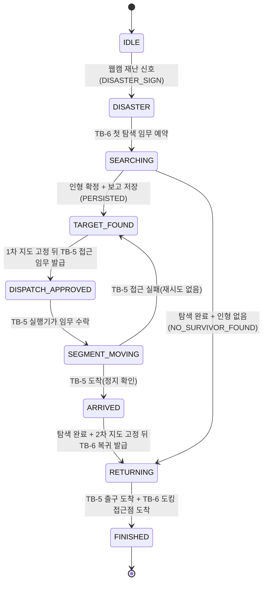

# 임무 상태 전이

## 한눈에 (2026-10-14, main `4163a25`)

이 문서가 답하는 질문은 하나다. **조정기는 임무를 어떤 순서로 진행하고, 어디서 왜 멈추는가?**

현장 설정은 지도 고정(`map_mode=SLAM_FREEZE`), 지도 전체 탐색(`search_mode=FRONTIER`), 출구 도착으로 구출 완료(`completion_mode=EXIT_ARRIVAL`)다. 아래 그림은 이 설정에서 임무 단계(`SystemState.phase`)가 바뀌는 순서다. 단계 판정은 `rescue_coordination/mission.py` 의 `MissionCoordinator.phase()` 한 곳에서 한다.

- `FINISHED` 단계이면 `SystemState.mode` 를 `MISSION_FINISHED` 로 보낸다(`ros_node.py` `system_mode`).
- TB-5 출구 도착 때 판정을 `RESCUE_CONFIRMED` 로 기록한다(`_confirm_by_exit_arrival`). 이때 단계는 이미 `RETURNING` 이라 그림에 따로 그리지 않았다.
- 인형이 없으면 TB-5 는 출발 자리에서 움직이지 않는다. 그래서 TB-6 이 도착하면 바로 `FINISHED` 다.
- 시나리오 원문과 결정은 [scope.md](../requirements/scope.md) Q-29(2026-10-13 밤 시나리오 변경)에 있다. 현장 값은 [현장 파일](../../config/field/search_area.field.json) `coordinator` 절에 있다.

## 임무 단계 (`SystemState.phase`)

`phase()` 는 위에서부터 차례로 검사하고 처음 맞는 값을 돌려준다.

| 순서 | 단계 | 조건 | 현장 설정에서 |
| --- | --- | --- | --- |
| 1 | `IDLE` | 재난 모드가 아님 | 시작 상태 |
| 2 | `FINISHED` / `RETURNING` | 복귀가 시작됨. 두 역할이 모두 도착했으면 `FINISHED` | 2차 고정 뒤 TB-6 복귀 발급부터 |
| 3 | `RECHECKING` | 열린 재확인이 있음 | 쓰지 않음(`completion_mode=RECHECK` 전용) |
| 4 | 판정 값(`RESCUE_CONFIRMED` 등) | 판정이 있음 | 복귀가 먼저라 보이지 않음 |
| 5 | `DISPATCH_APPROVED` / `SEGMENT_MOVING` / `ARRIVED` / `TARGET_FOUND` | 자동 접근 단계 = 발급 / 수락 / 도착 / 실패 | TB-5 출동부터 |
| 6 | `AWAITING_CONTINUE` 등 | 운영자 구간 승인 방식(`support_dispatch=OPERATOR`) | 쓰지 않음 |
| 7 | `TARGET_FOUND` | 확정·저장된 인형이 있음 | 인형 확정 뒤 |
| 8 | `SEARCHING` / `DISASTER` | 첫 탐색 임무를 예약했는지 | 재난 신호 뒤 |

시스템 모드는 `NORMAL` 에서 `DISASTER` 로 한 번 바뀌고 되돌아가지 않는다. `CLEARING`(오탐 해제)은 계약 어휘(`rescue_contracts.SYSTEM_MODES`)에만 있다. 조정기 코드에서는 쓰는 곳을 찾지 못했다(`rescue_coordination/` grep `CLEARING`).

## 지도 고정 단계

단계 값은 `CoordinatorCore.frozen_stage` 다. 지도 revision 은 탐색 revision(R0)에서 시작한다.

| 단계 | 들어가는 조건 | TB-6 | TB-5 | 코드 |
| --- | --- | --- | --- | --- |
| 0 (고정 전) | 시작 | R0 에서 SLAM 으로 지도를 만들며 탐색 | 출발 자리에서 대기 | — |
| 1 (1차 고정, R0+1) | 인형 저장 + TB-6 정지 | R0 에서 탐색 계속 | R0+1 로 위치를 잡고 인형 앞 접근점으로 이동 | `_freeze_tick`, `_try_freeze`, `_rebase_on_freeze` |
| 2 (2차 고정, R0+2) | 탐색 완료 + TB-6 정지 | R0+2 로 바꾼 뒤 도킹 접근점으로 | R0+2 에서 가장 가까운 출구로 | `_freeze_tick`, `_final_exit_ready` |

- 인형이 없을 때도 두 고정을 모두 한다. TB-6 이 최종 지도로 바꿔야 복귀할 수 있기 때문이다.
- 고정 지도는 `/rescue/map/frozen_revision` 글의 hash 가 맞을 때만 받는다(#242).
- 1차 고정에서는 인형 위치를 새 revision 으로 다시 보고한다. 2차 고정에서는 다시 보고하지 않는다.

## 로봇별 진행

| 로봇 | 상태 변수 | 값의 순서 | 막힐 때 |
| --- | --- | --- | --- |
| TB-5 접근 | `mission.approach_phase` | `ISSUED` → `MOVING` → `ARRIVED` 또는 `FAILED` | `FAILED` 는 다시 시도하지 않고 `APPROACH_FAILED_<사유>` 를 보인다 |
| TB-5 출구 | `support_exit` | (없음) → `WAITING` → `ISSUED` → `AT_EXIT` 또는 `FAILED` | `WAITING` 동안 `SUPPORT_EXIT_IN_<n>S`, `MAP_NOT_FINAL` |
| TB-6 복귀 | `scout_return` | (없음) → `ISSUED` → `AT_DOCK_APPROACH` 또는 `FAILED` | `MAP_NOT_FINAL`, `SCOUT_HOME_NOT_FREE` |

TB-5 가 출구 대기(`WAITING`)에 들어가려면 도착 뒤 `support_exit_wait_s` 가 지나야 한다. FRONTIER 에서는 2차 고정까지 함께 기다린다.

## 이유 코드 (`SystemState.reason`)

이유 칸에는 값 하나만 들어간다. 우선순위는 아래 순서다(`system_state_change`).

1. 이번 tick 에 임무 발급을 막은 이유(`issue_block`). 교통 관제 보류도 여기 들어간다. 두 로봇이 함께 보류되면 TB-5 의 이유를 보인다(`_hold`).
2. 재기준한 인형의 재보고 대기(`TARGET_REBASED_ON_FREEZE`)
3. 임무 끝 단계(`mission_reason`: 생존자 없음, TB-6 복귀, 판정, TB-5 출구)
4. 탐색 상태(`_search_reason`)
5. 웹캠 감시 재설정, 위치 관측 거절
6. 두 로봇 간격 검사를 끈 채 TB-6 이 움직임(`TRAFFIC_SEPARATION_UNCHECKED`)

| 단계 | 이유 코드 | 뜻 | 풀리는 조건 |
| --- | --- | --- | --- |
| 탐색 | `EXPLORATION_MAP_UNKNOWN` | TB-6 실시간 지도를 아직 받지 못함 | `/robot6/map` 수신 |
| 탐색 | `SCOUT_POSE_UNKNOWN` | TB-6 위치가 없거나 오래됨 | 새 TB-6 위치 |
| 탐색 | `EXPLORATION_COMPLETE` / `EXPLORATION_TIMEOUT` | 탐색 끝(갈 경계 없음 / 시간 상한) | — (2차 고정으로 진행) |
| 고정 | `MAP_FREEZE_WAITING_SCOUT_STOP` | TB-6 정지를 기다림 | TB-6 정지 |
| 고정 | `MAP_FREEZE_REQUESTED` / `MAP_NOT_FROZEN` | 고정 요청 뒤 고정 지도를 기다림 | 고정 지도와 revision 글 수신 |
| 고정 | `MAP_FREEZE_FAILED` | 고정 실패 또는 시간 초과 | — (다시 시도하지 않음. 사람이 확인) |
| 고정 | `TARGET_REBASED_ON_FREEZE` | 재기준한 인형 위치의 저장을 기다림 | 보고 저장(PERSISTED) |
| TB-5 출동 | `SUPPORT_NOT_LOCALIZED` | TB-5 가 고정 지도에서 위치를 못 잡음 | TB-5 MapState 가 고정 revision |
| TB-5 출동 | `SUPPORT_NOT_READY` | TB-5 가 READY 가 아님(arm 필요) | TB-5 arm |
| TB-5 출동 | `SUPPORT_POSE_UNKNOWN` / `SUPPORT_POSE_BASIS_MISMATCH` | TB-5 위치가 없거나 다른 지도 기준 | 새 TB-5 위치 |
| TB-5 출동 | `SUPPORT_APPROACH_NOT_FREE` | 접근점이 고정 지도에서 비어 있지 않음 | — (사람이 확인) |
| TB-5 출동 | `APPROACH_FAILED_<사유>` | 접근 실패. 다시 시도하지 않음 | — |
| 출구 | `MAP_NOT_FINAL` | 2차 고정 전 | 2차 고정 |
| 출구 | `SUPPORT_EXIT_IN_<n>S` | TB-5 출구 출발까지 남은 초 | 시간 경과 |
| 출구 | `SUPPORT_EXIT_UNREACHABLE` | 출구가 있으나 격자 경로가 없음 | — |
| 출구 | `SUPPORT_START_UNKNOWN` | QR 출구가 없고 TB-5 출발 자리도 모름 | 현장 파일에 TB-5 출발 자리 측정값 |
| 출구 | `SUPPORT_EXITING` / `SUPPORT_AT_EXIT` / `SUPPORT_EXIT_FAILED` | TB-5 출구 이동 경과 | — |
| 복귀 | `START_POSE_UNKNOWN` | TB-6 출발 자세를 모름(도킹 접근점의 기준) | 출발 자세 수신 |
| 복귀 | `SCOUT_HOME_NOT_FREE` | 도킹 접근점이 비어 있지 않음 | — |
| 복귀 | `SCOUT_RETURNING` / `SCOUT_AT_DOCK_APPROACH_DOCK_BY_HAND` / `SCOUT_RETURN_FAILED` | TB-6 복귀 경과. 도킹은 사람이 함 | — |
| 종료 | `NO_SURVIVOR_FOUND` | 탐색을 끝냈는데 인형이 없음 | — |
| 공통 | `TASK_REFUSED` | 실행기가 임무를 거절해 잠시 대기 | `admission_timeout_s` 뒤 새 임무 |

### 교통 관제 이유 코드

교통 관제(`traffic_control=TB5_PRIORITY`)는 지도 고정 현장 설정에서만 켠다. TB-5 가 늘 먼저 간다. TB-5 가 사람을 이끌고 사람이 그 뒤를 따라가기 때문이다. 코드 목록은 `ros_node.py` 의 `TRAFFIC_REASONS` 10개다. 웹 문구는 `rescue_console/view.py` 의 `MISSION_REASONS` 에 있다(PR #286). 거리 값과 설정 이름은 [조정기 구현 기록](../implementation/implementation-coordination.md)에 있다.

| 이유 코드 | 막는 로봇 | 뜻 | 풀리는 조건 |
| --- | --- | --- | --- |
| `TRAFFIC_SUPPORT_WAITING_SCOUT_STOP` | TB-5 | TB-5 경로 근처를 가던 TB-6 임무를 취소하고 정지를 기다림 | TB-6 임무 끝(CANCELED 등) |
| `TRAFFIC_SCOUT_STOP_TIMEOUT` | TB-5 | 취소한 TB-6 이 `traffic_stop_timeout_s` 안에 서지 않음 | TB-6 정지. 현장 확인 필요 |
| `TRAFFIC_SUPPORT_WAITING_SCOUT_YIELD` | TB-5 | TB-6 을 TB-5 경로 밖으로 비키게 보냄 | TB-6 이 경로에서 `traffic_path_clearance_m` 밖 |
| `TRAFFIC_SCOUT_YIELD_NO_SPACE` | TB-5, TB-6 | TB-6 이 비킬 자리가 `traffic_yield_max_m` 안에 없음. 두 로봇 모두 섬 | — (대체 동작 없음. 사람이 확인) |
| `TRAFFIC_SCOUT_HELD_FOR_SUPPORT` | TB-6 | TB-6 의 새 목표가 TB-5 경로와 가까움 | TB-5 도착 또는 경로 변경 |
| `TRAFFIC_ROBOTS_TOO_CLOSE` | TB-5, TB-6 | 두 로봇(또는 새 목표와 상대 로봇)이 `traffic_min_separation_m` 미만 | 거리가 벌어짐. TB-6 이 서 있으면 먼저 비킴 |
| `TRAFFIC_SUPPORT_PATH_UNKNOWN` | TB-5 | 고정 지도에서 TB-5 격자 경로를 찾지 못함 | 경로가 생김 |
| `TRAFFIC_SCOUT_POSE_UNKNOWN` | TB-5, TB-6 | TB-6 위치가 없거나 오래됨 | 새 TB-6 위치 |
| `TRAFFIC_SUPPORT_POSE_UNKNOWN` | TB-6 | TB-5 위치가 없거나 오래됨 | 새 TB-5 위치 |
| `TRAFFIC_SEPARATION_UNCHECKED` | (막지 않음) | TB-5 가 아직 움직인 적 없고 출발 자리도 측정하지 않아, TB-6 을 간격 검사 없이 보냄 | 현장 파일에 TB-5 출발 자리 측정값 |

- 보류 코드는 새 명령만 막는다. 움직이는 명령을 취소하는 경우는 TB-5 경로 근처를 가는 TB-6 하나다.
- `TRAFFIC_SEPARATION_UNCHECKED` 는 보류가 아니다. TB-6 목표를 보낼 때마다 조정기 기록에 `TRAFFIC_SEPARATION_UNCHECKED task=… goal=…` 을 남기고, 다른 이유가 없을 때 이유 칸에 보인다(팀 규칙 6, 조용한 대체 금지).

## 로봇 실행기 상태 (확인 필요: 통합-로봇)

로봇 쪽 준비·임무·정지 상태(arm, `STOP_LATCHED`, `STOP_UNCONFIRMED` 등)는 `rescue_robot` 실행기의 상태다. 이 문서는 조정기 쪽만 코드로 다시 확인했다. 로봇 쪽 설명은 아래 「기록」의 S-01~S-04, S-07 에 있는 2026-10-11 초안 그대로이며, 지금 코드와 맞는지는 통합-로봇의 확인이 필요하다.

## 기록 (2026-10-14 옮김)

아래는 2026-10-11 초안(계획 PR 3의 논리 제안) 전문이다. 위 본문으로 대체했고, 이력 확인용으로만 남긴다. 2026-10-14 에 확인한 차이는 아래와 같다.

- S-00 의 `CLEARING` 전이는 조정기 코드에 없다.
- S-06 의 SUPPORT `HOLD`, 운영자 구간 승인(`MOVE_SEGMENT`), SCOUT 재확인 흐름은 현장 설정에서 쓰지 않는다. 현장은 자동 출동(`APPROACH_TARGET`), 출구 도착 완료(`EXIT_ARRIVAL`), 두 번의 지도 고정이다.
- S-06 의 「설정 구역을 순서대로 `SEARCH_AREA`」는 지금 「지도 전체 탐색(FRONTIER)」이다.
- S-05 구출 축의 「재확인으로만 `RESCUE_CONFIRMED`」는 `completion_mode=RECHECK` 에서만 맞다.

### 2026-10-11 초안 원문

계획 PR 3의 논리 제안이며 실행 코드·실기 결과가 아니다. 두 로봇 각각의 실행기는 [인터페이스 계약](contracts.md)의 시간·좌표·권한 관문을 적용한다. 협업 coordinator는 임무를 배정하고 operations는 요청과 결과를 표시/기록한다. 화면의 버튼 상태와 실제 로봇 상태를 같은 변수로 취급하지 않는다.

두 AMR은 확정 요구이며, 발견→안전 접근→보고와 네 PC 전체 배치는 현재 검증할 설계 기준안이다. 후자의 최종 인수 확정을 이 문서가 대신하지 않는다.

#### S-00. 시스템 모드 (BRD v0.1, 2026-10-08)

전체 시스템의 모드는 로봇·사건 상태와 별도 축이다. 실행 가능한 어휘는 `rescue_contracts.SYSTEM_MODES`.

| 현재 | 이벤트/관문 | 다음 |
| --- | --- | --- |
| `NORMAL` | 고정 웹캠(1대, 2026-10-09 결정)의 `SiteEvent(kind=DISASTER_SIGN)` 가 정책의 판정 조건(Part I 3.1.2 시연 시나리오 기준, Q-11)을 충족 | `DISASTER`. coordination 이 이벤트를 검증(유효 영상·시각·중복 event_id)한 뒤 운영자 승인 없이 SCOUT 로봇에 수색 임무(SEARCH_AREA)를 발급하고 관리자 화면에 알림(FR-03·04, Q-12 결정 2026-10-10). 수동 시작은 자동 발급이 실패했을 때의 대체 수단이며 쓰면 기록한다. 카메라 어댑터 자체는 모드를 바꾸지 못한다 |
| `DISASTER` | 오탐 해제 조건 충족(Q-11) 또는 운영자 해제 | `CLEARING`: 진행 중 임무를 S-04 정지 관문으로 종료하고 SCOUT 복귀. 정지 확인 뒤 `NORMAL`(E-01) |
| `DISASTER` | SUPPORT 출동 조건: 확인 `CONFIRMED` 사건 + 저장 확인(receipt `PERSISTED`). 조정기 `support_dispatch=AUTO`(저장소 소유자 결정 2026-10-13, 1B)면 그것만으로, `OPERATOR` 면 운영자 출동 승인(`DISPATCH_SUPPORT`, Q-12 결정 2026-10-10)도 | 모드는 유지. AUTO: TB-5 에 접근 임무(`APPROACH_TARGET`, 대상에서 `approach_standoff_m` 만큼 TB-5 쪽, 승인 없음) 하나를 예약. OPERATOR: 첫 구간 이동 임무(`MOVE_SEGMENT`) 예약(S-03·S-06), 다음 구간은 운영자 “계속” 승인(`CONTINUE_SEGMENT`)마다 새 generation 으로 예약 |
| 어느 모드든 | 모드 전이 이벤트는 시각·근거(SiteEvent ID)·판정 정책 version 과 함께 보고 저장 | — |

모드가 `NORMAL` 이면 자동 수색·접근 임무를 발급하지 않는다. 모드 전이는 운영 기록이며 로봇 측 정지 latch 를 대신하지 않는다.

#### S-01. 동시에 유지할 상태와 우선순위

로봇마다 다음 상태를 별도로 가진다.

| 상태 축 | 값 제안 | 의미 |
| --- | --- | --- |
| readiness | `INITIALIZING`, `READY`, `DEGRADED`, `NOT_READY` | 센서·시계·TF·Nav2·설정 준비 상태. READY가 움직이고 있다는 뜻은 아님. 도킹 중 센서 준비와 실제 이동 허가도 구분 |
| motion | `STOPPED`, `MOVING`, `STOP_REQUESTED`, `STOP_UNCONFIRMED` | 명령 접수와 관측된 정지를 구분 |
| safety/control latch | `DISARMED`, `ARMED`, `STOP_LATCHED`, `FAULT_LATCHED` | 재연결/새 탐지/늦은 goal 응답으로 latch 해제 금지 |
| task | 아래 S-03 상태 | task_id·generation·goal UUID와 함께 관리 |

충돌하는 이벤트의 우선순위는 **현장/운영자 정지·장비 fault → 권한/lease/필수 센서·시간·좌표 유효성 상실 → deadline/취소 → 정상 결과 → 새 목표/탐지**다. 같은 시점의 모든 원인은 기록하되, 낮은 우선순위 이벤트가 정지/실패를 성공으로 덮어쓰지 않는다. 실제 물리 정지를 확인할 수 없으면 어떤 상위 임무 상태에서도 `STOP_UNCONFIRMED`를 숨기지 않는다.

#### S-02. 준비·재시작·제어권

| 현재 | 이벤트/관문 | 다음 상태·조치 |
| --- | --- | --- |
| 시작 | 새 robot/executor boot | DISARMED + INITIALIZING. 이전 task·lease·goal을 자동 재실행하지 않음 |
| INITIALIZING | 도킹 장치가 있고 준비용 UNDOCK 요청; C-06의 별도 준비 제어권·fresh dock/driver 상태·정지/장치 guard 통과 | 협업 DISARMED를 유지하며 실행기만 UNDOCK. Nav2/다른 이동과 배타 실행; action 접수는 완료가 아님 |
| INITIALIZING / 준비 action 진행 | UNDOCK 후 fresh is_docked=false·정지 확인; 필요한 센서/TF/위치 추정 준비 확인 | 준비 action 종료 후 일반 readiness 검사. 접수 뒤 무동작/timeout/상태 불명은 NOT_READY + S-04 정지 관문 |
| INITIALIZING | 필수 설정 고정, 로봇 ID/버전 일치, live 센서/시간/TF/Nav2 준비 | READY + DISARMED. 도킹 중 power_saver 해제·센서 발행이 확인돼도 이동 허가는 별도 dock guard 적용; 명시적 제어권 등록 대기 |
| READY + DISARMED | 새 authority 등록, 기존 권한 폐기·정지 확인, lease 수락 | ARMED. 단일 coordinator authority와 로컬 실행기 boot에 결합 |
| INITIALIZING | 준비 timeout·필수 값 미확인 | NOT_READY. 원인과 필요한 조치 보고; 무기한 조용히 대기하지 않음 |
| ARMED | 접근/수색에 필요한 준비 상실 | 임무 중단 관문 S-04로 이동. DEGRADED/NOT_READY 이유 기록 |
| STOP/FAULT_LATCHED | 원인 해결·정지/준비 확인·명시적 reset/resume | 이전 임무를 되살리지 않고 새 generation/권한으로 재등록 |
| 어느 상태 | coordinator 또는 로봇 실행기 재시작 | 이전 boot/epoch의 lease와 수락 여부를 불확실로 처리. 로컬 watchdog·재등록 절차 적용 |

원본 로봇 3번은 기본 `power_saver: True`에서 도킹 중 카메라/라이다가 없었고, 같은 기록은 `False`면 켤 수 있다고 설명한다. 새 장비의 설정·실제 센서 발행을 확인하며 이 조건을 모든 AMR의 고정 특성으로 일반화하지 않는다. 도킹 중 센서 READY가 가능해도 도킹 장치가 있는 플랫폼의 수색·접근·재관측 **이동 전에는 fresh is_docked=false를 반드시 확인**한다. DOCK는 운영자/기동 절차의 별도 준비 제어권으로 기존 임무 취소·정지 뒤에만 요청한다. 도킹/언도킹 자체의 장치 이동은 협업 이동과 다른 준비 action guard를 사용한다(C-06).

SLAM에서 AMCL active를 필수로 기다리지 않는다. 준비 상태는 실제 선택한 위치 추정 backend의 관측 가능한 품질과 TF 계약으로 정의한다. 임무 노드가 Nav2 lifecycle 복구를 직접 시작하지 않고 소유 관리자에게 복구 요청을 보낸다. 복구 중에는 새 이동 임무를 받지 않는다.

#### S-03. 로봇별 임무 상태 머신

| 현재 | 이벤트/필수 guard | 다음 상태·효과 |
| --- | --- | --- |
| `IDLE` | ExecuteTask 수신; 아직 action 수락 전 | `VALIDATING`; command/task/generation과 admission 처리 기록. 이동 명령 없음 |
| VALIDATING | ARMED/READY, 다른 이동 task/준비 action 없음, 시간·권한·대상/구역·좌표 revision·필수 정책 유효; 도킹 장치가 있는 플랫폼의 이동은 fresh is_docked=false | action 수락 후 `PLANNING`; 접근은 안전 후보, 수색은 지정 구역 내 다음 목표를 계획 |
| VALIDATING | 잘못된 입력·만료·불일치·준비 부족 | goal 응답 accepted=false, admission 기록 `REJECTED`와 사유를 남기고 IDLE. action Result는 생성하지 않음 |
| PLANNING | 경로/목표 유효, 통로 자원 확보, goal 발행 직전 revision·이동용 dock guard 재검증 | `NAVIGATING`; 발급한 goal UUID와 관측/변환 revision 고정 |
| PLANNING | 후보 없음/경로 없음 | budget 안이면 `REPLAN_PENDING`, 초과면 `UNREACHABLE`; 대상 사건은 삭제하지 않음 |
| NAVIGATING | 정상 진행 | 현재 goal의 feedback만 반영. 새 위치가 들어왔다고 매번 재발급하지 않음 |
| NAVIGATING | 경로 차단·재계획 필요 | `REPLAN_PENDING`; 기존 goal 처리와 정지 필요 여부를 정책대로 완료 후 새 경로 선택 |
| REPLAN_PENDING | retry/전체 deadline 남음, 위치·센서·명령권 유효 | PLANNING. 재시도마다 전체 deadline을 초기화하지 않음 |
| NAVIGATING | 현재 goal의 성공 결과 | 접근/재관측은 `VERIFYING`, 수색은 다음 수색 지점 계획 또는 구역 완료 확인. Nav2 성공을 대상 확인 성공으로 바꾸지 않음 |
| VERIFYING | fresh 대상 재관측·동일성/좌표/이격 조건 통과, 정지 확인 | `COMPLETED`; 접근 증거·실제 정지 위치·관측 ID를 결과에 첨부 |
| VERIFYING | 대상 없음/동일성 불확실/위치 조건 미충족 | `STOPPING`; 정지 관문 후 FAILED(reason=NEEDS_REOBSERVATION). 사건은 NEEDS_REOBSERVATION, 별도 재관측은 새 generation으로 배정 |
| NAVIGATING (대상 의존 임무) | 짧은 탐지/모델 결과 공백; C-03의 SHORT_LOSS_MAX·원 관측 유효시간과 모든 독립 guard 안 | 기존 goal만 유지. 새 goal·관측 수명 연장 없음; 공백/만료 경계는 CT-02로 시험 |
| 대상 의존 APPROACH_TARGET/REOBSERVE_TARGET의 비종료 상태 | 원 관측 만료·SHORT_LOSS_MAX 초과·대상 유효성 상실 | S-04의 STOPPING; 사건 NEEDS_REOBSERVATION. SEARCH_AREA는 무관한 대상 만료만으로 중지하지 않음 |
| 어느 비종료 상태 | 취소·deadline·영향받는 frame 변경·lease 만료·정지 요청·해당 임무의 필수 센서/시간/위치 준비 상실 | S-04의 STOPPING. 성공 결과가 뒤늦게 와도 해당 중단을 덮어쓰지 않음 |

action 수락 후 Result outcome은 `COMPLETED`, `CANCELED`, `EXPIRED`, `UNREACHABLE`, `FAILED`로 구분한다. 수락 전 REJECTED는 별도 admission 기록이며 action Result가 아니다. 다른 task가 활성일 때 새 요청이 들어오면 admission에서 거절하고 기존 task 상태를 유지한다.

정지 미확인은 motion 상태로 남으며 수락 임무의 Result는 `outcome=FAILED`, `terminal_reason=STOP_UNCONFIRMED`, `stop_confirmed=false`로 통일한다. 최초 취소/만료 원인도 보존한다. 이동 goal/속도 출력이 있었던 임무는 정상 완료·취소·실패 어느 경로든 종료 전에 정지 관문을 거친다. 정지 확인 실패 결과를 보낸 뒤에도 latch·감시와 새 임무 차단을 유지한다. 진행 중 목표가 없다는 내부 변수만으로 STOPPED를 만들지 않는다.

`SEARCH_AREA`는 로봇별 지정 구역·수색 정책을 실행한다. PR 2의 통합 후보는 `explore_lite`의 frontier 후보를 실행기에 전달하는 방식(B)이며, 실행기가 검증 후 Nav2 goal을 단독 발행한다. 직접 Nav2 goal을 보내는 방식(A)은 coordinator/controller 없는 격리 실험에만 둔다. frontier/지정 waypoint의 최종 선택과 구현·성능은 아직 검증하지 않았다. 검색·재계획은 실행 예산을 갖는다. 탐지 노드의 실패를 이유 없이 “수색 완료”로 전환하지 않는다.

`REOBSERVE_TARGET`는 대상의 위치/동일성을 새 관측으로 확인하는 별도 임무다. 마지막 알려진 위치를 표시하는 것과 자동 접근에 쓸 fresh 목표는 다르다. 오래된 위치에 대한 재관측 이동을 허용할지는 제한된 수색 영역·현재 장애물/위치 품질·접근 금지 영역을 갖춘 별도 정책으로 사전 결정해야 한다. 그 정책이 없으면 이동을 보류한다.

#### S-04. 취소·정지·늦은 응답

1. 중단 원인과 활성 task/generation/goal UUID를 먼저 기록하고 새 goal 수락·재발급을 막는다.
2. 실행기는 해당 goal의 cancel과 최종 명령 억제를 요청한다. `STOP_REQUESTED`/`STOPPING`으로 표시한다.
3. cancel 접수/응답, Nav2 terminal result, 최종 command fence, 실제 정지 관측을 별도 기록한다. 응답 누락 시 정지 감시는 계속한다.
4. 정지 기준이 관측되면 STOPPED. 취소/실패/만료 원인에 맞는 종료 결과를 내고 coordinator에 알린다.
5. 정지 확인 deadline을 넘거나 odom/driver 상태가 끊기면 motion=STOP_UNCONFIRMED. 수락 임무는 FAILED(reason=STOP_UNCONFIRMED, stop_confirmed=false)로 보고한다. 웹에는 확인 불가를 표시하고 해당 로봇의 새 임무를 차단한다.
6. 원인 해결 후 명시적 재등록/재개와 새 generation 없이는 움직이지 않는다. 같은 임무 ID 재전송으로 정지 latch가 풀리지 않는다.

늦게 수락된 goal은 **그 goal UUID에 대해** 취소/억제하고 새 세대의 goal을 잘못 취소하지 않는다. 이전 task 결과와 현재 task 결과를 같은 navigator의 마지막 결과 값으로 혼동하지 않도록 goal별 기록을 둔다. 중복 cancel/stop 요청은 같은 결과를 반환하며 부수 효과를 반복하지 않는다.

최종 watchdog은 master PC의 추론·executor callback 지연과 독립적으로 로컬 만료를 감시하는 구조를 제안한다. 이 독립성이 실제 장비에서 확인되지 않으면 시험 계획의 정지 관문을 통과할 수 없다.

#### S-05. 대상 사건 상태와 보고 상태

대상 사건은 **확인 상태**, **접근 상태**, **보고 상태**를 분리한다. 한 enum에 모두 넣으면 “보고했으나 접근 불가” 같은 정상 결과를 표현하기 어렵다.

| 축 | 전이·조건 |
| --- | --- |
| 확인 | `CANDIDATE` → 서로 일관된 유효 관측과 동일성 기준 충족 시 `CONFIRMED`; 관측/지도 기준이 만료·불확실하면 `NEEDS_REOBSERVATION`; 운영자/정책의 근거 있는 판정으로 `DISMISSED` |
| 접근 | `UNASSIGNED` → `ASSIGNED` → `IN_PROGRESS` → 정지·재확인·이격 조건을 통과하면 `APPROACH_COMPLETE`; 그 외 `BLOCKED`, `UNREACHABLE`, `CANCELED`, `FAILED` |
| 보고 | `NOT_QUEUED` → `QUEUED` → `RECEIVED` → 필수 내용/증거가 저장되고 receipt 확인 시 `PERSISTED`; 실패 시 `RETRY_PENDING`/`PENDING_EVIDENCE` 유지 |
| 구출(BRD v0.2 3.5) | `NOT_CHECKED` → 그 대상을 감시하던 고정 웹캠의 소실 후보 `SiteEvent(kind=TARGET_DISAPPEARED_CANDIDATE)`(target_id·watch_id)가 오거나, 웹캠이 판정 불가일 때 운영자가 영상을 보고 그 대상의 재확인을 지시하면(`REQUEST_RECHECK`, Q-26) SCOUT 의 재관측 임무(REOBSERVE_TARGET)를 새 generation 으로 예약한다. 같은 사건의 유효 소실 후보(또는 운영자 재확인 지시), 그 이후의 SCOUT 관측(`RecheckObservation`), 카메라 `ABSENT`·LiDAR `CLEAR`·관측 범위 `VALID` 가 모두 맞을 때만 `RESCUE_CONFIRMED`(시연 판정, BRD v0.2 3.5.5). 하나라도 `UNKNOWN` 이거나 불확실하면 `RECHECK_NEEDED` 유지(FR-24), 인형이 보이면 확정하지 않고 지원 대상으로 남긴다(3.5.6). 소실 후보만으로는 완료하지 않고, 탐지가 없다는 것만으로 `ABSENT` 로 보지 않는다(**부재 증거만으로 확정하지 않는다**, KPI-06). 출구 카메라·`EXIT_PASS` 는 카메라 1대 결정(2026-10-09)으로 판정 입력에서 빠졌다. 어휘는 `rescue_contracts.RESCUE_STATES` |

처음 발견했을 때 사건을 기록하고 접근 불가여도 위치·근거·실패 사유를 보고한다. `APPROACH_COMPLETE`와 `PERSISTED`가 모두 확인된 정상 접근·보고 시나리오를 완료로 집계한다. 접근 불가 시험은 접근 성공률의 성공 분자에 넣지 않고, 별도 “실패 처리·보고 성공” 지표로 집계한다.

새 관측으로 대상 위치가 바뀌어도 기존 report를 덮어쓰지 않고 report revision 또는 새 report_id로 연결한다. 같은 사람으로 병합한 근거·별개로 유지한 이유·운영자 정정 이력도 보존한다. 인물 탐지 confidence로 건강/생존 상태를 생성하지 않는다.

#### S-06. 두 로봇 협업 전이 (2026-10-08 개정: 프로파일 역할 SCOUT / SUPPORT)

역할은 배포 프로파일 v2 `mission.roles` 의 데이터다(C-02). 아래 SCOUT/SUPPORT 는 그 값이며 코드 상수가 아니다. 이전의 대칭 A/B 안은 [scope](../requirements/scope.md) 「첫 통합 시나리오」의 「이전」 열에 보존한다.

| 단계 | coordinator의 판단·관문 | SCOUT / SUPPORT 동작 |
| --- | --- | --- |
| 수색 | SCOUT READY/ARMED, 설정 구역의 실행 근거(basis·map session/revision) 확인 | SCOUT 가 설정 구역을 순서대로 `SEARCH_AREA` 실행. SUPPORT 는 `HOLD`(제자리 정지 유지; 프로파일 `hold_positions` 로 이동시키는 명령이 아님) |
| SCOUT 발견 | 관측의 시간·좌표·class·위치 품질 확인, 사건 생성/중복 검토 | SCOUT 는 유효 관측을 전달; 미확인 사건을 접근 완료로 표시하지 않음 |
| SUPPORT 선정 | 저장 확인(receipt `PERSISTED`) 뒤 AUTO 면 바로(2026-10-13, 1B), OPERATOR 면 운영자 출동 승인(`DISPATCH_SUPPORT`, Q-12 결정 2026-10-10). 경로 증거는 Phase 1 규칙(C-06·C-10 #88)으로 목표 지점만, 원 관측의 projection `VALID` | SUPPORT 의 HOLD 를 정지 확인으로 풀고(release) 새 generation 으로 AUTO 는 `APPROACH_TARGET`, OPERATOR 는 첫 구간 `MOVE_SEGMENT` 예약(PENDING) → 실행기 `TaskAdmission` 뒤에만 ACTIVE |
| SUPPORT 접근 | 공통 좌표·대상 유효성·통로/명령 lease 유지, 구간 끝의 실제 정지 확인 뒤 운영자 “계속” 승인(`CONTINUE_SEGMENT`) | SUPPORT 는 한 번에 한 구간만 움직이고 승인마다 새 generation 의 `MOVE_SEGMENT` 를 받는다(coordinator 는 다음 구간을 자동 발급하지 않음). 마지막 구간 뒤 SUPPORT 의 `REOBSERVE_TARGET` 으로 인형을 다시 탐지한다. 구조대원(사람)이 뒤를 따르며 로봇은 사람을 추종하지 않는다. SCOUT 는 정책(`scout_continues_during_approach`)대로 수색을 잇거나 현 구역 뒤 대기 |
| SCOUT 재확인 | 고정 웹캠의 소실 후보(`TARGET_DISAPPEARED_CANDIDATE`) 뒤 같은 지점의 `REOBSERVE_TARGET`(웹캠이 판정 불가일 때는 운영자의 `REQUEST_RECHECK`, Q-26); 구출 판정은 S-05 구출 축(카메라 `ABSENT`·LiDAR `CLEAR`·관측 범위 `VALID` 모두) | SCOUT 가 재관측·LiDAR 증거를 제공. SUPPORT 는 접근 종료·정지 확인 뒤 다시 HOLD |
| 결과 저장 | 보고 receipt·필수 근거 확인 | 접근 결과·보고 결과·구출 판정을 구분한 사건 종료/후속 수색 결정 |

역할은 **회차마다** 프로파일로 바꿀 수 있고(역할을 뒤집은 회차도 시험 목록에 둔다), 코드는 어느 로봇이 SCOUT 인지 추정하지 않는다. **한 회차 안의 자동 역할 교대**는 F-01 후속으로 보류한다([scope](../requirements/scope.md) F-01).

SCOUT 가 수색을 계속하느라 대상이 관측에서 사라진 경우에는 마지막 좌표를 새 관측처럼 갱신하지 않는다. SUPPORT 의 로컬 재관측이 확보되기 전까지 SCOUT 의 지원을 유지할지, 제한된 재관측 임무를 쓸지는 **시험 전에** 결정한다. 어떤 정책이든 유효기간 초과를 숨기고 접근을 계속하는 경로는 허용하지 않는다.

coordinator가 SUPPORT 의 정지/위치를 확인하지 못하면 접근 성공이나 통로 이탈을 추정하지 않는다. 다른 로봇으로 재배정할 때도 이전 로봇의 점유/이동 상태를 확인하거나 해당 영역을 차단한 대체 계획을 써야 한다. 단순 lease 만료로 두 로봇이 같은 좁은 통로에 진입하지 않게 한다.

#### S-07. 주요 실패 전이

| 실패 | 즉시 처리 | 재개 조건·보고 |
| --- | --- | --- |
| 짧은 탐지/모델 결과 공백 | C-03의 SHORT_LOSS_MAX·원 관측 유효시간과 모든 독립 guard 안에서 기존 goal만 유지; 새 goal·관측 수명 연장 없음 | 공백 타이머는 원 observed_at가 전진하는 새 유효 관측으로만 갱신. 경계 초과/다른 guard 실패 시 바로 아래 중단 적용 |
| 대상 관측 만료·SHORT_LOSS_MAX 초과·대상 유효성 상실 | 대상 의존 APPROACH_TARGET/REOBSERVE_TARGET은 STOPPING, 사건 NEEDS_REOBSERVATION. SEARCH_AREA는 무관한 대상 만료만으로 중지하지 않음 | 유효한 새 관측·새 generation 또는 사전 정의한 별도 재관측 구역 정책; 원 관측과 새 관측 구분 |
| 준비용 UNDOCK/DOCK 접수 뒤 무동작·timeout·dock 상태 불명 | NOT_READY + S-04 정지 관문, 협업 이동 차단 | fresh 물리 상태·정지·센서 준비 확인과 별도 권한의 새 요청. 접수만으로 준비 완료 금지 |
| frame/map revision 변경 | 영향받은 배정/goal 중단, 파생 위치 invalid | backend가 원 관측 보정을 지원하면 재계산·검증, 아니면 재관측 |
| localization/scan/TF 품질 상실 | 이동 제한·정지; 과거 pose를 live로 사용하지 않음 | readiness 복구·원인 확인·명시적 재개 |
| 장애물 추가 | 충돌 보호 경로 유지, 경로/자원 재검토 | budget 안에서 우회/대기, 없으면 UNREACHABLE |
| 장애물 제거 | 과거 막힘을 즉시 free로 덮어쓰지 않음 | 새 센서 관측·costmap/지도 상태와 경로 가능성 확인 |
| master/coordinator 통신 단절 | lease/로컬 watchdog에 따른 정지·상태 불확실 기록 | 연결 복구만으로 출발하지 않음; authority·task 재조정 |
| operations/DB 중단 | 로봇은 설정된 임무/정지 정책 수행, 보고는 로컬 보류 | 동일 report_id로 재전송·중복 제거, 저장 receipt 확인 |
| 다른 로봇 ID·낮은 generation·이전 boot 명령 | 거절·감사 기록 | 활성 정상 임무를 바꾸지 않음 |
| Nav2 실패 반복·action 결과 없음 | 제한된 재시도·전체 deadline·정지 관문 | FAILED/UNREACHABLE 등 관측된 outcome 보고. 정지 미확인이면 FAILED(reason=STOP_UNCONFIRMED, stop_confirmed=false) |

실패 후 자동 회복을 넣는 경우에도 권한·시간·좌표·정지 조건을 생략하지 않는다. 운영자 reset은 근거 없는 성공 판정을 대신하지 않는다.

#### S-08. 상태 전이 시험의 최소 불변식

- 로봇당 활성 이동 권한/goal의 소유자는 하나이며 다른 로봇 ID가 상태를 바꾸지 않는다.
- 원 관측의 observed_at과 최초 deadline은 중계·재시도로 증가하지 않는다.
- 완료한 이전 task/goal의 늦은 이벤트가 현재 generation을 바꾸지 않는다.
- STOP/FAULT_LATCHED에서 명시적 재개 관문 없이 MOVING으로 가지 않는다.
- map/transform revision이 invalid인 관측으로 새 접근을 시작하지 않는다.
- Nav2 성공, cancel 응답, 0 속도 발행, DB 수신 ACK를 각각 접근 완료·정지 완료·보고 저장 완료로 과장하지 않는다.
- 보고 실패·접근 불가·통신 단절도 사건과 원인을 보존하며, 성공률 계산의 분모에서 임의로 빼지 않는다.

#### 원본 근거와 한계

이 계약은 [P4의 임무 입력 관문](https://github.com/jaebeom/ROKEY_P4/blob/1a2d0a9811f59a501c7597edf54c72fec8a80e26/src/rokey_amr/rokey_amr/controller.py#L175-L210), [늦은 action 수락 처리 후보](https://github.com/jaebeom/ROKEY_P4/blob/1a2d0a9811f59a501c7597edf54c72fec8a80e26/src/rokey_amr/rokey_amr/goal_timer.py#L83-L173), [AMR의 목표/만료 경로](https://github.com/mi1nn/amr-mini-project/blob/ee355d0b5896ea58bccac73ce1a7857f62e96024/src/rokey_pjt/rokey_pjt/rc_car_follower.py#L388-L446), [접근 정보 만료](https://github.com/mi1nn/amr-mini-project/blob/ee355d0b5896ea58bccac73ce1a7857f62e96024/src/rokey_pjt/rokey_pjt/rc_car_follower.py#L517-L528)를 참고해 새 요구를 분리한 것이다. 원본의 상태 이름/상수·실기 성능을 승계하지 않았으며 테스트를 실행하지 않았다.
