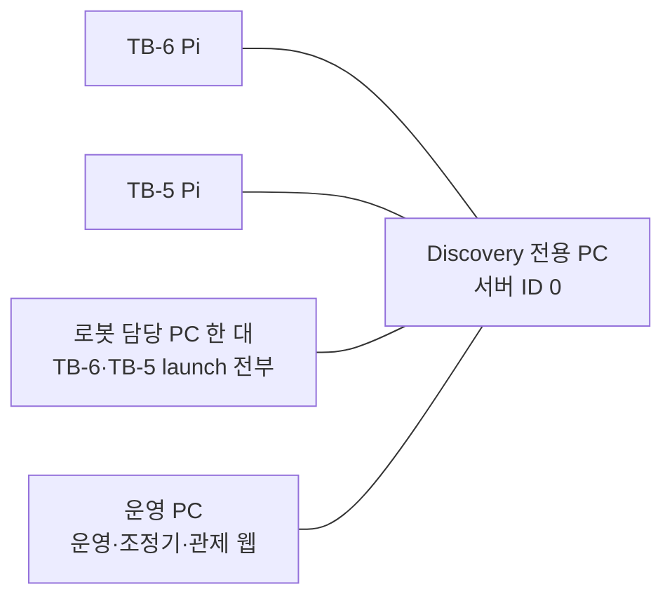

# 현장 실습 기록 (2026-10-15 오후, run1015b)

## 한눈에

오늘 오후 실습은 로봇 담당 PC 한 대가 두 로봇을 맡고, 운영 PC 와 Discovery 전용 PC 를 따로 둔 첫 구성이었다. 17:59 에 재범이 실습을 중지했다. **TB-6 은 첫 목표를 받기는 했지만 한 걸음도 움직이지 않았고, 임무는 `NO_SURVIVOR_FOUND`(생존자 없음)로 끝났다.** TB-5 는 Pi 와 Create3 사이 연결이 끊겨 쓰지 못했다.

막힌 곳은 열한 군데다. 같은 일이 되풀이되지 않게 코드로 막을 것과 실습 순서로 막을 것을 나눴다(4절). 레슨런은 [lessons-learned.md](../process/lessons-learned.md) LL-12 ~ LL-17 이다.

- 기준 코드: 운영 PC 는 main `5669356`, 15:5x 부터 `6d43fce` 빌드다(운영 PC 기록 #337). 로봇 담당 PC 의 빌드 커밋은 이 기록에 없다 [미확인]. 다음 회차부터 PC 마다 `git rev-parse HEAD` 를 남긴다. 실습 도중 #334(TB-5 출발값) 한 줄을 두 PC 현장 파일에 먼저 넣었다(sha256 `61be502b…`, 저장소 main `d34fa51` 과 같음 [측정, 작전이 재현]).
- 이 기록을 쓴 자리(작전)는 로봇 담당 PC 에 접근하지 않았다. 2절 시각과 측정값은 실기·배포 자리가 세션 메시지로 보낸 것이다. 3절 원인 중 「코드 확인」은 작전이 main `360d4ef` 코드를 읽어 확인했다.

## 1. 구성

- 모든 PC 가 전용 서버 하나만 적는다(재범 결정 2026-10-15, [discovery-host.md](../process/discovery-host.md)). 로봇 Pi 의 Discovery 설정은 바꾸지 않았다.
- 로봇 담당 PC 는 Wi-Fi 로만 붙었다(유선 포트 내려감).

## 2. 시간순 기록

> [!WARNING]
> 원문 미확인 (전달: 실기·배포 자리, 2026-10-15 15:45 ~ 18:00): 아래 표의 시각, 로그 문구, 측정값.

| 시각 | 무슨 일 | 결과 |
| --- | --- | --- |
| 15:16 | TB-6 Pi turtlebot4 서비스 재시작 | 그 뒤 `/robot6/undock` 액션 서버 0, `dock_status` 안 옴 |
| 15:44 | `undock 6` | 90초 동안 응답 없이 끝남 |
| 15:45 | 로봇 담당 PC 에서 ping 30번 | 공유기·Discovery PC·TB-6 Pi 손실 0%, **TB-5 Pi 손실 97 ~ 100%** |
| 15:58 ~ 16:27 | Discovery 전용 PC 재부팅 | 서버가 약 30분 꺼져 있었음. 서버는 사용자 서비스가 아니라 터미널에서 띄운 것 |
| 16:33 ~ 16:47 | 다른 PC 의 map_server·AMCL 이 `/robot6/map` 에 발행 | 재범 요청으로 꺼짐. 어느 PC 인지는 모름(GID 호스트 바이트로만 구분) |
| 16:54 / 16:59 | TB-6 SLAM 을 서 있어도 처리하는 설정(`minimum_travel_distance`·`heading` 0)으로 다시 띄움 | 백그라운드로 띄운 16:59 에는 slam_toolbox 가 `inactive` 에 머묾. `change_state` activate 로 풂 |
| 17:01 | `START_POSE captured robot_a map=(-0.116, -0.057, 2.950)` | 서 있는 TB-6 에서 `/robot6/pose` 2 Hz |
| 17:05 ~ 17:08 | TB-5 출발값을 재범이 줄자로 잼(TB-6 오른쪽 1.86 m). 두 PC 현장 파일에 먼저 넣음 | 저장소는 #334 |
| 17:25 | 준비 점검 카메라를 RGB 미리보기에서 큰 RGB 압축본으로 바꿈(재범 지시) | 로봇 쪽 미리보기가 꺼져 있어 두 로봇 모두 `STOP_OR_READINESS_NOT_READY` 였음. 바꾼 뒤 로봇당 약 1.5 MB/s |
| 17:30 | TB-5 `lifecycle_manager_navigation`: controller_server 활성화 60초 시간 초과 → 「Aborting bringup」 | 같은 시각대 Wi-Fi·Discovery 장애 |
| 17:33 | `undock 5` | 「Waiting for an action server」에서 멈춤 |
| 17:37 | TB-5 Pi ping 0% 인데 `create3_repub`·`turtlebot4_node` 가 그래프에 없음 | 재범 확인: TB-5 상태 LED 중 Create3 통신 표시가 꺼짐 |
| 17:39 | ping 이 다시 나빠짐(공유기 10% 손실, TB-6 70% 손실, 최대 1.3초) | 로봇 담당 PC 수신 8.3 MB/s |
| 17:38 ~ 17:41 | TB-5 launch 를 모두 끔 | 공유기·TB-6 손실 0% 로 회복 |
| 17:42 | 지도 고정 노드·TB-6 SLAM 다시 띄움 | 새 출발 자세 (-0.115, -0.062, 2.899). 조정기는 17:01 값과 달라 `START_POSE_CONFLICT` |
| 17:43 | 수신 다시 잼 | 약 2 MB/s, 같은 토픽을 두 프로세스가 받는 곳 없음 |
| 17:43 | TB-6 `task_arm` | `STOP_OR_READINESS_NOT_READY`. TB-6 깊이 영상 0 Hz, 깊이 camera_info 0 Hz(RGB 는 18 ~ 30 Hz) |
| 17:50 | 재범이 TB-6 Pi 에서 확인 | `wlan0` 무선 절전 `on` |
| 17:53 | TB-6 카메라 `stop_camera` → `start_camera`(재범 승인) | 깊이 4.6 Hz 로 복구, `task_arm` ARMED |
| 17:54:07 | 운영자 재난 선포 → `SEARCH_AUTO_STARTED` → 첫 탐색 목표 (-1.17, 0.94, 2.36) | — |
| 17:54:09 | 실행기 SEND → bt_navigator 「Action server is inactive. Rejecting the goal」 | 결과 FAILED |
| 바로 뒤 | `FRONTIER none` 3번 → `EXPLORATION_COMPLETE` → `NO_SURVIVOR_FOUND` | TB-6 은 움직이지 않음 |
| 17:56 | TB-6 Nav2 상태 | bt_navigator·behavior_server·velocity_smoother·collision_monitor·docking_server `inactive`, controller_server 만 `active` |
| 17:59 | 재범이 실습 중지 | 로봇 담당 PC launch 모두 끔 |

## 3. 막힌 곳과 원인

| # | 막힌 곳 | 원인 | 근거 |
| --- | --- | --- | --- |
| B1 | Discovery 서버가 30분 꺼짐 | 전용 PC 를 재부팅했는데 서버가 터미널에서 띄운 프로세스라 다시 뜨지 않았다 | 실기·배포 보고. [discovery-host.md](../process/discovery-host.md) 8절에 이미 「사용자 서비스 등록」이 남은 일로 있다 |
| B2 | 다른 PC 가 `/robot6/map` 에 발행 | 같은 Discovery 서버와 도메인에 팀 밖 노드가 붙을 수 있다. LL-03 과 같은 사고 | 실기·배포 보고 |
| B3 | 서 있는 TB-6 에서 출발 자세가 안 잡힘 | slam_toolbox 는 `minimum_travel_distance`·`heading`(기본 0.1) 이상 움직인 스캔만 처리해서 서 있으면 `/pose` 를 내지 않는다. 저장소 기본은 turtlebot4 `slam.yaml` 이다 | [추정] 현장에서 0 으로 바꾸자 2 Hz 로 나옴. 코드 확인: `tb6_slam.launch.py` 의 `slam_params_file` 기본이 비어 있음 |
| B4 | slam_toolbox 가 `inactive` 에 머묾 | launch 가 configure 뒤 「inactive 가 됐다」 이벤트를 받아야 activate 를 보낸다. 이벤트 구독이 매칭되기 전에 이벤트가 나가면 놓친다 | [추정, 재현 못 함] 로봇·지도 자리가 launch_ros 코드를 읽고 판단 |
| B5 | TB-5 Wi-Fi 끊김, ping 튐 | 로봇 Pi 무선 절전이 다시 켜져 있었다(재부팅하면 켜짐). 무거운 영상이 Wi-Fi 하나로 몰렸다 | TB-6 Pi `power_save on` 확인(17:50). TB-5 는 미확인. 런북 2단계에 「켤 때마다 끄기」가 이미 있었지만 빠졌다 |
| B6 | Pi turtlebot4 서비스 재시작 뒤 Create3 연결 끊김 | 재시작 뒤 Pi ↔ Create3 브리지가 다시 붙지 않았다 [추정]. TB-6(15:16 뒤)과 TB-5(17:37)에서 같은 증상 | 액션 서버 0, `dock_status` 발행자 0, Create3 통신 LED 꺼짐 |
| B7 | 준비 점검 카메라가 0 Hz | 저장소 로봇 설정의 준비 점검 카메라가 RGB 미리보기인데, 로봇 쪽 미리보기가 꺼져 있었다. 터널 판정 화면도 같은 미리보기를 쓴다 | 코드 확인: `config/robots/robot_*.v2.json` `camera_topics`, 현장 파일 `passage.view_image_topic` |
| B8 | TB-6 깊이 카메라만 멈춤 | OAK-D 설정은 켜져 있는데(`stereo.i_publish_topic` True) 깊이와 깊이 camera_info 가 0. 카메라를 껐다 켜자 복구 | 실기·배포 보고 |
| B9 | Nav2 가 반만 켜졌는데 「준비됨」 | 실행기의 Nav2 준비 판정이 `ActionClient.server_is_ready()` 다. bt_navigator 는 configure 단계에서 액션 서버를 만들어서 inactive 여도 참이다 | 코드 확인: `rescue_robot/ros_node.py:54`, `task_status.py:37-40` |
| B10 | 목표 하나가 거절되자 「생존자 없음」으로 끝남 | 실패한 탐색 경계는 이유와 상관없이 다시 고르지 않는다. 후보가 없으면 지도 갱신 3번 뒤 탐색을 끝낸다. B3 설정으로 서 있어도 지도가 갱신돼 3번이 몇 초 만에 지나갔다 [추정] | 코드 확인: `rescue_coordination/ros_node.py:688-733` |
| B11 | 지도 고정 노드를 다시 띄우자 `START_POSE_CONFLICT` | 조정기는 프로세스 하나에 출발 자세를 한 번만 받고, 그 자세로 TB-6 복귀점을 계산한다(설계대로, 협업·관제 확인). 그래서 지도 고정 노드를 다시 띄우면 조정기도 다시 띄워야 했다 | 코드 확인: `rescue_coordination/ros_node.py:609-662` |

## 4. 되풀이하지 않게 할 것

| # | 막는 방법 | 어디서 | 상태 |
| --- | --- | --- | --- |
| B9 | Nav2 lifecycle 관리자 `is_active` 가 success 일 때만 `nav2_state=READY`. 아니면 출발 승인 거절 | 로봇·지도 #340 | 검토 끝(OPS-285) |
| B10 | 로봇이 출발하지 못한 목표(거절·수락 시간 초과·정지 증거 낡음)는 「가 봤음」으로 치지 않고 다시 고른다. 그동안 `SCOUT_GOAL_NOT_STARTED` 를 보인다. Nav2 가 끝까지 꺼져 있으면 탐색 시간 한도 뒤 `EXPLORATION_TIMEOUT` 으로 끝나는 한계는 남는다 | 협업·관제(조정) #338 | 검토 끝(OPS-284) |
| B3·B4 | TB-6 SLAM 기본 설정을 저장소에 두고(서 있어도 처리), 띄운 뒤 active 가 아니면 로그로 드러낸다 | 로봇·지도 PR | 요청함(2026-10-15) |
| B7 | 준비 점검 카메라를 로봇이 실제로 내는 토픽으로. 영상 대신 가벼운 camera_info 로 도착만 보는 방안 포함 | 로봇·지도 PR | 요청함(2026-10-15) |
| B5·B6·B8·B11·B1 | 실습 순서에 확인 줄을 넣는다(Pi 무선 절전, 재시작 뒤 Create3 연결, 언도킹 뒤 깊이 영상, Nav2 active, 지도 고정 노드를 다시 띄울 때 새 회차, Discovery 서버 먼저 확인) | [field-runbook.md](../process/field-runbook.md) | 이 PR |
| B2 | 회차 전 배선 점검의 「같은 토픽 다른 발행자」를 지도에도 본다. 팀에 알리기 | 실습 순서 + 팀 공지 | 이 PR(순서), 공지는 재범 |
| B1 | Discovery 서버 사용자 서비스 등록 | [discovery-host.md](../process/discovery-host.md) 8절 | 재범 승인 대기 |

## 5. 실기로 확인하지 못한 것

- TB-5 는 오늘 한 번도 고정 지도 위에서 위치를 잡지 못했다(1차 고정이 없었다). 출발 정렬(#317)·TB-5 추정 위치 표시(#335)는 실기 NOT_RUN 이다.
- 위 4절 코드 수정은 아직 PR 전이거나 검토 전이다. 머지되기 전에는 실습 순서의 확인 줄로 막는다.
