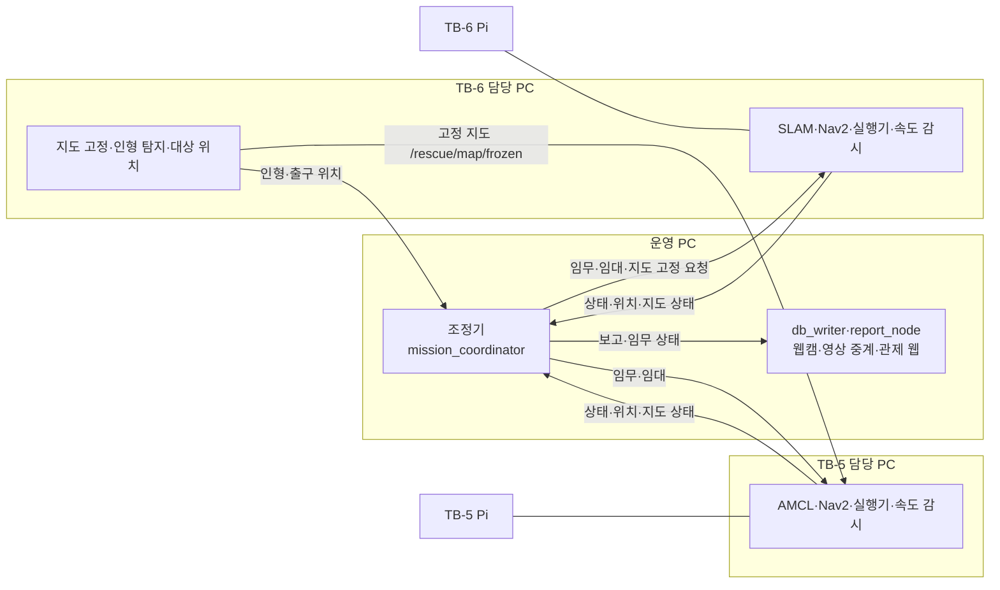

# 통합 구현 기록

## 한눈에 (2026-10-15, main `f6e56b6`)

이 문서가 답하는 질문은 하나다. **PC 세 대와 로봇 두 대는 무엇으로 이어져 있고, 그 연결은 로봇 없이 어디까지 확인했나?**



- PC 는 역할 이름으로 부른다. 운영 PC, TB-6 담당 PC, TB-5 담당 PC 다([용어집](../glossary.md)). 시험 중에는 두 로봇 담당 PC 를 한 PC 에서 돌리기도 한다.
- 조정기는 로봇 launch 를 띄운 PC 와 다른 PC 에서 띄워야 한다. 실행기가 같은 PC 의 조정기 시계를 거절한다(`LIVE_ROS expects two distinct PCs`, `rescue_robot/live_clock.py`).
- 노드 사이 메시지 계약은 [인터페이스 계약](../design/contracts.md), 임무 흐름은 [scope 「지금 시나리오」](../requirements/scope.md), 현장에서 띄우는 순서는 [현장 실행 안내](../process/field-runbook.md)에 있다.
- PC 세 대와 로봇 두 대를 처음부터 끝까지 이어 돌린 실기 회차는 없다(NOT_RUN). 로봇 없는 리허설만 했다.

## PC 별로 띄우는 것

| PC 역할(프로파일 호스트 id) | launch | 노드 |
| --- | --- | --- |
| 운영 PC(`operations` + `coordination`) | `operations.launch.py`, 관제 웹, `coordinator.launch.py` | `rescue_db_writer`, `rescue_report_node`, `mission_coordinator`. 인자를 줄 때만 `webcam_node`, `mjpeg_relay`, `rescue_map_snapshot` 등 |
| TB-6 담당 PC(`compute_a`) | `tb6_slam.launch.py`(탐색 중), `passage_points.launch.py`, `overhead_passage.launch.py`, `robot.launch.py`, `map_freeze.launch.py`, `amr_perception.launch.py`, 2차 고정 뒤 `frozen_localization.launch.py` | `/robot6` 아래 `slam_toolbox`, Nav2, `rescue_command_watchdog`, `rescue_command_adapter`, `passage_points`, `overhead_passage`. namespace 없이 `rescue_map_freeze`, `amr_target`, `target_locator`, `exit_locator` |
| TB-5 담당 PC(`compute_b`) | `passage_points.launch.py`, `overhead_passage.launch.py`, `frozen_localization.launch.py`, `robot.launch.py` | `/robot5` 아래 AMCL, `rescue_frozen_map_relay`, Nav2, `rescue_command_watchdog`, `rescue_command_adapter`, `passage_points`, `overhead_passage` |

launch 값은 세 곳에서만 온다. 배포 프로파일 v2.1(저장소 밖), [현장 파일](../../config/field/search_area.field.json), 현장에서 재는 launch 인자다. 변환 함수는 `src/rescue_bringup/rescue_bringup/field_launch.py` 에 모여 있고, launch 들은 arm·임무·이동 명령을 보내지 않는다.

## PC 사이 통신

| 항목 | 지금 | 근거 |
| --- | --- | --- |
| Discovery | 시험 중 권고안 A. 모든 PC 가 두 로봇 Pi 의 Discovery 서버를 둘 다 적는다 | [네트워크·Discovery Server](../design/network-discovery.md), 재범 2026-10-13 |
| 최종 구성 | 전용 Discovery 서버 PC. 로봇이 그 서버에 붙는 방법은 결정 대기 | 같은 문서 |
| 시계 | 각 PC 는 timesyncd 측정값으로 오차 상한을 계산한다(현장 파일 `live_inputs.clock_backend`, `task.live.clock_backend`). chrony 는 로봇 Pi 쪽이다. 로봇 Pi 오차는 현장 파일 `sensor_host_clock_error_bound_ns`(2026-10-13 측정 150 ms) | `rescue_contracts/clock_measurement.py`, [rescue_robot README](../../src/rescue_robot/README.md) |
| 이름 | 로봇 노드는 로봇 namespace 안에 있다. 공통 토픽은 `/rescue/...` 다 | [인터페이스 계약](../design/contracts.md) |

## 연결이 이어졌는지 보는 도구

| 도구 | 보는 것 | 보지 않는 것 |
| --- | --- | --- |
| `scripts/field/preflight_role.py` | PC 한 대의 패키지·현장 파일·지도·시계·Discovery 설정 | 다른 PC 와의 연결 |
| `scripts/field/wiring_check.py`(#296) | 연결마다 발행자 수, 구독자, 타입, QoS(전달 품질 설정. reliability, durability), 같은 이름 노드. 기대 연결표는 프로파일과 현장 파일로 코드에서 만든다 | 메시지 간격, TF 내용, 표에 없는 연결 |
| `scripts/field/link_check.py` | 로봇 토픽이 이 PC 에 오는 간격과 가장 긴 끊김 | 노드 이름 |

- `wiring_check.py` 종료 코드는 0 = 모두 PASSED, 2 = FAILED 있음, 3 = NOT_RUN 있음이다. 그래프를 못 읽으면 PASSED 가 아니라 NOT_RUN 이다.
- 이 도구만 `ROS_SUPER_CLIENT=True` 로 띄운다. Discovery 서버 아래의 보통 노드는 그래프 전체를 보지 못하기 때문이다.
- 실제 PC 에서는 아직 돌리지 않았다(NOT_RUN).

## 로봇 없는 리허설

| 리허설 | 층위 | 무엇이 진짜인가 | 결과 |
| --- | --- | --- | --- |
| 한 PC 배선 리허설(#299, 2026-10-14) | E3 | 이 저장소의 현장 노드 전부(실제 namespace `/robot6`·`/robot5`). Nav2·SLAM·AMCL·Pi·웹캠은 가짜 끝점 | 배선 61줄 모두 PASSED. 평면 TF 로 두 번 고정 10단계 PASSED. 임무 시작 5단계 PASSED. 현장 측정 TF 로는 지도 고정 실패를 재현했고, #291 수정 뒤 같은 리허설에서 10단계 PASSED. 첫 회차에서 #298 을 찾음. [기록](../evidence/rehearsal-2026-10-14-wiring-one-pc.md) |
| 조정 흐름 리허설 `tests/ros/e3_rehearsal_abc.py`(2026-10-13) | E3 | 조정기, `target_locator`, `db_writer`, `report_node`. 실행기·카메라·지도 고정은 가짜 | 공식 3회 모두 PASS 16 / FAIL 0. [기록](../evidence/rehearsal-2026-10-13-record.md) |
| 오프라인 데모 `rescue_bringup.offline_demo`(2026-10-08) | E2 | Python 코어만, 한 프로세스 | 14개 검사. ROS 없음. 아래 「기록」 |

한 PC 배선 리허설은 이렇게 돌린다. 현장 서버 주소를 지우고 `127.0.0.1:<포트>` 만 쓰며, 도메인은 10 이상이어야 한다.

```bash
bash scripts/field/wiring-rehearsal/run.sh <install> <결과 폴더> SEARCHING 11888 193
REHEARSAL_PROBE=freeze bash scripts/field/wiring-rehearsal/run.sh <install> <결과 폴더> FROZEN 11888 193
```

- 실행기 두 개에는 리허설에서만 `host_shim` 을 넣어 시계 측정의 host id 를 따로 준다. 한 PC 에서 「다른 PC」 검사를 지나가게 하려는 것이다. 현장 PC 에서는 쓰지 않는다.
- 끝낼 때는 프로세스 그룹마다 INT → TERM → KILL 을 보내고, Discovery 서버는 그 PID 로 끈다. 이름으로 넓게 잡아 끄지 않는다.
- 자세한 인자와 단계는 [rescue_bringup README](../../src/rescue_bringup/README.md) 「한 PC 배선 리허설」 절에 있다.

## 아직 확인하지 못한 것

- PC 세 대와 로봇 두 대로 `wiring_check.py` 를 돌린 결과. NOT_RUN.
- 진짜 Nav2·SLAM·AMCL·Pi 와의 QoS. 리허설의 가짜는 이름과 개수만 의미가 있다.
- 권고안 A 에서 TB-6 담당 PC 의 `/rescue/map/frozen` 을 TB-5 담당 PC 가 받는지 [추정, 실측 전].
- 최종 Discovery 구성(전용 서버 PC)으로 바꾼 뒤의 연결.

## 기록 (2026-10-08 판)

아래는 2026-10-08 판 본문을 그대로 옮긴 것이다. 당시에는 ROS 노드 없이 한 프로세스에서 Python 코어를 잇는 오프라인 데모만 있었다. 이 데모 코드와 시험은 지금도 main 에 있다. 지금 PC 사이 연결은 위 절을 본다.

### 오프라인 통합 리허설

PR 10은 PR 5~9의 순수 코어를 **하나의 Python 프로세스**에서 연결한다. 구성 파일은 예정된 고사양 PC 2대·중간 사양 PC 2대를 검증하지만, 해당 PC에 프로세스를 배포하거나 ROS를 실행하지 않는다. 사용한 실제 로봇은 0대이며 실제 모델 추론·SLAM·Nav2·주행·4-PC 통신과 AC 실기는 NOT_RUN이다. AMR 2대 필수 요구와 PC 4대 예정 자원/현재 배포 기준안의 구분은 [범위](../requirements/scope.md)를 따른다.

`src/rescue_bringup/rescue_bringup/offline_demo.py`의 `run_scenario(profile_path, output_directory)`는 summary dict를 반환한다. 모듈 CLI는 성공 0, 잘못된 프로파일/출력 경로 또는 리허설 실패 2를 반환한다. `load_deployment`로 프로파일을 먼저 검증하며, 이 합성 fixture는 논리 ID `robot_a`, `robot_b`만 지원한다. 다른 유효 ID를 입력해도 A/B 실행으로 조용히 대체하지 않는다. 프로파일의 네 호스트는 배치 데이터이며 실제 연결 대상이 아니다.

#### 실행

저장소 루트에서 Python 3.10 이상으로 실행한다. 이 경로에는 ROS·YOLO·GPU 패키지가 필요하지 않다.

```sh
export PYTHONPATH=src/rescue_bringup:src/rescue_robot:src/rescue_mapping:src/rescue_perception:src/rescue_coordination:src/rescue_operations:src/rescue_contracts
python3 -m unittest discover -s tests -p test_offline_demo.py -v
python3 -m rescue_bringup.offline_demo config/deployment.example.json --output work/offline-run-001
python3 -m rescue_operations work/offline-run-001/operations.sqlite3 --limit 100
```

출력 디렉터리는 반드시 새 경로여야 한다. 재실행은 `work/offline-run-002`처럼 다른 경로를 사용한다. 기존 디렉터리/파일을 지우거나 덮어쓰지 않는다. 중간 실패 뒤 생긴 디렉터리도 그대로 보존하며 다음 실행에 재사용하지 않는다. `summary.json`의 `passed`는 아래 E2 검사 통과만 뜻한다. DB 내 `PERSISTED`도 로컬 저장 완료이며 구조·접근 성공을 뜻하지 않는다.

#### 연결한 경로와 14개 검사

| 단계 | 합성 입력·연결 | 확인하는 것 |
| --- | --- | --- |
| 관측/위치 | 각각의 4×4 registered RGB-D 메타데이터, 2 m 깊이, 명시적 `TRACKING`·같은 local track 문자열 → perception | 원 관측 stamp·UUID·모델 manifest·증거 참조를 보존. 두 로봇은 별도 CANDIDATE 사건 |
| 공통 좌표 | optical XYZ → 관측 시각의 합성 3D transform → 로봇 map → mission | x/y/z 회전을 포함해 변환. 소스/세션/revision과 원 int64 ns를 실제 `MappingRegistry.project`에 전달. 원 epoch `1700000000123456789`가 보존되고 TF query에 1 ns를 더하면 `STALE_TRANSFORM` 거절 |
| 역할 교환 제안 | A 관측→B 후보, B 관측→A 후보 → coordination → mapping snapshot | target 위치와 이격한 접근 후보를 만들고 좌표를 검사. 두 역할 모두 제안되지만 `auto_approach_eligible=false`, `approach_command_sent=false` 유지 |
| 만료/보정 | A 관측의 만료 뒤 재발행, A의 map revision 증가 | 만료 재발행 거절. A 관측만 NEEDS_REOBSERVATION, B 관측은 VALID. A가 source 또는 destination인 두 목표는 모두 무효 |
| 수색 취소·인계 | 같은 executor의 SEARCH_AREA SEND **의도** → 발견 → CANCEL → terminal `CANCELED` → 합성 정지 샘플 → 재arm → 새 generation → 접근 admission | terminal만으로 결과가 완료되지 않음. 정지 후 실제 `TaskAdmission`을 `Allocator.record_admission`에 넘겨 pending→active. mapping 자동 허가가 false이므로 접근 SEND 없음 |
| 통로 | 합성 점유 lease 만료 | 물리 이탈 증거 없이 FREE로 바꾸지 않고 OCCUPANCY_UNKNOWN 유지 |
| 증거/보고 | 각 관측에 연결한 합성 PNG bytes → operations → outbox | bytes 저장 전 PENDING_EVIDENCE, 저장 뒤 PERSISTED. A 보고의 응답 유실 뒤 같은 ID로 재전송하고 두 DB를 다시 열어 보고 2개·상태·시도 횟수 확인 |

검사 이름과 결과는 `summary.json.checks`에 모두 저장된다. 14개 항목은 서로 다른 완료 조건이며 하나라도 false면 `passed=false`와 실패 종료가 된다. `synthetic_search`의 SEND·stop_confirmed는 외부로 발행한 명령이나 실제 정지 관측이 아니다. 값의 출처를 `SYNTHETIC_ACTION_AND_ODOMETRY`와 `real_command_sent=false`로 함께 남긴다. `synthetic_search`는 수색의 terminal 상태와 정지 결과, 수색/접근 admission, 배정 상태, 접근 dispatch 거절을 보존한다. 접근 작업은 admission을 받았어도 `GUARD_INVALID`의 STOPPING에서 끝나며 실제 접근 완료·해제까지 시연하지 않는다. 정지 관측과 재arm은 fixture가 공급한 입력이며 운영자의 실기 승인이나 장치 상태를 의미하지 않는다.

첫 제안의 좌표 유효성이 나중의 이동 권한을 보장하지 않는다. 이 데모는 실제 SLAM backend의 보정 이벤트를 검증하지 않았기 때문에 정상 기하에서도 자동 접근이 차단돼야 성공이다. 코드의 false를 true로 바꾸는 것은 실기 준비를 구현하거나 검증하는 방법이 아니다.

#### 저장 파일과 증거 의미

- `summary.json`: E2 표시, 실제 로봇 0·프로세스 1, 모델/ROS 실행 false, 실기 NOT_RUN, 프로파일 이름·SHA·검증된 배치 snapshot, 제안·보정·수색·보고 검사 결과.
- `operations.sqlite3`: 로컬 operations 보고 2개, report/payload hash/receipt와 관측별 생성 PNG bytes. WAL/SHM은 SQLite가 필요에 따라 만든다.
- `outbox.sqlite3`: 같은 두 보고의 송신 상태·receipt·시도 횟수. 응답을 한 번 잃은 첫 보고는 2회, 다른 보고는 1회 후 PERSISTED가 된다.

PNG는 코드가 만든 4×4 단색 타일이며 카메라 촬영·사람 사진·YOLO 결과가 아니다. 관측의 evidence UUID/SHA와 보고 ref를 연결하고 저장한 실제 bytes의 hash를 확인한다. 모델 manifest의 SHA도 합성 fixture 식별자이며 실제 모델 파일 해시를 주장하지 않는다. 이 데모의 `OPTIONAL` 증거 정책은 Q-07의 운영 사진 정책 결정이 아니다. 선언한 두 ref는 OPTIONAL이어도 실제 bytes가 있어야 보고가 완료된다.

보고는 UNCONFIRMED·NOT_ATTEMPTED이며 위치는 null이다. 지도 보정/미검증 backend 때문에 접근하지 못한 발견 기록을 보존한 결과다. `PERSISTED`를 `APPROACH_COMPLETE`나 물리적 구조 완료로 올리지 않는다.

관측 시각의 유일한 원본은 ROS 형식 `(sec=1700000000, nanosec=123456789)`이다. 공통 `ros_time_to_ns`로 정확히 `1700000000123456789`를 만들며 perception→source observation→관측 시각 TF query→실제 mapping 투영→보고/evidence까지 int64 ns 그대로 전달한다. 만료·발행·보고·정책 시각은 같은 원본에 정수 ns duration을 더해 파생한다. float epoch를 거치거나 같은 시각을 초/ns로 따로 적지 않는다. `received_steady`, action/정지 timer만 프로세스 로컬 초 단위다. ROS adapter는 여전히 미구현이며 원 sec/nanosec과 시각 의미를 이 경계로 가져오는 실제 연결은 E3에서 검증해야 한다. 내부 fixture 정책 `SYNTHETIC_NOT_LOCKED_FOR_RUN`의 거리·속도·시간 숫자를 장비 기본값으로 가져가지 않는다. `uid()`는 uuid5라 같은 라벨이면 반복된다. `GoalSnapshot.snapshot_id`는 실행마다 새로 나오는 uuid4라 summary.json의 그 필드는 실행마다 다르다.

#### 검증 범위와 후속

`tests/test_offline_demo.py`의 10개 시험은 두 역할·자동 허가 차단, A 관측만의 무효화와 모든 의존 목표 차단, 연결된 수색 취소/정지/새 generation/admission, epoch ns 보존과 1 ns TF 불일치 거절, 실제 evidence bytes/receipt 유실/reopen, 기존 출력 보존, 잘못된 프로파일, 다른 로봇 ID, 모듈 CLI를 확인한다. 구성 요소별 E2 시험은 각 PR의 테스트와 별도로 실행한다. 하나의 시나리오 PASS가 모든 계약·경로를 검증했다는 뜻은 아니다.

CT-06·CT-07은 **E2 부분 구현/검증**이다. 발견을 받은 수색 executor의 취소→terminal fence→정지 확인→같은 배정기가 발급한 새 generation→접근 admission→실제 receipt로 배정 승격까지 연결했다. 접근 SEND는 미검증 mapping backend gate 때문에 계속 차단한다. ROS cancel/result 전달, 실제 정지 관측, 접근 주행·현장 재확인, 통신 지연·재연결의 전체 사슬은 미구현/NOT_RUN이다. E2 일부 통과를 CT 전체 또는 E3/E4 통과로 표시하지 않는다.

이 리허설이 다루지 않는 경로:
- CT-08의 UNDOCK·준비 제어권.
- CT-09의 장애물·최소 거리 후보 거절.
- CT-03의 센서 정합. 여기의 alignment 근거는 `fixture-only`다.

실제 readiness/clock/TF/SLAM backend·ROS adapters·실시간 탐지·모델/센서 평가·최종 명령 감시·2 AMR 및 예정 4-PC 부하는 [현장 실행 관문](../process/field-runbook.md)에 남긴다. 해당 관문 전에는 `runtime_enabled=false`인 정적 프로파일을 실제 주행 launch라고 취급하지 않는다.

#### 고정 원본 근거

이 데모는 원본 실행 코드를 복사하지 않은 새 통합 fixture다. 과거 기록은 실패/시험 원리의 근거이며 이번 실행 결과가 아니다.

- [P4 가짜 두 로봇 관제 시험](https://github.com/jaebeom/ROKEY_P4/blob/1a2d0a9811f59a501c7597edf54c72fec8a80e26/src/rokey_sysmon/test/test_integration_fake_robots.py#L1-L52): 모의 사건·DB 확인과 실제 로봇 시험을 구분하는 참고.
- [P4 늦은 action 수락 시험](https://github.com/jaebeom/ROKEY_P4/blob/1a2d0a9811f59a501c7597edf54c72fec8a80e26/src/rokey_amr/test/test_goal_timer.py#L161-L176): 비동기 action 지연을 별도로 시험할 근거.
- [AMR 과거 관측 hold 재발행](https://github.com/mi1nn/amr-mini-project/blob/ee355d0b5896ea58bccac73ce1a7857f62e96024/src/rokey_pjt/rokey_pjt/webcam_detector.py#L145-L159): 수신·발행 시각이 원 관측을 새롭게 만들지 않는지 확인할 근거.

#### 설치 검증과 CI

공통 표준 Python 계약 `rescue_contracts`를 포함한 7개 패키지를 설치한다. 이는 ROSIDL 메시지 패키지가 아니다. 각 코어는 공유 오류·int64 ns·로봇 ID/admission 계약에 의존하며, bringup의 `offline` extra는 오프라인 통합 의존성을 선언한다. 오프라인 빌드는 setuptools·wheel이 이미 있는 Python으로 `python3 -I scripts/check_wheels.py`를 실행한다. 이 도구는 소스 복사본의 이름 집합이 일치하는 wheel 7개를 새 venv에 설치하고 `pip check`, source 경로 없는 격리 import, 소스 디렉터리가 존재하지 않는 tests/config 전용 checkout에서 비어 있지 않은 설치본 전체 시험을 실행한다. 모든 7개 모듈의 import 위치가 새 venv 안인지 확인한다.

[초기 로컬 증거](../evidence/pr10-local-validation.md)의 147개·6 wheels 기록은 당시 소스의 historical 증거로 보존한다. 최신 API를 연결한 시험 수·명령·소스/wheel 해시는 [round 2 통합 증거](../evidence/pr11-round2-validation.md)에 별도로 기록한다. CI에는 기존 3개 Python source matrix 외에 Python 3.12 설치본 검사를 추가했다. Actions 실행 전에는 새 job을 PASS로 표시하지 않는다.
