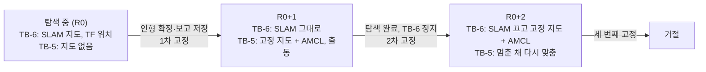

# 지도와 좌표 구현 기록

## 한눈에 (2026-10-15, main `f6e56b6`)

이 문서가 답하는 질문은 하나다. **기준 지도 없이 시작한 회차에서 두 로봇은 어떤 지도와 위치를 쓰고, 그 지도는 언제 어떻게 바뀌나?**

- 공통 좌표는 TB-6 SLAM(지도 작성과 위치 추정을 함께 하는 방법) 지도의 `map` frame 이다. 기준 지도는 주지 않는다(재범 결정 2026-10-13, scope Q-29 ⑦).
- 지도는 한 회차에 두 번 고정한다. 1차(R0+1)는 인형 발견 때, 2차(R0+2)는 탐색 완료 때다. 고정할 때마다 revision(지도 판 번호)이 하나 오른다.
- 미리 재는 좌표(TB-5 출발값, TB-6 도킹 접근 지점, 출구)는 모두 TB-6 출발 자세 기준이다.
- 로봇·PC 이름과 용어는 [용어집](../glossary.md)을 따른다. 값은 [현장 파일](../../config/field/search_area.field.json)과 배포 프로파일(저장소 밖)에 있다.
- 두 번 고정 흐름 전체의 실기는 NOT_RUN 이다. 2026-10-14 현장 회차에서는 TB-6 위치가 잡히지 않아 고정이 실패했다(아래 「알려진 실패」).

## 누가 무엇을 맡나

| 노드 | 어느 PC | 코드 | 맡은 일 |
| --- | --- | --- | --- |
| `slam_toolbox` | TB-6 담당 PC | `launch/tb6_slam.launch.py` | 탐색 중 TB-6 지도 `/robot6/map` 과 TF `map→odom` |
| 지도 고정 `rescue_map_freeze` | TB-6 담당 PC, 한 번만 | `rescue_robot/map_freeze.py`, `launch/map_freeze.launch.py` | `/rescue/map/freeze` 서비스를 받으면 TB-6 SLAM 지도를 저장하고 해시를 붙여 `/rescue/map/frozen` 과 짝 `/rescue/map/frozen_revision` 으로 낸다. TB-6 출발 자세도 남긴다 |
| 고정 지도 중계 `rescue_frozen_map_relay` | 각 로봇 담당 PC | `rescue_robot/frozen_map_relay.py`, `launch/frozen_localization.launch.py` | 자기 로봇 실행기가 받아들인 revision 의 고정 지도를 `<ns>/map` 으로 복사한다 |
| AMCL(고정 지도 위 위치 추정)·고정 지도 중계(`rescue_frozen_map_relay`) | 각 로봇 담당 PC | `launch/frozen_localization.launch.py` | 고정 지도 위 위치 추정. map_server 는 쓰지 않고 중계 노드가 `<ns>/map` 을 낸다. TB-5 는 처음부터, TB-6 는 2차 고정 뒤 |
| 실행기(지도·위치 입력) | 각 로봇 담당 PC | `rescue_robot/live_sources.py`, `slam_tf_pose.py`, `live_pose.py` | 지도가 고정 지도와 해시가 같을 때만 적재한다. 위치와 지도 상태(`RobotPose`·`MapState`)를 낸다 |
| 조정기 | 운영 PC | `rescue_coordination/ros_node.py`(`map_mode=SLAM_FREEZE`) | 1차·2차 고정 시점을 정하고 `/rescue/map/freeze` 를 부른다([조정기 구현 기록](implementation-coordination.md)) |

## 로봇별 지도 모드

실행기의 지도 모드는 현장 파일 `robots.<id>.task.saved_map.mode` 로 로봇마다 하나다. 모드 사이에 자동 전환이나 대체는 없다.

| 모드 | 로봇 | 고정 전(R0) | 1차 고정 뒤(R0+1) | 2차 고정 뒤(R0+2) |
| --- | --- | --- | --- | --- |
| `SLAM_THEN_FROZEN` | TB-6 | SLAM 지도. 위치는 TF `map→odom→base_link` | 그대로(SLAM, R0) | 자기 `<ns>/map` 이 R0+2 고정 지도와 해시가 같을 때만 적재. AMCL 위치만 인정. SLAM 으로 돌아가지 않음 |
| `FROZEN_MAP_AMCL` | TB-5 | 지도 없음, `MapState` `UNKNOWN` | R0+1 고정 지도 + AMCL(출발값은 TB-6 출발 자세 기준) | 멈춰 있고 작업이 없을 때 R0+2 로 다시 맞춤(`MAP_REALIGN`) |
| `SAVED_MAP_AMCL` | 로봇 없는 시험 | 저장 지도(측정 해시) + AMCL | 고정 지도 무시 | 같음 |

- 더 높은 revision 은 작업이 없고 odom 이 `STOPPED` 일 때만 받는다(`MAP_REVISION_ADOPTED`). 움직이는 중이면 `MAP_REVISION_DEFERRED <이유>` 를 남기고, 멈추면 그때 받는다. 기다리는 동안 새 목표는 `FRAME_REVISION_MISMATCH` 로 거절한다.
- 해시가 다른 지도가 `<ns>/map` 에 오면 적재하지 않는다(`map is not the frozen map`). 이미 아는 revision 에 다른 지도가 오면 지도를 막는다. 새 회차가 필요하다.
- 두 고정 모드는 지도 해시 파라미터 `task.saved_map.occupancy_sha256` 를 빈 문자열로 받는다. 고정이 해시를 정하기 때문이다. 이전에는 빈 문자열을 「값 없음」으로 보고 실행기가 시작하자마자 꺼졌다(한 PC 리허설에서 발견, #298 에서 고침).
- 규칙의 자세한 목록은 [rescue_robot README](../../src/rescue_robot/README.md) 「지도 수명 주기」 절에 있다. 고정 지도와 짝 토픽의 계약은 [인터페이스 계약](../design/contracts.md) C-04a 다.

## TB-6 위치

탐색 중 TB-6 위치는 TF(좌표 변환) 로 만든다(#253 실행기, #255 지도 고정 노드).

| 항목 | 지금 코드 | 이유 |
| --- | --- | --- |
| 위치 | TF `map→odom`(slam_toolbox) 과 `odom→base_link`(Create 3) 를 합친 값. 실행기 poll 주기와 지도 고정 노드 0.2 s 마다 읽는다 | slam_toolbox 는 처리한 스캔마다만 `/robot6/pose` 를 낸다. 서 있는 TB-6 은 새 값이 없다 [추정] |
| 시각 | 두 edge 중 오래된 쪽 | 멈춘 edge 가 위치를 새것으로 보이게 하지 않으려는 것 |
| 공분산 | 마지막 `/robot6/pose` 값. 현장 파일 `slam_covariance_max_age_ns`(30 s [제안])보다 오래되면 위치는 무효 | TF 에는 공분산이 없다 |
| TF 모양 | 두 edge 를 3D(위치, 단위 쿼터니언)로 합성한 뒤 지도 평면의 x, y, 방향으로 내린다. 숫자가 아니거나 단위 회전이 아닌 edge 는 버린다. 합성한 기울기가 10도(`MAX_TILT_RAD`, [제안])를 넘으면 위치를 만들지 않는다(#291) | `rescue_robot/slam_tf_pose.py` |

코드는 `rescue_robot/slam_tf_pose.py:SlamTfPose`, `live_sources.py:attach_slam_tf_pose`, `map_freeze.py` 다.

## TB-6 출발 자세와 미리 재는 좌표

- SLAM 지도 원점은 Create 3 odom 원점이다. 바닥 표시 출발 자리와 다를 수 있다 [추정].
- 그래서 지도 고정 노드는 시작 뒤 처음 받은 유효한 TB-6 위치를 회차마다 한 번 남긴다. 파일은 `output_dir/start_pose.json`, 토픽은 `/rescue/map/start_pose/robot_a`(TRANSIENT_LOCAL)다.
- 지도 고정 노드는 TB-6 이 움직이기 전에 띄운다. 다시 띄우면 저장한 값을 다시 낸다. 새 회차는 새 `output_dir` 로 띄운다.
- TB-5 출발값 `robots.robot_b.initial_pose_xy_yaw` 는 이 출발 자세 기준으로 잰다. 재는 도구는 `scripts/field/capture_initial_pose.py` 다. 2026-10-14 두 로봇 출발 간격은 1.95 m(가로)·0.05 m(세로)였다 [측정, 재범 줄자, 둘 다 도킹 상태].

## 좌표 변환 라이브러리 `rescue_mapping`

| 부분 | 지금 쓰나 |
| --- | --- |
| 3D 강체 변환·지도→임무 정렬(`RigidTransform`·`FrameAlignment`) | 씀. 실행기 `task_site_runtime.py`, 인식 `map_projection.py`·`target_location.py`·`recheck.py` |
| 관측 보존·목표 snapshot 검사(`MappingRegistry`) | 현장 경로에서는 안 씀. 합성 리허설 `rescue_bringup/offline_demo.py` 만 |
| `auto_approach_eligible` | 항상 `False`. TB-5 자동 접근은 이 값이 아니라 로봇별 정책 `task.live.auto_target.*` 으로 받는다 |

이 패키지 코드는 2026-10-08 뒤로 바뀌지 않았다. API 설명은 아래 「기록」 절과 [rescue_mapping README](../../src/rescue_mapping/README.md)에 있다.

## 알려진 실패 (2026-10-14 현장)

- TB-6 의 실제 TF 는 높이와 roll·pitch 가 정확히 0 이 아니었다(roll·pitch 약 0.5°, 높이 수 mm). 당시 코드는 평면이 아닌 edge 를 모두 버렸다(`planar_origin` 검사).
- 그래서 TB-6 `MapState` 가 `UNKNOWN` 이고 출발 자세가 남지 않았으며, 지도 고정이 `no TB-6 start pose recorded` 로 실패했다.
- 한 PC 리허설에서 같은 TF 값을 넣어 같은 실패를 재현했다([리허설 기록](../evidence/rehearsal-2026-10-14-wiring-one-pc.md) 9·10회차).
- #291 이 고쳤다(위 「TF 모양」). 같은 리허설에서 현장 TF 값으로 지도 고정 10단계가 통과했다. 실기는 NOT_RUN 이다.

## 시험

| 층위 | 무엇 | 명령 또는 기록 |
| --- | --- | --- |
| E2 로봇 없이 | 고정·중계·모드별 지도 적재·revision 규칙·TF 위치 | `python3 -I scripts/run_tests.py` |
| E3 한 PC 리허설 | 실제 노드로 1차·2차 고정, TB-6 SLAM 끄기, 중계와 두 `MapState` | `REHEARSAL_PROBE=freeze bash scripts/field/wiring-rehearsal/run.sh ...`. 평면 TF 10단계 PASSED, 현장 측정 TF 10단계 FAILED(현장 재현) |
| E4 실기 | 두 번 고정 흐름 전체 | NOT_RUN. 2026-10-14 실패, #291 이 고침(실기 확인 전) |

## 기록 (2026-10-08 판)

아래는 2026-10-08 판 본문을 그대로 옮긴 것이다. 당시에는 `rescue_mapping` 라이브러리만 있었다. 지금 현장 지도 흐름은 위 절을 본다.

### 좌표·관측·revision 순수 로직 구현

`rescue_mapping`에 카메라 광학 frame의 3D 점→로봇 native map→공통 mission 변환과 관측·지도 버전 검사를 추가했다. 이는 [계약 C-04·05](../design/contracts.md) 및 [CT-04·05](../process/acceptance-plan.md)의 **E2 합성 입력 검증**이다. PR 5의 두 로봇 SLAM·Nav2나 실제 TF/backend가 없으므로 PR 6의 실제 인수 전체를 완료한 것은 아니다.

#### 구현된 범위

| 책임 | 구현 |
| --- | --- |
| 3D 기하 | translation xyz + quaternion xyzw, source→target 방향, 역변환. planar map 정렬도 같은 3D 표현 사용 |
| 관측 보존 | frozen 원 ID·camera/robot/boot·sensor frame/point·원 observed_at/valid_until·clock·map 참조. 입력 list는 tuple로 복사, 같은 ID의 다른 의미 거절 |
| 시각·TF | 원 관측과 정확히 같은 query stamp 요구. EXACT 표본 또는 명시적인 검증 보간 구간만 입력. 최신 TF fallback 없음 |
| 로봇 격리 | `source_robot + native_frame`으로 TF/지도 비교. 두 로봇의 접두 없는 `map`/카메라 이름도 서로 섞이지 않음 |
| 정렬 | 단일 authority, source/destination frame, clock domain, session/map/transform revision, 유효 기간·오차·status 검사 |
| 보정·재시작 | 로봇별 영향 관측과 의존 목표 snapshot 목록 반환. A 보정으로 B 원 관측/파생 위치를 변경하지 않음 |
| provenance | Projection마다 불변 원 관측, 실제 사용한 TimedTransform/FrameAlignment, source별 CoordinateVersion을 함께 보존. 혼합 목표도 관측별 참조 tuple 유지 |
| 목표 재검사 | snapshot 생성 뒤 source 또는 destination 버전이 바뀌면 거절. 변조된/다른 registry의 snapshot도 거절 |

`map_update_sequence`는 지도 셀 갱신 번호이고 `map_revision`은 좌표 의미를 바꾸는 보정 번호다. `transform_revision`은 map→mission 정렬의 변경이다. 세 값을 혼용하지 않는다. 이전 세션 ID는 폐기 후 다시 사용할 수 없으며 동일 revision의 다른 정렬 payload도 거절한다.

관측·sensor boot·map session ID는 canonical nonzero UUID 문자열이며 map/transform revision과 map update sequence는 uint64 범위를 검사한다. quaternion은 유한 nonzero 값만 받고 최대 성분으로 먼저 크기를 조정한 뒤 정규화하여 subnormal/큰 유한 입력에서도 단위 회전을 유지한다.

`Projection.status='VALID'`와 `GoalValidation.coordinates_valid=True`는 제공된 입력의 일관성만 나타낸다. **Projection·GoalSnapshot·GoalValidation의 `auto_approach_eligible`은 항상 False이고, 정상 결과에도 `BACKEND_NOT_INTEGRATED`를 명시한다.** 실제 보정 감지를 검증하지 않고 이 플래그를 켜는 API는 없다.

#### 입력 어댑터가 나중에 증명해야 할 것

`SourceObservation`의 map session/revision은 원 관측을 해당 시각의 TF와 연결할 때 확정한 참조다. 도착한 메시지에 현재 registry 번호를 붙이는 방식은 허용되지 않는다. `TimedTransform`의 `evidence_id`·보간 구간은 입력 adapter가 제공한 주장이고 이 모듈이 실제 TF buffer를 읽어 증명한 값이 아니다. `INTERPOLATED_VALIDATED` 입력은 이미 검증된 TF 조회 결과를 표현할 뿐 여기서 시간 보간을 수행하지 않는다. 입력의 clock 동기화·센서 stamp 의미 역시 실제 장비에서 확인해야 한다.

모든 `now_ns`는 하나의 clock domain에서 비교한다. 원 관측의 0/future/expiry와 정렬 기간을 검사하며, registry가 관측한 현재 시각이 뒤로 가면 `CLOCK_RESET_REQUIRED`를 latch한다. 시계 복구 후 새 registry와 세션/정렬 확인이 필요하다. 이 처리는 로봇 정지 실행을 대체하지 않는다.

지도 보정 뒤 과거 관측을 최신 `map→odom` 차이로 고치지 않는다. 해당 원 관측의 map 참조가 달라졌으면 `NEEDS_REOBSERVATION`이다. 이 단계에는 graph node와 관측을 연결하는 재투영 backend가 없다. 유효한 map→mission 정렬만 변경되고 원 map revision은 같으면 기존 파생 위치는 `STALE_DERIVATION`으로 구분한다. 지도 세션/보정 변경 또는 정렬 무효화는 `NEEDS_REOBSERVATION`이다. `STALE_DERIVATION` 뒤 보정/무효화가 발생하면 재관측 상태로 승격하며 기존 goal은 계속 무효다. 정렬만 바뀐 경우에는 최초 sensor-time TF를 보존한 채 새 파생 위치를 계산할 수 있다. 파생 위치 기록의 이전 값도 남긴다.

#### API와 후속 연동

`MappingRegistry(clock_domain_id=..., alignment_authority=..., max_position_error_m=..., max_rotation_error_rad=...)` 생성 후 다음을 사용한다. Python import 경로는 `rescue_mapping`이며 실제 `.msg`/`.action` 계약을 대신하지 않는다.

| API | 결과/실패 의미 |
| --- | --- |
| `start_session(robot, map_frame, session)` | 새 MapState 및 영향 Invalidation; retired session 재사용 거절 |
| `advance_map_revision(robot, session, revision)` | 수동/어댑터 보정 입력, 영향 원본은 보존하고 파생 위치·goal 무효화 |
| `record_map_update(robot, session, sequence)` | 점유 지도 내용 갱신 순서. 좌표 보정 없음 |
| `set_alignment(alignment)` / `invalidate_alignment(robot, reason)` | 정렬 메타데이터 갱신 또는 무효화, 영향 ID 목록 |
| `retain_observation(raw)` / `original(id)` | 파생 변환 성공과 독립적인 원 관측 보존·조회 |
| `project(raw, tf, now_ns=...)` | Projection. TF가 없거나 stamp/frame/version이 다르면 MappingError |
| `projection(id, now_ns=...)` / `projection_history(id)` | 현재 유효성 평가 / 변경 이력의 불변 tuple |
| `capture_goal_snapshot(ids, destination_robot, mission_point_xyz, now_ns=...)` | 모든 source version과 destination version을 가진 E2 후보. mission 점을 대상 로봇 map으로 역변환 |
| `validate_goal_snapshot(snapshot, now_ns=...)` | coordinates_valid·reasons. 자동 접근 자격은 별도이며 항상 False |

실행기는 임무 수락 때와 실제 goal 발행 직전에 snapshot을 다시 검사해야 한다. `_lock`은 이 registry 프로세스 내부의 연산을 직렬화한다. 두 PC 사이의 검사 직후 보정과 발행의 경합, 명령 lease, task generation, 취소·물리 정지·새 generation 재개는 아직 구현하지 않았다. `Invalidation`을 돌려주는 것만으로 취소나 정지했다고 기록하지 않는다. snapshot의 좌표는 후보이며 footprint/costmap/경로·사람 재확인 판단도 별도 기능이다.

#### 재사용 출처와 시험 근거

이 코드는 새로 작성했으며 원본 코드·라이선스 미확정 구현을 복사하지 않았다. P4 [target_locator.py](https://github.com/jaebeom/ROKEY_P4/blob/1a2d0a9811f59a501c7597edf54c72fec8a80e26/src/rokey_amr/rokey_amr/target_locator.py#L74-L107)의 관측 시각 TF 조회·실패 처리 원리와 [geometry 시험](https://github.com/jaebeom/ROKEY_P4/blob/1a2d0a9811f59a501c7597edf54c72fec8a80e26/src/rokey_amr/test/test_geometry.py#L43-L96)을 참고했다. 원본의 단일 map/AMCL 준비 조건이나 과거 threshold는 승계하지 않았다.

`tests/test_mapping.py`는 합성 광학 좌표의 3D 회전·이동, planar 정렬·역변환, 두 로봇의 같은 native frame 격리, 원 관측 불변/ID 충돌, observation-time TF, 명시적 보간 근거, clock/expiry, map 재시작·보정·정렬 변경, 혼합 사건 provenance와 목표 수락 후 revision 변경을 검사한다. 정상 기하에서도 자동 접근 자격이 False인지 확인한다. 시험 수치·좌표·시간은 fixture이며 운용 임계값 제안이 아니다.

Python 3.12.14에서 wheel을 만들고 별도 venv에 네트워크 없이 설치한 뒤, 소스 PYTHONPATH를 사용하지 않는 격리 import 및 30개 unittest가 통과했다. 이는 Python 패키징과 합성 E2 로직 검증이며 ROS/`colcon`·SLAM backend·실기 검증은 아니다.

미구현: 실제 TF 조회·시각 동기화, SLAM 보정 이벤트/posegraph node 연계, 기준점으로 정렬 추정/오차 실측, 센서 depth 품질/공분산 전파, ROS transport/메시지, persistent DB·bounded retention, 실제 목표/취소/정지/재개, 두 AMR·실제 PC 배치 검증. registry는 메모리 수명이므로 재기동 시 snapshot이 복원되지 않으며 원 관측/기록의 영속화는 별도다. 무제한 장기 runtime에 배치하지 않는다.

#### 검토 수정: 상태와 공통 오류

`tests/test_review_mapping.py`는 정렬만 바뀐 파생 위치, 그 뒤 map/session/정렬 무효화, 방어적인 VERSION_MISMATCH 분기와 C-09 오류 envelope를 검사한다. `MappingError.code`는 `rescue_contracts` 공통 분류이며 `detail_code`는 `rescue_mapping.<원 세부 코드>`다. 예를 들어 관측 만료는 `STALE_OBSERVATION`/`rescue_mapping.OBSERVATION_EXPIRED`, TF 시각 불일치는 `STALE_TRANSFORM`/`rescue_mapping.TF_TIME_MISMATCH`다. 원인 분류표는 패키지마다 복제하지 않는다. 이는 기존 기록의 시험 수나 source hash를 바꾼다는 뜻이 아니다.
