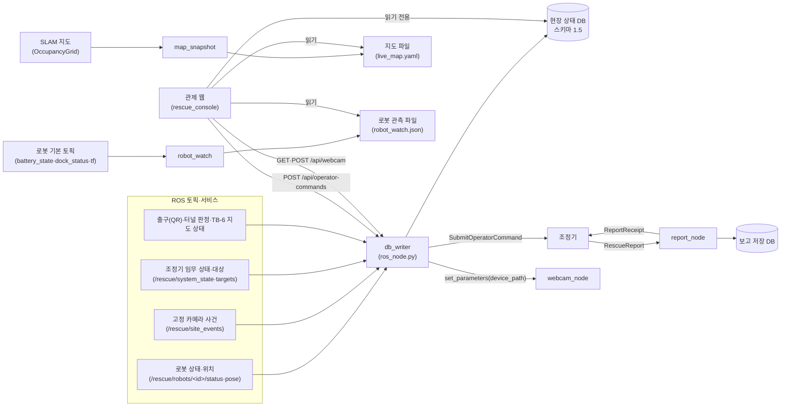

# 운영(operations) 구현

## 한눈에 (2026-10-14, main 3278a3e)

이 문서가 답하는 질문은 「운영 PC 의 `rescue_operations` 노드가 무엇을 받아 어디에 쓰고, 관제 웹은 이 DB 를 어떻게 읽는가」다.



### 지금 구조

| 노드 (실행 이름) | 받는 것 | 쓰는 것 | 띄우는 조건 (`operations.launch.py`) |
| --- | --- | --- | --- |
| DB 기록 (`db_writer`, `ros_node.py`) | 로봇 상태·위치, 고정 카메라 사건, 조정기 `SystemState`·`TargetSnapshot`, 출구(QR) `TargetLocation`, 로봇별 터널 판정(JSON), TB-6 `MapState`. 같은 프로세스가 HTTP API(`127.0.0.1`)를 연다 | 현장 상태 DB(유일한 쓰기 프로세스) | 늘 |
| 보고 저장 (`report_node`) | 조정기 `RescueReport`(`/rescue/reports`) | 보고 저장 DB(현장 상태 DB 와 다른 파일), `ReportReceipt`(`/rescue/report_receipts`) | 늘 |
| 지도 파일 (`map_snapshot`) | SLAM 지도(`map_topic`, 예: `/robot6/map`) | 관제 웹 `--live-map` 이 읽는 지도 파일 | 인자 `map_topic`·`map_dir` |
| 로봇 관측 (`robot_watch`) | `<ns>/battery_state`·`dock_status`·`tf`·`tf_static`(구독만) | 관제 웹 `--robot-watch` 가 읽는 파일 | 인자 `robot_namespaces`·`robot_watch_path` |

| HTTP 경로 | 하는 일 | 코드 |
| --- | --- | --- |
| `POST /api/operator-commands` | 운영자 명령 6종(`START_SEARCH`·`DISPATCH_SUPPORT`·`CONTINUE_SEGMENT`·`REQUEST_RECHECK`·`RETURN_HOME`·`SET_CAMERA_WATCH`)을 조정기로 넘기고 답을 기록 | `command_api.py:CommandGate` |
| `GET /api/webcam` | 운영 PC 에 꽂힌 카메라 목록과 지금 장치 | `command_api.py:WebcamSwitch.state` |
| `POST /api/webcam` | 웹캠 장치 바꾸기. 꽂히지 않은 장치는 거절, 결과는 `error_log` | `command_api.py:WebcamSwitch.switch` |

표마다 누가 쓰고 누가 읽는지는 [DB 스키마](../design/db-schema.md) 「한눈에」에 있다.

### 아래 기록과 달라진 점

| 기록의 설명 | 지금 (2026-10-14) |
| --- | --- |
| 현장 상태 DB `schema=1.2`, 읽기 함수는 1.1 파일만 받음 | 스키마 1.5(2026-10-15). 1.0 ~ 1.4 파일은 새 `db_writer` 가 열 때 1.5 로 올린다. 그 전까지 읽기 함수는 거절하고 관제 웹은 503 응답을 낸다 |
| 회차마다 새 DB 경로로 띄움 | 한 DB 안에서 회차(`runs`, `run_id`)로 나눈다. 화면용 읽기 함수는 열린 회차의 쌓이는 행만 준다. 리플레이 읽기 함수는 아래 표 끝에 있다([db-schema](../design/db-schema.md) 4-1절) |
| 받는 명령 다섯 종 | 여섯 종(`SET_CAMERA_WATCH` 포함, `command_api.py:COMMAND_FIELDS`) |
| 「지도는 아직 받지 않는다」 | `map_snapshot` 노드가 SLAM 지도를 파일로 쓴다(#209). `db_writer` 는 TB-6 지도 revision(`MapState`)만 받는다 |
| `report_node` 를 launch 에 넣기는 NOT_RUN | `operations.launch.py` 가 늘 띄운다 |
| 로봇 이름 AMR1·AMR2 | TB-6·TB-5 |
| HTTP 경로는 명령 하나 | 명령, 웹캠 고르기(#257), 초기화(`POST /api/runs/reset`, 2026-10-15) 셋 |

실기(로봇 망에서 실제 로봇과 함께)는 대부분 NOT_RUN 이다. 2026-10-13 에 운영 PC 에서 시험용 TB-5 SLAM 지도, TB-5·TB-6 직접 관측, 웹캠 2대 전환을 측정했다(관제 웹 README 「현재 상태」).

### 초기화 (2026-10-15)

관제 웹의 초기화 버튼은 `POST /api/runs/reset` 으로 온다. 범위는 (나) TB-6 SLAM 지도와 지도 고정까지 처음으로 되돌리기이고, 지난 기록은 회차별로 남긴다(재범 결정 2026-10-15). 지금 코드에는 조정기·지도 고정·relay·실행기 어느 것도 프로세스를 끄지 않고 비우는 방법이 없다. 그래서 첫 판은 운영 쪽 회차만 이 API 가 넘기고, 로봇 쪽은 사람이 다시 띄운다. 원격 재기동과 조정기 안 reset 명령은 동결 뒤로 미뤘다(작전 2026-10-15).

- **어느 프로세스가 회차를 바꾸나.** API 는 `db_writer` 와 같은 프로세스에서 돌고, 그 프로세스의 하나뿐인 `SiteStateLedger` 로 `reset_run` 을 부른다. 회차 ID 는 객체 메모리에 두지 않고 쓸 때마다 DB 의 `runs` 에서 읽는다. 그래서 다른 연결이 회차를 닫거나 열어도 다음 행은 DB 의 열린 회차로 들어간다(머지 담당 지적, `tests/test_operations_run_reset.py` `OtherProcessTests`).
- **거절.** 배치 로봇 둘 중 하나라도 아래에 걸리면 처음 걸린 이유로 거절하고 `operator_commands` 에 남긴다. 다른 것은 바꾸지 않는다.

| 순서 | 이유 코드 | 조건 |
| --- | --- | --- |
| 1 | `ROBOT_STATUS_STALE` | 상태가 없거나 받은 지 5초가 넘음 [제안, 관제 웹 로봇 카드와 같은 값] |
| 2 | `ROBOT_MOVING` | `motion_state` 가 `STOPPED` 가 아님(`STOP_UNCONFIRMED` 포함) |
| 3 | `TASK_ACTIVE` | `active_task_id` 가 있음 |
| 4 | `ROBOT_NOT_DOCKED` | `dock_state` 가 `DOCKED` 가 아님(모름 포함) |

- **받으면 한 트랜잭션에서.** 초기화 명령 행을 닫는 회차에 쓰고, 두 로봇의 지금 상태를 그 회차 이력에 한 줄씩 남기고(재기동 확인의 「전」 값), 회차를 닫고, 지금 값만 담는 표(`target_states`, `mission_state`, `current_map`, 터널 목록 두 표)를 비우고, 새 회차를 연다. `robot_status` 는 비우지 않는다. 새 회차에는 마지막으로 들은 조정기 boot 를 `previous_coordinator_boot_id` 로 적고, 그 boot 의 `SystemState`·`TargetSnapshot` 은 새 회차에 기록하지 않는다(`error_log` 에 `PREVIOUS_RUN_SOURCE` 로 boot 마다 한 번).
- **답.** 운영자 명령과 같은 모양(`accepted`, `request_id`, `reason`, `request_state`, `created_task_id`)에 `run_id` 를 더한다. 같은 `command_id` 를 다시 보내면 처음 답을 `DUPLICATE` 로 돌려주고 다시 초기화하지 않는다. DB 가 실패하면 503 이고 `accepted` 가 없다.
- **재기동 확인.** `read_reset_checklist` 가 DB 로 볼 수 있는 것만 준다. 조정기는 새 회차에 임무 상태가 기록되면 다시 뜬 것이다. 로봇은 실행기 boot 가 초기화 때와 다르면 그 로봇의 `robot.launch` 가 다시 뜬 것이다. SLAM, 지도 고정, relay, AMCL, 출발 정렬은 이 DB 에 흔적이 없어 사람이 확인하는 칸이다.

PC 별 재기동 순서. 로봇 담당 PC 한 대가 두 로봇을 맡고 조정기는 운영 PC 에 있는 배치다(재범 결정 2026-10-15, [현장 실행 안내](../process/field-runbook.md)). 런북의 자세한 절차는 통합-로봇이 고친다.

| 순서 | PC | 할 일 | 확인 |
| --- | --- | --- | --- |
| 1 | 운영 PC | 두 로봇이 도킹·정지·임무 없음일 때 관제 웹에서 초기화를 누른다 | 답 `accepted=true`, 새 `run_id` |
| 2 | 운영 PC | 조정기 launch 를 끈다. 운영 launch(`db_writer`·`report_node`)와 관제 웹은 그대로 둔다 | — |
| 3 | 로봇 담당 PC | 두 로봇의 launch 를 모두 끈다(SLAM, 지도 고정, 고정 지도 relay·AMCL, 출발 정렬, 실행기, 깊이 점, 터널 판정) | 사람 확인 |
| 4 | 운영 PC | 조정기를 다시 띄운다 | 자동(`coordinator_restarted`) |
| 5 | 로봇 담당 PC | 런북 4단계. 로봇 감독이 TB-6 을 언도킹하고 출발 표시에 둔다. **도킹한 채로 지도 고정 노드를 띄우지 않는다.** 출발 자세는 언도킹한 자리에서 잡아야 TB-5 출발값과 맞는다. 그다음 SLAM, 실행기, 지도 고정(**새 `output_dir`**) 순으로 띄운다 | 사람 확인(출발 표시) + 자동(TB-6 실행기 boot) |
| 6 | 로봇 담당 PC | 런북 5단계. TB-5 를 언도킹하고 고정 지도 위치 추정·출발 정렬·실행기를 띄운다 | 자동(TB-5 실행기 boot) |

조정기와 두 실행기는 함께 다시 띄워야 한다. 실행기는 이미 받은 것 이하의 임무 번호를 `STALE_GENERATION` 으로 거절한다(`rescue_robot/executor.py`). 두 relay 와 두 실행기를 다시 띄우지 않으면 새 회차의 R0+1 이 앞 회차와 다른 지도라 `MAP_RELAY_BLOCKED` 로 막힌다(`rescue_robot/frozen_map_relay.py`).

## 기록 (2026-10-08 ~ 2026-10-13)

아래는 각 단계에서 쓴 구현 기록이다. 그때의 설명을 그대로 두었다. 지금과 다른 곳은 위 「아래 기록과 달라진 점」을 본다.

### PR 9 로컬 관제 보고·증거 저장·outbox 구현 (2026-10-08)

#### 목적과 완료 범위

보고를 받았다는 사실을 영속 보고 완료와 구분한다. 동일 report_id 재전송, ops 재시작, 업로드 실패, DB 쓰기 실패, 저장 뒤 receipt 유실을 처리하는 새 Python 표준 라이브러리 구현이다. [계약 C-02·C-05·C-08](../design/contracts.md)과 [시험 CT-12](../process/acceptance-plan.md)를 로컬 SQLite로 연결한다. 원본 실행 코드·사진·모델을 복사하지 않았다.

이번 구현의 `PERSISTED`는 **operations DB의 보고와 선택한 증거 정책이 로컬 transaction으로 저장됨**이다. 송신 측은 해당 ID와 payload 해시의 PERSISTED receipt를 받아 자기 outbox에도 기록한 뒤 재전송 대상에서 제외한다. ROS/DDS 전달, 실제 센서 관측, 로봇 정지, 4-PC 배포, 사진의 진위·영상 디코딩, 시스템 전원 손실 내구성은 이 로컬 시험으로 입증하지 않는다.

공개 네트워크 서버는 추가하지 않았다. `ReportTransport` Protocol과 `LedgerTransport` callable이 API 경계를 제공한다. 원격 어댑터는 인증·전송 크기 상한·연결 및 응답 timeout을 구현하고 아래 고정 스키마와 receipt 검증을 유지해야 한다. 어댑터 호출 1회가 끝나지 않는 경우를 로컬 outbox가 강제로 중단하지는 않는다.

### 파일과 책임

| 파일 | 책임 |
| --- | --- |
| `src/rescue_operations/rescue_operations/schema.py` | 고정 report/envelope/evidence 스키마와 입력 상한·시각·ID 검증, 의미 payload 정규화 해시 |
| `src/rescue_operations/rescue_operations/ledger.py` | operations 단독 소유 SQLite, 증거 bytes, receipt 전이, 송신 측 별도 outbox, typed callable, 로컬 읽기 snapshot |
| `src/rescue_operations/rescue_operations/__main__.py` | 기존 DB를 읽기 전용으로 열어 JSON 내보내기. 성공 0, 입력·저장소 오류 2 |
| `tests/test_operations.py` | 재시작, 실제 DB rollback, 증거 실패, receipt 유실·역순·잘못된 ID, 중복·동시 요청, CLI 오류 |

### 스키마 1.0

미선언 필드는 거절한다. `schema_version`은 현재 정확히 `1.0`만 허용하며 minor 확장을 암묵적으로 수용하지 않는다. ID는 소문자 표준 UUID 문자열, generation/revision/sequence는 bool을 제외한 uint64다. wall timestamp는 양수 uint64 **ns**다. 좌표는 유한한 m 값이고 정규화 시 float로 변환한다. NaN/Inf·누락 ID·잘못된 UUID·음수/0 timestamp·역순 시각을 거절한다. 출력 저장 시각은 operations 호스트의 `time.time_ns()`이며 다른 호스트 시계 동기화의 증거가 아니다.

#### 의미 payload: 모든 필드가 해시에 포함됨

| 필드 | 형식과 의미 |
| --- | --- |
| `schema_version`, `report_id`, `target_id` | `1.0`, 불변 보고 ID, 사건 ID |
| `observation_id`, `source_robot`, `source_camera`, `source_boot_id` | 원 발견 관측 ID, 프로파일 식별자 형식의 로봇 ID, 원 카메라 이름, 원 센서/관측 생성 프로세스 UUID. 중계 publisher로 덮어쓰지 않음 |
| `clock_domain_id` | 보존하는 관측의 시간 기준 이름. 이 이름 자체로 동기화·최신성을 승인하지 않음 |
| `robot_id`, `task_id`, `generation` | 수행 로봇, 임무 ID와 세대. 원 발견 로봇과 다를 수 있음 |
| `observation_result` | `DETECTED`만 지원 |
| `confirmation_result` | `CONFIRMED` 또는 `UNCONFIRMED` |
| `confirmation_observation_id`, `confirmed_at_ns` | CONFIRMED이면 원 발견과 다른 관측 UUID와 시각. UNCONFIRMED이면 둘 다 null |
| `approach_result` | `APPROACH_COMPLETE`, `UNREACHABLE`, `FAILED`, `CANCELED`, `NOT_ATTEMPTED`. 의료·물리적 구조 결과 없음 |
| `position` | null 또는 아래 위치 객체. APPROACH_COMPLETE이면 위치와 CONFIRMED가 필수 |
| `observed_at_ns`, `reported_at_ns` | 원 발견과 최초 보고 생성 시각. `observed <= confirmed <= reported`; 재전송 때 바꾸지 않음 |
| `reason` | 1 ~ 1024자. 관측한 결과·실패 사유 |
| `evidence_refs` | 아래 증거 객체 최대 8개. evidence_id 중복 금지 |
| `model_id`, `model_sha256`, `deployment_version` | 모델 식별자·소문자 SHA-256과 배포 버전. 다른 source 의미를 새 ID에 연결하는 provenance |

`position`의 정확한 필드는 `x`, `y`, `z`, `frame_id`, `map_session_id`, `map_revision`, `transform_revision`, `authority_id`다. revision을 새롭게 검증하거나 좌표를 변환하는 기능은 PR 6의 책임이다. operations는 보고된 좌표 참조를 보존하며, 이를 주행 입력으로 되돌려 발행하지 않는다. 이 위치는 보고용 최종 위치 하나다. 모든 원 관측의 좌표 provenance를 합치는 TargetEstimate 저장소를 대신하지 않는다.

기본 문자열 상한은 256자, UUID 36자, SHA-256 64자다. 정규화 JSON은 UTF-8 65,536 bytes 이하이다. 객체 키는 정렬하고 공백을 제거하며 숫자 좌표를 정규화한다. 배열 순서는 의미 payload의 일부다. 전송 성공에 따라 필드·evidence_refs 순서를 바꾸지 않는다. 수정된 보고는 새 report_id를 사용한다. 현재 같은 target/task에 대한 서로 다른 report_id를 자동으로 하나의 최종 결과로 병합하거나 성공률로 집계하지 않는다.

#### 전송 envelope: 의미 payload 해시에서 전부 제외

`schema_version`, `publisher_id`, `publisher_boot_id`, `sequence`, `published_at_ns`만 허용한다. boot는 프로세스별 UUID, sequence는 그 boot 내 uint64이고, 발행 시각은 양수 ns다. outbox 재전송은 이 envelope만 바꿀 수 있다. 저장소는 첫 envelope를 감사 정보로 보존하며, 동일 ID/동일 payload의 이후 envelope로 원본 보고를 덮어쓰지 않는다. 역순·중복 보고를 받아 복구해야 하므로 이 수신기는 envelope sequence 역순을 이유로 보고를 버리지 않는다. 센서 watchdog·lease가 요구하는 live sequence 정책과 구별한다.

#### evidence_ref와 byte 저장

정확한 필드는 `evidence_id`, `sha256`, `media_type`, `observation_id`, `acquired_at_ns`다. media_type은 image/png 또는 image/jpeg다. URI나 다른 PC의 로컬 파일 경로는 허용하지 않는다. evidence ID가 API 조회의 키다. 참조의 observation ID와 획득 시각은 보고에 기록된 최초 관측 또는 재확인 관측에 정확하게 대응해야 한다. 오래된 사진에 새 확인 시각만 붙이는 입력은 거절한다.

`store_evidence(ref, content)`는 1 ~ 4,194,304 bytes의 실제 bytes를 받고 SHA-256을 직접 계산한 뒤 metadata와 BLOB을 같은 SQLite transaction에 저장한다. 해시 불일치·DB 실패이면 성공 결과를 돌려주지 않는다. 같은 evidence_id의 다른 metadata는 충돌이다. 이 함수는 영상 디코딩·카메라 서명·실제 인물 여부를 검증하지 않는다. MIME 선언과 hash는 그 검증을 대신하지 않는다. 시험 bytes는 문장 fixture이며 인물 사진은 포함하지 않았다.

사진 필수 여부 Q-07은 결정하지 않았다. 생성자가 다음 정책 중 하나를 명시하고 DB metadata에 보존한다. 재오픈 때 다른 정책을 적용하면 `POLICY_MISMATCH`로 거절한다.

| 정책 | PERSISTED의 추가 조건 |
| --- | --- |
| `OPTIONAL` | refs가 없으면 사진 없이 저장 가능. 선언한 refs가 있으면 모두 실제 저장되어야 함 |
| `OBSERVATION` | 원 발견 observation_id의 사진 참조가 최소 1개 필요. 선언한 모든 refs가 실제 저장되어야 함 |
| `CONFIRMATION` | confirmation_observation_id의 사진 참조가 최소 1개 필요. 선언한 모든 refs가 실제 저장되어야 함. 재확인하지 못한 보고는 이 엄격한 정책에서 PENDING_EVIDENCE 유지 |

실패 보고도 유실 없이 보존한다. CONFIRMATION 정책에서 UNCONFIRMED 보고는 완료될 수 없으므로 실패 보고 완료까지 요구하는 운영에는 정책을 그대로 채택하면 안 된다. 현재 구현은 사진 정책의 최종 결정을 숨기거나 누락 증거를 있다고 간주하지 않는다. 필요한 참조를 보고에 빠뜨린 경우에는 불변 report_id를 수정하지 않고 올바른 refs를 가진 새 보고를 발행해야 한다.

### 공개 API와 상태 전이

| 호출 | 의미 |
| --- | --- |
| `ReportLedger(path, evidence_policy=..., allowed_robot_ids=...)` | operations 호스트의 로컬 파일. :memory:·디렉터리·NUL 경로 거절. 부모 디렉터리는 먼저 준비 |
| `receive(payload, envelope) -> Receipt` | 검증된 불변 보고 저장 후 RECEIVED. 재전송이면 이미 저장된 가장 최근 receipt. 같은 ID의 다른 의미는 ID_CONTENT_CONFLICT |
| `store_evidence(ref, bytes) -> dict` | hash 검증 후 실제 증거 저장. 보고 상태를 암묵적으로 전진시키지 않음 |
| `persist(report_id) -> Receipt` | 필수 payload·증거 확인 후 PERSISTED, 부족하면 PENDING_EVIDENCE. 저장 실패는 예외이며 PERSISTED receipt 없음 |
| `get(report_id)`, `list_reports(limit=100)` | payload·receipt·첫 envelope·수신 시각. 목록 상한 1 ~ 1000 |
| `ReportOutbox(path, allowed_robot_ids=...).enqueue(payload)` | 송신 PC의 별도 로컬 DB에 QUEUED 보존. 동일 ID 의미 충돌 거절 |
| `deliver(report_id, envelope, transport)` | 시도 횟수를 먼저 저장하고 callable 1회 호출. 유효한 PERSISTED receipt만 완료. 전송 실패/잘못된 receipt는 RETRY_PENDING·오류 기록·None 반환 |
| `pending(limit=100)`, `get(report_id)` | 재시작 뒤 재전송 목록과 상태/시도 횟수/receipt 조회 |
| `LedgerTransport(ledger)` | 프로세스 내부 receive→persist API 어댑터. 네트워크 통신을 한 것으로 주장하지 않음 |
| `read_reports(path, limit=100, report_id=None)` | 기존 operations DB를 SQLite mode=ro/query_only로 읽음. 사진 BLOB은 내보내지 않음 |

`Receipt`는 `receipt_id`, `report_id`, `payload_sha256`, `status`, `revision`, `persisted_at_ns`, `error_code`의 frozen dataclass이며 `to_dict()`로 JSON 직렬화한다. 상태 변경마다 receipt ID와 revision이 바뀐다. 동일 상태의 중복 호출은 같은 receipt다. 수신기 상태는 RECEIVED→PENDING_EVIDENCE→PERSISTED 또는 RECEIVED→PERSISTED로 진행하고 PERSISTED를 후퇴시키지 않는다.

송신기는 receipt의 report ID·payload hash·상태·revision·영속 시각을 확인한다. 낮은 revision의 늦은 receipt나 늦은 실패로 이미 확인한 PERSISTED를 덮어쓰지 않는다. remote commit 뒤 응답만 유실되거나 송신 outbox의 receipt 쓰기가 실패하면, 다음 시도에서 같은 report_id를 보내 기존 receipt를 회수한다. DB 파일 자체 삭제/손상과 증거 백업·보존 기간·disk quota 관리·outbox 자동 retry scheduler는 후속 운영 작업이다. 자동 무한 재시도는 없다. 보존한 보고는 오래되었다는 이유로 새로운 관측이 되지 않는다.

### 실행 가능한 로컬 예시

아래 값은 synthetic fixture다. 실제 로봇·관측 성공의 예가 아니다. 부모 폴더가 있고 기존 DB가 다른 정책으로 만들어지지 않은 로컬 경로에서 실행한다.

```python
import uuid
from rescue_operations.ledger import ReportLedger, ReportOutbox, LedgerTransport

def uid():
    return str(uuid.uuid4())

payload = {
    "schema_version": "1.0", "report_id": uid(), "target_id": uid(),
    "observation_id": uid(), "source_robot": "robot_a", "source_camera": "front_rgb",
    "source_boot_id": uid(), "clock_domain_id": "offline-fixture",
    "robot_id": "robot_b", "task_id": uid(), "generation": 1,
    "observation_result": "DETECTED", "confirmation_result": "UNCONFIRMED",
    "confirmation_observation_id": None, "approach_result": "UNREACHABLE",
    "position": None, "observed_at_ns": 100, "confirmed_at_ns": None,
    "reported_at_ns": 300, "reason": "Synthetic route blocked",
    "evidence_refs": [], "model_id": "synthetic", "model_sha256": "a" * 64,
    "deployment_version": "offline-fixture",
}
envelope = {
    "schema_version": "1.0", "publisher_id": "coordinator", "publisher_boot_id": uid(),
    "sequence": 0, "published_at_ns": 400,
}
allowed_robot_ids = ("robot_a", "robot_b")  # 예시. 실제 값은 검증된 deployment.robots에서 주입
with ReportLedger("operations.sqlite3", evidence_policy="OPTIONAL", allowed_robot_ids=allowed_robot_ids) as ledger:
    with ReportOutbox("sender.sqlite3", allowed_robot_ids=allowed_robot_ids) as outbox:
        outbox.enqueue(payload)
        receipt = outbox.deliver(payload["report_id"], envelope, LedgerTransport(ledger))
        assert receipt.status == "PERSISTED"
        assert ledger.get(payload["report_id"])["payload"]["approach_result"] == "UNREACHABLE"
```

PERSISTED와 APPROACH_COMPLETE는 서로 다른 축이다. 위 예시는 실패 결과를 영속 보고한 것이며 접근 성공으로 집계하지 않는다.

### 소유권·transaction·배포 경계

operations만 operations DB를 쓴다. 네 PC가 파일을 NFS/SMB 등으로 공유하지 않는다. 이 코드가 네트워크 파일 시스템을 자동 탐지하는 것은 아니므로 운영 경로를 로컬 디스크로 설정해야 한다. 여러 호출은 프로세스 내 RLock과 SQLite BEGIN IMMEDIATE로 직렬화하고 다른 연결의 write lock은 최대 약 1초 기다린 뒤 STORAGE_ERROR로 반환한다. SQLite WAL와 synchronous=FULL을 설정한다. with 블록/close로 연결을 닫고 예외에서 rollback한다. 전송 callable 실행 중에는 DB write transaction을 붙잡지 않는다.

라이브 도메인 어댑터·DDS QoS·웹 로그인·공개 HTTP·실시간 영상 스트림·운영자 명령은 없다. operations API는 현재 로컬 함수 경계이며 4-PC 네트워크 API 완료로 표기하지 않는다. 현 단계의 공개 export는 read-only CLI다. PR 10은 이 callable과 임시 로컬 DB로 소프트웨어 통합을 검증할 수 있다.

### 검증과 한계

```bash
PYTHONPATH=src/rescue_contracts:src/rescue_operations python3 -m unittest discover -s tests -p test_operations.py -v
PYTHONPATH=src/rescue_contracts:src/rescue_operations python3 -m rescue_operations operations.sqlite3 --limit 100
```

실제 실행 증거는 [PR9 로컬 검증 기록](../evidence/pr09-local-validation.md)에 별도로 남긴다. 주요 시험은 DB close/reopen, 두 연결 동시 중복 수신, 보고/증거/receipt 쓰기 실패 rollback, commit 뒤 응답 유실, 송신 receipt DB 쓰기 실패, 필수 증거 누락·hash 불일치, 늦은 receipt, ID 충돌, 잘못된 schema·UUID·NaN·시각, 읽기 전용 CLI다. 외부 네트워크를 열지 않았고 장비·ROS·실기 시험을 실행하지 않았다.

### 원리 참고

고정 원본의 [P4 evidence 관측 시각 매칭](https://github.com/jaebeom/ROKEY_P4/blob/1a2d0a9811f59a501c7597edf54c72fec8a80e26/src/rokey_sysmon/rokey_sysmon/evidence.py#L24-L104), [P4 가짜 두 로봇 시험](https://github.com/jaebeom/ROKEY_P4/blob/1a2d0a9811f59a501c7597edf54c72fec8a80e26/src/rokey_sysmon/test/test_integration_fake_robots.py#L1-L52), [AMR 재발행 관측 시각 문제](https://github.com/mi1nn/amr-mini-project/blob/ee355d0b5896ea58bccac73ce1a7857f62e96024/src/rokey_pjt/rokey_pjt/webcam_detector.py#L109-L159)를 선별 근거로 삼았다. SQLite·outbox 코드를 해당 파일에서 이식한 것이 아니다. 과거 가짜 로봇 시험 결과는 이번 2 AMR 실기 증거가 아니다. 기존 저작권·라이선스가 새 구현에 자동 승계되었다고 추정하지 않는다.

### 프로파일 ID와 오류 계약

`source_robot`와 `robot_id`의 형식은 공통 `rescue_contracts.robot_id`로 검사한다. 저장소·outbox 생성자는 검증된 프로파일에서 정확히 두 개의 서로 다른 ID를 `allowed_robot_ids`로 받아야 하며 기본값은 없다. `robot3`/`robot7` 같은 ID도 가능하고, 두 필드 중 하나라도 허용 집합 밖이면 `WRONG_ROBOT`으로 쓰기 전에 거절한다. 허용 집합은 정렬한 불변 tuple로 보존하고 읽기 전용 속성으로 제공한다.

DB metadata에는 허용 ID 집합을 사진 정책과 함께 고정한다. 순서만 다른 같은 집합으로는 재오픈할 수 있고, 집합 변경이나 허용 ID metadata가 없는 이전 DB는 `POLICY_MISMATCH`다. 기존 DB에 현재 설정을 조용히 덮어쓰거나 과거 보고를 바꾸지 않는다. 필요한 데이터 이전은 원본 보존 후 별도 명시적 migration으로 다뤄야 한다. 읽기 전용 export도 저장된 `allowed_robot_ids`를 함께 표시한다.

`OperationsError`는 공통 `RescueError`이며 `.code`는 C-09, `.detail_code`는 `rescue_operations.<원 세부 코드>`다. 예를 들어 저장 실패는 `REPORT_NOT_PERSISTED`/`rescue_operations.STORAGE_ERROR`로 표현한다. `tests/test_review_operations.py`는 사용자 지정 ID, 알 수 없는 원본/수행 로봇, 정책 불변·재오픈 불일치·기존 metadata 부재를 실제 임시 SQLite로 검사한다. 기존 실행 증거·source hash는 수정하지 않는다.

### 관제 화면 읽기 API: 현장 상태 (BRD Part I 3.7.1 ~ 3.7.4, 2026-10-08, 1.1·1.2 는 2026-10-11)

관제·화면이 읽을 로봇 상태, 현장 사건·출구 카운트, 대상 상태를 `rescue_operations/site_state.py`에 둔다. 보고 장부와는 **다른 SQLite 파일**(metadata `role=operations-site-state`, `schema=1.2`)이다. 쓰는 쪽이 이전 파일을 열면 같은 트랜잭션에서 빠진 표를 더하고(1.1 은 `mission_state` 를 새 모양으로 다시 만들어) schema 를 올린다(기존 행 보존, [db-schema](../design/db-schema.md) 4절). 읽기 함수는 1.1 파일만 받는다. 보고 스키마 1.0과 재오픈 정책은 바꾸지 않는다. 쓰는 쪽은 operations 하나다. 읽는 쪽은 `mode=ro`·`query_only`로 열고, 없는 파일을 만들지 않는다. 단, WAL 모드 DB를 읽기 전용으로 열어도 SQLite가 빈 `-wal`·`-shm` 파일을 만들 수 있다. 본문 파일 바이트는 바뀌지 않는다(관제·화면 확인, 2026-10-08). 시험은 본문 바이트 불변과 없는 DB 미생성만 검사한다.

| 함수 | 반환 | 규칙 |
| --- | --- | --- |
| `SiteStateLedger(path, allowed_robot_ids=...)` | 쓰기 객체 | 허용 로봇 ID는 metadata에 고정되며 바뀌면 `POLICY_MISMATCH` |
| `.record_robot_status(dict)` | 저장했으면 `True` | 로봇당 최신 1행. 같은 boot에서는 sequence가 큰 것만 받는다. 같은 sequence에 다른 내용이면 `ID_CONTENT_CONFLICT`. 다른 boot는 `stamp_ns`가 더 클 때만 받는다(늦게 온 이전 boot 메시지 차단). 배터리 값·시각, 활성 task·generation은 짝으로만 있음 |
| `.record_site_event(SiteEvent)` | 저장했으면 `True` | 사건 ID별 추가만 한다. 같은 내용 재전송은 `False`, 다른 내용은 `ID_CONTENT_CONFLICT` |
| `.record_target_state(dict)` | 저장했으면 `True` | 대상당 최신 1행. `updated_at_ns`가 더 큰 것만 받는다. 보류 사유는 `RECHECK_NEEDED`일 때만 있을 수 있고, 없어도 된다(`TargetEstimate` 에 사유가 없음, #96). `support_robot_id`는 `support_state=NONE`일 때만 None |
| `.record_error(dict)` | 새 행의 `seq` | 오류 이력(3.7.4), 추가 전용. 키 `at_ns, robot_id, task_id, code, detail`. `code` 는 C-09 `CANONICAL_CODES` 만, 세부 원인은 `detail`. `robot_id`·`task_id` 는 None 가능 |
| `.record_mission_state(dict)` | 저장했으면 `True` | 1행. 키 `mode, phase, trigger_event_id, started_at_ns, generation, updated_at_ns` 와 선택 출동 키 `target_id, target_revision, route_revision, segment_index, segment_count, segment_phase`(없으면 None). `updated_at_ns` 가 큰 것만 받는다. `mode` 는 계약 `SYSTEM_MODES`(CLEARING 포함)와 `MISSION_FINISHED`(phase FINISHED 일 때만), `generation` 은 None 가능, `MISSION_PHASES` 는 [제안] |
| `.record_operator_command(dict)` | 저장했으면 `True` | 명령 ID별 추가만, 거절도 기록. `kind` ∈ `OPERATOR_COMMAND_KINDS`(1차 IDL `SubmitOperatorCommand` operation 8개 + 콘솔 계획 4개 [제안]), 거절이면 `reason` 필수. 재전송 멱등 |
| `.record_map_snapshot(dict)` | 저장했으면 `True` | 스냅샷 ID별 추가만. 키 `snapshot_id, robot_id, revision, path, sha256, at_ns`. bytes 는 DB 밖 |
| `read_robot_status(path)` | `{schema_version, robots:[{robot_id, robot_boot_id, state_sequence, role, stamp_ns, pose, motion_state, readiness, battery_percent, battery_stamp_ns, active_task_id, generation, received_at_ns}]}` | 표시용 스냅샷이다. live readiness 증거가 아니다(C-05). frame이 다른 pose끼리 거리를 비교하지 않는다 |
| `read_site_events(path, *, limit=100)` | `{schema_version, exit_pass_count, site_events:[SiteEvent 필드]}` | `exit_pass_count`는 저장된 `EXIT_PASS`의 서로 다른 사건 ID 수이고 `limit`과 무관하다. 트랙 중복 제거는 인식이 하고 여기서 다시 하지 않는다(TS-04). 구출 판정의 `TargetBasis.exit_pass_count`도 이 값을 쓴다. 사건마다 `SiteEvent` 필드를 모두 담는다: #48 전에 저장된 행의 `target_id`·`watch_id` 는 None 으로 채우고, 그런 사건의 같은 내용 재전송은 멱등이다 |
| `read_target_states(path)` | `{schema_version, targets:[{target_id, position, detection_confirmed, rescue_state, rescue_reasons, verdict_id, support_state, support_robot_id, updated_at_ns, target_revision, persisted_report_id}]}` (`target_revision`·`persisted_report_id` 는 선택 키, 없던 행은 None) | 구조 상태 4단계는 화면 표시층이 이 원자료로 합성한다(Q-20). 계약 어휘 `RESCUE_STATES`는 그대로 둔다 |
| `read_error_log(path, *, limit=100)` | `{schema_version, errors:[{seq, at_ns, robot_id, task_id, code, detail}]}` | 최신 순, `limit` 은 최근 N건 |
| `read_mission_state(path)` | `{schema_version, mission}` | 기록 전에는 `mission=None`. 표시용이고 판정은 coordinator |
| `read_operator_commands(path, *, limit=100)` | `{schema_version, commands:[명령 dict, accepted 는 bool]}` | `requested_at_ns` 최신 순 |
| `read_map_snapshots(path, *, limit=100)` | `{schema_version, maps:[스냅샷 dict]}` | `at_ns` 최신 순. 이미지는 `path` 에서 읽고 `sha256` 으로 확인 |
| `read_exit_locations(path, *, limit=100)` | `{schema_version, exits:[출구 관측 dict]}` | `observed_at_ns` 최신 순, 같으면 `location_id`. db_writer 가 `/rescue/exit_location`(VALID, `exit_qr`)을 기록(스키마 1.3, OPS-144) |
| `read_allowed_robot_ids(path)` | `{schema_version, allowed_robot_ids:[robot_id 정렬]}` | 기록 노드가 DB 를 처음 만들 때 고정한 배치 로봇 목록(metadata). 상태가 아직 오지 않은 로봇도 들어 있다(#147). 읽기 전용·오류 규칙은 다른 read_* 와 같다 |
| `.run_id`, `.open_run(*, at_ns, note=None, previous_coordinator_boot_id=None)`, `.close_run(*, at_ns)` (1.5) | 열린 회차 ID / 새 회차 ID / 닫은 회차 ID(없으면 None) | 열 때 열린 회차가 없으면 하나 연다. 한 번에 하나만 열린다(`TASK_BUSY`). 쌓이는 표 다섯에 쓰는 행은 열린 회차의 `run_id` 를 갖는다 |
| `list_runs(path)` (1.5) | `{schema_version, run_id, open_run_id, runs:[{run_id, started_at_ns, ended_at_ns, map_session_id, note, previous_coordinator_boot_id}]}` | 연 순서 |
| `read_site_events_range`·`read_operator_commands_range`·`read_error_log_range`·`read_map_snapshots_range`·`read_exit_locations_range`·`read_robot_status_history`·`read_target_state_history` `(path, *, run_id, start_ns=None, end_ns=None, limit=1000)` (1.5) | `{schema_version, run_id, truncated, <키>:[...]}` | 한 회차, `start_ns` 이상 `end_ns` 미만, 오래된 것부터. 더 있으면 가장 새 행이 잘리고 `truncated=True`. 로봇 이력은 로봇당 1초에 한 줄 [제안] |

모르는 값은 None이나 `UNKNOWN`으로 둔다. `support_state` 네 값(`NONE`·`ASSIGNED`·`ARRIVED`·`FAILED`)은 관제·화면과 맞춘 화면 쪽 어휘이며 [제안], C-09 오류 코드가 아니다. 보류 사유의 닫힌 집합은 협업·관제 판정 정책 소유라서, 여기서는 형식(중복 없는 식별자)만 검사한다.

후속: `state_json` 의 키 추가(`segment_phase`·`candidate_event_id`)는 미뤘다([db-schema](../design/db-schema.md) 4절 「보류」). 로봇 상태의 `dock_state`·`segment_index` 와 ROS 수신은 아래 「DB 쓰기 어댑터」 절. 판정 이력 영속화와 재시작 복구, 관제 화면 연결은 이 절 밖이다. `tests/test_operations_site_state.py`가 위 규칙을 실제 임시 SQLite로 검사한다.

#### 오프라인 리허설: 현장 상태 DB 의 BRD 흐름 (E2, 2026-10-11)

`tests/test_operations_site_flow.py` 가 [console-and-db-plan](../design/console-and-db-plan.md) 1절 흐름(웹캠 1대)을 합성 데이터로 현장 상태 DB 에 차례로 기록하고, 단계마다 operations 읽기 함수로 화면에 나갈 값을 확인한다. 실제 로봇 0대, ROS·카메라·coordination 판정 없음. 언제 재난인지, 출동을 받을지, 구출 완료인지는 coordination 몫이라 **정해진 결과를 넣는다**. 이 리허설이 검증하는 것은 DB 와 읽기 API 가 흐름을 빠짐없이 담고 보여 주는지다. E3·E4 는 NOT_RUN 이다.

| 확인 | 결과 |
| --- | --- |
| 17단계: 평시 → 지진 감지 → AMR1 정찰 → 지도 → 발견(미확정) → 확정 전 출동 거절 → 확정 → 출동 승인 → 구간 정지 → 오류 → 계속 → 도착 → 구조 완료 후보 → 재확인 → 구출 완료 → 복귀 → 종료 | 단계마다 임무 단계가 기대대로 바뀌고 모든 기록이 저장됨 |
| 교차 확인 | 배지의 트리거 = 저장된 `DISASTER_SIGN`(시각 같음), 후보 사건의 `target_id` = 구출 완료 대상, 승인 명령의 대상·로봇 = 화면의 지원 로봇 |
| operations 재시작 뒤 전체 재전송 | 오류 이력만 늘고(추가 전용) 나머지 표는 그대로 |
| 늦게 온 스냅샷 | 임무·대상·로봇 상태를 되돌리지 않음 |
| 오탐 해제(S-00 DISASTER → CLEARING → NORMAL) | 리허설에서 처음 실패(`mode` 가 NORMAL/DISASTER 만 받음) → 계약 `SYSTEM_MODES` 로 고침 |

리허설이 드러낸 빈 곳 (결정 대기, 코드 변경 없음):

1. ~~카메라 감시 설정 `SET_CAMERA_WATCH`(C-11 2행)를 명령 이력에 남길 수 없다~~ — #77·#98 로 IDL 이 정해져 `OPERATOR_COMMAND_KINDS` 에 FINISH_MISSION·RESET_STOP·SET_CAMERA_WATCH 를 더했다(2026-10-11). 시험은 IDL 파일과 대조한다.
2. 화면의 「구간 i/N」: 로봇의 구간 번호는 아래 「DB 쓰기 어댑터」 에서 `robot_status.segment_index` 로 담았다. 구간 수(N)는 `SystemState.segment_count` 에 있어 임무 상태를 받는 다음 단계에서 담는다.
3. 도킹 상태: 아래 「DB 쓰기 어댑터」 에서 `robot_status.dock_state` 로 담았다.
4. 후보와 대상의 연결은 `site_events` 의 후보 `target_id` 로 이미 읽을 수 있다. 보류한 `target_states.state_json.candidate_event_id` 는 이 연결만을 위해서라면 필요 없을 수 있다 [제안].
5. 오류 이력에는 재전송 구분 키가 없어, 어댑터가 재시작 뒤 같은 오류를 다시 보내면 행이 늘어난다. DB 쓰기 어댑터(이 레인)가 오류를 다시 보내지 않는다(설계 그대로).
6. 콘솔의 모드 표시(`view.py` `MODES`)에 CLEARING 이 없다. 콘솔이 `read_mission_state` 를 읽기 시작할 때 필요하다(관제·화면).

`FLOW` 는 데이터, `apply` 하나만 DB 에 쓴다. [통합 리허설](implementation-integration.md)의 `offline_demo`(기반 레인)로 옮길 때는 이 둘을 가져가 summary 검사로 잇고, coordination 코어가 main 에 들어오면 정해진 결과 자리를 코어 출력으로 바꾼다.

### DB 쓰기 어댑터 (ROS → 현장 상태 DB, 2026-10-11)

현장 상태 DB 의 유일한 쓰기 프로세스다. 담당은 상태 감시([일정](../process/schedule.md) 2절 담당표, 10-11 팀 공지). 변환 코어 `rescue_operations/ros_ingest.py` 는 ROS 를 import 하지 않고 필드 이름으로만 읽어 E2 로 시험한다. `rescue_operations/ros_node.py`(실행 이름 `db_writer`)는 구독만 하고 코어를 부른다. 발행·명령은 없다.

| 받는 것 (1차 IDL) | DB | 규칙 |
| --- | --- | --- |
| `RobotStatus` (로봇별 토픽) | `robot_status` | 역할은 배치 설정(`robot_roles`). `battery_known=false`·빈 `active_task_id`·빈 `dock_state` 는 None, 배터리는 `battery_fraction`×100 과 상태 시각. `segment_index` 는 진행 중 task 가 있을 때만 [제안]. 오래된 sequence 는 오류 없이 무시 |
| `RobotPose` (로봇별 토픽) | `robot_status.pose` | `mission_pose_status=VALID` 일 때만 x·y·yaw·frame_id, 아니면 위치를 숨긴다. 오는 즉시 `record_robot_pose` 로 쓰고 받은 시각은 바꾸지 않는다. 표시용이며 준비 증거가 아니다(C-05) |
| `SystemState` (`/rescue/system_state`, #90 발행) | `mission_state` | 머지된 C-10(`contracts.md` 207행) 그대로. `has_trigger`·`has_dispatch` 가 거짓이면 그 칸은 None(메시지의 0·빈 문자열을 쓰지 않음), 구간 상태는 IDL 어휘 7개(조정기 내부 어휘는 거절), 순서는 `changed_at_ns`(조정기 재시작 시 `state_sequence` 가 1부터라 쓰지 않음), `generation` 은 None, `reason`(사유 코드, #91)은 빈 문자열이면 None |
| `TargetSnapshot` (`/rescue/targets`, #96 발행) | `target_states` | 대상마다 한 행. #96 질문 코멘트의 기본안 [제안]: 순서는 스냅샷 `envelope.published_at_ns`(접근 상태만 바뀌면 `latest_observed_at_ns` 는 그대로, `estimate_revision` 은 조정기 재시작 시 처음부터), 좌표는 `mission_position`·지도 기준은 마지막 `locations[]` 의 `frame_ref`(`mission_frame`·`map_session_id`·`map_revision`), 관측이 없으면 위치 None. `approach_state` 8개 → `support_state` 4개(UNASSIGNED·CANCELED → NONE, ASSIGNED·IN_PROGRESS → ASSIGNED, APPROACH_COMPLETE → ARRIVED, BLOCKED·UNREACHABLE·FAILED → FAILED), 지원 로봇은 배치 설정의 SUPPORT 로봇. `detection_confirmed` 는 CONFIRMED 일 때만 참. `estimate_revision` 은 선택 키 `target_revision` 으로 둔다(#115 콘솔이 출동 승인에 보냄). `persisted_report_id` 는 선택 키로 두고 빈 문자열은 None 이다(#118 관제·화면 요청: 조정기는 출동 승인에 보고 저장 영수증을 요구하고, 콘솔은 이 값이 있는 대상만 고른다. 영수증을 보내는 노드가 main 에 없어 지금은 늘 None). 메시지에 없는 `rescue_reasons`(빈 목록)·`verdict_id`(None). 거절된 대상만 `error_log` 에 남기고 나머지 대상은 저장 |
| `SiteEvent` | `site_events` | C-10: `visibility_state` 가 VALID 가 아니면 거절. 빈 `target_id`·`watch_id` 는 None, `has_clock_error_bound=false` 면 오차 None. 계약에 없는 `source_boot_id`·`metrics`·`policy_version` 은 버린다 |

거절·충돌한 메시지는 표에 쓰지 않고 `error_log` 에 남긴다(공통 코드, 받은 시각, 어떤 메시지인지). DB 파일 자체가 실패하면 같은 DB 에 남길 수 없어 노드 로그(error)로 남긴다. 노드 파라미터는 기본값이 없다: `db_path`, `allowed_robot_ids`, 같은 순서의 `robot_roles`·`status_topics`·`pose_topics`, `site_events_topic`, `system_state_topic`, `targets_topic`. 일관되지 않으면 시작하지 않는다(종료 코드 2). QoS 는 SDD IF-010·011·071·076 의 [제안] 신뢰성·깊이에, 구독 지속성은 `SystemState`·`TargetSnapshot` 만 TRANSIENT_LOCAL(#90·#96 이 래치로 발행, 늦게 시작해도 현재 임무 상태·대상 목록을 받음)이고 나머지는 VOLATILE(IF-011 의 TRANSIENT_LOCAL 발행과도 VOLATILE 발행과도 맞음. TRANSIENT_LOCAL 구독은 VOLATILE 발행을 거절해 #90 probe 와의 실행에서 로봇 상태가 들어오지 않았다), 기동 로그에 git SHA·DB 경로·schema·로봇·토픽을 남긴다(설치본은 `.git` 이 없어 `UNKNOWN`).

| 검증 | 결과 |
| --- | --- |
| E2: `tests/test_operations_ros_ingest.py`, `tests/test_operations_ros_node.py`, `tests/test_operations_site_state.py` | 통과 |
| 로컬 ROS 실행(jazzy, `ROS_DOMAIN_ID=77`, `ROS_AUTOMATIC_DISCOVERY_RANGE=LOCALHOST`, 한 PC, 2026-10-11): 합성 발행기가 상태·위치·사건(VALID 1, OCCLUDED 1)을 4초간 되풀이 | 첫 실행에서 결함 둘(상태 뒤 위치가 오면 재전송이 `ID_CONTENT_CONFLICT`, SIGINT 에 종료 코드 1)을 찾아 고침. 고친 뒤: 로봇 행에 역할·위치(yaw 0.5)·도킹·구간·배터리, VALID 사건 1건, `error_log` 는 OCCLUDED 8건뿐, 종료 코드 0 |
| 같은 조건에서 1.1 파일(위 실행이 남긴 DB 의 복사본)을 열고, #90 과 같은 토픽·QoS 로 `SystemState` 4단계(정찰 → 구간 이동 → 승인 대기 → 조정기 내부 어휘 MOVING) 를 발행 | 파일이 1.2 로 올라가고(`mission_state` 열 7 → 13) 기존 로봇 행·사건·오류 이력 8건이 남음. 임무 = AWAITING_CONTINUE, 구간 1/3, AWAITING_APPROVAL. MOVING 은 거절되어 `error_log` 3건. 종료 코드 0 |
| 같은 조건(2026-10-12)에서 `tests/ros/e3_coordinator_probe.py`(실제 조정기 노드, #96 `TargetSnapshot` 발행 포함)와 db_writer 를 함께 실행 | probe PASS 19·FAIL 0, 두 프로세스 종료 코드 0. `target_states` 1행: 확인됨, NOT_CHECKED, 지원 ASSIGNED·robot_b, 지도 기준은 마지막 관측의 `frame_ref`, `target_revision` 0(조정기 `estimate_revision` 그대로), `persisted_report_id` 는 probe 가 보낸 PERSISTED 영수증의 보고 ID(선택 키를 더할 때마다 다시 실행). 같은 때 `mission_state` = DISASTER/RECHECKING/구간 1/2/AWAITING_APPROVAL. `error_log` 는 probe 의 가짜 로봇 상태(`state_sequence` 0 고정) 충돌 400건뿐이고 대상 거절은 0건 |

E3 범위 밖: 실제 로봇·다른 PC·Discovery Server·실제 발행 노드와의 연결은 NOT_RUN 이다. 지도는 아직 받지 않는다(운영자 명령은 아래 절). 마지막 VALID 위치는 새 위치가 올 때까지 유지된다(위치 토픽이 끊기면 낡은 위치, 나이 상한은 후속).

### 운영자 명령 API (관제 웹 → 조정기, 2026-10-12)

공지(10-12)의 「운영자 명령 API」다. 관제 웹(#115)이 `POST /api/operator-commands` 로 보낸 명령을 조정기 서비스 `SubmitOperatorCommand`(`/rescue/operator_command`)로 넘기고, 답을 돌려주고, `operator_commands` 에 남긴다. 요청·응답 모양은 #115 에서 맞췄다([코멘트](https://github.com/jaebeom/ROKEY-7/pull/115#issuecomment-6118222924)). 핵심은 `rescue_operations/command_api.py`(ROS 를 import 하지 않음, E2 시험)이고, `ros_node.py` 가 db_writer 와 **같은 프로세스**에서 HTTP 서버와 서비스 클라이언트를 띄운다([관제 웹·DB 계획](../design/console-and-db-plan.md) 2절 operations_node). 현장 상태 DB 에 쓰는 프로세스는 계속 하나이고, 구독 콜백과 HTTP 요청은 잠금으로 한 번에 하나씩 쓴다.

| 요청 `kind` | 키 (조정기 `mission.COMMAND_FIELDS` 와 같음) |
| --- | --- |
| `START_SEARCH`·`RETURN_HOME` | `command_id`(UUID, 콘솔이 만듦)·`kind`·`operator_id` |
| `DISPATCH_SUPPORT` | + `target_id`·`target_revision` |
| `CONTINUE_SEGMENT` | + `target_id`·`target_revision`·`route_revision`·`segment_index` |
| `REQUEST_RECHECK` | + `target_id` |

다른 키가 있거나 필요한 키가 없거나, 위 다섯 밖의 종류(PAUSE·RESUME·CANCEL·STOP_ROBOT 등)이면 조정기에 보내지 않는다. 본문 상한은 8 KiB. IDL 로는 `target_revision` → `expected_target_revision`, 쓰지 않는 필드는 빈 값, `robot_id` 는 비운다(조정기가 역할로 고름). `issued_at_ns` 는 그 `command_id` 를 처음 받은 시각이다. 조정기는 `issued_at_ns` 까지 비교하므로, 재전송에 새 시각을 찍으면 DUPLICATE 대신 `ID_CONTENT_CONFLICT` 가 된다(아래 로컬 실행에서 찾아 고침). 이 시각은 프로세스가 기억하므로 db_writer 를 다시 켠 뒤의 재전송은 해당하지 않는다.

| 상황 | HTTP | 본문 | 기록 |
| --- | --- | --- | --- |
| 조정기 접수·거절·DUPLICATE | 200 | `accepted`, `request_id`(= `command_id`), `reason`(조정기 `reason_code`, 거절이면 필수), `request_state`, `created_task_id` | `operator_commands`(DUPLICATE 는 처음 행을 둠) |
| operations 가 요청을 거절 | 400 | `accepted=false`, `reason=INVALID_INPUT` | id·종류·운영자를 읽을 수 있으면 `operator_commands`(`result=REFUSED_BY_OPERATIONS`), 아니면 `error_log` |
| 조정기 서비스 없음 / `command_timeout_s` 무응답 | 503 / 504 | `accepted` **없이** `error=ACCEPT_TIMEOUT`·`request_id` | `error_log` 만 |

503·504 에 `accepted` 를 넣지 않는 것은, 조정기가 실제로 받았을 수 있는데 콘솔이 「거절」로 보이면 운영자가 새 명령을 다시 누르기 때문이다. 콘솔은 이 본문을 「전달됐는지 모름」으로 보인다(#115 `read_reply`). 같은 `command_id` 로 다시 보내면 조정기가 처음 답을 돌려준다.

노드 파라미터(기본값 없음)에 `api_host`·`api_port`(1 ~ 65535)·`operator_command_service`·`command_timeout_s`(0 초과, 콘솔 5초 미만, 3.0 [제안])가 늘었다. **API 자체에는 로그인 확인이 없다.** 로그인·ADMIN 확인은 콘솔이 하므로 `api_host` 는 `127.0.0.1` 로 두고, 콘솔은 `--operations http://127.0.0.1:<api_port>` 로 연결한다. 다른 경로는 404, 본문이 너무 크면 413 이다.

| 검증 | 결과 |
| --- | --- |
| E2: `tests/test_operations_command_api.py`(요청 검사·IDL 필드·응답·기록·재전송 시각·HTTP), `tests/test_operations_ros_node.py`(파라미터) | 통과 |
| 로컬 ROS 실행(jazzy, `ROS_DOMAIN_ID=77`, `ROS_AUTOMATIC_DISCOVERY_RANGE=LOCALHOST`, Discovery Server 환경 변수 해제, 한 PC, 2026-10-12): [`tests/ros/e3_command_api_probe.py`](../../tests/ros/e3_command_api_probe.py) 가 db_writer(API)와 실제 조정기 노드를 띄우고 콘솔처럼 POST | 첫 실행에서 재전송이 `ID_CONTENT_CONFLICT` 였다(위 `issued_at_ns`). 고친 뒤 11개 모두 PASS: 조정기 전 503(`accepted` 없음, 행 없음, `error_log` ACCEPT_TIMEOUT), 잘못된 요청 400, 재난 전 START_SEARCH 200 거절 `NOT_AUTHORIZED`, DISASTER_SIGN·READY 뒤 200 접수(작업 ID 발급), 재전송 200 DUPLICATE·처음 답, 조정기 종료 뒤 503, db_writer 종료 코드 0 |

| 같은 조건에서 머지된 #115 콘솔의 전송 코드(`rescue_console.commands.build_request`·`send_command`, Flask 없이 도는 부분)로 같은 API 를 호출 | 재난 전 START_SEARCH 「거절 NOT_AUTHORIZED(재난 모드가 아님)」, 재난 뒤 「접수」, 같은 id 재전송 DUPLICATE, 출동 없는 CONTINUE_SEGMENT 「거절 INVALID_INPUT」, 조정기 종료 뒤 `BAD_RESPONSE`·전달 `UNKNOWN`(「전달됐는지 모름」), 틀린 포트 `UNREACHABLE`·전달 `NOT_SENT`. 명령 표 3행, db_writer 종료 코드 0 |

E3 범위 밖: 콘솔 웹 화면(Flask)에서 버튼을 누르는 것, 실제 로봇·다른 PC, 실기는 NOT_RUN 이다. 위 실행에서 조정기는 가짜 실행기가 없어 `execute_task server not ready` 오류를 한 번 남겼다(명령 접수와 무관). RequestStop·지도·증거 업로드 같은 다른 HTTP 경로(계획 4절)는 아직 없다.

### 구조 보고 저장 노드 (조정기 RescueReport → ReportReceipt, 2026-10-13)

조정기는 대상을 찾으면 `/rescue/reports`(IF-072)로 `RescueReport` 를 보내고, `/rescue/report_receipts`(IF-073)로 PERSISTED 영수증이 보고의 `record_ids` 를 전부 담아 올 때까지 `report_retry_s` 마다 다시 보낸다. 그 영수증을 받아야 대상의 `persisted_report_id` 가 채워지고 관제의 AMR2 출동 승인이 열린다("보고 저장 대기" 해제). 이 노드가 그 영수증을 낸다.

| 파일 | 책임 |
| --- | --- |
| `report_store.py` | `RescueReportStore`: IDL 보고 장부(SQLite, `ledger._Database` 기반, 역할 `rescue-report-store`). `receipt_fields`: 영수증 필드 |
| `report_node.py` | `report_node` 실행 파일. 구독 → `save` → 영수증 발행. QoS RELIABLE / VOLATILE / KEEP_LAST 10 |

- 같은 `report_id`·같은 내용은 한 번만 저장하고 처음 영수증(같은 `receipt_id`)을 다시 보낸다. 전송 envelope 는 재전송마다 달라 내용 비교에서 뺀다. 노드를 다시 켜도 DB 에서 같은 영수증을 찾는다.
- 거절은 REJECTED 와 이유: 같은 ID 다른 내용 `ID_CONTENT_CONFLICT`(원래 기록 유지), 형식 오류 `INVALID_INPUT`, DB 실패 `STORAGE_ERROR`. 거절 영수증은 `included_record_ids` 를 비우고 `has_persisted_at=false` 다. 조정기는 REJECTED 를 받으면 그 보고를 다시 보내지 않으므로 실패가 로그(ERROR)와 관제(대기 유지)에 남는다.
- 기존 `ReportLedger`(schema 1.0 보고: observation_id·source_robot·model_sha256 등)는 조정기 IDL 보고와 필드가 달라 그대로 넣을 수 없다. 없는 필드를 지어내지 않으려고 장부를 따로 두었다. 증거 바이트 저장·`PENDING_EVIDENCE` 는 이 장부에 없다(조정기 보고의 `evidence_refs` 는 지금 비어 있음).
- 파라미터(기본값 없음): `db_path`(site_state DB 와 **다른 파일**), `reports_topic`, `receipts_topic`, `envelope_schema_version`, `publisher_id`. 의존에 `rosidl_runtime_py`(메시지 → dict) 추가.
- 시험: `tests/test_operations_report_store.py`(9개, 수정 전 실패 커밋 뒤 구현).
- 문자열 파라미터는 숫자처럼 보이면 따옴표로 감싼다: `-p "envelope_schema_version:='0.1'"`. 따옴표가 없으면 ROS 가 `0.1` 을 DOUBLE 로 읽어 노드가 기동하지 않는다(`InvalidParameterTypeException`) [측정, 2026-10-13].
- ROS 실행 [측정, 2026-10-13, ROS 시험 PC, 로봇과 다른 도메인·LOCALHOST]:
  - 조정기 `publish_report` 와 같은 모양의 보고(TargetLocation 2개) → PERSISTED, `included_record_ids` == `record_ids`. 다른 envelope 으로 재전송 → 같은 receipt_id, DB 1행. 노드 재시작 뒤 재전송 → 같은 receipt_id.
  - `record_ids` 빔·`report_id` 형식 오류 → REJECTED INVALID_INPUT, 같은 report_id 다른 내용 → REJECTED ID_CONTENT_CONFLICT, 모두 ERROR 로그·`included_record_ids` 빔·`has_persisted_at=false`.
  - `message_to_ordereddict` 는 고정 길이 배열(`float64[4]`·`float64[9]`)을 리스트로 바꿔 canonical JSON 이 된다.
  - 실제 조정기(`e3_coordinator_probe.py` 파라미터, `deployment.v2.example.json`)와 함께: VALID TargetLocation 1개 → 조정기 REPORT → 영수증 PERSISTED(24 ms) → 조정기 로그 `RECEIPT ... PERSISTED -> saved=True`, `TargetSnapshot.persisted_report_id` 채워짐, 재전송 없음.
- 보고 크기: 조정기는 같은 대상의 위치를 모두 담아 새 보고를 만든다. 공용 한도 64 KiB(`schema.MAX_JSON_BYTES`)로는 위치 1개 약 1.8 KB 기준 34개째부터 REJECTED INVALID_INPUT 이 돼 출동 승인이 열리지 않았다 → 보고 장부만 `REPORT_MAX_BYTES` = 1 MiB 로 둔다(사용자 결정 2026-10-13). 실제 값을 채운 위치 500개 보고까지 PERSISTED [측정, 2026-10-13].
- NOT_RUN: `operations.launch.py` 에 넣기(실기·배포 담당 요청), 관제 웹에서 "보고 저장 대기" 해제와 출동 승인 버튼 활성(완료 기준 — 그 입력인 `TargetSnapshot.persisted_report_id` 까지만 확인), 실기.
