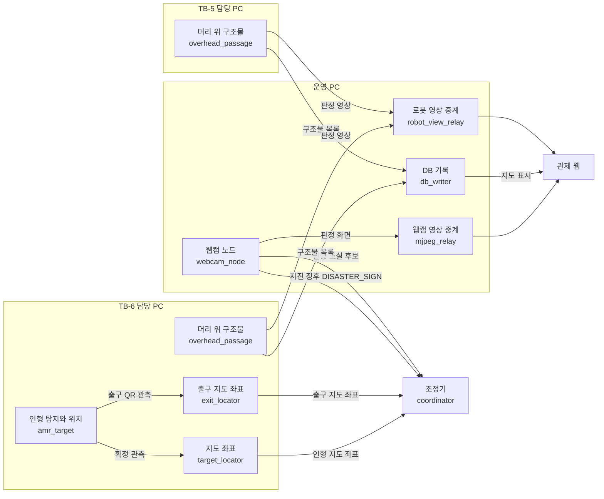

# 인식 구현

## 한눈에 (2026-10-15, main 5d9304a)

**이 문서가 답하는 질문:** 웹캠과 로봇 카메라로 무엇을 판정하고, 판정 결과는 어디로 가나?



| 부분 | 하는 일 | 상태 | 자세한 곳 |
| --- | --- | --- | --- |
| 지진 판정 | 웹캠 화면 전체가 여러 번 흔들리면 지진 징후 사건을 낸다. 조정기가 이것으로 TB-6 탐색을 자동으로 시작한다(#228) | 구현됨. 실물 웹캠 1회 확인 [측정, 2026-10-12]. 오탐률 NOT_RUN | [1절](#1-웹캠-고정-카메라-1대) |
| 인형 소실 후보 | 웹캠 감시 영역에서 인형이 출구 쪽으로 사라지면 후보를 낸다 | 구현됨. 실물 웹캠 확인 [측정, 2026-10-12]. 지금 시나리오에서는 기록만 한다(완료 판정은 TB-5 출구 도착) | [1절](#1-웹캠-고정-카메라-1대) |
| 인형 탐지와 위치 | TB-6 카메라 영상에서 인형(`survivor`)을 찾고 깊이로 위치를 잰다 | 구현됨. robot5 깊이 1회 확인(사용자). 노드 전체 실기 NOT_RUN | [2절](#2-tb-6-인형-탐지와-위치) |
| 지도 좌표 | 확정 관측을 촬영 시각의 TF 로 지도 좌표로 바꾼다 | 구현됨. 실기 NOT_RUN | [3절](#3-지도-좌표-target_locator) |
| 출구 QR | 출구 QR 을 읽어 출구 위치를 낸다. 여러 출구, 정확히 같은 내용만 | 구현됨. 실기 NOT_RUN | [4절](#4-출구-qr) |
| 머리 위 구조물 | 터널 같은 구조물의 가장 낮은 높이를 재서 통과 가능·불가·판정 불가로 판정한다. 운영 PC 의 DB 기록(db_writer)이 목록을 받아 관제 웹 지도에 그린다(#262·#263). 판정 영상은 로봇 영상 중계(robot_view_relay)가 관제 웹으로 보낸다 | 구현됨. 실기 NOT_RUN. 높이 기준 확인 필요 | [5절](#5-머리-위-구조물-overhead_passage) |
| 머리 위 여유 기록 | TB-5 앞 깊이 점을 세어 기록만 하는 도구 | 구현됨. 실기 NOT_RUN. 바닥 위 점이 모자라면 UNKNOWN | [6절](#6-머리-위-여유-기록-headroom_record) |
| 재확인 관측 | TB-6 이 한 지점을 다시 보고 있음·없음을 낸다 | 구현됨. 지금 시나리오에서는 쓰지 않는다 | [7절](#7-지금-쓰지-않는-기능) |

시나리오 단계는 [scope.md](../requirements/scope.md)의 「지금 시나리오」 절(#268)이 정한다. 현장 값은 [현장 파일](../../config/field/search_area.field.json) 하나에만 있다. 이 문서는 값을 다시 적지 않는다. 노드 실행 인자와 로그 읽는 법은 [인식 README](../../src/rescue_perception/README.md)에 있다.

로봇 이름. TB-6 = 탐색 로봇(코드 값 `robot_a`, 네임스페이스 `/robot6`). TB-5 = 지원 로봇(`robot_b`, `/robot5`).

## 1. 웹캠 (고정 카메라 1대)

웹캠 노드(webcam_node) 하나가 한 프레임을 세 판정에 같은 시각으로 넣는다. 운영 PC 에서 operations launch 가 띄운다.

| 판정 | 규칙 (한 줄) | 코드 |
| --- | --- | --- |
| 지진 징후 | 화면을 블록으로 나눠 직전 프레임과 비교한다(정규화 상호상관, ZNCC). 화면 **전체**가 같은 방향으로 움직이고, 정해진 시간 안에 방향이 여러 번 바뀌면 사건 1개 | `disaster_sign.py:DisasterSignDetector` |
| 가림 | 화면 대부분이 가려지면 판정 불가(UNKNOWN). 판정 불가는 흔들림 횟수를 더하지도 지우지도 않는다 | 같은 파일 |
| 인형 소실 후보 | 감시 영역에서 인형이 몇 프레임 보인 뒤에만 잰다. 사라진 시간이 충분하고, 마지막 위치가 출구 영역이면 후보 1개 | `target_watch.py:TargetWatchDetector` |
| 감시 설정 | 조정기가 감시 영역을 건다(SetCameraWatch). 수락·거절과 이유를 돌려준다 | `webcam_service.py:WatchSlot` |
| 카메라 상태 | 열기·읽기 실패는 OFFLINE, 가림은 UNKNOWN 과 이유 | `webcam_node.py` |
| 판정 화면 | 판정 결과를 그린 영상을 낸다. 판정에는 쓰지 않는다 | `webcam_node.py`, `webcam_service.py:status_items`·`draw_status` |
| 시계 | 이 PC 시계를 주기적으로 잰다. 측정이 없거나 오래되면 UNKNOWN. 조정기는 UNKNOWN 사건을 쓰지 않는다 | `rescue_contracts.clock_measurement` |

- 모델: 웹캠 전용 yolo26n([manifest](../../assets/manifest/webcam-yolo26n-survivor.json)). 7개 모델 비교 결과는 기록 절에 있다.
- 판정 화면 영상은 판정에 쓰지 않는다. 웹캠 영상 중계(mjpeg_relay)가 관제 웹으로 보낸다.
- 판정 화면 위쪽 띠는 한글 상태창 3칸이다. 칸은 지진, 인형, 출구 순서다(2026-10-15 사용자 요청, #301).
- 평상시 YOLO 는 감시가 걸렸을 때만 돈다. 지진 사건을 한 번 낸 뒤에는 감시가 없어도 YOLO 를 돌려 인형 상자와 이동 궤적을 그린다. 이때 쓰는 출구 판정기는 화면용이다. 화면용 판정기는 인형 소실 후보도 사건도 내지 않는다.
- 출구 칸 제목이 「출구」면 화면용 판정이다. 「출구 · 감시」면 조정기가 건 감시의 판정이다.
- 한글은 CJK 글꼴로 그린다. 글꼴 경로는 필수 파라미터 `debug_font_path` 다. 노드는 기동할 때 글꼴을 열어 보고, 못 열면 멈춘다.
- 관제 웹은 중계기의 `GET /health` 가 주는 마지막 프레임 나이로 영상 끊김을 판정한다(#302).
- 정책 값은 모두 기본값이 없다. 값은 실행 설정에서 온다.
- 확인 [측정, 2026-10-12, ROS 시험 PC, USB 웹캠]: 흔들기 1회에 지진 사건 1건. 인형을 출구 쪽으로 옮기면 후보 1건, 반대쪽이면 후보 없음. 5.00 fps.
- NOT_RUN: 현장 웹캠 PC 에서의 측정, 오탐률, 장시간 동작. 지진 뒤 YOLO 가 도는 동안의 CPU 사용량과 프레임 속도.

## 2. TB-6 인형 탐지와 위치

인형 탐지 노드(amr_target)는 TB-6 담당 PC 에서 돈다. 로봇은 영상만 보내고, 계산은 모두 PC 에서 한다.

| 단계 | 하는 일 | 코드 |
| --- | --- | --- |
| 탐지 | RGB 마다 YOLO 1회. 클래스는 `survivor` 하나 | `amr_target.py:create_node`, `camera_utils.py` |
| 고르기 | 신뢰도가 기준 이상이고 상자가 화면 안에 완전히 들어온 탐지 중 가장 높은 것 하나 | `amr_target.py` |
| 깊이 | 선택한 RGB 프레임과 시각이 가장 가까운 깊이 영상 한 장만 디코딩한다. 상자 중심 작은 영역의 깊이 중앙값을 쓴다 | `selective_depth.py`, `target_utils.py` |
| 왜곡 | RGB 가 보정 안 된 영상이면 상자 점만 CameraInfo 로 보정한다 | `amr_target.py` |
| 확정 | 신뢰도 충족 + 위치 성공이면 확정(CONFIRMED). 아니면 이유와 함께 미확정 | `person_pipeline.PersonPipeline` |
| 내보내기 | 첫 확정 관측 1개를 `/rescue/observations` 로 낸다. 같은 회차에 다시 내지 않는다 | `amr_target.py` |

- 모델: 로봇 카메라용 100 epoch best.pt([manifest](../../assets/manifest/yolo26n-survivor-v2.json), 2026-10-11 선택). 웹캠 모델과 바꿔 쓰지 않는다.
- 시계·정렬 근거·토픽 이름은 기본값 없는 실행 인자다. 하나라도 빠지면 노드가 시작하지 않는다.
- 시각·정렬·깊이 품질 검사는 기록 입력 코어(`core.py`, `adapter.py`)의 규칙을 그대로 쓴다(`person_pipeline` 경유). 코어의 자세한 계약은 기록 절에 있다.
- 위치 계산에 실패하면 좌표를 임의로 만들지 않고 실패 이유를 로그에 남긴다(원인 표는 [인식 README](../../src/rescue_perception/README.md) 「원인 가르기」).
- 확인: robot5 에서 깊이 약 1.350 m 를 사용자가 확인했다 [사용자 실기, 2026-10-13].
- NOT_RUN: 고친 노드 전체를 TB-6 에서 돌린 시험(E4).

## 3. 지도 좌표 (target_locator)

| 항목 | 규칙 |
| --- | --- |
| 입력 | 확정 관측(위치 VALID) |
| 변환 | 촬영 시각의 TF(map ← 카메라)를 쓴다. 최신 TF 로 바꾸지 않는다 |
| 지도 판 | TB-6 MapState 의 session·revision 을 붙인다. 해당 지도 판보다 먼저 촬영한 관측은 거절한다 |
| 시계 | 관측 시계가 SYNCED 이고 오차 상한이 있어야 한다 |
| 출력 | `/rescue/target_locations` 에 VALID 위치 하나를 발행한다. 거절한 관측은 발행하지 않는다 |

같은 노드를 출구용으로 한 번 더 띄운다(exit_locator → `/rescue/exit_location`). 코드: `target_locator.py:main`, `target_location.py`. 실기 NOT_RUN.

## 4. 출구 QR

| 항목 | 규칙 |
| --- | --- |
| 읽기 | 인형 탐지와 같은 프레임에서 QR 을 모두 읽는다(`detectAndDecodeMulti`) |
| 인정 | 내용이 허용 목록의 한 값과 정확히 같아야 한다. 출구마다 정해진 프레임 수만큼 연속으로, 같은 자리에서 읽혀야 한다 |
| 이름 | 어느 출구인지는 `track_id` 에 QR 내용 그대로 |
| 내보내기 | 출구마다, 지도 판마다 한 번 |

코드: `exit_qr.py:detect_qrs`·`ExitQrConfirmer`(#245). 처리 시간: QR 0개 15 ms, 2개 45–49 ms [측정, 704×704]. 실기 NOT_RUN.

## 5. 머리 위 구조물 (overhead_passage)

로봇마다 하나씩 돈다. Nav2 의 통로 정지와 같은 깊이 점·같은 상자를 본다.

| 판정 | 뜻 |
| --- | --- |
| 통과 가능 (PASSABLE) | 가장 낮은 높이 ≥ 0.46 m(재범 결정) |
| 통과 불가 (BLOCKED) | 가장 낮은 높이 < 0.46 m |
| 판정 불가 (UNKNOWN) | 구조물 아래 바닥을 못 봄. 높이를 내지 않는다 |

- 라이다 평면보다 낮은 물체는 보통 장애물이라 내지 않는다.
- 같은 판정이 연속 몇 번 나와야 확정한다. 확정된 목록을 `/rescue/robots/<id>/overhead_passages` 로 낸다(JSON, 해석은 `parse_overhead_passages` 하나).
- 판정 영상: 미리보기 RGB 위에 빈 공간을 초록·빨강·회색으로 칠한다(#264).
- 코드: `overhead.py:judge`·`PassageRegistry`·`render_view`(#259, #264).
- **높이 기준 확인 필요(OPS-203):** 높이는 base_link 의 z 다. 라이다 높이 값은 바닥에서 잰 값이다. 열린 PR #254 의 측정대로 바닥이 base_link 아래 약 0.2 m 라면 높이가 약 0.2 m 낮게 나온다 [계산].
- NOT_RUN: 실제 OAK-D 점구름, 현장 PC 처리 시간, TB-6 라이다 높이.

## 6. 머리 위 여유 기록 (headroom_record)

TB-5 앞 상자 안에서 낮은 깊이 점을 세어 STOP·PASS 를 JSON 으로 기록만 한다. 로봇을 멈추지 않는다.

**판정.** 상자 안 바닥 위 점 중 `clearance_m` 보다 낮은 점이 `min_points` 개 이상이면 STOP 이다. 그렇지 않고 바닥 위 점이 `min_points` 개 이상이면 PASS, 그보다 적으면 UNKNOWN(`FEW_POINTS_ABOVE_FLOOR`)이다. CameraInfo 가 없거나 깊이가 오래된 프레임은 UNKNOWN 으로 기록한다. TF 가 없는 프레임은 건너뛰고, 마감 시각까지 표본을 다 못 모으면 남은 회차를 UNKNOWN(`NO_TF`, `NO_DEPTH`)으로 채운다. 2026-10-13 까지는 빈 관측도 PASS 로 나왔다. 2026-10-14 재범 결정으로 고쳤다.

실기 NOT_RUN.

## 7. 지금 쓰지 않는 기능

| 기능 | 코드 | 왜 안 쓰나 |
| --- | --- | --- |
| 재확인 관측 (ObserveTarget) | `recheck_server.py:RecheckServer`, `recheck.py` | 완료 판정이 TB-5 출구 도착이라 TB-6 재확인을 하지 않는다(scope Q-10, 현장 파일 `completion_mode`) |
| 녹화 재생 도구 | `bag_replay.py`, `bag_replay_cli.py`, `tools/perception_bag_replay.py` | 현장 경로 밖의 오프라인 진단 도구다. 실제 녹화로 돌린 기록은 없다(NOT_RUN) |
| 단독 카메라 노드 | `amr_camera.py` | 현장 launch 가 띄우지 않는다. 탐지 화면만 따로 볼 때 쓴다 |

## 8. 시험

| 범위 | 명령·파일 |
| --- | --- |
| 단위 (ROS 없음) | `python3 -I scripts/run_tests.py` (인식은 `tests/test_perception_*.py`) |
| 격리 ROS (E3) | `tests/ros/e3_amr_target_probe.py`, `e3_target_locator_probe.py`, `e3_overhead_probe.py`, `e3_headroom_probe.py`, `e3_camera_watch_probe.py` |
| 실기 | 위 표의 NOT_RUN 항목 |

## 기록 (2026-10-08 ~ 2026-10-13)

아래는 2026-10-14 전까지 이 문서의 본문이다. 지우지 않고 그대로 옮겼다(제목 단계만 한 칸 내림). 그때의 이름을 그대로 둔다: AMR1 = TB-6, AMR2 = TB-5, PC3 = 웹캠 PC.

**지금과 다른 점** — 아래 글이 이렇게 말하면, 지금은 화살표 뒤가 맞다.

| 아래 글 (당시) | 지금 |
| --- | --- |
| RGB 에서 사람을 찾는 모델이 없고, YOLO·ROS·TF 를 실행하지 않았다(2026-10-08) | amr_target 이 YOLO 를 돌리고, 촬영 시각 TF 를 조회한다(2절) |
| 모델 추론·학습 결과는 NOT_RUN, Detector 가중치는 Q-18 로 열림(2026-10-11) | 학습을 마쳤고 로봇 카메라 best.pt 를 골랐다([manifest](../../assets/manifest/yolo26n-survivor-v2.json)) |
| 압축 영상 해제 어댑터는 후속(2026-10-08) | amr_target 이 compressed RGB 와 compressedDepth 를 푼다 |
| 웹캠 모델은 실물 웹캠으로 시험하지 않았다(2026-10-11) | 2026-10-12 실물 웹캠으로 확인했다(같은 기록의 뒤쪽 「고정 웹캠 노드」) |
| 실제 카메라의 stamp 의미는 재기 전 UNKNOWN(원본 P4 로봇 기록) | TB-6 은 CAPTURE 로 측정해 실행 인자로 넣는다([인식 README](../../src/rescue_perception/README.md)) |
| 소실 후보는 재확인 트리거이고 AMR1 재관측이 확정한다 | 지금 시나리오는 TB-5 출구 도착으로 끝난다. 재확인 관측은 쓰지 않는다(7절) |
| ROS 구독 노드는 후속 | 노드 목록은 한눈에 그림 |

### 기록 입력 기반 인식 코어 (2026-10-08)

계획 PR 7은 [C-02·03·05](../design/contracts.md), [D-06](../design/algorithm-decisions.md), [CT-01·02·03·10](../process/acceptance-plan.md)의 일부를 실행 가능한 순수 Python 로직으로 구현한다. RGB 픽셀에서 사람을 찾는 모델은 아직 없다. 입력은 이미 얻은 탐지 bbox/class와 RGB/Depth 메타데이터, 복호화된 깊이 배열이다. 이 PR에서 실제 YOLO, 가중치, ROS, CameraInfo 구독, TF, 카메라, 두 로봇을 실행하지 않았다.

### AMR 학습 클래스 변경(2026-10-11)

[사용자 요구] 이번 OAK-D 영상 학습의 단일 클래스는 기존 `person` 대신 `survivor`(class ID `0`)다. [수집·전처리·학습 계획](oakd-survivor-training-plan.md)에 `oakd/image_raw` 영상 촬영과 1초 간격 추출, 파라미터 비교·결과 docs 제출을 정리했다. 모델 추론과 학습 결과는 아직 NOT_RUN이다. 후속 연동은 모델 metadata·`ModelManifest.class_labels`·`ConfirmationPolicy.person_labels`·Detector 출력 label을 `survivor`로 일치시킨다. 기존 API 이름과 과거 person 합성 시험은 유지하며, survivor는 개별 인형 신원이나 생존 판정이 아니다.

### 입력과 광학 위치

`FrameMeta`는 frame·원 `observed_at_ns`·clock domain·stamp 의미·해상도·보정 ID다. `DepthFrame`은 `16UC1`/mm 또는 `32FC1`/m와 직사각형 Python sequence를 받는다. 16비트 자료는 범위 안 정수만 허용한다. 32비트 깊이의 NaN/Inf/0/범위 밖 값은 센서 결측으로 제외하며, scalar 설정/시간·bbox의 NaN/Inf/bool은 오류다. 압축 이미지나 bytes를 디코딩하는 adapter는 후속이다.

`AlignmentEvidence.verified`는 설치 adapter가 **Depth가 RGB rectified pixel grid에 등록됐고 값이 해당 optical z**라는 실험 근거를 제공할 때만 true로 넣는 계약이다. 이 코어가 물리 정렬을 인증하는 필드가 아니다. 근거 ID·calibration ID·양쪽 frame·해상도·intrinsics·rectified 상태를 검사하며 해상도 비율만으로 정합시키지 않는다. 서로 다른 stamp 의미나 clock domain, `UNKNOWN` 시각 의미를 가진 pair로 위치를 만들지 않는다. pair의 최대 stamp 차이는 정수 ns의 `DepthPolicy.max_stamp_skew_ns`다. 한쌍의 기록을 검증하며 실시간 동기화 queue는 제공하지 않는다.

bbox는 `[x0,y0,x1,y1)`의 영상 경계 좌표다. 정수로 감싼 bbox 전체가 ROI이며, bbox 바깥/빈 bbox는 조용히 잘라 쓰지 않고 거절한다. 유효 깊이 수·비율·최대−최소 spread를 명시한 정책과 비교한다. 통과하면 중앙값 z와 bbox 중심의 pixel centre로 `(x right, y down, z forward)` m 좌표를 계산한다. 배경 혼입 때문에 spread가 크면 `DEPTH_DISCONTINUITY`, 값이 부족하면 `DEPTH_INSUFFICIENT`다. 중앙값과 이 품질 관문은 표적 표면을 올바르게 선택했다는 증거가 아니며 segmentation/ROI 개선은 데이터로 평가해야 한다.

**E2 성능 경계:** `DepthFrame.__post_init__`는 전체 영상의 각 픽셀을 Python으로 검증하고 복사한다. ROI도 Python list를 만든다. 1280×720이면 전체 검사만 프레임당 921,600개 표본이며 실시간 성능을 주장하지 않는다. 후속 실시간 어댑터는 bounded ROI crop 또는 검증된 array 입력을 제공해야 한다. 이때 encoding/단위·shape·NaN/범위 처리·immutable 입력 소유권을 보존하고, crop 원점에서 원 영상 pixel centre와 intrinsics로 돌아가는 대응을 명시한다. 이식 전후의 위치/거절 결과가 같고, 두 영상 동시 처리에서 end-to-end 지연·누락·메모리가 사전 합의한 예산 안임을 측정한 뒤 승급한다. 이 PR에 numpy/ROI 어댑터나 실측 예산을 추가한 것은 아니다.

`LocalizationResult`는 위치 또는 실패 이유·유효 표본 수·정렬 근거를 갖는다. sensor covariance를 추정하거나 0으로 꾸미지 않는다. 공분산, 외부 파라미터, 관측 시각 TF, 공통 frame/session/revision은 mapping adapter와 추가 검증의 책임이다. `LOCATED`는 optical point 계산에 성공했다는 뜻이며 접근 허가는 아니다.

### 불변 관측과 최신성

`ModelManifest`는 모델 ID·SHA-256 형식·중복 없는 class 순서를 검증한다. Detection의 class ID와 label이 manifest에 동시에 맞아야 한다. 가중치를 로드/검사하지 않으므로 제공된 SHA가 실제 파일과 일치하는지는 adapter의 책임이다. `Detection.tracking_mode`는 기본값 없이 필수이며 `DETECTION_ONLY`(처음부터 탐지만), `TRACKING`(유효 track ID가 있는 추적), `TRACKING_FALLBACK`(추적 실패 뒤 탐지로 저하)을 구분한다. TRACKING에는 비어 있지 않은 track_id가 필수이고 숫자 문자열 `"0"`도 유효하다. 나머지 두 모드의 track_id는 None이어야 한다. 모드도 원 관측의 의미 payload hash에 포함되므로 같은 관측 ID에서 상태를 조용히 바꿀 수 없다. track 없이 같은 class만으로 동일 인물이라고 확정하지 않는다.

`Observation`은 source robot/camera/boot, 원 `FrameMeta`, 모델·탐지·위치, 최초 `valid_until_ns`, clock 상태/`clock_error_bound_ns`, 증거 ID/SHA를 보존한다. 로봇 ID는 `rescue_contracts.robot_id`의 배포 프로파일 형식에 맞아야 한다. 문자열 UUID는 소문자 표준 형식의 non-nil ID를 요구한다. 시각 0·float·bool·int64 범위 초과, 만료≤관측, 잘못된 SHA·class·bbox를 거절한다. 중첩된 배열은 tuple로 저장한다. `observed_at_ns`는 frame에서 읽으며 수신/발행 시각으로 바꾸는 setter가 없다.

`Publication`은 publisher/boot/uint64 sequence/`published_at_ns`/schema_version을 관측 바깥에 둔다. 이 전송 envelope를 바꿔도 관측의 의미 payload hash는 변하지 않는다. 현재 schema는 `1.0`만 지원한다. 발행 sequence의 실제 증가·수신 queue/QoS를 담당하는 transport adapter는 아직 없다.

`validate_freshness`는 `now_ns`·receiver clock domain/`receiver_clock_error_bound_ns`와 `TimePolicy(max_age_ns, max_future_ns, max_clock_error_ns, stamp_delay_bound_ns)`를 검사한다. UNKNOWN stamp/clock·미확인 오차·다른 domain·과도한 clock 오차·미래 stamp·나이 초과·최초 유효기간 만료는 유효 임무 입력으로 거절한다. 보수적 나이는 `now_ns−observed_at_ns+송수신 clock 오차 ns+센서 stamp 지연 상한 ns`이며 반환값도 int ns다. 원 유효기간도 오차/지연을 더한 현재 시각으로 검사한다. CAPTURE/DRIVER_RECEIVE 각각의 실제 의미·지연 상한은 설치 adapter에서 측정해야 한다.

**패키지 경계 시간 계약:** 모든 관측·TF query·만료·발행·현재 wall 시각은 `timestamp_ns`가 검사하는 양수 int64 ns, 정책 duration과 시계 오차는 `duration_ns`가 검사하는 0 이상 int64 ns다. 로컬 `received_steady`만 프로세스 내부 monotonic float 초이며 다른 PC 값과 비교하지 않는다. ROS 헤더는 공통 `ros_time_to_ns(sec, nanosec)`로 정확히 합치고 `ns_to_ros_time(ns)`로 분리한다. 실측 stamp를 float epoch 초로 바꿨다가 복원하지 않는다. 실제 epoch `1700000000123456789`의 1 ns 보존/Depth pair 경계와 TF 조회 입력 exact equality를 시험했다. 공통 `seconds_to_ns`는 decimal 정책/fixture 입력에만 쓰며 이미 소실된 ROS stamp 정밀도를 복구하는 API가 아니다. 구 API의 float 초 필드·인자는 호환 경로 없이 폐기하므로 소비자도 함께 갱신한다.

**오류 계약:** 순수 Python 공통 패키지 `rescue_contracts`는 ROSIDL 메시지 구현이 아니다. `PerceptionError`는 `RescueError`를 상속하고 소비자가 분기할 canonical `.code`, `rescue_perception.<원인>`의 `.detail_code`, `.component`, 상세 `.detail`을 보존한다. 대응표는 공통 `canonical_code` 하나가 소유한다. 예를 들어 FUTURE_OBSERVATION은 CLOCK_UNCERTAIN, UNSUPPORTED_DEPTH/MODEL_CLASS_MISMATCH는 INVALID_INPUT으로 분류된다. `LocalizationResult.reason`은 위치 상태를 설명하는 기존 어휘이고 예외 코드가 아니다. 실패 결과에도 `.error_code`/`.detail_code`를 제공하며 LOCATED에는 둘 다 None이다.

`ObservationRegistry.ingest`는 수신 시계 관문을 통과한 뒤 ID 충돌을 검사하고 현재 최신성을 평가한다. 같은 ID·같은 payload는 DUPLICATE이며 기존 객체를 반환한다. 새 ID이지만 원 stamp가 역순이면 기록은 보존하고 REORDERED를 반환한다. 같은 frame stamp의 서로 다른 사람은 각각 ACCEPTED하되 공백 타이머는 갱신하지 않는다. source robot/camera/boot별로 **원 stamp가 전진하는 새 유효 관측만** last_new_receive를 갱신한다. 만료된 재발행은 거절되고, 이전 boot의 수신 기록은 새 boot로 이어지지 않는다.

**역순 발견의 설계 결정:** 역순을 재발행과 같다고 보지 않는다. 새로운 observation_id의 REORDERED 관측도 최초 원본과 Admission 상태를 `history()`의 불변 tuple에 남긴다. 중복은 기존 이력을 바꾸지 않고 타이머를 갱신하지 않는다. 현재 ConservativeEventRegistry는 REORDERED에서 신규 자동 사건을 만들지 않는다. 이는 발견 삭제가 아니라 기록과 자동 허가의 분리다. 다중 카메라 지연으로 뒤늦게 발견된 다른 사람을 보고/재확인 후보로 승격하는 후속 사건 정책은 관측 나이·공통 좌표·동일성 불확실성·원본 provenance를 검사해야 하며, 과거 frame의 도착만으로 최신 관측·새 접근 권한을 부여하지 않아야 한다. 별도 정책을 검증하기 전까지 현재 제한을 유지한다.

유효한 receiver wall/monotonic 시각은 관측이 오래됐거나 ID 충돌로 거절되어도 추적한다. 어느 수신 시계든 역행하면 해당 registry의 clock fault를 latch하여 이후 정상 범위의 시각·새 관측·새 source boot에도 계속 `CLOCK_UNCERTAIN`을 반환한다. 기존 수신 기록을 성공으로 갱신하지 않는다. caller가 시간 기준을 복구·재검증한 뒤 새 receiver session(`ObservationRegistry`)을 만들어야 한다. 새 객체 생성 자체가 시계 동기화의 증거는 아니며, source 프로세스 boot 변경도 receiver 시계 fault를 해제하지 않는다.

이 registry는 단일 프로세스의 E2 기록이다. 영속 dedup, 재시작 복구, 시계의 순방향 급변 감지, 소스 재등록/활성 boot fencing, 수신 메모리 상한·감사 저장·transport 재연결은 미구현이다. 소비자는 admission 당시의 유효성을 영구 허가로 쓰지 않고 실제 사용 시점에 freshness·좌표·권한을 다시 검사해야 한다. 인터페이스 dataclass는 신뢰 경계나 서명이 아니며 외부 입력 adapter의 검증을 대체하지 않는다.

### 로봇 카메라 사람 탐지 파이프라인 (E2)

`rescue_perception.person_pipeline`은 로봇 카메라 한 스트림의 프레임마다 탐지기 → 위치 → 관측 → 확정 여부를 잇는다. 주행·임무·관측 간 병합은 하지 않는다.

| 항목 | 규칙 |
| --- | --- |
| 모델 | `Detector` 인터페이스(`infer(rgb, observed_at_ns) -> Inference | None`) 뒤에 둔다. 가중치·런타임은 Q-18로 열려 있어 이 PR에 추론 구현이 없다. `RecordedDetections`는 프레임 stamp(int ns)별로 녹화된 탐지를 돌려주는 재생용 구현이다. 그 stamp에 기록이 없으면 `None`(모델이 돌지 않음)이고 빈 결과와 구별한다 |
| 관측 | 설정된 대상 label(`ConfirmationPolicy.person_labels`; 이번 학습은 `survivor`) 탐지마다 [입력 어댑터](#입력-어댑터-기록-입력-e2)의 `observe`로 `Observation`을 만든다. 탐지 헤더는 그 RGB 헤더다. `person_labels`가 모델 manifest에 없거나 출력 label이 manifest 밖이면 `MODEL_CLASS_MISMATCH`로 프레임 전체를 거절한다. 그래야 「돌았지만 사람 없음」이 「이 모델은 사람을 못 봄」과 섞여 재관측의 부재 근거로 새지 않는다. `observation_id`·`evidence_id`는 (boot, stamp, 순번)의 uuid5라 재생해도 같다. 모든 프레임의 관측을 내므로 스트림 최신성(LL-06)은 registry가 그대로 판단한다 |
| 확정 | `CONFIRMED`는 `confidence ≥ confirm_confidence_min`이면서 위치가 `LOCATED`일 때만이다. 아니면 `UNCONFIRMED`이고 이유(`LOW_CONFIDENCE`, 위치 실패 이유)를 붙인다. 값은 Q-21이며 기본값이 없다. 미확정도 관측으로 남는다 |
| 후보 표시 | `new_candidate`: 같은 track은 처음 한 번, 그리고 CONFIRMED로 오를 때 한 번 더 참이다. 내려가는 변화는 새 후보가 아니다. track이 없는 탐지는 프레임 사이를 이을 수 없어 매번 새 후보다(보수적 과분리) |
| 순서 | 마지막으로 처리한 stamp 이하 프레임은 `DUPLICATE`/`REORDERED`로 무시한다. 프레임의 모든 관측을 만든 뒤에만 상태를 바꾸므로, 거절된 프레임은 흔적을 남기지 않는다 |

관측들 사이의 「일정 거리 이내 좌표 병합」(Part I 3.3.4)은 협업·관제의 `TargetEstimate`가 한다(작전 결정 [제안], 2026-10-08). 시험은 `tests/test_perception_person_pipeline.py`(14개, 합성 프레임과 녹화 형식의 탐지)다. 모델 추론·bag 재생·실시간 성능은 NOT_RUN이다.

### 탐지 클래스 이름: `survivor` (2026-10-11)

요구조자(시연 인형)를 탐지하는 YOLO 모델의 클래스 이름은 **`survivor` 하나로 통일한다.** 고정 카메라 담당 지시(2026-10-11, 원문 "클래스명은 survivor로 한다", 적용 범위: 이 저장소의 모든 인형 탐지 모델과 학습 데이터).

| 대상 | 규칙 |
| --- | --- |
| 적용 범위 | 고정 웹캠(출구 인형 카운트·구조 지점 감시)과 로봇 카메라(`person_pipeline`) 모두. 모델이 둘이어도 클래스 이름은 같다 |
| 학습 데이터 | Roboflow 등 라벨링 도구의 클래스 이름도 `survivor`. `doll`·`teddy bear`·`person` 으로 라벨하지 않는다 |
| 라벨 기준 | 시연 인형(요구조자 대체물) 한 개를 상자 하나로 감싼다. 구조대원·줄을 당기는 사람·끌개는 `survivor` 가 아니며 라벨하지 않는다(사람만 나온 프레임은 빈 이미지로 남긴다) |
| 코드·설정 | 이름을 코드 상수로 두지 않는다. 모델 manifest 의 `ModelManifest.class_labels` 와 로봇 카메라의 `ConfirmationPolicy.person_labels` 에 `("survivor",)` 를 설정으로 넣는다(AGENTS.md 8절). 다른 이름이 오면 지금처럼 `MODEL_CLASS_MISMATCH` 로 거절된다 |
| 사전학습 모델 | COCO 사전학습 모델은 인형을 `teddy bear` 로 낸다(2026-10-11 웹캠 확인). 확인용일 뿐 배포하지 않으며, `teddy bear` 를 `survivor` 로 바꿔 부르는 매핑을 두지 않는다. 배포 모델은 `survivor` 로 학습한 모델이다 |
| 기록 | 학습한 모델은 `assets/manifest/` 에 출처·데이터셋 버전·가중치 해시와 함께 `class_labels: ["survivor"]` 를 적는다 |

기존 시험의 `"person"`·`"dummy"`·`"doll"` 은 합성 입력의 임의 이름이라 그대로 둔다(클래스 이름이 설정으로만 들어온다는 것을 시험한다).

### 보수적 사건 후보

`ConservativeEventRegistry.register(admission, event_id=..., candidate_event_ids=...)`는 수신한 관측별로 별도 CANDIDATE를 만든다. 같은 관측을 재등록하면 같은 사건을 반환하며 event ID/연결 목록 또는 원 payload가 달라지면 충돌이다. REORDERED 관측은 새 사건 입력으로 수락하지 않는다. 같은 frame의 다른 사람, 다른 로봇의 같은 track ID, track 없는 관측은 각각 별도 사건이다.

`candidate_event_ids`는 이미 존재하는 사건과의 **미확인 연결 후보**다. 사건을 합치거나 CONFIRMED로 올리지 않는다. 공통 좌표·시간·불확실성·다중 관측/재확인 근거로 동일성을 판정하는 후속 coordination 정책이 필요하다. 현재는 같은 실제 사람의 연속 프레임도 별도 후보가 될 수 있으며, 이 보수적 과분리를 사람 수/구조 성공 통계로 집계하면 안 된다.

### 고정 웹캠 지진 징후 (E2, 실측 전)

`rescue_perception.disaster_sign`은 고정 웹캠 영상만으로(모델 없이) `rescue_contracts.SiteEvent(kind="DISASTER_SIGN")`를 만든다. 사건은 증거이고 재난 모드 전환은 협업·관제의 정책이 한다([계약](../design/contracts.md) C-01, [S-00](../design/state-machines.md)). 판정 방식은 PR #33 설계 v3 합의(2026-10-09)다. 화면 **전체**가 앞뒤로 여러 번 흔들리면 지진 징후로 본다.

| 단계 | 규칙 |
| --- | --- |
| 이동량 | 회색조 격자를 `blocks_x`×`blocks_y` 블록으로 나누고, 블록마다 직전 프레임에서 ±`search_cells` 칸 안을 ZNCC 로 찾는다. 평균을 빼고 정규화하므로 조명이 전체로 밝아지거나 어두워져도 이동으로 보지 않는다 |
| 영상 정상 | 무늬 있는 블록(표준편차 ≥ `texture_min`)이나 매칭된 블록(ZNCC ≥ `match_min`)이 `valid_ratio_min` 미만이면 UNKNOWN(가림·어두움·매칭 실패). UNKNOWN 은 흔들림 횟수를 더하지도 지우지도 않는다 |
| 화면 전체 | 원래 장면이 보이는 블록(아래 장면 확인)의 이동 중앙값을 화면 이동으로 보고, 네 사분면 모두에 그와 `agree_tol` 안으로 맞는 블록이 있어야 한다. 아니면 부분 움직임(사람 통과)이라 조건 거짓. 손·사람이 덮은 블록은 투표에서 빠진다 |
| 장면 확인 | 카메라가 흔들리면 장면은 같고 위치만 밀리지만, 렌즈 앞 손처럼 가까운 물체는 장면 자체를 가린다. 흔들림 없이 `window_ns` 이상 멈춰 있던 화면을 기준 장면으로 두고, 블록마다 지금 화면이 기준 장면을 ±`search_cells` 칸 옮긴 것과 ZNCC ≥ `scene_match_min` 이면 "보임". 보이는 블록이 `visible_min` 미만이면(화면 대부분이 가려짐) UNKNOWN(`SCENE_CHANGED`), 보이는 블록이 `valid_ratio_min` 미만이면서 한 사분면에 보이는 블록이 하나도 없으면 사분면 확인을 할 수 없으므로 UNKNOWN(`QUADRANT_COVERED`), 그보다 덜 가려지면(조금 떨어져 지나가는 사람, 위쪽으로 지나가며 한 구역만 가림) 판정을 계속한다. 사람이 있으면 그림자·자동 노출로 가려지지 않은 바닥 칸도 기준 장면과 달라질 수 있어, 한 구역 가림만으로 보류하면 지나가는 사람에도 보류가 잦았다(17:51 실측 지나가기 97/335). 16:06 녹화 재생 [측정]: 지나가기 보류 11/377, 가리기 50/437, 흔들기·가만히 보류 0. 카메라 바로 앞에 서서 화면 절반 가까이를 막으면 여전히 보류된다(담당자 결정 2026-10-10: 가림을 잡되 지나가는 사람은 보류하지 않음). 손에도 무늬가 있어 무늬 기준(`texture_min`)만으로는 가림을 못 잡는다(2026-10-10 녹화에서 가려진 블록의 표준편차 중앙값 13.2 [측정]). 바뀐 화면이 `rebase_ns` 이상 안정적이면 카메라가 옮겨진 것으로 보고 새 기준 장면으로 삼는다 |
| 횟수 | 이동 크기 ≥ `shift_min` 이면 방향을 기록하고, 직전 방향과 반대(내적 < 0)면 전환 1회. `window_ns` 안의 전환이 `shakes_min` 이상이면 조건 참 |
| 사건 | #33 규칙 그대로. 조건이 `hold_ns`(≤ `window_ns`) 이어지면 사건 1개, `release_ns` 동안 거짓이어야 다시 낸다. 간격 > `max_gap_ns` 면 횟수·구간·직전 프레임을 버린다. 중복·역순·디코딩 거절 프레임은 상태를 바꾸지 않는다 |
| 시각·ID·confidence | #33 그대로. `observed_at_ns`는 hold 를 채운 프레임, 시작은 `detail`의 `onset_ns`. uuid5 ID, 시간 기준은 `SourceBinding`에서. `confidence=1.0`은 "규칙 충족(이진)" |

정책 값은 모두 Q-11 로 정하고 **기본값이 없다**. 진도 7 은 시나리오 근거일 뿐 웹캠으로 재지 않는다. 시험은 `tests/test_perception_disaster_sign.py`(30개, 합성 48×48 영상)다. 조명 오탐, 해상도 변경 `IndexError`, 렌즈 앞 손, 잠깐 멈춘 손, 무늬 있는 손의 가림, 화면 일부를 가리며 지나가는 사람, 화면 대부분을 덮고 움직이는 손, 한쪽을 덮은 손, 위쪽으로 지나가는 사람의 회귀 시험은 고치기 전 코드에서 실패함을 커밋으로 남겼다.

**실측 도구:** `tools/webcam_quake_probe.py`가 OpenCV 로 웹캠 프레임을 읽어 위 판정에 넣고 대시보드로 보여 준다. 왼쪽은 카메라 화면(블록 격자·사분면 경계·이동 화살표·상태 색 테두리·사건 배너), 오른쪽은 상태 카드(정상·흔들림 감지·판단 보류·카메라 끊김과 이유), 상황 칩, 방향 전환 칸 막대, 무늬·직전 화면 일치·원래 장면 보임 게이지(눈금 = 기준), 최근 5초 이동 그래프, 사건 기록이다. 숫자 키로 상황(가만히·흔들기·조명·지나가기·가리기)을 표시한다. 결과는 측정마다 `.artifacts/webcam_quake/<날짜-시각>/`(`.gitignore` 대상)에 `probe.csv`(프레임별 기록), `meta.json`(인자·정책·git SHA·상황별 요약), `--record` 이면 `view.mp4`(대시보드 화면)로 남는다. `--video`로 영상 파일을 같은 판정에 넣을 수 있다. 카메라가 끊기면 종료하지 않고 다시 연결한다. 인자 기본값은 측정 시작값이지 Q-11 값이 아니다(장면 일치 0.6·보임 30% 는 2026-10-10 녹화 분석에서 고른 시작값).

**한계:** 횟수만 보고 세기는 보지 않는다(시연용 판정). 순수 Python 이라 해상도·`sample_stride`·`search_cells`에 따라 처리 시간이 커진다. 웹캠 자동 초점은 화면 배율을 바꿔 전체 이동처럼 보일 수 있으므로 고정한다. 실물 USB 웹캠에서 `webcam_node` 로 흔들기 1회에 `DISASTER_SIGN` 1건(방향 전환 4/4)을 확인했다 [측정, 2026-10-12, ROS 시험 PC: Ubuntu 24.04·Jazzy·i7-12700H CPU, PC3 여부 미확인](아래 「고정 웹캠 노드」 절). 오탐률·장시간 측정은 NOT_RUN 이다.

### 고정 웹캠 인형 탐지 모델 비교 (E2, 2026-10-11)

웹캠이 구조 지점에서 인형이 사라졌는지 판정할 때(Q-26: 지진 감지 + 대상 소실 후보) 쓸 `survivor` 탐지 모델을 같은 데이터·같은 설정으로 비교했다. 영상·데이터셋은 저장소에 넣지 않는다. 선정한 yolo26n 가중치는 `assets/models/webcam-yolo26n-best.pt`, 출처·해시는 [`assets/manifest/webcam-yolo26n-survivor.json`](../../assets/manifest/webcam-yolo26n-survivor.json) 이다(2026-10-12 사용자 승인, AGENTS 8절 예외). **실물 웹캠으로는 아직 시험하지 않았다** — 아래 수치는 녹화 영상에서 뽑은 프레임으로 잰 값이다.

- #95 와의 관계: #95 는 **AMR 카메라(OAK-D)** 용 yolo26n 이고, 이 절은 **고정 웹캠** 용이다. 같은 모델 구조지만 학습 데이터(카메라·화각·장면)가 달라 가중치를 서로 바꿔 쓰지 않는다.
- 노트북: `tools/colab/survivor_model_compare.ipynb` — Colab 한 번 실행으로 학습·평가·속도·오탐/미탐·bootstrap 95% 구간·요약. 끝난 모델은 건너뛰고, 한 모델이 실패해도 나머지를 계속하며 실패를 기록한다.
- 결과 원본(노트북이 만든 파일 그대로, [측정, 2026-10-11, Colab T4]):
  - [`webcam-survivor-compare/results.csv`](webcam-survivor-compare/results.csv): 모델별 valid·test mAP, P/R, best epoch, 학습 시간, GPU·CPU ms(Ultralytics `val`)
  - [`webcam-survivor-compare/analysis.json`](webcam-survivor-compare/analysis.json): 모델별 bootstrap 95% 구간·TP/FP/FN·실패 이미지 이름, 모델 쌍 21개의 valid·test 차이와 구간
  - [`webcam-survivor-compare/dataset_info.json`](webcam-survivor-compare/dataset_info.json): 데이터셋 zip sha256, 분할별 이미지·박스 수, Roboflow 전처리·증강
- 데이터셋 `survivor-webcam-v2`(파일 `survivor-v2-merged.zip`, sha256 `46d901fc…`): train 720장(웹캠 영상 1개, 원본 240 × 증강 3), valid 236장·인형 222, test 246장·인형 236 [측정, 2026-10-11; [dataset_info.json](webcam-survivor-compare/dataset_info.json)]. valid·test 는 **학습과 따로 찍은 영상**에서만 뽑았고 증강은 train 에만 있다. 첫 데이터셋은 영상 하나를 무작위로 나눠 평가 인형 43개 중 39개가 학습 인형과 사실상 같았고(인형 영역 유사도 ≥ 0.95), v2 는 0/458 이다 [측정, 2026-10-11; 로컬 분석, 원본 파일은 저장소 밖].
- 설정: 100 epoch, patience 30, 입력 640, batch 16(rtdetr-l 8), seed 0, AdamW lr0 0.002(auto), Colab T4.

| 모델 | 파라미터(M) | valid mAP50-95 (95% 구간) | test mAP50-95 (95% 구간) | test 오탐 / 미탐 | CPU ms/장(Colab) |
| --- | --- | --- | --- | --- | --- |
| **yolo26n** | 2.38 | 0.958 (0.947~0.968) | **0.920** (0.900~0.937) | 8 / 7 | **107** |
| yolo26s | 9.47 | 0.958 (0.948~0.966) | 0.901 (0.877~0.920) | 18 / 6 | 312 |
| yolov8s | 11.13 | 0.960 (0.949~0.969) | 0.897 (0.875~0.923) | 5 / 4 | 299 |
| yolo11s | 9.41 | 0.948 (0.935~0.961) | 0.897 (0.868~0.918) | 6 / 6 | 281 |
| rtdetr-l | 31.99 | 0.966 (0.957~0.974) | 0.894 (0.867~0.918) | 4 / 9 | 1,245 |
| yolov8n | 3.01 | 0.962 (0.952~0.971) | 0.882 (0.865~0.908) | 2 / 6 | 116 |
| yolo11n | 2.58 | 0.952 (0.939~0.960) | 0.881 (0.862~0.903) | 6 / 3 | 155 |

[측정, 2026-10-11] mAP·파라미터·CPU ms 는 [results.csv](webcam-survivor-compare/results.csv), 95% 구간·오탐/미탐은 [analysis.json](webcam-survivor-compare/analysis.json) 이다(구간은 이미지 bootstrap 1,000회로 다시 잰 mAP 기준이라 점추정과 소수 셋째 자리가 다를 수 있다). 오탐·미탐은 신뢰도 0.25, IoU 0.5 기준이다.

- **고르기(valid):** valid 에서 yolo26n 은 rtdetr-l·yolov8n·yolov8s·yolo26s·yolo11n 과 **구분 불가**이고 yolo11s 보다만 높다(차이 구간이 0 을 넘는 쌍만 "우세") [측정, 2026-10-11; [analysis.json](webcam-survivor-compare/analysis.json) `pairwise.*.valid`]. 즉 valid 만으로는 최상위 묶음(6개)을 가를 수 없고, 그 묶음 안에서 가장 작고(2.38M) CPU 가 가장 빠른(107 ms) yolo26n 을 고른다.
- **확인(test):** test 에서 yolo26n 은 나머지 6개 모두보다 높고 차이의 95% 구간이 모두 0 보다 크다(+0.020~+0.037) [측정, 2026-10-11; [analysis.json](webcam-survivor-compare/analysis.json) `pairwise.*.test`]. 나머지 6개끼리는 test 15쌍 모두 구분 불가. valid→test 하락도 yolo26n 이 가장 작다(0.038, 나머지 0.051~0.080). **웹캠 인형 탐지 모델로 yolo26n 을 제안한다** [제안].
- 한계: valid·test 를 같은 시간대·같은 사람이 찍었다. 배경 이미지가 valid 14·test 10장뿐이다. 조건별(저조도·가려짐·원거리) 분석 없음.
- 실물 웹캠 실시간: 5.00 fps 유지, 인형 탐지 신뢰도 0.96, 소실 후보 정상 [측정, 2026-10-12, ROS 시험 PC: Ubuntu 24.04·Jazzy·i7-12700H CPU, PC3 여부 미확인](아래 「고정 웹캠 노드」 절). NOT_RUN: PC3 에서의 측정, 조건별(저조도·원거리) 측정, 실기(E3·E4).
- 상세 보고서(학습 곡선 7개 비교·실패 이미지·그림): 팀 Notion [「[perception] Webcam 출구 구조 판정」](https://www.notion.so/3f6d8f79f52d80929ae1c089a194a6cc). 저장소의 수치 근거는 위 결과 원본 파일이다.

### 고정 웹캠 구조 지점 소실 판정 (E2, 2026-10-11)

`rescue_perception.target_watch`는 Q-26 결정(웹캠 = 지진 감지 + 구조 지점 대상 소실 후보)과 [C-11](../design/contracts.md)에 따라, 감시 영역(ROI) 안의 인형 유무로 `SiteEvent(kind="TARGET_DISAPPEARED_CANDIDATE")`를 만든다. 인형 상자는 웹캠 survivor 탐지기가 주고, 이 모듈은 상자와 ROI 만 본다. ROS·모델 없이 시험된다.

| 단계 | 규칙 |
| --- | --- |
| 감시 | `WatchSpec`: coordinator 가 발급한 `watch_id`·`target_id`(canonical UUID), 정규화 ROI, `watch_revision`(SetCameraWatch, #77). 바인딩과 다른 카메라는 거절 |
| 있음 | 점수 ≥ `score_min` 이고 상자 면적 중 ROI 안 비율 ≥ `roi_overlap_min` 인 상자가 하나라도 있으면 PRESENT |
| 무장 | `present_confirm_frames` 연속 있음 뒤에만 소실을 잰다. 한 번도 못 보면 UNKNOWN(`NOT_YET_SEEN`) — ROI 오류를 드러낸다 |
| 소실 | 무장 뒤 VALID 프레임에서 "없음"이 `absent_hold_ns` 이상·`absent_min_frames` 이상 이어지면 ABSENT_CANDIDATE. 사건은 watch 하나에 하나(같은 watch → 같은 event_id) |
| 출구 방향 | 소실 시간을 채워도 **감시 중인 인형이 출구 쪽으로 사라졌을 때만** 후보(사용자 결정 2026-10-12, Q-26 추가 항목). 인형은 직전 위치에서 `track_max_jump` 이내의 가장 가까운 상자로 따라가고, 화면 가림 중에도 모델 상자로 따라간다. 사라질 때 마지막 중심이 `exit_roi_xyxy_normalized` 안이면 후보, 아니면(반대쪽·제자리에서 사라짐, 화면 안 다른 곳) UNKNOWN(`NOT_VIA_EXIT`) — 운영자 판단 |
| 판정 불가 | 가림(OCCLUDED)·영상 상태 불명·탐지기 결과 없음은 UNKNOWN, 소실 시간을 다시 잰다. 후보를 만들지 않고 관제 웹의 운영자 판단(REQUEST_RECHECK, C-11 10행)으로 넘긴다. 간격 > `max_gap_ns` 도 다시 잰다 |
| 순서 | 중복·역순 프레임은 상태를 바꾸지 않는다. 재생하면 같은 결과·같은 ID |

`visibility`(VALID/OCCLUDED/UNKNOWN)는 웹캠 노드가 정해 넣는다. 정책 값은 기본값이 없다. 시험은 `tests/test_perception_target_watch.py`(21개, 합성 상자. 출구 방향 6개 추가 2026-10-12)이고 구현 전 커밋에서 실패함을 남겼다. 웹캠 노드(SetCameraWatch 수신·TargetPresence 발행)와 실제 탐지기 연결, 실물 웹캠 실시간 시험은 [측정, 2026-10-12, ROS 시험 PC: Ubuntu 24.04·Jazzy·i7-12700H CPU, PC3 여부 미확인] 에서 확인했다(아래 절). NOT_RUN: PC3 에서의 시험, 실기.

### 고정 웹캠 노드 `webcam_node` (E2, ROS 실행 2026-10-12)

SDD v0.1 의 cam.capture·cam.quake·cam.presence(IF-075 ~ IF-078)를 PC3 프로세스 하나로 묶었다. 10-13 얇은 전 구간 실기에 웹캠 소실 후보가 들어가야 해서, 노드를 셋으로 나누지 않고 프레임 하나를 같은 시각으로 세 판정에 넣는다. 원 영상 토픽(IF-074)과 영상 게이트웨이(cam.video)는 없다.

| 출력·입력 | 이름(예시 파라미터) | 내용 |
| --- | --- | --- |
| `CameraStatus` | `/rescue/cameras/cam_fixed/status` | 프레임마다. 열기·읽기 실패는 OFFLINE, 요청과 다른 해상도는 DEGRADED |
| `SiteEvent` | `/rescue/site_events` | 지진 징후(`disaster_sign`)와 소실 후보(`target_watch`). VALID 시야에서만 생긴다 |
| `TargetPresence` | `/rescue/cameras/cam_fixed/presence` | 감시가 있을 때 프레임마다(RELIABLE·TRANSIENT_LOCAL·1) |
| `SetCameraWatch` | `/rescue/cameras/cam_fixed/set_watch` | `webcam_service.WatchSlot` 이 수락·거절. 응답 이유: ACCEPTED·CAMERA_MISMATCH·EXPIRED·REVISION_MISMATCH·INVALID_INPUT·WATCH_MISMATCH |

- 판정 경계 `webcam_service`(ROS 없이 시험): 감시 칸(같은 command_id 재전송 멱등, 수락마다 revision +1, 해제는 활성 watch_id·ROI 일치 필요, 영상 크기가 바뀌면 감시 해제), 시야(영상 끊김 → UNKNOWN, 지진 판정의 화면 가림 OCCLUDED·SCENE_CHANGED·QUADRANT_COVERED → OCCLUDED, MATCH_FAILED → UNKNOWN), 모델 상자 → `DetectionBox`(0~1 경계의 부동소수 오차만 자름, 면적 0 버림). 시험 `tests/test_perception_webcam_service.py`(19개).
- **국소 가림 한계(OPS-74-02):** 사람이 ROI 만 가리면 화면 전체 가림이 아니라 VALID 로 들어가 소실 시간이 흐른다. 후보는 재확인 트리거일 뿐이고 AMR1 재관측이 확정한다(KPI-06).
- 탐지기: 웹캠 survivor yolo26n(위 절). 기동 때 모델 파일 sha256 이 `model_sha256` 과 다르면 기동하지 않는다. 탐지 실패 프레임은 탐지 결과 없음(UNKNOWN)으로 넣고 소실로 세지 않는다.
- 시각은 프레임을 받은 직후 system time(`DRIVER_RECEIVE`)이다. 시계 상태는 파라미터로 고정하지 않고 측정한다(2026-10-13): `clock_backend`(timesyncd·chrony)를 `rescue_contracts.clock_measurement.ClockSampler` 로 `clock_poll_period_s` 마다 읽는다. 마지막 기록이 SYNCED 이고 메시지 관측 시각이 측정 시각 이후·`clock_max_age_ns` 안이면 `SYNCED` 이고, 오차 상한은 측정값에 표본 뒤 `clock_drift_ppm` 만큼을 더한다. 그 밖은 모두 `UNKNOWN`(상한 없음)이며, `clock_backend: NONE` 이면 항상 `UNKNOWN` 이다. 조정기는 `SYNCED`+상한이 있어야 DISASTER 로 넘어간다(`TIME_BASIS_UNUSABLE`). [측정, 2026-10-13] 개발 PC 의 timesyncd 1회 측정은 SYNCED, 오차 상한 약 365 ms 였다. 웹캠 PC 값은 NOT_RUN 이다. 증거 sha256 은 그 프레임 원 픽셀(bgr8)의 해시이고, 사진 바이트를 operations 로 올리는 일은 후속이다.
- 파라미터는 기본값이 없다. 예시와 시작값은 `src/rescue_perception/rescue_perception/config/webcam_node.example.yaml`(설치하면 `share/rescue_perception/config/` 에도 있다) [제안, 2026-10-12] 이고 확정은 PC3 실측 뒤 배포 프로파일로 옮긴다. 의존: `rclpy`·`rescue_interfaces`·`python3-opencv`(package.xml), `ultralytics`(pip).
- 스모크 [측정, 2026-10-12, 개발 Mac·ROS 없음]: 노드와 같은 호출 순서(지진 판정 → yolo26n → 소실 판정)를 녹화 TEST 영상(약 4분, 5 fps 로 솎음)에 넣었다. 첫 프레임 인형 둘레를 ROI 로 감시를 걸자 ACCEPTED, 인형을 옮긴 7.8 초에 소실 후보 1개, 지진 사건 0, 화면 가림 42 프레임은 UNKNOWN(OCCLUDED). 프레임당 중앙값: 지진 판정 25 ms, yolo26n 32 ms(Apple M3 Pro CPU). PC3 값이 아니다.
- 출구 방향 실기 [측정, 2026-10-12, ROS 시험 PC·USB 웹캠, 출구 = 프레임 왼쪽 `[0.0, 0.0, 0.2, 1.0]`]: 왼쪽으로 들고 나감 → 후보 1건(`last_seen_center=(0.030,0.707)`), 오른쪽으로 들고 나감 → 후보 없음·UNKNOWN, 화면 안 다른 곳으로 옮김 → 후보 없음·UNKNOWN. 처음엔 옮기는 사람 때문에 화면 전체가 OCCLUDED 인 동안 추적이 멈춰 출구로 나가도 NOT_VIA_EXIT 였다 → 가림 중에도 상자로 추적(기록 470 프레임 재생으로 확인). 감시는 인형이 ROI 안에서 3 프레임 연속 보여야 시작하므로, 시험 때는 PRESENT 확인 뒤 옮긴다.
- 판정 화면용 영상: `debug_image_topic`(빈 문자열이면 끔)에 위 상태창·출구 영역·감시 영역·인형 상자(점수 통과만)·인형 이동 궤적만 그린 JPEG(`sensor_msgs/CompressedImage`, BEST_EFFORT)을 낸다. 판정에는 쓰지 않는다. 약 6 Hz, 640×480 한 장 35 kB [측정, 2026-10-12]. 평상시 YOLO 는 감시가 걸렸을 때만 돈다. 다만 지진 사건을 한 번 낸 뒤에는 감시가 없어도 화면 전체를 감시 영역으로 둔 화면용 출구 판정기를 하나 만들어 YOLO 상자·궤적·출구 상태를 그린다. 이 판정기는 presence·사건을 보내지 않는다. 감시가 걸리면 그 판정기를 그린다. 카메라를 바꾸면 처음 상태로 돌아간다. 화면 위 띠는 한글 상태창 3칸이다(`webcam_service.status_items`·`draw_status`). 지진(없음·흔들리는 중·감지됨), 인형(대기·보임 93%·안 보임·탐지기 오류), 출구(대기·화면 안에 있음·안 보인 지 1.5초·출구로 사라짐·다른 쪽으로 사라짐·인형 찾는 중·화면 가림)이고, 출구 칸 제목이 `출구` 면 기록에 남지 않는 화면용 판정, `출구 · 감시` 면 운영자 감시의 판정이다(「화면용」 글자는 2026-10-15 사용자 요청으로 뺌). 한글은 PIL 과 CJK 글꼴로 그리며 글꼴 경로는 필수 파라미터 `debug_font_path` 다(`debug_image_topic` 이 '' 이면 '' 가능, 기동 때 열어 보고 못 열면 멈춤). 예전의 지진 블록 격자·화면 이동 화살표·점수 미달 회색 상자·아래 영어 글자는 지웠다(2026-10-15 사용자 요청: 한글로, 필요한 것만 보기 좋게). 지진 뒤 YOLO 가 도는 동안의 CPU·프레임 속도는 NOT_RUN. 기동할 때 모델을 읽은 바로 뒤 빈 화면으로 YOLO 를 한 번 미리 돌린다(`webcam_node.warm_up`, 같은 imgsz·conf). 전에는 지진 감지 순간 첫 호출이 1.5 ~ 3 초 걸려 웹캠 영상이 멈췄고, 3 초일 때는 중계기(stale 2 초)가 스트림을 닫았다(2026-10-15 녹화 측정). 준비가 실패해도 지진 판정은 돌아야 하므로 노드는 멈추지 않고 오류 로그를 남긴다. 실제 기동 로그 `YOLO warm-up 1.34s` [측정, 2026-10-15, GPU].
- 카메라 상태: SDD `CameraStatus` 계약("정지 영상·끊김·가림은 UNKNOWN")대로, 지진 판정이 화면 가림(`OCCLUDED`·`SCENE_CHANGED`·`QUADRANT_COVERED`)을 보면 `UNKNOWN` 과 그 이유(`quality_reason`)를 낸다. 전에는 가려도 `ONLINE` 이라 감시가 없는 평상시 가림이 드러나지 않았다(2026-10-12 실기).
- 파이프라인 실기 [측정, 2026-10-12, ROS 시험 PC·USB 웹캠]: 시험용 대시보드(저장소 밖)가 조정기 대신 `DISASTER_SIGN` 을 받자마자 `SetCameraWatch`(화면 전체 ROI)를 걸었다. 흔들기 → 지진 감지 → 자동 감시 → 인형 있음 → 출구로 나감 → 구출 후보 1건, 반대쪽으로 나감 → 후보 없음. 손으로 렌즈를 가리거나 사람이 카메라 바로 앞을 지나가면 카메라 상태 `UNKNOWN`·판정 보류로 지진 사건 없음, 감시 중 사람이 인형 뒤로 지나가면 PRESENT 유지.
- USB 끊김: 웹캠을 손으로 흔들다 USB 연결이 끊긴 기록이 있다(커널 로그 2026-10-12 20:26:43). 이 PR 의 노드(장치 경로 #119·종료 처리 #121 포함)로 USB 를 소프트웨어로 끊었다가(`/sys/bus/usb/devices/<포트>/authorized` 0→1) 10초 뒤 다시 붙이면, 감시가 없을 때와 있을 때 모두 `OFFLINE`(READ_FAILED → 2초마다 OPEN_FAILED)을 내고 다시 붙은 지 1초 안에 `ONLINE` 으로 돌아왔다. 감시도 그대로 이어졌다 [측정, 2026-10-12]. 그 전 빌드(장치 번호로 열던 때)에서 손으로 뽑았을 때는 OFFLINE 없이 멈춘 적이 두 번 있다 — 물리적으로 뽑는 경우는 이 빌드로 다시 확인해야 한다(NOT_RUN).
- ROS 실행 [측정, 2026-10-12, ROS 시험 PC: Ubuntu 24.04·Jazzy·i7-12700H CPU, PC3 여부 미확인]: `ROS_DOMAIN_ID` 를 로봇과 다른 값으로, `ROS_AUTOMATIC_DISCOVERY_RANGE=LOCALHOST`, Discovery Server 설정 해제. USB 웹캠(640×480), 모델 sha256 `8b61f691…` 일치.
  - 기동 로그: git SHA·boot id·모델 경로·sha256·카메라·해상도·주기·정책 값 전부 한 줄. SIGINT 종료 로그 남음.
  - status·site_events·presence 토픽과 set_watch 서비스가 뜬다. status ONLINE, 5.00 fps(목표 5).
  - CPU(코어 1개 기준 `top`): 감시 없음 약 33%(지진 판정만), 감시 중 약 42%(+ yolo26n). RSS 약 600 MB. 감시를 건 직후 첫 10초 구간만 4.1 fps(첫 추론 준비), 이후 5.00.
  - 감시 걸기(OPERATOR_ROI, 인형 둘레 ROI) → ACCEPTED·revision 1, presence PRESENT/VALID. 인형을 치우자 마지막으로 본 뒤 약 3.3 초(17 프레임)에 `TARGET_DISAPPEARED_CANDIDATE` 1건, presence ABSENT_CANDIDATE. 웹캠을 흔들자 `DISASTER_SIGN` 1건(방향 전환 4/4).
  - 고친 것: `watch_id` 가 UUID 가 아닌 요청이 INVALID_INPUT 으로만 남고 이유가 로그에 없었다 → 거절 이유를 로그에 붙인다(`detail=watch_id: canonical nonzero UUID required`).
  - 카메라 번호는 꽂는 순서로 바뀌었다(이 PC 는 내장 카메라가 0, USB 웹캠이 2) → 파라미터를 `device_index`(번호) 대신 `device_path`(`/dev/v4l/by-id/...` 고정 경로)로 바꿨다(2026-10-12). 기동 로그에 실제 장치(`/dev/videoN`)를 함께 남긴다.
- NOT_RUN: PC3 에서의 실행, 장시간·오탐률 측정, coordinator 의 SetCameraWatch 호출과 연결, 실기.

### 공개 API와 E2 실행

공개 항목은 `rescue_perception.__init__`에서 가져올 수 있다. 호출 예시는 `tests/test_perception.py`의 setUp/observation/ingest helper에 있다. 모든 정책 수치는 그 시험의 합성 입력 전용이다.

```python
from rescue_perception import ObservationRegistry, ConservativeEventRegistry

registry = ObservationRegistry()
admission = registry.ingest(
    observation,
    now_ns=wall_time_ns,
    received_steady=local_monotonic,
    receiver_clock_domain=clock_domain,
    receiver_clock_error_bound_ns=clock_error_ns,
    policy=time_policy,
)
event = ConservativeEventRegistry().register(admission, event_id=new_event_uuid)
# observation.localization.point_optical -> mapping adapter; Nav2 goal이 아님.
```

저장소 루트에서 `PYTHONPATH=src/rescue_contracts:src/rescue_perception python3 -m unittest discover -s tests -p test_perception.py -v`로 실행한다. 34개 unittest는 등록 깊이의 수학·단위, 잘못된 정합/해상도/시각, 깊이 결측·불연속, 모델 class, UUID·NaN/Inf/bool, 관측 불변·중복/충돌/역순/만료, receiver 시계 역행 latch·거절 입력 뒤 역행 감지, 복수 대상과 로봇별 사건 분리, 실제 epoch ns 경계·공통 오류·tracking_mode·역순 이력을 다룬다. 이는 CT의 E2 일부이며 ROS/센서/모델 성능·실제 표적 위치/접근 검증은 NOT_RUN이다. TF 누락/SLAM revision은 이 코어의 PASS로 대신하지 않는다.

### 입력 어댑터 (기록 입력, E2)

`rescue_perception.adapter`는 `sensor_msgs/Image`(RGB·Depth)·`CameraInfo`·`vision_msgs/Detection2D`와 **필드 이름이 같은 객체**를 받아 위 코어로 넘긴다. ROS를 import하지 않으므로 rclpy 메시지, bag에서 역직렬화한 메시지, 시험용 객체를 똑같이 받는다.

| 단계 | 함수 | 하는 일 · 거절 |
| --- | --- | --- |
| 시각 | `stamp_ns(header)` | `ros_time_to_ns(sec, nanosec)` 하나로만 정수 ns를 만든다. float `sec`는 `INVALID_INPUT` |
| RGB | `rgb_frame(image, binding)` | `FrameMeta` 와 픽셀 바이트의 실제 SHA-256(관측 증거). `data` 길이 ≠ `step × height` 면 거절 |
| Depth | `depth_frame(image, binding)` | `16UC1`(mm)·`32FC1`(m)만. `is_bigendian`·행 패딩(`step`)을 지켜 표준 라이브러리 `struct`로 푼다. 다른 encoding(`mono16`, 압축)은 변환하지 않고 `UNSUPPORTED_DEPTH` |
| 보정 | `camera_intrinsics(info, binding, rectified=)` | `rectified`는 caller가 넣는 근거다(구독한 영상이 rectified 스트림인지). `d`에서 추정하지 않는다. rectified면 ROS 관례대로 `p`, 아니면 `k`를 쓰고 코어가 `ALIGNMENT_UNVERIFIED`로 위치를 거절한다. `p` 이동 성분 ≠ 0(보조 스테레오 카메라)·binning·부분 ROI는 거절 |
| 탐지 | `detection_from_vision_msgs(det, model, tracking_mode=)` | 가설이 정확히 하나여야 한다(최고 점수를 몰래 고르지 않음). `tracking_mode`는 caller가 반드시 넣는다. `TRACKING`이 아닌데 `det.id`가 있으면 거절한다 |
| 묶음 | `observe(rgb, depth, info, detection, detection_header, …)` | 탐지 헤더의 stamp·frame_id가 RGB와 1 ns라도 다르면 거절(다른 프레임의 상자를 붙이지 않음, LL-06). `valid_until_ns = observed_at_ns + ObservationPolicy.validity_ns`이고 수신 시각과 무관하다 |

**소스 정보는 밖에서 넣는다.** `SourceBinding`은 `source_robot`·`source_camera`·`source_boot_id`·clock domain·**스트림별** stamp 의미·`calibration_id`·clock 상태·오차 상한을 가진다. 어댑터는 토픽 이름이나 메시지 내용으로 이것을 추정하지 않는다. `source_robot=None`(로봇이 아닌 소스, 예: 고정 카메라)이면 `LocalizationResult`까지만 만들고 `observation=None`, `observation_blocked="SOURCE_IDENTITY_UNDEFINED"`를 돌려준다. 지금 `Observation` 계약에는 로봇 식별만 있으므로, 고정 카메라의 식별은 공통 계약이 정할 때까지 임시 값으로 채우지 않는다. 그때도 `FrameMeta`·`LocalizationResult`를 그대로 입력으로 쓸 수 있게 두 단계를 나눴다.

시험은 `tests/test_perception_adapter.py`(14개)다. 2026-10-08 기준 녹화 bag이 없어 **모든 입력이 합성**이다. 실제 epoch `1700000000123456789` ns가 헤더 → `FrameMeta` → `Observation`까지 리터럴로 같은지, 정렬·시각·깊이 실패 7종이 위치 없이 관측으로 남는지, 중복·역순 입력이 `last_new_receive`와 `valid_until_ns`를 바꾸지 않는지를 확인한다. **실시간 성능은 미검증(NOT_RUN)이다:** Depth 바이트 전수 디코딩과 `DepthFrame` 전수 검사가 모두 Python 루프다.

### 녹화(rosbag2) 재생 도구

`tools/perception_bag_replay.py`는 rosbag2 녹화를 위 입력 어댑터에 그대로 넣는다. 로봇·ROS 그래프·모델 없이 돈다. bag을 읽으려면 ROS 2 Python 패키지(`rosbag2_py`, `rclpy`, `rosidl_runtime_py`, `vision_msgs`)가 필요하다.

- `replay BAG --config CFG`: 네 토픽(RGB·Depth `Image`, `CameraInfo`, `vision_msgs/Detection2DArray`)을 rclpy로 역직렬화한다. 탐지 배열마다 **같은 stamp의 RGB**와 **가장 가까운 Depth**(차이가 `max_stamp_skew_ns` 이하)를 짝짓고, 그 전에 받은 마지막 `CameraInfo`를 쓴다. 탐지마다 JSON 한 줄을 출력한다(`OBSERVATION`/`LOCALIZATION_ONLY`/`REJECTED`/`UNPAIRED`와 이유). 짝을 못 찾은 배열도 버리지 않고 이유와 함께 출력한다. 빈 탐지 배열은 `EMPTY_DETECTIONS`로 출력해 탐지가 없는 프레임과 입력 누락을 구별한다.
- `CFG`는 바인딩·정렬·모델·정책 값을 모두 가진 JSON이다. 키가 하나라도 빠지거나 더 있으면 거절한다. 기본값은 없다. `tools/perception_bag_replay.synthetic.json`은 아래 합성 bag 전용이다(모델 SHA는 0으로 채운 자리 표시이고, 실제 가중치 해시가 아니다).
- `write-synthetic OUT`: 4×4 프레임 3개짜리 합성 bag을 쓴다(두 번째 프레임은 깊이 구멍, Depth stamp는 RGB보다 1 µs 늦음). 실제 녹화가 아니라 메시지 형식·직렬화 경로의 확인용이다.
- 짝짓기·설정 로직은 ROS를 import하지 않는 `rescue_perception.bag_replay`에 있고, `tests/test_perception_bag_replay.py`로 시험한다. `rescue_perception.bag_replay_cli`가 rclpy 역직렬화와 CLI만 맡고 `tools/perception_bag_replay.py`는 source checkout의 진입 wrapper다. 설치본은 `python3 -m rescue_perception.bag_replay_cli replay BAG --config CFG`로 같은 경로를 실행한다. 실제 bag 읽기는 CI에서 돌지 않는다(PR 본문에 로컬 실행 기록).

실제 녹화 bag은 저장소 밖에 두고 출처·해시·취득 절차를 `assets/manifest/`에 적는다.

#### 오프라인 시각·동기화 진단 (2026-10-12, E2)

[사용자 요구] 2026-10-12 원문: “add the smallest offline rosbag replay adapter … reports unusable timestamps or synchronization gaps. Keep it E2-only … Do not assume a bag is present; make the input path configurable.” 적용 범위는 인식 레인의 기존 `bag_replay.py`와 CLI·해당 시험·이 구현 기록이다. 최신 `main`에 이미 있는 재생 경로를 재사용하며 공통 계약·운용 정책을 바꾸지 않는다.

```bash
# BAG_PATH와 CFG_PATH는 사용자가 지정한다. 기본 bag 위치·자동 탐색 없음.
python3 tools/perception_bag_replay.py replay "$BAG_PATH" --config "$CFG_PATH"
# ROS 없는 합성 기록 시험
PYTHONPATH=src/rescue_contracts:src/rescue_perception python3 -m unittest discover -s tests -p test_perception_bag_replay.py -v
```

- RGB·Depth·CameraInfo·탐지 배열 및 개별 탐지의 헤더를 공통 정수 ns 변환으로 검사한다. 0·음수·float·bool·잘못된 nanosec·int64 범위 초과·필드 누락은 `REJECTED / UNUSABLE_TIMESTAMP`와 role·상세 이유를 출력한다. 기록 단계 오류에는 `record_index`(선택된 토픽의 입력 순번)가 있으며 `stamp_ns=null`이다. 개별 탐지 오류의 `stamp_ns`는 배열의 유효 시각이고 `index`는 배열 안의 순번이다. 오류 입력만 제외하고 뒤의 유효 기록을 처리한다. bag 수신 시각이나 실행 PC의 현재 시각으로 헤더를 채우지 않는다.
- RGB 헤더는 탐지 배열과 같은 stamp여야 한다. Depth 차이가 `DepthPolicy.max_stamp_skew_ns`와 같으면 허용하고 초과하면 `UNPAIRED / NO_DEPTH_WITHIN_SKEW`로 보고한다. 가장 가까운 Depth의 원 시각·절대 차이 `depth_skew_ns`·설정 상한을 함께 출력하며 Depth가 없으면 시각·차이는 `null`이다. RGB·CameraInfo 누락도 기존 이유로 보고한다. `UNKNOWN` 또는 서로 다른 stamp 의미, 검증되지 않은 정렬과 깊이 결측은 기존 코어의 위치 실패 이유로 남는다.
- 설정 토픽은 각 역할마다 비어 있지 않은 서로 다른 문자열이어야 한다. bag 경로가 없으면 ROS import 전에 명시적으로 실패한다. CLI 종료코드는 결과가 있고 위치 실패·거절·공백이 없을 때 `0`(빈 탐지 배열은 정상 결과), 거절·위치 실패·공백 또는 재생 결과가 전혀 없을 때 `1`, 경로·설정·ROS 의존성·읽기 오류는 stderr의 `INPUT_ERROR`와 `2`다. 결과가 없으면 stdout에 `EMPTY_REPLAY`를 출력한다. 읽기 오류 전에 출력된 진단은 남을 수 있으므로 종료코드까지 확인한다.

**검증 가능:** 합성 기록의 exact ns 보존, 헤더 형식 오류, 탐지 stamp에 따른 RGB 매칭, 설정된 RGB–Depth 차이 경계와 미매칭, 기존 코어의 optical 위치/위치 거절 경로. 새로운 운용 임계값은 없다. 이 진단은 recorded stamp 사이의 차이이며 센서 캡처 동기화의 실측이 아니다.

**검증 불가 / NOT_RUN:** 실제 녹화 bag의 유무·내용·출처, 캡처/드라이버 stamp 의미와 시계 오차, 실제 RGB–Depth 공간 정렬·보정, TF·지도 revision·공통 좌표, 모델 가중치/성능·신원 동일성, 현재 wall 시각에 대한 freshness/admission, DDS·QoS·네트워크 누락·실시간 처리, 물리 접근·정지와 2 AMR·4 PC 인수. 그래프 구독·발행·`rclpy.init`·`ros2 bag play`는 호출하지 않는다. ROS 라이브러리는 파일 역직렬화 경계에만 사용하며 E3/E4 통과를 주장하지 않는다.

**검증 기록 [측정, 2026-10-12]:** ROS 없는 replay 시험 13개 PASSED(exit 0). 수정 전 회귀시험은 FAILED(9 failures, 23 errors, exit 1)였고 시험을 수정 코드보다 먼저 커밋했다. 임시 디렉터리에 기존 `write-synthetic`으로 만든 bag을 역직렬화해 원 ns와 optical point 2개, `DEPTH_INSUFFICIENT` 1개를 확인했다. replay exit 1은 주입한 깊이 결측의 예상 결과다. 합성 bag은 실행 뒤 제거했으며 실제 녹화의 증거가 아니다. `python3 -I scripts/run_tests.py`의 전체 단위시험 835개 PASSED(exit 0). 문서 검사 PASSED(exit 0); 원본 객체/줄 상한 검사는 `--sources` 미제공으로 SKIP이다.

**설치본 CI 오류 수정 [측정, 2026-10-12]:** 최초 head `36f31e4`에서 docs·Python 3.10~3.12 CI는 PASSED였지만 `installed-wheels`는 FAILED였다. CLI 시험이 checkout의 `tools/perception_bag_replay.py`를 직접 읽어, tools가 없는 설치본에서 `FileNotFoundError` 3건이 발생했다. CLI 로직을 패키지 모듈 `bag_replay_cli.py`로 옮기고 시험도 그 모듈을 import하게 했다. 기존 tools 명령은 wrapper로 유지한다. 설치본 CI를 우회하거나 시험을 skip하지 않는다. 변경 시험의 수정 전 결과는 13개 중 errors=3, exit 1이며 시험 커밋 뒤에 구현을 둔다. 수정 후 source 시험 835개는 skip 없이 OK(exit 0), `python3 -I scripts/check_wheels.py`는 8개 설치 wheel·835개 시험 OK(exit 0, Flask 미설치 웹 시험 27개 SKIP/NOT_RUN)였다. replay 시험 13개는 설치본에서도 skip 없이 실행했다. 합성 bag에서 기존 tools 명령과 패키지 모듈 명령의 JSON 출력은 같았고, 깊이 결측의 exit 1·없는 bag의 exit 2를 확인했다.

**처리 한계:** 짝짓기는 녹화 전체를 메모리에 보관하고 Depth 최근접 검색을 하며, 메시지가 탐지 배열 뒤에 저장돼도 헤더로 매칭할 수 있다. 실제 도착 지연/온라인 queue·메모리/처리 예산을 검증하지 않는다. Depth 한 장을 여러 배열이 쓸 수 있고 같은 RGB stamp의 반복은 마지막 기록을 쓴다. CameraInfo는 배열 전에 본 마지막 유효 기록이며 보정 변경의 시간적 유효성/실물 정합을 인증하지 않는다. 탐지 배열이 없는 RGB/Depth 기록은 `EMPTY_REPLAY`이며 미사용 프레임의 누락률이나 탐지 성능은 계산하지 않는다. timestamp 역순·시계 되감김의 세션 분할, 원본 bag 해시·영속 observation dedup·transport 손실률은 제공하지 않는다. 재생 namespace·binding은 입력마다 출처에 맞게 제공하고 재생 결과를 주행 허가로 쓰지 않는다.


### 실제 카메라 연결 조건

아래는 원본 P4 로봇 3번의 당시 기록이다. 파이널 로봇(`Q-01`)에서 다시 재야 하며, 재기 전에는 `SourceBinding`의 stamp 의미를 `UNKNOWN`으로 둔다.

| 항목 | 이 어댑터가 요구하는 것 | 원본 기록 |
| --- | --- | --- |
| Depth 형식 | 비압축 `sensor_msgs/Image` `16UC1` 또는 `32FC1` | 원본은 대역폭 때문에 `compressedDepth`(16비트 PNG + 12바이트 헤더)를 받았다 [[원본 기록](https://github.com/jaebeom/ROKEY_P4/blob/1a2d0a9811f59a501c7597edf54c72fec8a80e26/docs/reference/2026-10-02-day2-ai-vision.md#L36-L36)]. 압축 해제 어댑터는 이 PR에 없다 [미확인: 파이널에서 쓸 전송 형식] |
| 정렬 | Depth가 RGB rectified 격자에 등록되고, 해상도·`frame_id`·`calibration_id`가 같다 | 후보 D 설정에서 두 `camera_info` 크기 같음, `K` 차이 0, Depth `frame_id` = RGB 광학 프레임 [측정, 2026-10-06; [원본 기록](https://github.com/jaebeom/ROKEY_P4/blob/1a2d0a9811f59a501c7597edf54c72fec8a80e26/docs/decisions.md#L103-L104)]. 다음 날 stereo 640×360으로 바뀌었다. `camera_info` 일치는 설정 일관성일 뿐 정렬 증거가 아니다 [[원본 기록](https://github.com/jaebeom/ROKEY_P4/blob/1a2d0a9811f59a501c7597edf54c72fec8a80e26/docs/reference/2026-10-03-pr-review.md#L58-L58)]. 겹쳐 보기와 줄자 비교가 있어야 `AlignmentEvidence.verified=True`로 넣는다 [미확인] |
| 해상도·주기 | 제한 없음. RGB·Depth·CameraInfo 크기가 같아야 위치를 낸다 | RGB 1280×720 15 fps, 수신 지연(수신 − 헤더) 82 ms, Depth `compressedDepth` 6.3 Hz [측정, 2026-10-06; [원본 기록](https://github.com/jaebeom/ROKEY_P4/blob/1a2d0a9811f59a501c7597edf54c72fec8a80e26/docs/decisions.md#L90-L90)]. 이 82 ms는 시계 오차를 포함한 차이라 stamp 의미를 정하는 근거가 아니다 |
| stamp 의미 | 스트림마다 `CAPTURE`/`DRIVER_RECEIVE`를 실측해 넣는다 | [미확인] — 원본에서 재지 않았다 |
| RGB–Depth stamp 차 | `DepthPolicy.max_stamp_skew_ns` 이하 | [미확인] — 값은 실측 뒤 정책으로 정한다 |
| 탐지 입력 | 탐지 헤더 = 그 RGB 프레임의 헤더, 가설 1개, 추적 모드 명시 | 모델 추론 연결은 후속 PR이다 |
| QoS | 어댑터는 QoS를 모른다. 구독 노드(후속)가 정한다 | 원본 RGB preview 250×250은 RELIABLE이었다 [측정, 2026-10-01; [원본 기록](https://github.com/jaebeom/ROKEY_P4/blob/1a2d0a9811f59a501c7597edf54c72fec8a80e26/docs/reference/2026-10-01-lab-environment-baseline.md#L50-L50)]. Depth·CameraInfo QoS는 [미확인] |
| 센서 가용 | — | 원본 로봇은 도킹 중 카메라를 끄는 설정이었다 [측정, 2026-10-01; [원본 기록](https://github.com/jaebeom/ROKEY_P4/blob/1a2d0a9811f59a501c7597edf54c72fec8a80e26/docs/reference/2026-10-01-lab-environment-baseline.md#L51-L51)] |

후속: 로봇·지도가 로봇 배정 뒤 녹화한 bag으로 같은 시험을 다시 돌린다(bag과 해시는 `assets/manifest/`). 압축 영상 해제, ROI/array 실시간 어댑터, ROS 구독 노드는 그 뒤다.

### 원리 참고와 남는 관문

새 구현은 원본 함수를 복사하지 않았다. 다음 고정 원본을 읽고 실패 조건과 필요한 수학 원리를 새 데이터 계약으로 작성했다.

- [P4 depth 디코딩·유효 중앙값·역투영](https://github.com/jaebeom/ROKEY_P4/blob/1a2d0a9811f59a501c7597edf54c72fec8a80e26/homework/day2/rokey_vision/rokey_vision/common.py#L172-L251): encoding/단위와 유효 표본, pinhole 원리를 참고. 원본 numpy/OpenCV·반경/거리 기본값·압축 decoder는 이식하지 않음.
- [P4 RGB/Depth/탐지 시간 동기](https://github.com/jaebeom/ROKEY_P4/blob/1a2d0a9811f59a501c7597edf54c72fec8a80e26/homework/day2/rokey_vision/rokey_vision/depth_distance.py#L113-L132): 헤더 pair의 정합 필요를 참고. ROS synchronizer 구현과 설정을 복사하지 않음.
- [P4 관측 시각 TF](https://github.com/jaebeom/ROKEY_P4/blob/1a2d0a9811f59a501c7597edf54c72fec8a80e26/src/rokey_amr/rokey_amr/target_locator.py#L74-L107): 원 stamp 보존을 참고. 최신 TF fallback이나 지도 변환을 이 PR에서 구현하지 않음.
- [AMR hold 재발행](https://github.com/mi1nn/amr-mini-project/blob/ee355d0b5896ea58bccac73ce1a7857f62e96024/src/rokey_pjt/rokey_pjt/webcam_detector.py#L109-L159): 과거 좌표와 새 발행 stamp를 혼동하는 경로를 방지하는 시험 근거. 최고 confidence 단일 대상/고정 평면 보정값을 채택하지 않음.

프로젝트 라이선스·maintainer의 기존 미결정 표시는 유지한다. 이 PR은 원본 소스·가중치·데이터·카메라 보정 파일을 복제하지 않는다. 새 대상의 독립 평가 데이터, 실제 모델/가중치 검증, CameraInfo/rectification/Depth 정렬·시각 의미, covariance, 실시간 adapter와 E3/E4의 2 AMR·배포 시험은 후속 관문이다.
