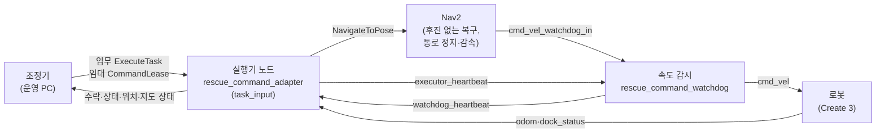

# 로봇 실행기 구현 기록

## 한눈에 (2026-10-15, main `f6e56b6`)

이 문서가 답하는 질문은 하나다. **로봇 담당 PC 에서 도는 코드는 임무 하나를 받아 로봇을 어떤 순서로 움직이고 세우나?**



- 로봇 담당 PC 는 로봇마다 `robot.launch.py` 하나로 세 가지를 띄운다. Nav2, 속도 감시(`command_watchdog`), 실행기(`task_input`)다. 실행기와 속도 감시 노드는 로봇 namespace(TB-6 `/robot6`, TB-5 `/robot5`) 안에 있다.
- 조정기는 Nav2 를 직접 부르지 않는다. 임무는 실행기만 받고, 로봇의 `cmd_vel` 은 속도 감시 노드만 쓴다.
- 로봇·PC 이름은 [용어집](../glossary.md)을 따른다. 임무 흐름 전체는 [scope 「지금 시나리오」](../requirements/scope.md)에, 기능별 상태와 파라미터는 [rescue_robot README](../../src/rescue_robot/README.md)에 있다. 현장 값은 [현장 파일](../../config/field/search_area.field.json)에 있다.
- 두 로봇으로 처음부터 끝까지 돌린 실기 회차는 아직 없다(NOT_RUN). 2026-10-14 현장 회차에서는 TB-6 지도 고정이 실패했다. 원인은 기울어진 실제 TF(좌표 변환) 를 SLAM(지도 작성과 위치 추정을 함께 하는 방법) 위치 계산이 거절한 것이다. #291 이 고쳤다. 두 TF 를 3D 로 합성한 뒤 지도 평면으로 내리고, 합성한 기울기가 10도(`slam_tf_pose.py` `MAX_TILT_RAD`, [제안])를 넘을 때만 위치를 만들지 않는다. 한 PC 리허설(현장 TF 값)에서는 지도 고정이 통과했고, 실기는 NOT_RUN 이다.

## 노드와 파일

| 노드(실행 파일) | 파일(`src/rescue_robot/rescue_robot/`) | 맡은 일 |
| --- | --- | --- |
| 실행기 `rescue_command_adapter`(`task_input`) | `task_input_node.py` → `ros_node.py` | 노드 시작. 기본값 없는 파라미터를 받고 빠진 값이 있으면 시작하지 않는다 |
| 〃 | `task_site_runtime.py` | 현장 입력(LIVE_ROS). 임무 수락 관문, `~/task_arm`·`~/task_stop` 서비스, 완료 뒤 자동 재준비 |
| 〃 | `task_server.py`, `task_ingress.py`, `task_wire.py` | 임무 액션 `ExecuteTask` 와 임대 `CommandLease` 의 모양 검사 |
| 〃 | `nav2_adapter.py` | 실행기 코어와 Nav2 `NavigateToPose` 를 잇는다. 수락·발송·취소·종료·정지 관측을 서로 다른 입력으로 넘긴다 |
| 〃 | `executor.py` | 실행기 코어(ROS 없음). 한 번에 임무 하나, 준비(arm)·수락·발송·임대·취소·정지 확인 |
| 〃 | `readiness.py` | 준비 신호. odom·scan·카메라·TF·속도 감시 heartbeat 의 수신 나이 |
| 〃 | `live_sources.py`, `slam_tf_pose.py` | 지도와 위치 입력. TB-6 탐색 중 위치는 TF `map→base_link` |
| 〃 | `live_pose.py` | 위치 `RobotPose`·지도 상태 `MapState` 발행 |
| 〃 | `live_passage.py` | Nav2 `collision_monitor` 상태를 읽어 통로 정지 사유 `PASSAGE_BLOCKED` 를 붙인다 |
| 〃 | `live_clock.py`, `clock_capture.py` | 이 PC 와 조정기 PC 의 시계 측정. 같은 PC 면 거절(`LIVE_ROS expects two distinct PCs`) |
| 〃 | `live_parameters.py` | ROS 파라미터 → 현장 입력 설정. 고정 지도 모드에서 빈 지도 해시를 받는다(#298) |
| 속도 감시 `rescue_command_watchdog`(`command_watchdog`) | `watchdog.py`, `watchdog_node.py` | 마지막 속도 경로. 한계 초과·heartbeat 끊김이면 영구 정지(`STOP_LATCHED`), 풀기는 `~/reset` 만 |
| 지도 고정 `rescue_map_freeze`(`map_freeze`) | `map_freeze.py` | TB-6 담당 PC 에서 한 번만 띄운다. [지도 구현 기록](implementation-mapping.md) |
| 고정 지도 중계 `rescue_frozen_map_relay` | `frozen_map_relay.py` | 고정 지도를 `<ns>/map` 으로 복사한다. [지도 구현 기록](implementation-mapping.md) |

launch 쪽(`src/rescue_bringup/`)은 아래 셋이 로봇 동작에 닿는다.

| 파일 | 하는 일 |
| --- | --- |
| `launch/robot.launch.py` | TurtleBot4 Nav2 를 띄우고 최종 속도 출력을 `<ns>/cmd_vel_watchdog_in` 으로 돌린다. 이어서 속도 감시와 실행기를 띄운다. arm·임무·이동 명령은 보내지 않는다 |
| `rescue_bringup/nav2_recovery.py` | Nav2 복구에서 후진(`BackUp`)을 뺀다(#267, 재범 승인 2026-10-14). 플러그인을 빼고 `bt_navigator` 를 후진 한 줄만 뺀 BT(행동 트리) 사본(`behavior_trees/*_no_backup.xml`)으로 바꾼다 |
| `rescue_bringup/field_launch.py` `nav2_with_passage` | 현장 파일 `robot` 절 `passage.*` 값을 Nav2 `collision_monitor` 에 넣는다. 머리 위 통로 정지 `PassageStop`(#226)과 감속 `PassageSlow`(#260) |

## 임무 한 건의 순서

실행기는 `step_period`(현장 0.05 s)마다 한 번 판단한다. 아래 순서는 `executor.py` 의 상태(`state`)와 정지 잠금(`latch`) 이름을 그대로 쓴다.

| 순서 | 무엇이 일어나나 | 코드 | 실패하면 |
| --- | --- | --- | --- |
| 1 준비 | 사람이 `<ns>/rescue_command_adapter/task_arm` 을 부른다. 조정기 권한(authority)과 시계를 먼저 본다. 이어서 작업 없음, 세션 오류 없음, 최근 정지 증거, 준비 신호 여섯 개(드라이버·센서·SLAM·Nav2·언도킹·속도 감시)를 본다. 맞으면 잠금이 `ARMED` 가 되고 `RobotStatus.readiness` 가 `READY` 다 | `task_site_runtime.py:arm`, `executor.py:_arm_refusal` | 응답 `success=False`(`STOP_OR_READINESS_NOT_READY` 또는 오류 글). 조정기는 READY 가 아닌 로봇에 임무를 내지 않는다 |
| 2 수락 | 조정기의 `ExecuteTask` 를 받는다. 발행자·임대·시계·지도 기준(revision)·로봇별 허용 종류를 본다. 수락하면 `TaskAdmission` 을 낸다 | `task_site_runtime.py`, `executor.py:admit` | 거절 receipt 와 이유 코드. 같은 명령 ID 에 다른 내용이면 `ID_CONTENT_CONFLICT` |
| 3 발송 | 매 step 준비 신호·지도 guard·기한·임대를 다시 본다. 모두 맞으면 임무 좌표를 로봇 지도 좌표로 바꿔 `NavigateToPose` 를 보낸다 | `executor.py:dispatch`, `nav2_adapter.py`, `goal_binding.py` | 보내지 않는다. 준비가 풀리면 `STOPPING` 으로 간다 |
| 4 주행 | 조정기가 임대를 `lease_renew_period_s`(현장 0.5 s)마다 갱신한다. 실행기는 매 step guard 를 다시 본다 | `executor.py:tick`, `renew` | 임대 만료·guard 실패·`task_stop` 이면 Nav2 목표를 취소하고 `STOPPING` |
| 5 끝 | Nav2 가 끝(SUCCEEDED·CANCELED·ABORTED)을 알린 뒤, 최근 odom 표본이 연속으로 속도 상한 안이면 정지 확인이다. 결과는 `COMPLETED` 등이고 잠금은 `STOP_LATCHED` 다 | `executor.py:goal_terminal`, `observe_motion`, `_finish` | 시한 안에 정지를 확인하지 못하면 `FAILED / STOP_UNCONFIRMED`, 잠금 `FAULT_LATCHED` |
| 6 다시 준비 | `COMPLETED` 이고 정지가 확인됐고 세션 오류가 없으면, 1번과 같은 검사를 다시 해서 스스로 `ARMED` 가 된다(#281, 재범 4등급 승인 2026-10-14) | `executor.py:rearm_after_completion`, `nav2_adapter.py:_after` | 검사가 맞지 않으면 `STOP_LATCHED` 로 남고 `RobotStatus.stop_reason` 이 `REARM_REFUSED_<이유>` 다. 실패·취소·정지 버튼 뒤에도 `task_arm` 을 기다린다 |

- 자동 재준비는 로봇별 파라미터 `task.live.auto_rearm`(기본값 없음)으로 켠다. 현장 파일은 두 로봇 모두 켰다.
- 정지 확인은 Nav2 의 끝 알림만으로 하지 않는다. 취소 응답이나 0 속도 명령도 정지 증거가 아니다. odom 표본이 실제로 멈춘 것을 보여야 한다.
- 현장 입력(LIVE_ROS)은 수색 `SEARCH_AREA` 를 받는다. 그 밖에 자동으로 받는 종류는 로봇별 현장 파일 값 `robots.<id>.task.live.auto_target.kinds` 에 있다. TB-6 은 `REOBSERVE_TARGET`·`RETURN_HOME`, TB-5 는 `APPROACH_TARGET`·`RETURN_HOME` 이다. 받는 조건은 [rescue_robot README](../../src/rescue_robot/README.md) 「자동 대상 접근」 절에 있다.

## 멈추는 경로

로봇을 세우는 길은 넷이다. 위에서부터 사람이 먼저 쓰는 순서다.

| 경로 | 누가 | 무엇을 하나 | 근거 |
| --- | --- | --- | --- |
| 현장 정지 스크립트 | 사람 | `bash scripts/field/stop_robot.sh /robot6` 한 줄로 실행기 `task_stop` → Nav2 목표 모두 취소 → `cmd_vel` 0 을 보낸다. 단계마다 `[보냄]`·`[없음]`·`[실패]` 를 찍고, 끝에 남은 노드와 프로세스 PID 를 보여 준다 | `scripts/field/stop_robot.sh`, #256 |
| 실행기 정지 | 실행기 | 임대 만료, guard 실패, `task_stop` 이면 Nav2 목표를 취소하고 정지 확인을 기다린다 | `executor.py:request_stop` |
| 속도 감시 영구 정지 | 속도 감시 | 실행기 heartbeat 가 `heartbeat_max_age_s` 넘게 없거나, 속도가 한계(현장 0.3 m/s, 1.2 rad/s [임시값 #132])를 넘거나, 값이 유한하지 않으면 `STOP_LATCHED`. 이후 모든 명령을 0 으로 바꾼다. heartbeat 가 돌아와도 풀리지 않고 `~/reset` 으로만 푼다 | `watchdog.py`, #256 |
| 노드 종료 | launch | `robot.launch.py` 를 Ctrl+C 하면 속도 감시가 꺼지기 전에 `cmd_vel` 0 을 세 번 보낸다(로그 `watchdog stopped: 3 zero commands on <ns>/cmd_vel`) | `watchdog_node.py:zero_commands`, #256 |

이 넷으로도 멈추지 않으면 사람이 로봇을 들어 올린다. 속도 감시는 ROS 프로세스 안의 소프트웨어다. 물리 안전 인증이 아니다.

## 통로 정지와 감속

| 기능 | 무엇을 보고 | 무엇을 하나 | 근거 |
| --- | --- | --- | --- |
| 통로 정지 `PassageStop` | 깊이 점 `<ns>/passage_points` 가 머리 위 여유 0.46 m 띠 안에 있고 로봇 앞에 있음 | Nav2 `collision_monitor` 가 멈춘다. 실행기 feedback 과 결과에 `PASSAGE_BLOCKED` | `field_launch.py:nav2_with_passage`, `live_passage.py`, #219·#226 |
| 통로 감속 `PassageSlow` | 같은 깊이 점이 라이다 평면 위에 있음 | 속도를 0.3 배로 줄인다 [제안]. 벽 앞에서도 줄인다(벽과 터널을 구분하지 못함) | 같은 함수, #260 |

- 높이·거리 숫자는 현장 파일 `robot` 절 `passage.*` 한 곳에 있다. 결정은 scope Q-25(46 cm)다.
- 깊이 점이 오지 않으면 `collision_monitor` 가 1 s 뒤 로봇을 세운다. 깊이 없는 로봇은 `robot.launch.py` 가 띄우지 않는다.
- 깊이 점은 `passage_points.launch.py` 가 만든다(`depth_image_proc` 필요). 지도 위 터널 표시는 인식 쪽 `overhead_passage` 노드다([rescue_perception README](../../src/rescue_perception/README.md)).

## 시험

| 층위 | 무엇 | 명령 또는 기록 |
| --- | --- | --- |
| E2 로봇 없이 | 실행기 코어, 어댑터, 현장 입력, 속도 감시, launch 값, 후진 없는 BT | `python3 -I scripts/run_tests.py` |
| E3 ROS 통합(가짜 로봇) | odom 정지 증거, 준비 신호, 속도 감시 latch·reset | `tests/ros/e3_odom_probe.py`, `e3_readiness_probe.py`, `e3_watchdog_probe.py`([rescue_robot README](../../src/rescue_robot/README.md) 「검사」) |
| E3 한 PC 리허설 | 실제 namespace 로 현장 노드를 모두 띄우고 배선·지도 고정·임무 시작을 실제 메시지로 확인. 첫 회차에서 실행기가 시작하자마자 꺼지는 문제를 찾았다(#298) | [리허설 기록 2026-10-14](../evidence/rehearsal-2026-10-14-wiring-one-pc.md), `scripts/field/wiring-rehearsal/run.sh`(#299) |
| E4 실기 | 회차 전체 | NOT_RUN. 2026-10-14 TB-6 지도 고정 실패, #291 이 고침(실기 확인 전) |

## 아직 확인하지 못한 것

- 현장 회차 전체(arm → 탐색 → 두 번 고정 → TB-5 출동 → 출구 도착). NOT_RUN.
- 자동 재준비가 실기에서 TB-6 을 탐색 지점마다 멈추지 않게 하는지, TB-5 가 사람 앞에서 `support_exit_wait_s` 뒤 출구로 떠나는지. NOT_RUN.
- Create 3 `cmd_vel` 형식(`TwistStamped`)과 종료 0 명령이 로봇에 닿는지. NOT_RUN.
- 속도 감시 현장 값. 지금 값은 #132 임시값이고 결정 방식은 #94 에 남아 있다.
- Nav2 경로 따라가기 컨트롤러 교체(DWB → Rotation Shim + Regulated Pure Pursuit)는 열린 PR #300 이다. ㄷ 자 막다른 곳 비교 회차 전이라 main 에 없다.

## 기록 (2026-10-08 판)

아래는 2026-10-08 판 본문을 그대로 옮긴 것이다. 당시에는 ROS 연결이 없는 Python 코어만 있었다. 지금 상태는 위 절을 본다.

### PR 5 — 로봇 명령·정지 판정 코어

계획 PR 5의 **선행 Python 코어 구현**이다. 계획의 두 로봇 SLAM·Nav2 실제 연결/기동과 CT-08 실기 통과는 완료되지 않았다. PR 6~10을 작성할 수 있는 검증 가능한 임무 경계를 마련한다. 이 범위 변경은 실기 인수 조건을 삭제하지 않는다.

#### 동작

- UUID 명령·임무·로봇 세션·authority와 uint64 generation을 검증한다. 동일 명령/내용은 같은 수락 결과, 동일 ID/다른 내용은 충돌이다. 거절도 해당 ID의 불변 결과로 유지한다. 재시도 조건이 달라지면 새 명령 ID가 필요하다.
- `arm`은 fresh 정지 증거와 준비 상태가 있어야 한다. 다른 authority는 기존 authority를 명시한 stopped 등록 절차를 거친다. UUID 크기로 신구를 판정하지 않는다.
- 수락과 발송을 분리한다. `dispatch`에서 준비 상태·외부 guards·기한·임대를 다시 검사한다. 도킹 상태나 watchdog 미준비 상태에서는 이동 의도를 만들지 않는다.
- 수락 지연·deadline/lease 만료·guard 손실은 STOPPING으로 전이한다. 만료 후 임대 갱신은 부활시키지 않는다. 늦은 수락은 그 명령 UUID의 취소 의도를 만든다.
- 정지는 **액션 종료 fence + 연속된 fresh odometry 표본의 선속도/각속도 상한 충족**으로 판정한다. 취소 요청/응답·제로 속도 명령만으로 정지 성공 처리하지 않는다. 시한 초과는 `FAILED / STOP_UNCONFIRMED`, 원래 원인, `stop_confirmed=false`를 남기고 fault latch를 유지한다.
- Nav2 성공 뒤 정지한 `COMPLETED`는 경로 실행 경계의 결과다. 대상 재관측·신원·거리 조건을 확인하는 `APPROACH_COMPLETE`는 조정 계층에서 별도로 판정해야 한다.

#### 시험과 실행

```bash
python3 -I scripts/run_tests.py
python3 -I scripts/check_docs.py
```

공통 runner는 자신의 저장소 경로에서 시험을 탐색하고 하위 프로세스에도 동일 source 경로를 전달한다. 수집 0개를 오류로 처리한다. 첫 runner 실행에서 기존 CLI 하위 프로세스 3개가 import 경로를 받지 못한 실패를 발견했고, runner의 자식 환경 경로를 수정했다. 배포 검사 자체의 기대값은 바꾸지 않았다.

E2 시험은 중복/충돌·다른 로봇/boot/authority·미준비·발송 전 guard 손실·늦은 수락·임대 중복/만료·연속 정지·정지 시한 실패·이전 결과·잘못된 입력·단조 시계 역행을 확인한다. ROS·실제 액션 통신·장비측 정지는 E3/E4 미실행이다.

#### 출처와 설계 변경

P4 [goal_timer](https://github.com/jaebeom/ROKEY_P4/blob/1a2d0a9811f59a501c7597edf54c72fec8a80e26/src/rokey_amr/rokey_amr/goal_timer.py#L83-L173)의 수락/결과/취소 시간 경계와 늦은 수락 처리 원리를 참고했다. 원본 코드 복사 없이 C06 계약에 맞춰 새로 작성했다. P4 [FSM](https://github.com/jaebeom/ROKEY_P4/blob/1a2d0a9811f59a501c7597edf54c72fec8a80e26/src/rokey_amr/rokey_amr/fsm.py#L770-L815)의 AMCL 초기화·도크 준비 정책은 이식하지 않았다.

AMR [대상 만료 처리](https://github.com/mi1nn/amr-mini-project/blob/ee355d0b5896ea58bccac73ce1a7857f62e96024/src/rokey_pjt/rokey_pjt/rc_car_follower.py#L517-L528)는 반환만으로 기존 이동이 멈추는지 점검할 반례다. 이번 코어는 명시적인 취소와 정지 증거를 분리한다.

#### 연결 전에 필요한 것

1. 실제 로봇/ROS 배포판/네임스페이스/도메인/발행자 확인, SLAM·Nav2·센서 ready 수집. 현재 `Readiness`는 어댑터가 제공해야 하는 입력일 뿐 실제 검사기가 아니다.
2. `SEND` 의도를 목표 좌표·정확한 map session/revision에 결합하는 ROS action 어댑터. 목표 wire schema, wall clock bound 검사, 원격 인증/권한과 replay 방어, 프로세스 재시작 상태 복구는 미구현이다.
3. goal terminal callback이 더 이상 속도 의도를 낼 수 없다는 실행 fence와 로봇측 정지 감시. fault latch 복구는 현재 세션 재생성 전에 운영자/어댑터가 원인 해소·정지를 증명해야 한다. 원격 reset API는 없다.
4. 언도킹은 별도 준비 액션이다. 도킹 중 카메라 절전과 Nav2 미준비를 고려한 실제 운영 절차는 미구현이다.
5. `seen`/결과 이력은 프로세스 메모리이며 크기 제한·영속 세션/세대 저장은 후속 실기 어댑터의 필수 과제다. 장시간 공개 서비스로 사용하지 않는다.

CT-06/07/08의 일부 코어 불변식만 E2 증거를 얻는다. 상위 계약 전체와 계획 PR 5의 완료는 선언하지 않는다.

#### CLA-18/19/20 최종 수정

- `rescue_contracts`의 canonical error + qualified diagnostic, 정확한 int64 ns wall time과 TaskAdmission을 사용한다. 로컬 monotonic timer는 float 초이며 overflow/정밀도 소실 거절과 clock fault latch를 보존했다.
- `Executor(..., allowed_robot_ids=...)`는 프로파일에서 정확히 2개 ID를 명시적으로 받는다. Task DTO는 ID 형식만 검사하고 실행기가 대상·boot·authority·generation·policy를 확인한다.
- bounded odometry만 있고 action fence가 없는 실행 중 상태는 `MOVING`이다. 실제 정지를 요청한 STOPPING에서만 `STOP_REQUESTED`를 사용한다.
- `goal_terminal(..., terminal_status=...)`는 SUCCEEDED/CANCELED/ABORTED를 구별하고 Result.action_status와 original_cause를 보존한다. 중복 terminal은 정지 창을 초기화하지 않고 상충하는 terminal은 거절한다.
- CI의 `python -I scripts/run_tests.py`에 무효였던 PYTHONPATH 설정을 제거했다. 프로파일 CLI 단계의 환경은 유지한다.

`tests/test_executor_review.py`는 새 API와 위 문제의 회귀시험이다. 실물 driver/Nav2/odometry 및 준비용 undock는 연결하지 않았고, 모든 motion/정지 증거는 합성 E2 입력이다.

#### Task 의 goal 필드 (2026-10-08)

- C-06 Goal 의 `search_area_ref` 와 이동 목표를 `Task` 에 싣는다. `SEARCH_AREA` 는 `search_area_ref`(UUID) 필수, 다른 kind 는 `None`. `SEARCH_AREA`·`REOBSERVE_TARGET`·`APPROACH_TARGET` 은 `goal_pose` 필수, `HOLD` 는 `None`.
- `GoalPose(frame_id, x, y, yaw, map_session_id, map_revision, transform_revision)` 는 모양만 검사한다(유한값, canonical UUID, uint64; `transform_revision` 도 필수). 그 좌표가 현재 지도에서 유효한지·도달 가능한지는 mapping/coordination 이 판정한다. `SEARCH_AREA` 의 `goal_pose` 는 당분간 구역 대표점이고 frontier 선택은 후속이다.
- 두 필드는 `Task` 동등성에 포함되므로 같은 `command_id` 에 다른 구역·좌표가 오면 `ID_CONTENT_CONFLICT` 다(`tests/test_task_goal_fields.py`).
