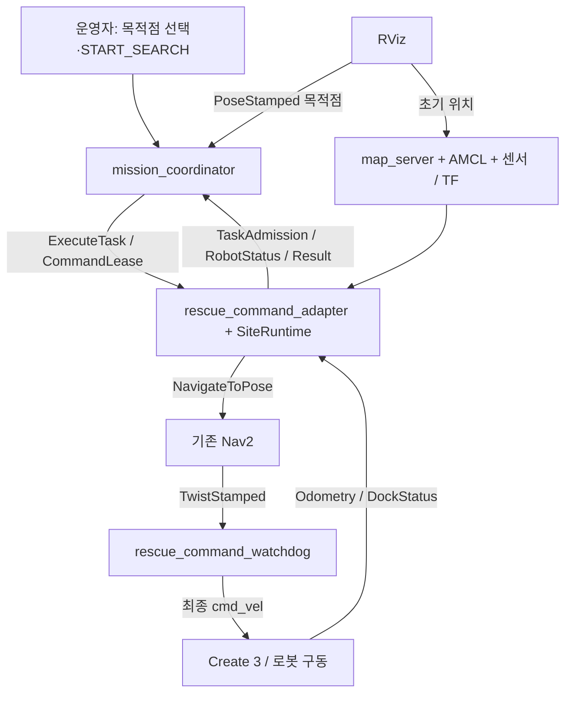
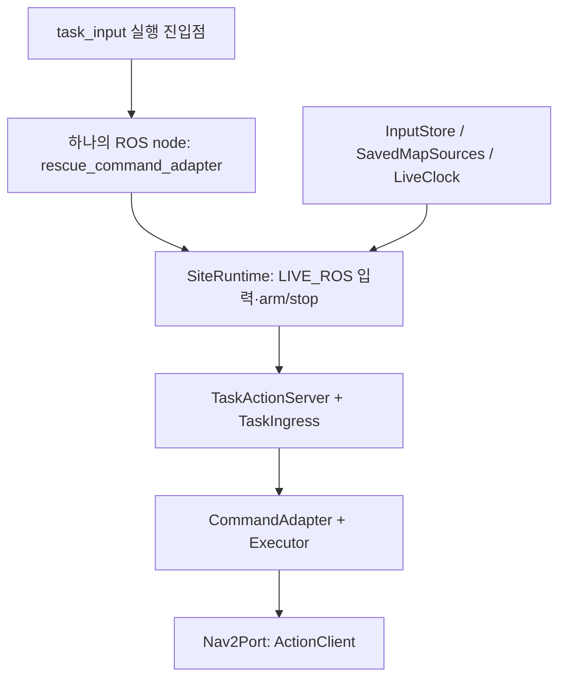
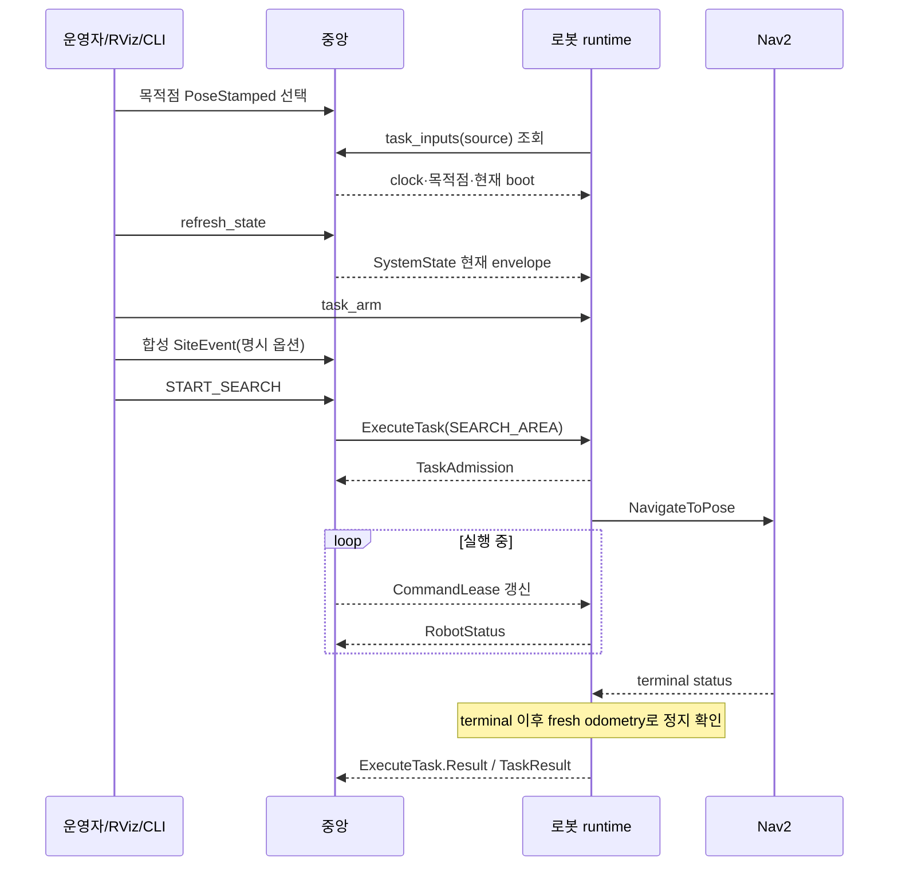
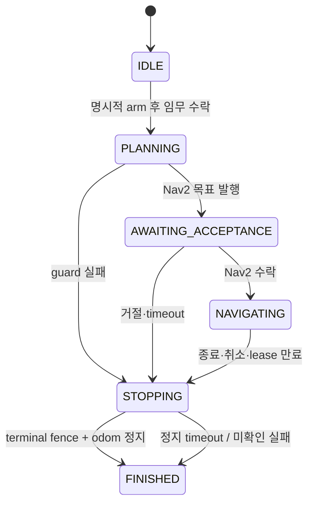

> **기록 문서 (2026-10-12 ~ 13, PR #132 기준).** 이 문서는 당시 단일 로봇 SEARCH_AREA 연결을 설명한다. 지금 코드와 다른 곳이 있다. 지금 구현은 [로봇 구현 기록](implementation-robot.md)을 본다.
>
> 지금 현장 실행 순서는 [현장 실행 안내](../process/field-runbook.md)를 따른다.

# SEARCH_AREA 로봇 실행기 구현과 ROS 인터페이스

## 1. 기준 코드와 구현 범위

이 문서는 **GitHub에 병합된 PR #132의 최종 head 9d79c656ee256a1b657e50fe097a24060c926efb**를 기준으로, 단일 로봇의 SEARCH_AREA 임무와 ROS 인터페이스를 설명한다. PR merge commit은 f22e9fbc94a6b3da8a65ab75ad067cc4eeea5353이다.

저장소 배치 경로는 docs/implementation/robot-search-area-20261012.md다. 설명 대상은 **task.input_mode=LIVE_ROS**의 SEARCH_AREA 연결이다. 기능과 타입은 최종 코드에서 확인하고 장비 실행 증거는 13절에서 따로 표시한다.

| 구현 기능 | 연결 |
| --- | --- |
| 목적점 수신 | 중앙 node가 PoseStamped를 받아 목적점 하나를 메모리에 보관 |
| 임무 시작 | 명시적 START_SEARCH 접수 후 ExecuteTask 발행 |
| 임무 입력 | 기존 task_input / SiteRuntime에서 Goal·권한·시계·지도·readiness 검사 |
| 실시간 입력 | 지도·AMCL·SystemState 구독, 중앙 task_inputs 비동기 조회 |
| Nav2 연결 | 목적점 바인딩, NavigateToPose Goal·응답·취소·종료 처리 |
| lease 갱신 | CommandLease의 ID·시각·sequence 검증과 로컬 기한 갱신 |
| 정지 확인 | action fence 이후 fresh odometry의 연속 정지 구간 판정 |
| 상태 보고 | TaskAdmission / RobotStatus / ExecuteTask Feedback·Result |
| 최종 속도 보호 | Nav2 최종 속도와 executor heartbeat를 watchdog에서 검사 |

LIVE_ROS는 SEARCH_AREA만 수락한다. 이 연결에서 SEARCH_AREA는 **선택한 목적점 하나로 이동하고 정지 결과를 보고하는 임무**로 구현되어 있다. 수신·반환 구조의 비적용 필드는 부록에 표시한다. [S1–S9]

## 2. 전체 아키텍처

### 2.1 제어 경로



중앙은 임무를 할당하고 lease를 발행한다. 중앙에서 `/robot6/cmd_vel`이나 Nav2를 직접 호출하지 않는다. 로봇 담당 PC의 `rescue_command_adapter`가 ExecuteTask를 받아 좌표·권한·준비 상태를 확인하고 Nav2 action을 호출한다. Nav2 최종 속도는 watchdog 입력으로 보내고, watchdog이 로봇의 최종 속도 토픽으로 전달한다. [S2–S6]

### 2.2 내부 구성과 ROS node의 차이



`SiteRuntime`, `TaskActionServer`, `TaskIngress`, `InputStore`, `LiveClock`, `SavedMapSources`, `Executor`, `CommandAdapter`, `Nav2Port`는 **프로세스 내부 Python 객체**다. 각각 독립 ROS node가 아니다. `task_input`은 실행 파일 이름이고 실제 node 이름은 `rescue_command_adapter`다. 별도 SearchRuntime을 새로 두지 않고 기존 SiteRuntime에 LIVE_ROS를 연결했다. [S2–S5]

| 구성 | 파일 | 역할 |
| --- | --- | --- |
| task_input | task_input_node.py | 기존 adapter main에 runtime factory를 연결 |
| SiteRuntime / InputStore | task_site_runtime.py | 중앙 세션·권한·목적점·지도 입력 검증, arm/stop 서비스 |
| LIVE_ROS 설정 | live_parameters.py | 타입이 지정된 ROS parameter로 현장 설정 구성 |
| SavedMapSources | live_sources.py | 실제 OccupancyGrid 해시와 AMCL 원 stamp·공분산 확인 |
| LiveClock | live_clock.py | 두 PC의 실측 OS clock과 중앙 목적점 조회 |
| TaskActionServer | task_server.py | ExecuteTask Goal/Feedback/Result, lease 구독, 상태·수락 발행 |
| TaskIngress | task_ingress.py | wire 입력·시각·임무/lease 동일성 확인 |
| MissionGoalBinder | goal_binding.py | 임무 frame에서 로봇 지도 frame으로 목표 바인딩 |
| CommandAdapter / Executor | nav2_adapter.py / executor.py | 임무 상태, Nav2 호출·취소, lease 만료, odometry 정지 판정 |
| Nav2Port | ros_node.py | NavigateToPose ActionClient와 콜백 |
| 중앙 입력 | live_task_inputs.py | RViz 목적점, task_inputs 서비스, 상태 재발행 지원 |
| watchdog | watchdog_node.py / watchdog.py | 속도·executor heartbeat 검사 및 최종 속도 출력 |

표의 파일은 `src/rescue_robot/rescue_robot/` 기준이며 중앙 입력은 `src/rescue_coordination/rescue_coordination/`에 있다.

## 3. node·ID·frame 대응

| 종류 | 실행 묶음의 값 | 의미 |
| --- | --- | --- |
| 논리 로봇 ID | `robot_a` | 중앙 할당 및 임무 메시지의 식별자 |
| 물리 ROS namespace | `/robot6` | 센서·Nav2·로봇 구동 토픽 경로 |
| 임무 통신 prefix | `/rescue/robots/robot_a` | ExecuteTask·lease·status·admission |
| 임무/저장 지도 frame | `map` | 목표 위치의 좌표 기준 |
| odom frame | `odom` | 실행 묶음의 readiness에서 확인하는 TF의 child frame |
| 로봇 base frame | `base_link` | Nav2/AMCL 설정에서 쓰는 로봇 기준 frame |
| 정책 이름 | `search-live-20261012` | 실행 묶음의 임시 현장 정책 식별자 |

`/robot6`라는 토픽 namespace와 `robot_a`라는 메시지 식별자는 다른 개념이다. 또한 토픽 namespace가 `/robot6`이어도 `header.frame_id`가 자동으로 `robot6/map`이 되는 것은 아니다. 이 구성은 `map → odom` TF edge를 확인한다. [S2, S4, S8]

| 실제 ROS node / 구성 | 실행 위치 역할 | 동작 |
| --- | --- | --- |
| `/mission_coordinator` | 중앙 PC | 임무 할당, lease 갱신, 상태 발행, 운영 명령 접수 |
| `/robot6/rescue_command_adapter` | 로봇 담당 PC | 임무 수신·검증, Nav2 목표/취소, 상태/결과 보고 |
| `/robot6/rescue_command_watchdog` | 로봇 담당 PC | Nav2 최종 속도 보호 경로 |
| `/robot6/rokey_search_rviz` | 로봇 담당 PC | 초기 위치 및 목적점 선택, map/scan/plan 표시 |
| `/robot6/map_server`, `/robot6/amcl` | localization launch | 저장 지도 발행, 위치 추정, map→odom TF |
| 기존 Nav2 구성 | navigation launch | bt_navigator, planner/controller, smoother, collision_monitor, lifecycle 구성 등 |
| 로봇 기본 구동·센서 구성 | 실제 TurtleBot4 | odom/dock/scan/camera/TF 제공, 최종 cmd_vel 수신 |

실행 묶음의 새 코드가 TurtleBot4 전체 node를 대체하지 않는다. Nav2 내부 구성·플러그인 상세는 설치된 TurtleBot4 패키지에 따르며 이 문서는 실제로 연결한 경계까지만 설명한다.

## 4. topic 목록과 QoS

아래 QoS는 **이 문서 기준 코드에서 직접 선언한 측**의 설정이다. 외부 node publisher의 QoS와 실제 매칭 상태를 검사한 결과와는 구분한다. 숫자만 넘긴 `create_publisher/subscription(..., 10)`은 통상 Reliable / Volatile / Keep Last 깊이 10 설정이다. [S2–S8]

### 4.1 중앙 ↔ 로봇 임무 통신

| topic | ROS 타입 | 송신 → 수신 | 사용 목적 | 코드의 QoS |
| --- | --- | --- | --- | --- |
| `/rescue/search_goal` | geometry_msgs/msg/PoseStamped | RViz → 중앙 | 평면 목표 x/y/yaw 선택 | RViz Reliable/Volatile; 중앙 Best Effort/Volatile/1 |
| `/rescue/site_events` | rescue_interfaces/msg/SiteEvent | 실행 묶음의 시작 CLI → 중앙 | `--synthetic-trigger`일 때 합성 DISASTER_SIGN | 중앙 10; CLI 발행은 ros2 CLI 설정 |
| `/rescue/system_state` | rescue_interfaces/msg/SystemState | 중앙 → 로봇 runtime | 중앙 boot/session 등록, 모드 snapshot | 양측 Reliable/Transient Local/1 |
| `/rescue/robots/robot_a/command_lease` | rescue_interfaces/msg/CommandLease | 중앙 → 로봇 | 실행 권한 기한 갱신 | 중앙 Reliable/Volatile/1; 로봇 Reliable/Volatile/10 |
| `/rescue/robots/robot_a/task_admission` | rescue_interfaces/msg/TaskAdmission | 로봇 → 중앙 | 임무 수락/거절 및 상세 이유 | 양측 Reliable/Volatile/10 |
| `/rescue/robots/robot_a/status` | rescue_interfaces/msg/RobotStatus | 로봇 → 중앙 | boot, readiness, 임무·이동·lease 상태 | 로봇 Reliable/Volatile/10; 중앙 Reliable/Volatile/1 |

### 4.2 로봇 센서·위치·속도

| topic | ROS 타입 | 연결 | 이번 코드의 사용 | 구독/발행 QoS |
| --- | --- | --- | --- | --- |
| `/robot6/map` | nav_msgs/msg/OccupancyGrid | map_server → runtime/RViz/Nav2 | 실제 해시·frame·지도 일치 검사 | runtime Reliable/Transient Local/1 |
| `/robot6/amcl_pose` | geometry_msgs/msg/PoseWithCovarianceStamped | AMCL → runtime | 원 시각·공분산·위치 유효성 | sensor_data: Best Effort/Volatile/5 |
| `/robot6/initialpose` | geometry_msgs/msg/PoseWithCovarianceStamped | RViz → AMCL | 실제 초기 위치 설정 | RViz Reliable/Volatile |
| `/robot6/odom` | nav_msgs/msg/Odometry | 로봇 → adapter | readiness, 실제 속도와 정지 구간 | sensor_data |
| `/robot6/dock_status` | irobot_create_msgs/msg/DockStatus | 로봇 → adapter | `is_docked`로 undocked 판정 | sensor_data |
| `/robot6/scan` | sensor_msgs/msg/LaserScan | LiDAR → adapter/Nav2/RViz | adapter에서는 도착 freshness; Nav2에서 장애물 입력 | adapter sensor_data |
| `/robot6/oakd/rgb/image_raw/compressed` | sensor_msgs/msg/CompressedImage | OAK-D → adapter | 도착 freshness만 확인, 탐지 추론하지 않음 | sensor_data |
| `/robot6/tf` | tf2_msgs/msg/TFMessage | TF 발행 구성 → adapter/RViz/Nav2 | `map → odom` edge의 도착 확인 | adapter Reliable/Volatile/100 |
| `/robot6/tf_static` | tf2_msgs/msg/TFMessage | 정적 TF → RViz/Nav2 | 기존 센서·로봇 좌표 연결 | task_input의 직접 구독 대상 아님 |
| `/robot6/plan` | nav_msgs/msg/Path | Nav2 → RViz | 계획 경로 표시 | RViz Reliable/Volatile/5 |
| `/robot6/cmd_vel_watchdog_in` | geometry_msgs/msg/TwistStamped | Nav2 최종 출력 → watchdog | watchdog 검사 전 속도 | watchdog Reliable/Volatile/10 |
| `/robot6/cmd_vel` | geometry_msgs/msg/TwistStamped | watchdog → 로봇 | 최종 속도 명령 | watchdog Reliable/Volatile/10 |
| `/robot6/rescue/executor_heartbeat` | std_msgs/msg/Header | adapter → watchdog | 실행기 프로세스 생존, 매 step 발행 | 양측 Reliable/Volatile/10 |
| `/robot6/rescue/watchdog_heartbeat` | std_msgs/msg/Header | watchdog → adapter | watchdog 정상 상태 freshness | 양측 Reliable/Volatile/10 |

실행 묶음의 `wheel_status_topic`은 빈 문자열이므로 wheel_status 구독은 연결하지 않았다. camera/scan readiness는 **메시지 도착 확인**이며 인식 결과나 센서 내용의 품질 인증이 아니다. watchdog heartbeat도 custom `rescue_interfaces/Heartbeat`가 아니라 `std_msgs/Header`다.

## 5. service와 action

### 5.1 서비스

| 경로 | 타입 | Request | Response | 작동 의미 |
| --- | --- | --- | --- | --- |
| `/rescue/operator_command` | rescue_interfaces/srv/SubmitOperatorCommand | operation·operator/robot ID·시각 등 | accepted: bool, reason_code: string 등 | 명시적 START_SEARCH 접수 |
| `/mission_coordinator/task_inputs` | rcl_interfaces/srv/GetParameters | names: string[], 실행 묶음의 `['source']` | values: ParameterValue[] | 메모리의 중앙 시계·목적점·정책 조회 |
| `/mission_coordinator/refresh_state` | std_srvs/srv/Trigger | 빈 request | success: bool, message: string | 기존 SystemState snapshot 재발행 |
| `/robot6/rescue_command_adapter/task_arm` | std_srvs/srv/Trigger | 빈 request | success: bool, message: string | fresh 정지/입력/readiness 확인 후 실행기 arm |
| `/robot6/rescue_command_adapter/task_stop` | std_srvs/srv/Trigger | 빈 request | success: bool, message: string | 기존 실행기 CANCEL_USER 정지 요청 |
| `/robot6/rescue_command_watchdog/reset` | std_srvs/srv/Trigger | 빈 request | success: bool, message: string | fresh executor heartbeat가 있을 때 watchdog latch 해제 |
| `/robot6/request_nomotion_update` | std_srvs/srv/Empty | 없음 | 없음 | 정지 중 다음 실제 scan으로 AMCL 갱신 요청 |

`task_stop.success=True`는 정지 요청을 전달했다는 뜻이다. 실제 정지 확인은 RobotStatus/TaskResult와 odometry에서 이루어진다. `task_arm`과 watchdog `reset`은 서로 다른 객체의 상태를 바꾼다. [S3, S5–S8]

`task_inputs`는 표준 GetParameters를 **지정한 별도 서비스 이름으로 만든 경계**다. `source`라는 파일을 읽는 것이 아니다. Request는 `names=['source']`, Response는 ParameterValue 배열 1개이며 `type=4`(STRING), `string_value`에 JSON 문자열을 담는다. JSON 안의 좌표는 숫자 배열, 시각은 정수이지만 **서비스 wire의 직접 값은 string**이다. 실행 묶음의 inputs.json 수동 관리 제거와 JSON 직렬화 제거는 다른 이야기다. [S3, S7]

### 5.2 Action 두 단계

| Action | Client → Server | Goal | Feedback/Result 사용 |
| --- | --- | --- | --- |
| `/rescue/robots/robot_a/execute_task` | 중앙 → task_input의 TaskActionServer | rescue_interfaces/action/ExecuteTask.Goal | 임무 단계·TaskResult 보고 |
| `/robot6/navigate_to_pose` | adapter Nav2Port → 기존 Nav2 navigator | nav2_msgs/action/NavigateToPose.Goal | 수락 여부·최종 action status 확인 |

ExecuteTask와 NavigateToPose는 다른 action이다. ExecuteTask Goal에는 SEARCH 참조와 지도 basis가 있고 **직접 x/y 필드가 없다**. `search_area_ref`를 중앙 task_inputs의 목적점 기록과 연결해 좌표를 얻는다. 이후 Nav2 Goal의 `pose`에 x/y와 quaternion을 넣는다.

이 adapter는 NavigateToPose feedback을 구독해 거리 값을 전달하도록 구현하지 않았다. ExecuteTask feedback의 `distance_remaining_known=False`, `current_pose.mission_pose_status='UNKNOWN'`을 유지한다. 미확인 거리 0이나 목적점 좌표를 현재 위치로 읽으면 안 된다. [S2–S5]

ROS action의 내부 goal/result/cancel 서비스와 feedback/status topic은 ROS action 프로토콜이 생성한다. 실행 묶음의 코드에서 그것들을 별도 application service로 만든 것은 아니다.

## 6. 자료형과 단위

### 6.1 Python 자료형과 ROS wire 타입

| 값 | ROS / IDL | Python 측 | 단위/의미 |
| --- | --- | --- | --- |
| 종류·상태·ID·frame | string | str | `SEARCH_AREA`, `START_SEARCH`, UUID 문자열, `map` |
| 접수·정지 확인·존재 flag | bool | bool | accepted, stop_confirmed, has_route 등 |
| 절대 시각 | int64 | int | Unix epoch ns, issued/deadline/observed/published |
| 순번·세대·revision | uint64 | int | sequence, generation, map_revision |
| 구간 index | uint32 | int | SEARCH에서는 보통 0/비적용 |
| 좌표·quaternion·속도 | float64 | float | m, rad, m/s, rad/s |
| 지도 resolution | float32 | float로 변환 | m/cell |
| 지도 width/height | uint32 | int | cell 개수 |
| OccupancyGrid data | int8[] | tuple/list[int] | 이 Grid는 -1…100을 허용; -1 미확인, 0 빈 셀 |
| stamp.sec / nanosec | int32 / uint32 | int | ROS builtin_interfaces/Time 구조 |
| parameter 정수 / 실수 | int64 / float64 | int / float | INTEGER/DOUBLE로 명시 선언 |

프로젝트 custom 상태 필드는 string으로 전송한다. Nav2 action의 terminal status는 별도로 int8 코드이며 adapter가 SUCCEEDED/CANCELED/ABORTED로 매핑한다. 예를 들어 `kind='SEARCH_AREA'`, `outcome='COMPLETED'`, `motion_state='STOPPED'`이다. Python int는 범위가 넓어도 ROS 필드는 int64/uint64/uint32의 고정 범위를 갖는다. bool을 int 대용으로 쓰지 않는다.

시간은 `issued_at_ns` 등의 정수 ns와 `duration_s` 등의 실수 초를 구분한다. `3.0`초 lease 정책을 메시지의 int64 시각으로 직접 보내지 않고, 로컬 monotonic 실행기 기한 계산에 사용한다. 필드 전체 표는 부록 A에 있다. [S4, S9]

### 6.2 표준 메시지에서 실제 사용한 필드

| 타입 | 필드 | wire 타입 | 사용 |
| --- | --- | --- | --- |
| PoseStamped | header.frame_id, header.stamp | string, Time(int32 sec/uint32 nanosec) | 목적점 frame, Nav2 Goal stamp |
| Pose / Point | position.x/y/z | float64 | 평면 x/y, z=0 |
| Quaternion | orientation.x/y/z/w | float64 | x=y=0, z=sin(yaw/2), w=cos(yaw/2) |
| PoseWithCovariance | covariance | float64[36] | AMCL 위치·yaw 불확실도 |
| Odometry | twist.twist.linear.x/y/z | float64 각 3개 | 3축 norm으로 선속도 계산 |
| Odometry | twist.twist.angular.x/y/z | float64 각 3개 | 3축 norm으로 회전속도 계산 |
| TwistStamped | header + twist.linear/angular | Header 1개 + Vector3 2개 | 최종 속도 전달, stamp는 출력 시각으로 작성 |
| DockStatus | is_docked | bool | undocked=not is_docked |
| TFMessage | transforms | TransformStamped[] | parent `map`, child `odom`인 edge만 readiness 반영 |
| Header | stamp, frame_id | Time, string | heartbeat payload; 수신 freshness는 로컬 도착 시각 사용 |
| CompressedImage | header/format/data | Header/string/uint8[] | readiness 콜백에서는 내용을 판독하지 않음 |
| GetParameters | names / values | string[] / ParameterValue[] | source 조회/응답 |

AMCL은 covariance[0]·[7]의 x/y 분산, [1]·[6]의 교차 공분산 대칭성과 양의 준정부호 조건, 최대 위치 고유값, [35]의 yaw 분산을 확인한다. 위치 분산 단위는 m², yaw 분산 단위는 rad²다. 이를 실제 캘리브레이션 오차 측정값과 동일하게 취급하지 않는다. [S4]


### 6.3 외부 node의 목적점 전달

RViz와 같은 형식으로 외부 node가 /rescue/search_goal에 PoseStamped를 발행할 수 있다.

| 필드 | wire 타입 | 값 / 단위 |
| --- | --- | --- |
| header.frame_id | string | map |
| header.stamp.sec / nanosec | int32 / uint32 | ROS Time; selector의 목적점 만료 판정에 사용하지 않음 |
| pose.position.x / y | float64 | 목적점 좌표, m |
| pose.position.z | float64 | 0.0 |
| pose.orientation.x / y | float64 | 0.0 / 0.0 |
| pose.orientation.z / w | float64 | sin(yaw/2) / cos(yaw/2), yaw는 rad |

중앙 node가 시작된 상태에서 목적점을 다음처럼 선택할 수 있다. 예시 좌표를 실제 배치 기본값으로 사용하지 않는다.

~~~bash
# 예시: map 기준 x=1.0 m, y=2.0 m, yaw=0 rad
ros2 topic pub --once --keep-alive 3.0 /rescue/search_goal \
  geometry_msgs/msg/PoseStamped \
  '{header: {frame_id: map}, pose: {position: {x: 1.0, y: 2.0, z: 0.0}, orientation: {x: 0.0, y: 0.0, z: 0.0, w: 1.0}}}'
~~~

중앙 selector는 frame 일치, 모든 값의 유한성, 평면 pose, quaternion z와 w 중 하나 이상이 0이 아닌지를 검사한다. z/w로 yaw를 계산하고 기존 첫 구역의 ID·map session/revision·transform revision을 유지한다.

선택만으로 모드 변경·arm·임무 발급·Nav2 전송을 하지 않는다. START_SEARCH 전 재선택은 허용하고, 수색 승인/시작 뒤 또는 pending/active/outbox/lease가 있으면 재선택을 거절한다. 중앙 재기동 시 새 선택이 필요하다.

선택 전 START_SEARCH는 PENDING_EVIDENCE로 거절한다. SEARCH_GOAL_NOT_SELECTED는 로그의 상세 이유다. 목적점 자체의 header.stamp freshness와 실제 map/AMCL/clock 입력 유효성은 다른 검사다. [S7]

## 7. LIVE_ROS 입력과 좌표 처리

1. 시작 스크립트가 실제 `/robot6/map` 한 메시지를 읽어 Grid를 만든다. frame, 크기, resolution, origin, occupancy data를 직렬화해 SHA-256을 계산한다. publication stamp와 load time은 해시에서 제외한다.
2. runtime은 같은 map을 구독해 frame·해시가 시작 시 설정과 일치하는지 확인한다. 다르면 기존 좌표 session을 계속 쓰지 않고 `FRAME_REVISION_MISMATCH`로 차단한다.
3. AMCL에서 새 원 stamp와 평면 pose·covariance가 유효한지 확인한다. 읽기나 timer poll로 AMCL 원 stamp를 최신으로 바꾸지 않는다.
4. mission/native frame은 모두 `map`이고 실행 묶음의 정합은 `[0.0, 0.0, 0.0]` identity transform을 명시했다. position/rotation error 0도 **실행 묶음의 선언값**이며 외부 캘리브레이션을 새로 측정했다는 뜻이 아니다.
5. 중앙 task_inputs에서 선택 목적점 `xy_yaw`, 지도 session/revision/transform_revision을 가져온다. Goal 참조·실제 로봇의 지도 basis와 대조한다.
6. MissionGoalBinder가 로봇 지도 기준 목표를 바인딩한다. yaw를 quaternion으로 바꿔 NavigateToPose에 보낸다.

원 입력이 만료되거나 중앙 boot/session이 바뀌면 새 임무를 막고, 활성 임무가 있으면 기존 cancel/stop 경로로 전환한다. 실행 중 SEARCH 목적점이 바뀌어도 동일 명령을 계속 쓰지 않는다. 중앙 selector 자체도 START_SEARCH 이후 목적점 변경을 거절한다. [S3–S5, S7]

### 중앙 source의 메모리 레코드

| JSON 내부 값 | Python 타입 | 사용 |
| --- | --- | --- |
| format/coordinator_id/publisher_boot_id/authority_epoch/schema_version/clock_domain_id | str | 기대 중앙·현재 boot·권한·schema 확인 |
| lease_duration_s / lease_renew_period_s | float | 로봇 정책과 동일성, 갱신 주기 검사 |
| destinations | dict[str, dict] | SEARCH 참조 ID를 목적점으로 매칭 |
| destinations[ref].robot_id/frame_id/map_session_id | str | 로봇·frame·map session 기준 |
| destinations[ref].xy_yaw | list[number] 길이 3 | [x m, y m, yaw rad], finite 검사 |
| map_revision/transform_revision | int | 지도와 정합 revision |
| clock.state/host_id/host_boot_id/epoch_id | str | 실측 clock 상태·호스트·epoch |
| clock.measured_at_ns/sampled_at_ns/valid_until_ns/error_bound_ns | int | 원 측정·sample·유효기간·오차 |
| clock.drift_ppm | number | 측정 뒤 경과 시간에 따른 오차 증가 예산 |

GetParameters 응답을 새로 받았다고 원 측정 시각이나 lease 유효기간을 늘리지 않는다. 조회 실패·중앙 응답 timeout은 기존 peer를 유지해 정상처럼 쓰는 대신 입력 세션을 차단한다. 지정 service와 publisher identity에 의존하는 배치 신뢰 경계이며 DDS 암호 인증을 새로 추가한 것은 아니다. [S3, S7]

## 8. 시작부터 도착까지의 흐름



| 단계 | 처리 | 통과/확인 기준 |
| --- | --- | --- |
| 1 | localization 및 RViz 기동 | 단일 map_server/AMCL, 실제 map과 frame 확인 |
| 2 | Nav2 + watchdog 기동 | 필요한 lifecycle 활성화, 속도 출력 배선 |
| 3 | 중앙 기동·초기 위치·목적점 선택 | 실제 초기 pose, `SEARCH_GOAL_SELECTED` |
| 4 | task_input 기동 | 실측 map hash, LIVE_ROS 설정, 중앙 시계·SystemState session·AMCL 확보 |
| 5 | request_nomotion_update 및 실측 clock 확인 | 시작 CLI가 AMCL 갱신 요청 후 OS clock SYNCED 확인 |
| 6 | refresh_state | envelope publication만 갱신, 원 changed_at/state_sequence 보존 |
| 7 | task_arm | 정지·readiness·권한·clock 입력을 확인해 ARMED |
| 8 | 선택한 합성 trigger를 발행하고 DISASTER 확인 | 합성 camera evidence로 표현하지 않음 |
| 9 | SubmitOperatorCommand START_SEARCH | 중앙 accepted=True는 접수 결과 |
| 10 | 중앙 → ExecuteTask SEARCH_AREA | robot boot/generation/lease ID/지도 기준을 포함 |
| 11 | 로봇 검증 및 TaskAdmission | 중앙 ACTIVE 전환의 수락 근거 |
| 12 | Nav2 Goal 발행 | frame=map, x/y/quaternion, 실제 Nav2 수락 |
| 13 | 실행 유지 | lease·readiness·지도/목적점·시계 guard 지속 검사 |
| 14 | Nav2 종료 후 정지 판정 | action fence와 fresh odom의 연속 정지 구간 |
| 15 | 결과 보고 | COMPLETED + stop_confirmed=True일 때 ExecuteTask succeed |

`start_search.py`는 설치된 상시 ROS node가 아니라 ros2 CLI를 호출하는 일회성 운영 스크립트다. 실패/거절/timeout이면 뒤의 명령을 보내지 않는다. `--synthetic-trigger`를 생략할 때는 이미 실제 사건으로 DISASTER 모드가 되어 있어야 한다. [S8]

## 9. lease 작동 원리

lease는 활성 임무를 계속 실행해도 되는 짧은 기한이다. 전체 임무 deadline과 별도로 유지된다.

| 항목 | 실행 묶음의 설정 | 타입/의미 |
| --- | --- | --- |
| 전체 task_duration_s | 120.0 s | DOUBLE; 중앙이 Goal deadline 계산 |
| 로컬 lease duration | 3.0 s | DOUBLE; admission 및 유효한 갱신 때 monotonic 기한 계산 |
| lease 갱신 주기 | 0.5 s | DOUBLE; 중앙 tick에서 due 계산 |
| lease message TTL | 4.0 s | DOUBLE → int64 ns; 메시지 수신 유효기간 |
| lease 수신 max age | 4,000,000,000 ns | INTEGER/int64; 오래된 메시지 거절 |
| clock max error | 2,000,000,000 ns | INTEGER/int64; 실행 묶음의 허용 예산, 실제 오차값과 구분 |

중앙이 ExecuteTask를 먼저 보낼 수 있으므로 Goal 수락 시 첫 wire CommandLease 도착을 반드시 요구하지 않는다. 로봇은 검증된 Goal·권한·clock과 명시적인 로컬 LeasePolicy로 최초 기한을 만든다. Goal을 중복 수신했다고 기한을 늘리지는 않는다. [S5]

갱신 수신 시 중앙/로봇 boot, authority epoch, generation, lease ID를 대조한다. `renewal_sequence`가 증가해야 하며, 실측 두 PC clock basis로 issued_at·valid_until·나이를 검사한다. 이미 로컬 lease가 만료되었거나 STOPPING이면 늦은 갱신으로 부활하지 않는다.

유효한 갱신에 한해 `lease_until = local_monotonic_now + 3.0`으로 갱신한다. **wire의 valid_until_ns를 그대로 로컬 실행기 기한으로 복사하지 않는다.** wire 유효기간은 수신 자격 검사이고 로컬 duration은 실행 유지 기한이다.

중앙은 task 종료/거절, DISASTER 이탈, stale RobotStatus, boot/authority/generation 불일치 등에 갱신을 중단한다. 로봇은 만료되면 `LEASE_EXPIRED`로 취소·정지 경로로 간다. 이 동작은 코드에 연결되어 있지만 2026-10-12 도착 성공만으로 lease 장애 주입 시험까지 통과했다고 기록하지 않는다. [S2, S5]

## 10. readiness·실행기·정지 판정

### 10.1 임무 실행 준비

driver(odom), sensors(scan와 설정 camera), slam(map→odom TF), nav2(action server availability), undocked(DockStatus), watchdog(heartbeat) 여섯 준비 flag를 확인한다. readiness의 `slam` 이름은 이 시험에서 신규 SLAM 지도를 만든다는 뜻이 아니다. 저장 지도+AMCL에서 공급되는 map→odom TF freshness로 사용했다.

Nav2 서버 endpoint 존재만으로 lifecycle active를 증명하지는 않는다. 실제 Goal 거절과 lifecycle 상태도 따로 보아야 한다. 도킹된 로봇은 이 협업 임무 경로에서 출발하지 않는다. 언도킹은 기존 별도 운영 절차였다. [S2, S4]

### 10.2 Executor 상태



상태(`state`), latch(`ARMED/STOP_LATCHED/FAULT_LATCHED`), motion(`MOVING/STOPPING/STOPPED/STOP_UNCONFIRMED`)는 별도 값이다. 정상 임무 완료 후에도 실행기 latch는 자동으로 다음 임무를 허용하지 않는다. [S5]

### 10.3 실제 정지의 조건

Nav2 `SUCCEEDED`, cancel ACK, 속도 0 한 메시지를 각각 실제 정지 완료와 동일하게 취급하지 않는다. 먼저 해당 Goal의 terminal 결과 등으로 action fence를 확보하고 **그 이후의** fresh odometry가 연속 정지 조건을 만족해야 한다.

| 정책 | 실행 묶음의 값 | 조건 |
| --- | --- | --- |
| linear_stop_max | 0.01 m/s | 3축 선속도 norm 상한 |
| angular_stop_max | 0.02 rad/s | 3축 회전속도 norm 상한 |
| stop_window | 0.5 s | 정지 조건을 연속으로 만족해야 하는 시간 |
| max_sample_gap | 0.3 s | 샘플 간 공백이 크면 정지 구간 재시작 |
| evidence_max_age | 3.0 s | 오래된 odom을 정지 근거로 사용하지 않음 |
| stop_timeout | 5.0 s | 정지 확인 실패 시 STOP_UNCONFIRMED |
| clock_error_bound_s | 2.0 s | odom header와 수신 PC wall clock 차이 허용 예산 |

중복/역순 odom stamp로 stop window가 늘어나지 않는다. 잘못된 stamp, 미래 sample, 과거 sample, 속도 초과, action fence 미확보 시 정지 구간을 인정하지 않는다. stamp를 로컬 monotonic 축으로 옮기는 계산은 `received_steady - (wall_now - header_ns)/1e9`다. 이 구성에서 두 PC clock 측정은 수행하지만 **로봇 장치 clock의 정확한 오차를 같은 측정으로 증명한 것은 아니다**. [S4–S5]

정지 확인 성공 시 결과의 `stop_confirmed=True`, `motion_state='STOPPED'`다. timeout이면 `stop_confirmed=False`, `outcome='FAILED'`, `terminal_reason='STOP_UNCONFIRMED'`와 fault latch를 남긴다.

### 10.4 watchdog 경로

Nav2 launch는 `collision_monitor`와 `docking_server`의 최종 `/robot6/cmd_vel`을 `/robot6/cmd_vel_watchdog_in`으로 node별 remap한다. controller/smoother 내부 remap은 유지한다. watchdog은 remap 그룹 밖에 두어 `/robot6/cmd_vel`을 발행한다. 독립 joystick 등 다른 최종 속도 writer가 남으면 이 배선을 우회할 수 있으므로 실행 묶음의 잔존 teleop 경로를 정리했다. [S6, S8]

| 입력 상황 | watchdog 동작 |
| --- | --- |
| 처음 fresh executor heartbeat | WAITING → ARMED |
| fresh heartbeat + 유한·범위 내 속도 | 전달(FORWARD) |
| heartbeat 나이 0.5 s 초과 | STOP_LATCHED, 전이 시 ZERO, 자신의 heartbeat 중단 |
| 비정상/초과 속도 | ZERO + STOP_LATCHED; clamp로 숨기지 않음 |
| 움직이는 명령 뒤 입력 침묵 0.5 s 초과 | ZERO 한 번; 이것만으로 latch하지 않음 |
| STOP_LATCHED에서 새 속도 입력 | 매 입력을 ZERO로 변환 |
| heartbeat가 돌아옴 | latch 자동 해제 안 됨 |
| 명시적 reset + fresh heartbeat | watchdog ARMED 복귀 가능 |

실행 묶음의 속도 상한은 선속도 norm 0.30 m/s, 회전속도 norm 1.20 rad/s이고 step_period는 0.05 s다. watchdog은 **주기마다 무조건 ZERO를 계속 발행하는 구현이 아니다**. 이 소프트웨어 경로와 PC↔로봇 단절 때 Create 3 자체 timeout은 별도로 검증할 항목이다. [S6, S8]

## 11. 주요 파라미터

값은 2026-10-12 현장 fixture이며 일반 배포 기본값이 아니다. 좌표·식별자·유효기간은 실행 환경에 맞는 입력이다. 아래에서 생략한 기존 phase1 파라미터를 SEARCH가 사용했다고 주장하지 않는다.

| 그룹 | 이름 | ROS parameter 타입 | 실행 묶음의 값/의미 |
| --- | --- | --- | --- |
| node 식별 | robot_id / namespace | STRING | robot_a / /robot6 |
| 실행 주기 | step_period | DOUBLE | 0.05 s |
| runtime | task.runtime_factory | STRING | rescue_robot.task_site_runtime:create_runtime |
| runtime | task.input_mode | STRING | LIVE_ROS |
| 통신 | nav_action / odom_topic / dock_status_topic | STRING | 위 endpoint 표의 명시 경로 |
| 준비 | camera_topics | STRING_ARRAY | OAK-D compressed 1개 |
| 준비 | wheel_status_topic | STRING | 빈 값, 구독 비적용 |
| 준비 | readiness.max_age_s.odom | DOUBLE | 1.0 s |
| 준비 | readiness.max_age_s.scan/camera/map_to_odom_tf | DOUBLE | 각 2.0 s |
| 준비 | readiness.max_age_s.watchdog_heartbeat | DOUBLE | 0.5 s |
| 중앙 | tick_period_s | DOUBLE | 0.1 s |
| 중앙 | status_max_age_s | DOUBLE | 3.0 s |
| 중앙 | admission_timeout_s | DOUBLE | 10.0 s |
| 로봇 | policy.acceptance_timeout | DOUBLE | 10.0 s |
| 입력 | task.input_max_age_ns | INTEGER(int64) | 30,000,000,000 ns |
| 입력 | task.poll_period_s | DOUBLE | 0.5 s |
| 중앙 입력 | live_inputs.poll_period_s | DOUBLE | 1.0 s |
| clock | task.live.clock_backend / live_inputs.clock_backend | STRING | timesyncd |
| clock | task.live.clock_max_age_ns / live_inputs.clock_max_age_ns | INTEGER | 3,600,000,000,000 ns |
| clock | task.live.clock_drift_ppm / live_inputs.clock_drift_ppm | DOUBLE | 100.0 ppm |
| map | task.saved_map.occupancy_sha256 | STRING | 실제 OccupancyGrid에서 계산 |
| map | task.saved_map.map_revision / transform_revision | INTEGER | 0 / 1 |
| 정합 | task.saved_map.transform_xy_yaw | DOUBLE_ARRAY | [0.0, 0.0, 0.0], 선언한 identity |
| 정합 | task.saved_map.valid_from_ns / transform_valid_until_ns | INTEGER | 시작 시 wall clock 기준 -3 s / +1 h 선언 window |
| 정합 | task.max_position_error_m / task.max_rotation_error_rad | DOUBLE | 각 0.1 m / 0.1 rad |
| AMCL | task.saved_map.max_position_variance_m2 / max_yaw_variance_rad2 | DOUBLE | 각 0.25 m² / 0.25 rad² |
| watchdog | cmd_vel_stamped | BOOL | true, TwistStamped 경로 |

lease·정지·watchdog 수치는 각각 9–10절에 한 번씩 정리했다. identity의 UUID는 임무 command/task ID, robot boot ID, 중앙 boot ID, authority epoch, map session ID와 역할이 다르며 같은 ID 하나로 대체하지 않는다. [S2–S8]

## 12. 실행 순서와 스크립트 책임

다음 명령은 #132에 포함된 실행 묶음을 설명한다. 문서 작성 중 실제 로봇에서 실행한 명령이 아니다. 저장소의 빌드된 root에서 각 프로세스는 별도 터미널로 실행한다.

| 순서 | 실행 묶음의 동작 | 스크립트 / 역할 |
| --- | --- | --- |
| 1 | 기존 감독하 언도킹, 단일 속도 writer 확보 | 별도 운영 절차 |
| 2 | 저장 지도·AMCL | start_localization.sh |
| 3 | RViz 표시 | start_viz.sh |
| 4 | Nav2 + watchdog | start_navigation.sh |
| 5 | 중앙 | start_coordinator.sh |
| 6 | 실제 초기 위치와 SEARCH 목적점 선택 | RViz 2D Pose Estimate / 2D Goal Pose |
| 7 | task runtime | start_robot.sh |
| 8 | 정지 AMCL 갱신 → clock → state refresh → arm → 명시적 검색 시작 | start_search.sh / start_search.py |

```bash
# 로봇 담당 PC, 각각 별도 터미널 / 빌드된 저장소 root
bash scripts/field/search-area/start_localization.sh "$PWD"
bash scripts/field/search-area/start_viz.sh "$PWD"
FASTDDS_BUILTIN_TRANSPORTS=UDPv4 bash scripts/field/search-area/start_navigation.sh "$PWD"

# 중앙 PC, 별도 터미널 / 빌드된 저장소 root
bash scripts/field/search-area/start_coordinator.sh "$PWD"

# RViz 초기 위치와 목적점 선택 이후: 로봇 담당 PC
bash scripts/field/search-area/start_robot.sh "$PWD"

# 중앙 PC: 실행 묶음의 명시적 합성 재난 시험
bash scripts/field/search-area/start_search.sh "$PWD" --synthetic-trigger
```

현장에서는 같은 묶음을 `/tmp/rokey-search-area-run`에서 사용했다. 실행 묶음의 통합 제출본에는 상대 경로 `scripts/field/search-area/`로 보관했다. localization/Nav2 스크립트는 setup 적용 후 `ROS_SUPER_CLIENT=False`를 명시한다. DDS 주소·domain을 여기서 새로 추정하거나 설정하지 않는다. [S8]

시작 스크립트의 accepted=True는 도착이 아니다. 중앙 SEND/ADMISSION/RESULT, 로봇 SEND/CANCEL/terminal 로그, RobotStatus·TaskResult와 실제 로봇을 함께 확인한다. 단일 반복 시험에서는 coordinator/executor 재기동과 새 목적점 선택을 사용한 절차로 보관했다.

## 13. 구현 확인과 실행 증거

| 구분 | 확인 결과 |
| --- | --- |
| 기준 코드 | 병합된 PR #132의 최종 head 9d79c65 |
| 본문의 기능·endpoint·타입 | 최종 source / IDL의 구현에 대응 |
| FILES의 지도 정합 기록 | 비어 있지 않은 evidence_id 확인, 동일 transform revision의 의미 충돌 확인 |
| FILES의 보호 경로 기록 | 비어 있지 않은 evidence_id 검사 |
| LIVE_ROS saved_maps 정합 | 명시한 설정을 정합 기준으로 사용하며 FILES 증거 레코드와 구분 |
| 실제 단일 robot6 이동·설정 목적점 도착 | 2026-10-12 사용자 보고 성공 |
| 최종 통합·축소 head의 colcon·실제 ROS/로봇 재실행 | #132 기록 기준 NOT_RUN |
| lease 단절·지연 큐·시계 변경·취소/정지 장애 주입 실기 | #132 기록 기준 NOT_RUN |

소프트웨어 구현과 실제 장비 시험 결과를 구분한다. 결과·feedback의 UNKNOWN pose, known=false 거리, 빈 stop_evidence는 인코더의 실제 반환 상태다. 유효 측정값이나 증거 레코드 발행으로 해석하지 않는다. [S1, S3, S5]

## 14. 반환 데이터의 의미

| 출력 | #132 인코더의 값 | 읽는 방법 |
| --- | --- | --- |
| ExecuteTask Feedback.current_pose | mission_pose_status=UNKNOWN | 숫자를 현재 pose로 사용하지 않음 |
| Feedback.distance_remaining_known | false | distance_remaining_m은 유효 거리 아님 |
| TaskResult.final_pose | UNKNOWN | 목적점 또는 AMCL 입력을 최종 pose로 채우지 않음 |
| TaskResult.completion_scope | SEARCH | SEARCH_AREA 임무의 실행 범위 |
| TaskResult.has_recheck | false | 이 결과에는 재관측 결과가 없음 |
| TaskResult.used_record_ids / stop_evidence | 빈 배열 | 독립 증거 레코드를 생성한 결과가 아님 |
| RobotStatus.sensor_quality | UNKNOWN | readiness의 메시지 도착 확인과 내용 품질을 구분 |
| RobotStatus.battery_known | false | battery_fraction을 유효 측정값으로 사용하지 않음 |

TaskResult의 outcome은 IDL에 여러 값이 정의되어 있지만, 이 실행 경로의 Nav2 ABORTED는 ACTION_ABORTED / FAILED로 처리한다. COMPLETED·CANCELED·EXPIRED·FAILED와 stop_confirmed를 함께 읽는다. [S3, S5, S9]

## 15. 코드·계약 근거

모든 ROKEY-7 코드/IDL 링크는 병합된 PR #132 최종 head에 고정한다. 관련 설계 문서는 인터페이스·시각·좌표·정지 의미의 대조 근거이며 구현 설명은 실제 코드에 따른다.

- **S1** [PR #132: 목적·범위·현장 결과와 재실행 미실시 기록](https://github.com/jaebeom/ROKEY-7/pull/132)
- **S2** [중앙 ros_node.py](https://github.com/jaebeom/ROKEY-7/blob/9d79c656ee256a1b657e50fe097a24060c926efb/src/rescue_coordination/rescue_coordination/ros_node.py), [로봇 ros_node.py](https://github.com/jaebeom/ROKEY-7/blob/9d79c656ee256a1b657e50fe097a24060c926efb/src/rescue_robot/rescue_robot/ros_node.py)
- **S3** [task_site_runtime.py](https://github.com/jaebeom/ROKEY-7/blob/9d79c656ee256a1b657e50fe097a24060c926efb/src/rescue_robot/rescue_robot/task_site_runtime.py), [live_parameters.py](https://github.com/jaebeom/ROKEY-7/blob/9d79c656ee256a1b657e50fe097a24060c926efb/src/rescue_robot/rescue_robot/live_parameters.py), [live_clock.py](https://github.com/jaebeom/ROKEY-7/blob/9d79c656ee256a1b657e50fe097a24060c926efb/src/rescue_robot/rescue_robot/live_clock.py)
- **S4** [live_sources.py](https://github.com/jaebeom/ROKEY-7/blob/9d79c656ee256a1b657e50fe097a24060c926efb/src/rescue_robot/rescue_robot/live_sources.py), [nav2_adapter.py](https://github.com/jaebeom/ROKEY-7/blob/9d79c656ee256a1b657e50fe097a24060c926efb/src/rescue_robot/rescue_robot/nav2_adapter.py)
- **S5** [task_server.py](https://github.com/jaebeom/ROKEY-7/blob/9d79c656ee256a1b657e50fe097a24060c926efb/src/rescue_robot/rescue_robot/task_server.py), [task_ingress.py](https://github.com/jaebeom/ROKEY-7/blob/9d79c656ee256a1b657e50fe097a24060c926efb/src/rescue_robot/rescue_robot/task_ingress.py), [task_policy.py](https://github.com/jaebeom/ROKEY-7/blob/9d79c656ee256a1b657e50fe097a24060c926efb/src/rescue_robot/rescue_robot/task_policy.py), [executor.py](https://github.com/jaebeom/ROKEY-7/blob/9d79c656ee256a1b657e50fe097a24060c926efb/src/rescue_robot/rescue_robot/executor.py)
- **S6** [watchdog_node.py](https://github.com/jaebeom/ROKEY-7/blob/9d79c656ee256a1b657e50fe097a24060c926efb/src/rescue_robot/rescue_robot/watchdog_node.py), [watchdog.py](https://github.com/jaebeom/ROKEY-7/blob/9d79c656ee256a1b657e50fe097a24060c926efb/src/rescue_robot/rescue_robot/watchdog.py)
- **S7** [live_task_inputs.py](https://github.com/jaebeom/ROKEY-7/blob/9d79c656ee256a1b657e50fe097a24060c926efb/src/rescue_coordination/rescue_coordination/live_task_inputs.py)
- **S8** [scripts/field/search-area](https://github.com/jaebeom/ROKEY-7/tree/9d79c656ee256a1b657e50fe097a24060c926efb/scripts/field/search-area)
- **S9** [rescue_interfaces IDL](https://github.com/jaebeom/ROKEY-7/tree/9d79c656ee256a1b657e50fe097a24060c926efb/src/rescue_interfaces), [task_wire.py](https://github.com/jaebeom/ROKEY-7/blob/9d79c656ee256a1b657e50fe097a24060c926efb/src/rescue_robot/rescue_robot/task_wire.py), [task_status.py](https://github.com/jaebeom/ROKEY-7/blob/9d79c656ee256a1b657e50fe097a24060c926efb/src/rescue_robot/rescue_robot/task_status.py)

표준 ROS 타입은 ROS 2 Jazzy 메시지 정의를 따른다. 참고: [OccupancyGrid](https://github.com/ros2/common_interfaces/blob/jazzy/nav_msgs/msg/OccupancyGrid.msg), [ParameterValue](https://github.com/ros2/rcl_interfaces/blob/jazzy/rcl_interfaces/msg/ParameterValue.msg).


관련 docs: [contracts.md](https://github.com/jaebeom/ROKEY-7/blob/9d79c656ee256a1b657e50fe097a24060c926efb/docs/design/contracts.md), [state-machines.md](https://github.com/jaebeom/ROKEY-7/blob/9d79c656ee256a1b657e50fe097a24060c926efb/docs/design/state-machines.md), [implementation-robot.md](https://github.com/jaebeom/ROKEY-7/blob/9d79c656ee256a1b657e50fe097a24060c926efb/docs/implementation/implementation-robot.md), [acceptance-plan.md](https://github.com/jaebeom/ROKEY-7/blob/9d79c656ee256a1b657e50fe097a24060c926efb/docs/process/acceptance-plan.md)

## 부록 A. 사용 메시지의 custom IDL 필드

아래 표는 #132 최종 head IDL에서 상수를 제외한 필드다. **IDL에 필드가 존재하는 것과 이번 SEARCH에서 그 기능을 사용한 것은 다르다.** 비적용 route/approval/recheck를 새 기능으로 설명하지 않는다. 빈 값·0·UNKNOWN의 비적용/미확인 의미는 본문을 따른다.

### A1. ExecuteTask

[고정 SHA의 IDL 원문](https://github.com/jaebeom/ROKEY-7/blob/9d79c656ee256a1b657e50fe097a24060c926efb/src/rescue_interfaces/action/ExecuteTask.action)

#### Goal

| 필드 | ROS wire 타입 | 의미 / 실행 묶음의 사용 |
| --- | --- | --- |
| `envelope` | `Envelope` | 공통 전송 identity·발행 시각 |
| `command_id` | `string` | 명령 ID |
| `task_id` | `string` | 임무 ID |
| `robot_id` | `string` | 논리 로봇 ID, 실행 묶음의 robot_a |
| `expected_robot_boot_id` | `string` | Goal 대상 실행기 boot ID |
| `coordinator_id` | `string` | 지정 중앙 ID |
| `authority_epoch` | `string` | 제어권 epoch ID |
| `generation` | `uint64` | 임무 세대, uint64 |
| `kind` | `string` | SEARCH_AREA |
| `issued_at_ns` | `int64` | 발행/명령 시작 절대 시각, ns |
| `deadline_ns` | `int64` | 명령 절대 마감 시각, ns |
| `lease_id` | `string` | Goal과 lease를 연결하는 ID |
| `target_id` | `string` | 대상 ID, 이번 SEARCH에서 비적용/빈 문자열 |
| `target_estimate_revision` | `uint64` | 이번 SEARCH에서 비적용/0 |
| `search_area_ref` | `string` | 중앙 목적점 레코드를 찾는 SEARCH 참조 ID |
| `home_ref` | `string` | 이번 SEARCH에서 비적용/빈 문자열 |
| `frame_ref` | `FrameRef` | 지도·정합 기준 구조 |
| `route` | `RouteCandidate` | 공통 IDL의 경로 구조, 이번 SEARCH에서 비적용 |
| `has_route` | `bool` | 이번 SEARCH에서 false |
| `approval` | `OperatorApproval` | 공통 IDL의 운영 승인 구조, 이번 SEARCH에서 비적용 |
| `has_approval` | `bool` | 이번 SEARCH에서 false |
| `policy_version` | `string` | 정책 식별자 |

#### Result

| 필드 | ROS wire 타입 | 의미 / 실행 묶음의 사용 |
| --- | --- | --- |
| `envelope` | `Envelope` | 공통 전송 identity·발행 시각 |
| `result` | `TaskResult` | TaskResult 구조 |

#### Feedback

| 필드 | ROS wire 타입 | 의미 / 실행 묶음의 사용 |
| --- | --- | --- |
| `envelope` | `Envelope` | 공통 전송 identity·발행 시각 |
| `task_id` | `string` | 임무 ID |
| `generation` | `uint64` | 임무 세대, uint64 |
| `state` | `string` | 실행 단계 문자열 |
| `segment_index` | `uint32` | 구간 index, 이번 SEARCH에서 0/비적용 |
| `current_pose` | `RobotPose` | 미확인 RobotPose, UNKNOWN |
| `distance_remaining_known` | `bool` | #132 인코더에서 false |
| `distance_remaining_m` | `float64` | m; known=false일 때 숫자를 해석하지 않음 |
| `reason_code` | `string` | 거절/실패 등 사유 문자열 |

### A2. SubmitOperatorCommand

[고정 SHA의 IDL 원문](https://github.com/jaebeom/ROKEY-7/blob/9d79c656ee256a1b657e50fe097a24060c926efb/src/rescue_interfaces/srv/SubmitOperatorCommand.srv)

#### Request

| 필드 | ROS wire 타입 | 의미 / 실행 묶음의 사용 |
| --- | --- | --- |
| `envelope` | `Envelope` | 공통 전송 identity·발행 시각 |
| `command_id` | `string` | 명령 ID |
| `operation` | `string` | 실행 묶음의 START_SEARCH |
| `operator_id` | `string` | 실행 묶음의 manual_field_test |
| `robot_id` | `string` | 논리 로봇 ID, 실행 묶음의 robot_a |
| `target_id` | `string` | 대상 ID, 이번 SEARCH에서 비적용/빈 문자열 |
| `expected_task_id` | `string` | 다른 operation용 공통 필드, START_SEARCH에서는 비적용 |
| `expected_generation` | `uint64` | 다른 operation용 공통 필드, START_SEARCH에서는 비적용 |
| `expected_target_revision` | `uint64` | 다른 operation용 공통 필드, START_SEARCH에서는 비적용 |
| `route_id` | `string` | 다른 operation용 공통 필드, START_SEARCH에서는 비적용 |
| `route_revision` | `uint64` | 다른 operation용 공통 필드, START_SEARCH에서는 비적용 |
| `segment_index` | `uint32` | 다른 operation용 공통 필드, START_SEARCH에서는 비적용 |
| `issued_at_ns` | `int64` | 발행/명령 시작 절대 시각, ns |
| `deadline_ns` | `int64` | 명령 절대 마감 시각, ns |
| `roi_xyxy_normalized` | `float64[4]` | camera watch용 4개 실수, START_SEARCH에서는 비적용 |
| `association_evidence_id` | `string` | 다른 operation용 공통 필드, START_SEARCH에서는 비적용 |

#### Response

| 필드 | ROS wire 타입 | 의미 / 실행 묶음의 사용 |
| --- | --- | --- |
| `envelope` | `Envelope` | 공통 전송 identity·발행 시각 |
| `accepted` | `bool` | 임무 수락 또는 운영 명령 접수 여부; 도착 의미 아님 |
| `command_id` | `string` | 명령 ID |
| `request_state` | `string` | ACCEPTED/REJECTED/DUPLICATE |
| `reason_code` | `string` | 거절/실패 등 사유 문자열 |
| `created_task_id` | `string` | 생성된 임무 참조, 접수 응답 계약에 따름 |
| `approval_id` | `string` | 승인 참조, 이번 START_SEARCH 이동 허가의 대체값 아님 |

### A3. Envelope

[고정 SHA의 IDL 원문](https://github.com/jaebeom/ROKEY-7/blob/9d79c656ee256a1b657e50fe097a24060c926efb/src/rescue_interfaces/msg/Envelope.msg)

#### Message

| 필드 | ROS wire 타입 | 의미 / 실행 묶음의 사용 |
| --- | --- | --- |
| `schema_version` | `string` | 실행 묶음의 rescue-envelope/1 |
| `publisher_id` | `string` | 발행자 ID |
| `publisher_boot_id` | `string` | 발행 프로세스 boot ID |
| `sequence` | `uint64` | 발행 증가 순번 |
| `published_at_ns` | `int64` | 실제 발행 wall 시각, ns |

### A4. ObservationTime

[고정 SHA의 IDL 원문](https://github.com/jaebeom/ROKEY-7/blob/9d79c656ee256a1b657e50fe097a24060c926efb/src/rescue_interfaces/msg/ObservationTime.msg)

#### Message

| 필드 | ROS wire 타입 | 의미 / 실행 묶음의 사용 |
| --- | --- | --- |
| `observed_at_ns` | `int64` | 원 관측/해당 기록 관측 시각, ns |
| `valid_until_ns` | `int64` | 유효기간 끝, ns |
| `stamp_semantics` | `string` | CAPTURE/DRIVER_RECEIVE/UNKNOWN |
| `clock_domain_id` | `string` | 공통 clock 기준 이름 |
| `clock_state` | `string` | SYNCED/UNKNOWN |
| `has_clock_error_bound` | `bool` | 오차 상한 존재 여부 |
| `clock_error_bound_ns` | `uint64` | 오차 상한, ns |

### A5. FrameRef

[고정 SHA의 IDL 원문](https://github.com/jaebeom/ROKEY-7/blob/9d79c656ee256a1b657e50fe097a24060c926efb/src/rescue_interfaces/msg/FrameRef.msg)

#### Message

| 필드 | ROS wire 타입 | 의미 / 실행 묶음의 사용 |
| --- | --- | --- |
| `robot_id` | `string` | 논리 로봇 ID, 실행 묶음의 robot_a |
| `native_frame` | `string` | 로봇 지도 frame; SEARCH Goal 자체가 정합 유효성을 증명하지 않음 |
| `mission_frame` | `string` | 임무 frame, 실행 묶음의 map |
| `map_session_id` | `string` | 지도 session ID |
| `map_revision` | `uint64` | 지도 revision |
| `transform_revision` | `uint64` | 정합 revision |
| `alignment_status` | `string` | 정합 상태; 중앙 SEARCH Goal은 VALID를 임의 주장하지 않음 |

### A6. CommandLease

[고정 SHA의 IDL 원문](https://github.com/jaebeom/ROKEY-7/blob/9d79c656ee256a1b657e50fe097a24060c926efb/src/rescue_interfaces/msg/CommandLease.msg)

#### Message

| 필드 | ROS wire 타입 | 의미 / 실행 묶음의 사용 |
| --- | --- | --- |
| `envelope` | `Envelope` | 공통 전송 identity·발행 시각 |
| `lease_id` | `string` | Goal과 lease를 연결하는 ID |
| `robot_id` | `string` | 논리 로봇 ID, 실행 묶음의 robot_a |
| `robot_boot_id` | `string` | 실행기 boot ID |
| `coordinator_id` | `string` | 지정 중앙 ID |
| `authority_epoch` | `string` | 제어권 epoch ID |
| `generation` | `uint64` | 임무 세대, uint64 |
| `renewal_sequence` | `uint64` | 증가하는 lease 갱신 순번 |
| `issued_at_ns` | `int64` | 발행/명령 시작 절대 시각, ns |
| `valid_until_ns` | `int64` | 유효기간 끝, ns |

### A7. TaskAdmission

[고정 SHA의 IDL 원문](https://github.com/jaebeom/ROKEY-7/blob/9d79c656ee256a1b657e50fe097a24060c926efb/src/rescue_interfaces/msg/TaskAdmission.msg)

#### Message

| 필드 | ROS wire 타입 | 의미 / 실행 묶음의 사용 |
| --- | --- | --- |
| `envelope` | `Envelope` | 공통 전송 identity·발행 시각 |
| `admission_id` | `string` | 수락/거절 기록 ID |
| `command_id` | `string` | 명령 ID |
| `task_id` | `string` | 임무 ID |
| `robot_id` | `string` | 논리 로봇 ID, 실행 묶음의 robot_a |
| `robot_boot_id` | `string` | 실행기 boot ID |
| `authority_epoch` | `string` | 제어권 epoch ID |
| `generation` | `uint64` | 임무 세대, uint64 |
| `accepted` | `bool` | 임무 수락 또는 운영 명령 접수 여부; 도착 의미 아님 |
| `reason_code` | `string` | 거절/실패 등 사유 문자열 |
| `observed_at_ns` | `int64` | 원 관측/해당 기록 관측 시각, ns |

### A8. RobotStatus

[고정 SHA의 IDL 원문](https://github.com/jaebeom/ROKEY-7/blob/9d79c656ee256a1b657e50fe097a24060c926efb/src/rescue_interfaces/msg/RobotStatus.msg)

#### Message

| 필드 | ROS wire 타입 | 의미 / 실행 묶음의 사용 |
| --- | --- | --- |
| `envelope` | `Envelope` | 공통 전송 identity·발행 시각 |
| `robot_id` | `string` | 논리 로봇 ID, 실행 묶음의 robot_a |
| `robot_boot_id` | `string` | 실행기 boot ID |
| `state_sequence` | `uint64` | RobotStatus 발행 순번; poll마다 증가 |
| `observed_at_ns` | `int64` | 원 관측/해당 기록 관측 시각, ns |
| `authority_epoch` | `string` | 제어권 epoch ID |
| `active_task_id` | `string` | 현재 임무 ID; 없으면 빈 값 |
| `generation` | `uint64` | 임무 세대, uint64 |
| `readiness` | `string` | READY/NOT_READY 등 준비 상태 |
| `task_state` | `string` | Executor 상태 |
| `motion_state` | `string` | STOPPED/MOVING/STOPPING/STOP_UNCONFIRMED |
| `segment_index` | `uint32` | 구간 index, 이번 SEARCH에서 0/비적용 |
| `stop_reason` | `string` | 정지 사유 |
| `stop_evidence` | `EvidenceRef[]` | 독립 기록기가 없으므로 현재 빈 배열 |
| `dock_state` | `string` | DOCKED/UNDOCKED/UNKNOWN |
| `dock_observed_at_ns` | `int64` | dock 수신 기록에 근거한 시각, ns |
| `lease_valid` | `bool` | 활성 임무의 로컬 lease 유효 여부 |
| `sensor_quality` | `string` | 현재 UNKNOWN |
| `nav2_state` | `string` | 서버 가용성 READY/NOT_READY/UNKNOWN |
| `battery_known` | `bool` | 현재 false |
| `battery_fraction` | `float64` | known=false, 숫자 사용 금지 |

### A9. RobotPose

[고정 SHA의 IDL 원문](https://github.com/jaebeom/ROKEY-7/blob/9d79c656ee256a1b657e50fe097a24060c926efb/src/rescue_interfaces/msg/RobotPose.msg)

#### Message

| 필드 | ROS wire 타입 | 의미 / 실행 묶음의 사용 |
| --- | --- | --- |
| `envelope` | `Envelope` | 공통 전송 identity·발행 시각 |
| `robot_id` | `string` | 논리 로봇 ID, 실행 묶음의 robot_a |
| `source_boot_id` | `string` | 원 source boot ID |
| `time` | `ObservationTime` | 원 관측 시각/clock 구조 |
| `native_pose` | `geometry_msgs/PoseWithCovarianceStamped` | 원 좌표 pose, 유효 flag에 따라 사용 |
| `mission_pose` | `geometry_msgs/PoseWithCovarianceStamped` | 임무 좌표 pose, 유효 flag에 따라 사용 |
| `frame_ref` | `FrameRef` | 지도·정합 기준 구조 |
| `mission_pose_status` | `string` | 결과/feedback 인코더에서 현재 UNKNOWN |

### A10. TaskResult

[고정 SHA의 IDL 원문](https://github.com/jaebeom/ROKEY-7/blob/9d79c656ee256a1b657e50fe097a24060c926efb/src/rescue_interfaces/msg/TaskResult.msg)

#### Message

| 필드 | ROS wire 타입 | 의미 / 실행 묶음의 사용 |
| --- | --- | --- |
| `task_id` | `string` | 임무 ID |
| `command_id` | `string` | 명령 ID |
| `robot_id` | `string` | 논리 로봇 ID, 실행 묶음의 robot_a |
| `generation` | `uint64` | 임무 세대, uint64 |
| `outcome` | `string` | IDL 열거값. 이 경로의 생성 결과는 COMPLETED/CANCELED/EXPIRED/FAILED |
| `completion_scope` | `string` | 이번 SEARCH_AREA 결과는 SEARCH |
| `terminal_reason` | `string` | 최종 종료 사유 |
| `original_cause` | `string` | 원 정지 요청 원인 |
| `stop_confirmed` | `bool` | terminal fence + fresh odom 정지 확인 |
| `motion_state` | `string` | STOPPED/MOVING/STOPPING/STOP_UNCONFIRMED |
| `final_pose` | `RobotPose` | 현재 UNKNOWN; 도착 좌표로 채우지 않음 |
| `used_record_ids` | `string[]` | 현재 빈 배열 |
| `frame_ref` | `FrameRef` | 지도·정합 기준 구조 |
| `recheck` | `RecheckObservation` | 이번 SEARCH에서 비적용 |
| `has_recheck` | `bool` | 이번 SEARCH에서 false |
| `stop_evidence` | `EvidenceRef[]` | 독립 기록기가 없으므로 현재 빈 배열 |

### A11. SystemState

[고정 SHA의 IDL 원문](https://github.com/jaebeom/ROKEY-7/blob/9d79c656ee256a1b657e50fe097a24060c926efb/src/rescue_interfaces/msg/SystemState.msg)

#### Message

| 필드 | ROS wire 타입 | 의미 / 실행 묶음의 사용 |
| --- | --- | --- |
| `envelope` | `Envelope` | 공통 전송 identity·발행 시각 |
| `state_sequence` | `uint64` | SystemState 상태 변경 순번; refresh 재발행 때 보존 |
| `mode` | `string` | NORMAL/DISASTER/MISSION_FINISHED |
| `changed_at_ns` | `int64` | 원 상태 변화 시각, refresh 때 보존 |
| `cause_event_ids` | `string[]` | 모드 원인 event ID 목록 |
| `active_task_ids` | `string[]` | 활성/예약 임무 목록 |
| `policy_version` | `string` | 정책 식별자 |
| `reason` | `string` | 상태 사유 |
| `phase` | `string` | 임무 세부 phase |
| `has_trigger` | `bool` | 재난 trigger 존재 여부 |
| `trigger_event_id` | `string` | 재난 trigger ID |
| `trigger_observed_at_ns` | `int64` | 원 trigger 관측 시각, ns |
| `has_dispatch` | `bool` | 이번 단일 SEARCH에서 지원 출동 비적용 |
| `target_id` | `string` | 대상 ID, 이번 SEARCH에서 비적용/빈 문자열 |
| `target_revision` | `uint64` | 지원/대상 기능 필드, 이번 시험 비적용 |
| `route_revision` | `uint64` | 지원 경로 기능 필드, 이번 시험 비적용 |
| `segment_index` | `uint32` | 구간 index, 이번 SEARCH에서 0/비적용 |
| `segment_count` | `uint32` | 지원 구간 기능 필드, 이번 시험 비적용 |
| `segment_phase` | `string` | 지원 구간 기능 필드, 이번 시험 비적용 |

### A12. SiteEvent

[고정 SHA의 IDL 원문](https://github.com/jaebeom/ROKEY-7/blob/9d79c656ee256a1b657e50fe097a24060c926efb/src/rescue_interfaces/msg/SiteEvent.msg)

#### Message

| 필드 | ROS wire 타입 | 의미 / 실행 묶음의 사용 |
| --- | --- | --- |
| `envelope` | `Envelope` | 공통 전송 identity·발행 시각 |
| `event_id` | `string` | 사건 ID |
| `camera_id` | `string` | 실행 묶음의 합성 trigger는 cam_manual_search_test |
| `source_boot_id` | `string` | 원 source boot ID |
| `kind` | `string` | 실행 묶음의 합성 trigger는 DISASTER_SIGN |
| `time` | `ObservationTime` | 원 관측 시각/clock 구조 |
| `target_id` | `string` | 대상 ID, 이번 SEARCH에서 비적용/빈 문자열 |
| `watch_id` | `string` | DISASTER_SIGN에서 빈 문자열 |
| `confidence` | `float64` | 실행 묶음의 합성 값 1.0, 실제 모델 추론 confidence 아님 |
| `visibility_state` | `string` | 실행 묶음의 합성 trigger VALID |
| `metrics_name` | `string[]` | 합성 시험은 SYNTHETIC_MANUAL_TEST |
| `metrics_value` | `float64[]` | 실행 묶음의 합성 시험 [1.0] |
| `policy_version` | `string` | 정책 식별자 |
| `evidence` | `EvidenceRef` | 합성 fixture의 EvidenceRef, 실제 camera evidence 아님 |

### A13. EvidenceRef

[고정 SHA의 IDL 원문](https://github.com/jaebeom/ROKEY-7/blob/9d79c656ee256a1b657e50fe097a24060c926efb/src/rescue_interfaces/msg/EvidenceRef.msg)

#### Message

| 필드 | ROS wire 타입 | 의미 / 실행 묶음의 사용 |
| --- | --- | --- |
| `evidence_id` | `string` | 증거 참조 ID |
| `sha256` | `string` | 참조 대상 bytes의 SHA-256 |
| `mime_type` | `string` | MIME 타입 |
| `source_id` | `string` | 원 source ID |
| `source_boot_id` | `string` | 원 source boot ID |
| `observed_at_ns` | `int64` | 참조 bytes의 원 관측 시각, ns |

