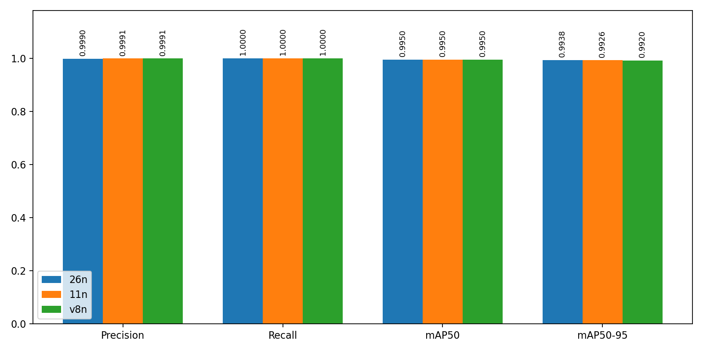
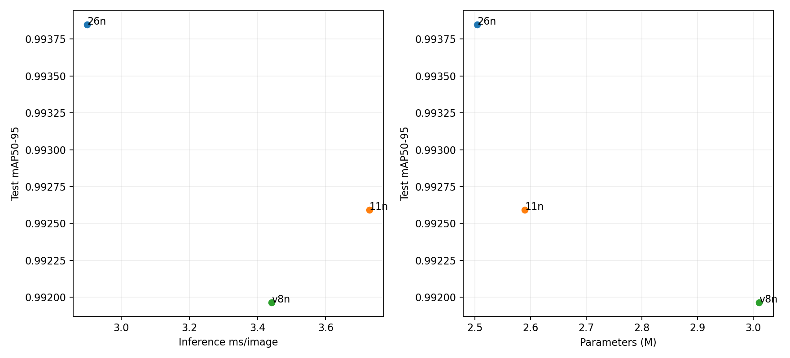
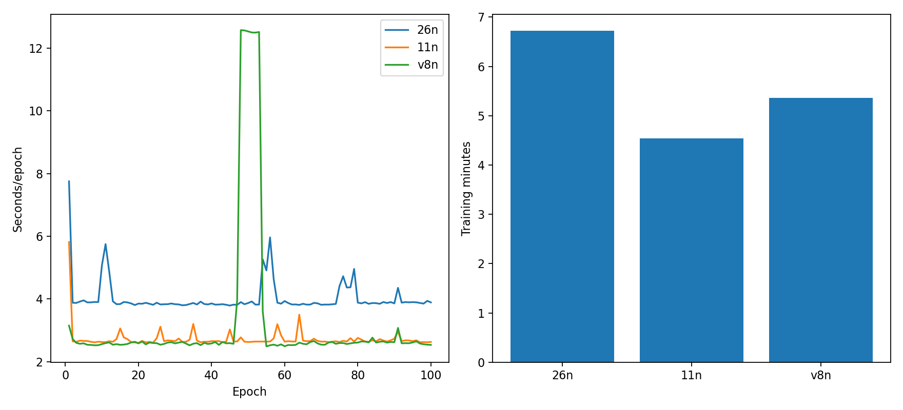

# Survivor nano 모델 비교

YOLOv8n · YOLO11n · YOLO26n을 같은 survivor v2 분할에서 비교했다.

측정일: 2026-10-12. RTX 3060 Laptop GPU, Ultralytics 8.4.170, PyTorch 2.14.1+cu130.

데이터: train 418 / val 120 / test 59장, survivor 1클래스. 분할 간 동일 SHA256 이미지 0장. 촬영 세션 분리는 미확인이다.

공통 설정: imgsz=640, batch=16, 최대 epochs=100, patience=20, seed=0, optimizer=auto. 기존 YOLO26n 100 epoch 모델은 재사용했다. 200 epoch 모델은 공정 비교에서 제외했다.

val/test 재평가: conf=0.001, IoU=0.7, FP32, batch=16, 동일 GPU. FPS는 모델 추론만의 1000/ms이며 카메라·ROS 종단 FPS가 아니다. 각 모델을 순차 평가한 단일 측정이다.

| 모델 | Params M | MB | 실행/best epoch(CSV) | 학습 분 | test P | test R | mAP50 | mAP50-95 | ms/img | 추론 FPS |
|---|---:|---:|---:|---:|---:|---:|---:|---:|---:|---:|
| 26n | 2.50 | 5.39 | 100/84 | 6.72 | 0.9990 | 1.0000 | 0.9950 | 0.9938 | 2.90 | 345 |
| 11n | 2.59 | 5.48 | 100/100 | 4.54 | 0.9991 | 1.0000 | 0.9950 | 0.9926 | 3.73 | 268 |
| v8n | 3.01 | 6.26 | 100/85 | 5.36 | 0.9991 | 1.0000 | 0.9950 | 0.9920 | 3.44 | 291 |

test는 사후 비교 보고용이다. 추가 튜닝이나 threshold 선택에는 val을 사용한다. 작은 점수 차이는 단일 seed로 우열을 확정하지 않는다. 촬영 세션 분리와 원거리·옆/뒤·가림의 현장 성능은 별도 확인이 필요하다.

참고 구성: [AMR mini project](https://github.com/mi1nn/amr-mini-project). 원 저장소 car/dummy 점수와 survivor 점수는 서로 비교하지 않는다.

이번 측정에서 YOLO26n의 test mAP50–95와 추론 속도가 가장 높았다. 정확도 차이는 약 0.13–0.19%p로 작아 현장 우열을 확정하지 않는다. 학습 시간은 서로 다른 시점에 실행한 CSV 누적 시간이며 통제된 속도 벤치마크가 아니다.

모델별 가중치 SHA256·크기와 결과는 [comparison.json](comparison.json), [comparison.csv](comparison.csv)에 기록했다. 평가 데이터 이미지·라벨의 해시는 [dataset_manifest.json](dataset_manifest.json)에 있다. 최종 선택은 기존 100 epoch YOLO26n으로 유지한다. 사람 오탐 재평가는 남은 문제다.
