# AMR Vision: survivor nano 모델 비교와 채택

[설정·측정, 2026-10-12] AMR 카메라의 시연 인형을 `survivor` 1클래스로 탐지한다. 최종 채택은 **YOLO26n의 100 epoch 실험 `best.pt`**다. 같은 v2 데이터로 YOLOv8n·YOLO11n·YOLO26n을 비교하고 최종 모델의 GPU 통계를 보충했다.

[PDF 상세 보고서](report/amr-vision-detailed.pdf) · [HTML 상세 보고서](report/amr-vision-detailed.html)

## 비교 조건

- 데이터: train 418 / val 120 / test 59장. 원본 이미지 512×512.
- 학습: imgsz=640, batch=16, 최대 epochs=100, patience=20, seed=0, optimizer=auto.
- 환경: RTX 3060 Laptop GPU, Ultralytics 8.4.170, PyTorch 2.14.1+cu130.
- 지표 재평가: conf=0.001, NMS IoU=0.7, FP32, batch=16.
- YOLO26n은 기존 100 epoch 모델을 재사용했다. 최대200 epoch 실험은 세 모델 공정 비교에서 제외했다.

## 3. 스크립트 사용법

저장소 루트에서 실행한다. 통계는 JSON/CSV로 조회하고, GPU 검증은 CUDA용 PyTorch와 Ultralytics 8.4.170 환경에서 기본 `yolo` CLI를 사용한다.

```bash
# 저장된 GPU 통계 조회
python3 -m json.tool docs/implementation/yolo-model-comparison/report/gpu-evaluation-summary.json

# 동일 최종 모델의 val 지표·F1 곡선·예측 이미지 생성
# dataset/data.yaml은 로컬 데이터셋의 실제 경로를 지정한 YOLO YAML이다.
yolo val model=assets/models/best.pt data=dataset/data.yaml \
  split=val imgsz=640 batch=16 device=0 conf=0.001 iou=0.7 half=False plots=True
```

`split=test`로 test를 평가한다. `conf=0.25`로 별도 실행하면 이 문서의 confusion matrix와 같은 confidence 기준을 사용한다. 기본 confusion matrix의 matching IoU는 0.45다. 지표와 F1 평가는 `conf=0.001` 결과를 사용한다.

| 출력 | 내용 |
| --- | --- |
| `report/images/` | 학습·loss·lr·데이터 통계·GPU confusion/F1·예측 그림 |
| `gpu-evaluation-summary.json` | 모델 해시·환경·설정·val/test 지표·threshold별 TP/FP/FN |
| `val/test-threshold-counts.csv` | threshold별 TP/FP/FN·Precision·Recall |
| `label_box_stats.csv`, `dataset_stats.json` | 이미지·박스 수, 빈 이미지 수, 박스 위치·크기 통계 |
| `yolo val` 실행 폴더 | 지표·곡선·confusion matrix·정답/예측 이미지 |

## 4. 모델 비교 결과

[측정, 2026-10-12] 같은 GPU 순차 단일 평가의 test 결과다. test mAP50은 세 모델 모두 99.50%다.

| 8가지 요소 | YOLOv8n | YOLO11n | YOLO26n · 채택 |
| --- | ---: | ---: | ---: |
| ① Params (M) | 3.01 | 2.59 | 2.50 |
| ② 가중치 크기 (MB) | 6.26 | 5.48 | 5.39 |
| ③ 실제 / CSV 최고 epoch | 100 / 85 | 100 / 100 | 100 / 84 |
| ④ 학습 시간 (분) | 5.36 | 4.54 | 6.72 |
| ⑤ test Precision | 99.9093% | 99.9135% | 99.9032% |
| ⑥ test Recall | 100.00% | 100.00% | 100.00% |
| ⑦ test mAP50-95 | 99.1966% | 99.2593% | 99.3847% |
| ⑧ 추론 ms/img / 환산 FPS | 3.44 / 291 | 3.73 / 268 | 2.90 / 345 |

[계산, 2026-10-12] FPS=1000/ms로 모델 추론만의 처리율이다. 카메라 수신·전처리·후처리·ROS 종단 FPS와 구분한다. 최고 epoch는 CSV mAP50-95 최초 최고값이며 checkpoint 내부 best epoch를 직접 읽은 값이 아니다. 학습 시간은 서로 다른 시점의 CSV 누적 시간으로, 통제된 학습 속도 벤치마크가 아니다.

### 4.1 학습 추이

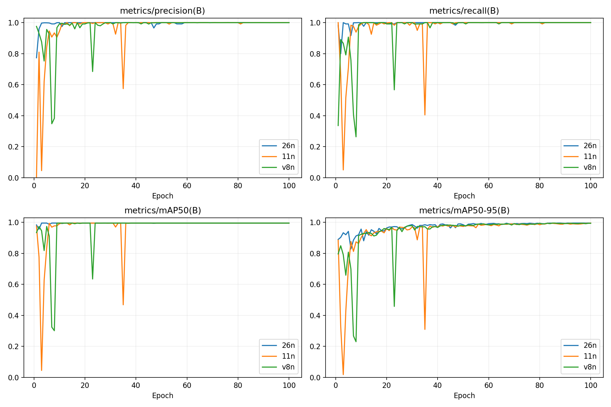

세 모델은 모두 100 epoch를 완료했다. YOLO26n은 초기 구간에서 상대적으로 안정적이며, YOLO11n·YOLOv8n은 일부 epoch에서 지표가 떨어졌다가 회복했다. 후기에는 높은 val 지표로 수렴했다.


### 4.2 test 성능과 속도/크기


이번 test에서 YOLO26n은 가장 높은 mAP50-95, 가장 짧은 추론 시간, 가장 작은 파라미터·파일 크기를 보였다. 11n은 기록된 학습 시간이 가장 짧았고 v8n은 가장 컸다. 정확도 차이는 약 0.13~0.19%p로 작으며, 단일 seed의 차이를 현장 우열로 확정하지 않는다.

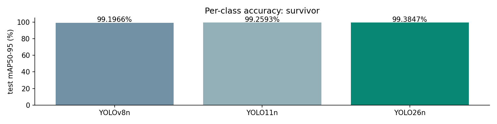

survivor 1클래스이므로 클래스별 mAP50-95와 전체 mAP50-95가 같다.

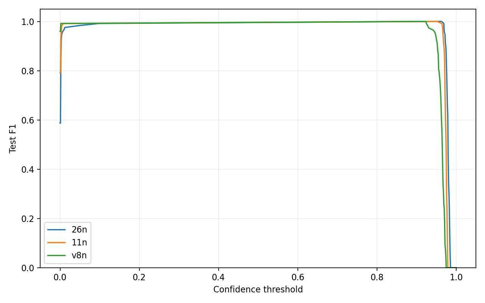

세 모델은 넓은 confidence 구간에서 높은 F1을 유지하고 높은 임계값 끝부분에서 급격히 하락한다.

## 5. 베스트 모델: YOLO26n

[사용자 결정, 2026-10-11] 최종 모델은 100 epoch 실험의 [best.pt](../../../assets/models/best.pt)다. 입력은 imgsz=640, 클래스는 `{0: survivor}`다.

[측정, 2026-10-12] SHA256: `0a149876a59fabb06bd57d8d146a4938a8fe2a74e030982941c28c431a4dcb74`.

100 epoch 실험은 최대200 epoch 실험보다 val mAP50-95가 1.3175%p, test가 0.6008%p 높아 선택했다. 최대200 실험은 58 epoch에서 조기 종료했다.

### 5.1 학습 추이

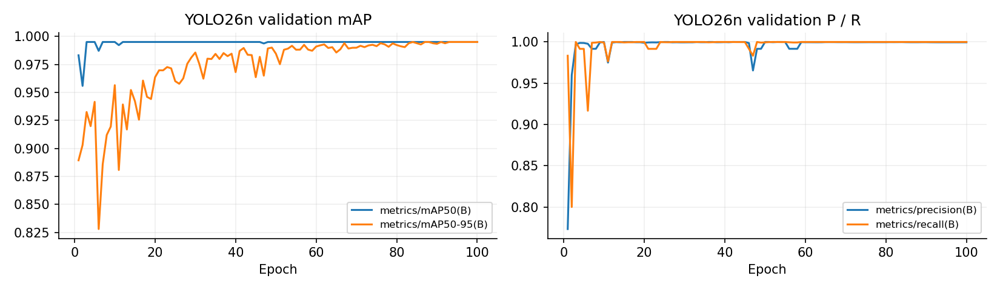

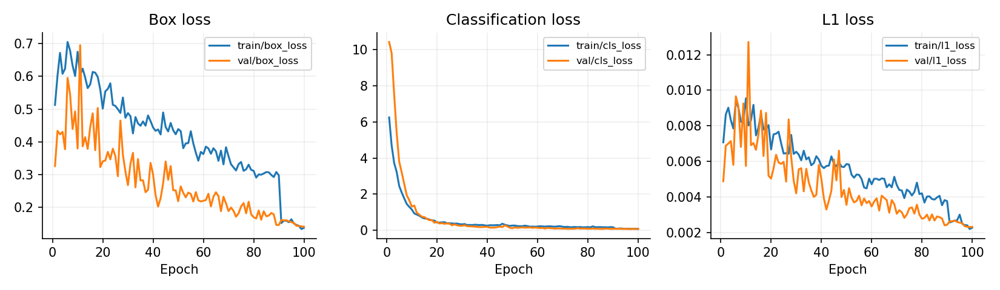

초기 손실이 감소하고 후기 val 지표는 높은 수준으로 유지됐다. CSV 최고 mAP50-95 epoch는 84다. YOLO26n CSV에는 box·cls·l1 loss가 기록됐다.

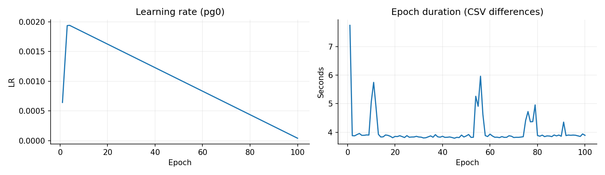

[설정·계산, 2026-10-12] auto → AdamW, 실제 초기 lr=0.002, warmup=3 epoch. CSV pg0 최고 lr은 0.001941, epoch 평균 4.03초, 첫 epoch 7.75초다.

### 5.2 성능 통계

[측정, 2026-10-12] 최종 모델의 **GPU 재평가** 결과다. 기존 세 모델의 GPU 비교와 별도로 상세 통계를 생성했다.

| split | Precision | Recall | mAP50 | mAP50-95 |
| --- | ---: | ---: | ---: | ---: |
| val 120장 | 99.9637% | 100.00% | 99.50% | 99.5000% |
| test 59장 | 99.9032% | 100.00% | 99.50% | 99.3847% |


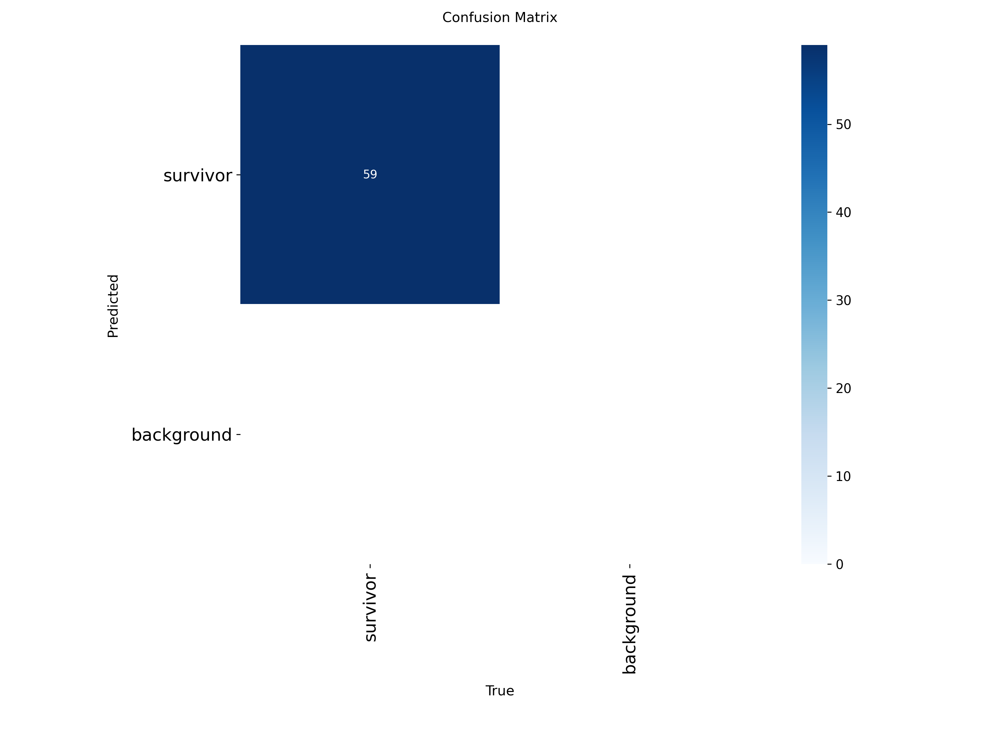

[측정, 2026-10-12] conf≥0.25, matching IoU>0.45에서 val TP/FP/FN=120/0/0, test=59/0/0이다. 행은 예측, 열은 정답이다. 이 val/test 데이터와 임계값에서의 결과다.

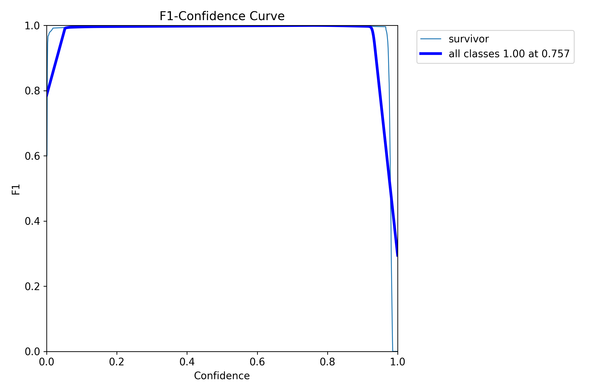

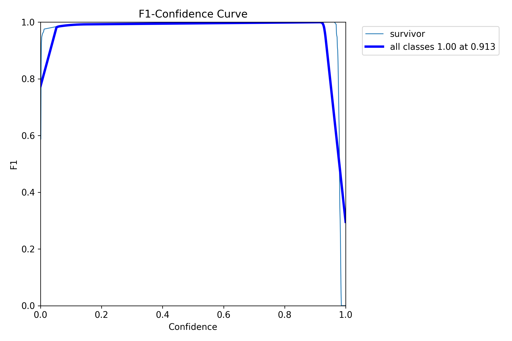

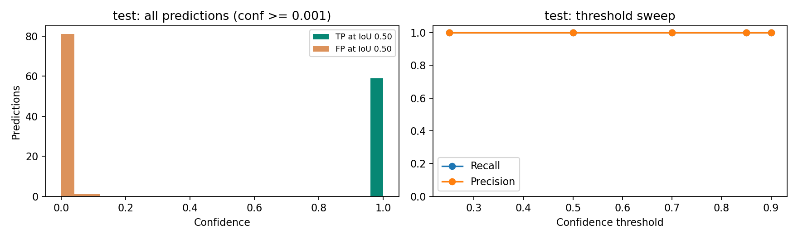

[측정, 2026-10-12] 저장된 예측(conf≥0.001)을 threshold별로 필터링했다. 아래 TP/FP/FN은 matching IoU≥0.50이므로 위 confusion matrix의 matching IoU와 구분한다.

| conf | val TP/FP/FN | test TP/FP/FN | val Recall | test Recall |
| --- | --- | --- | ---: | ---: |
| 0.25 | 120/0/0 | 59/0/0 | 100.00% | 100.00% |
| 0.50 | 120/0/0 | 59/0/0 | 100.00% | 100.00% |
| 0.70 | 120/0/0 | 59/0/0 | 100.00% | 100.00% |
| 0.85 | 119/0/1 | 59/0/0 | 99.17% | 100.00% |
| 0.90 | 119/0/1 | 59/0/0 | 99.17% | 100.00% |

val은 conf=0.25~0.70에서 120개 인형을 모두 탐지했고 0.85부터 한 개를 놓쳤다. 운영 threshold 선택은 val을 사용하며, test는 사후 비교 보고용으로 유지한다.

### 5.3 데이터 통계

[측정, 2026-10-12] 제공된 YOLOv8·YOLO11·YOLO26 형식의 ZIP은 이미지·라벨 내용이 동일하다. YOLO26 ZIP의 SHA256도 기존 학습 데이터와 같다. 총 597장·597박스이며 빈 이미지는 0장이다.

| split | 이미지 | survivor 박스 | 빈 이미지 | 박스 너비 범위(px) | 박스 높이 범위(px) |
| --- | ---: | ---: | ---: | --- | --- |
| train | 418 | 418 | 0 | 64.5~340.0 | 43.5~315.5 |
| valid | 120 | 120 | 0 | 40.0~299.0 | 44.5~309.0 |
| test | 59 | 59 | 0 | 70.0~289.5 | 50.0~331.5 |

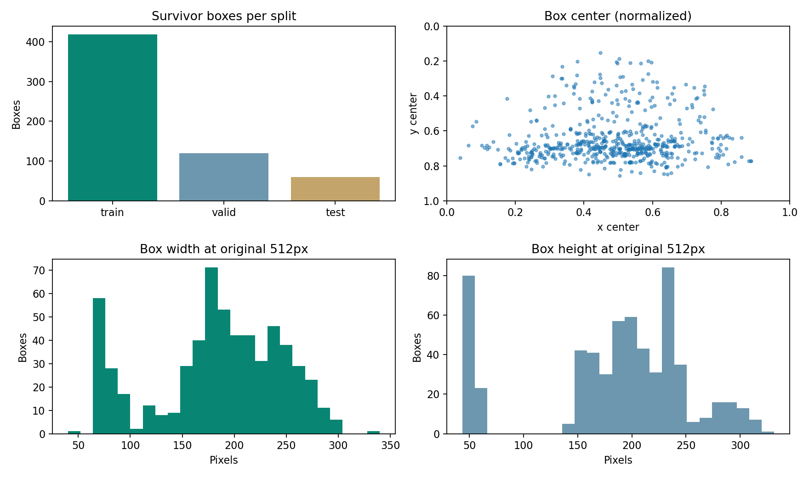

원본은 모두 512×512다. 인형 하나에 survivor 박스 하나를 표시하며, 박스 중심·크기 분포는 데이터에 포함된 시야와 대상 크기를 보여 준다.

### 5.4 예측 예시

[측정, 2026-10-12] 동일 val 이미지의 정답과 최종 YOLO26n의 GPU 예측을 비교했다. imgsz=640, FP32, RTX 3060 Laptop GPU다.

| val 정답 | val GPU 예측 |
| --- | --- |
| 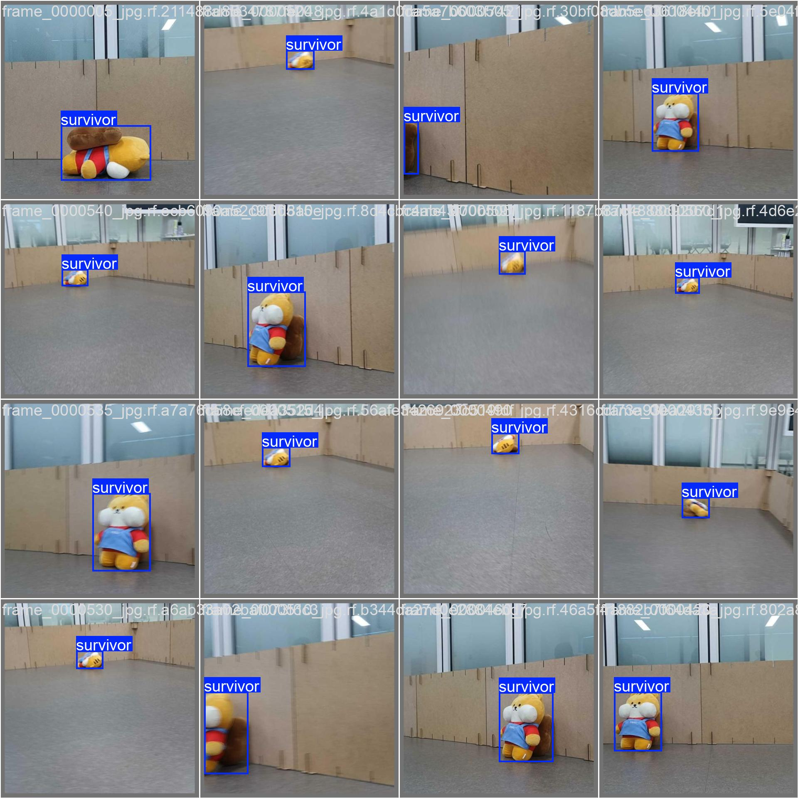 | 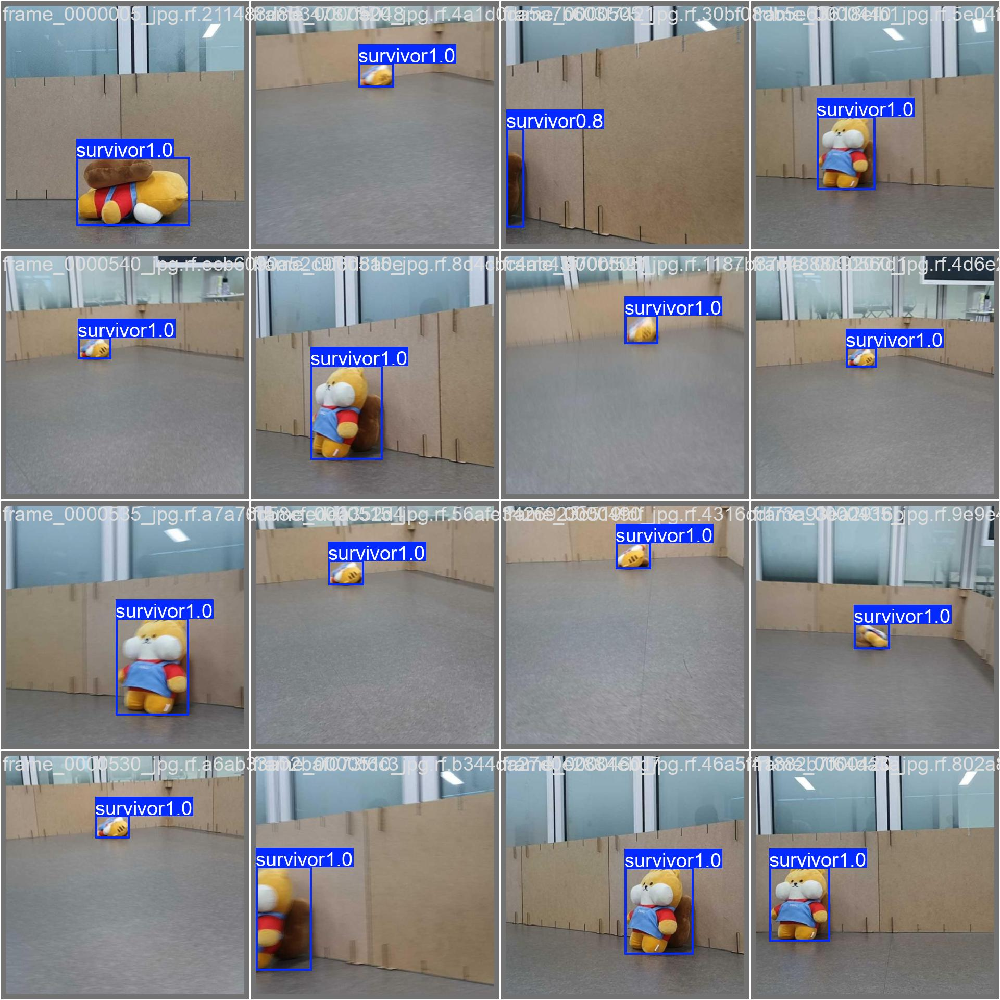 |
| 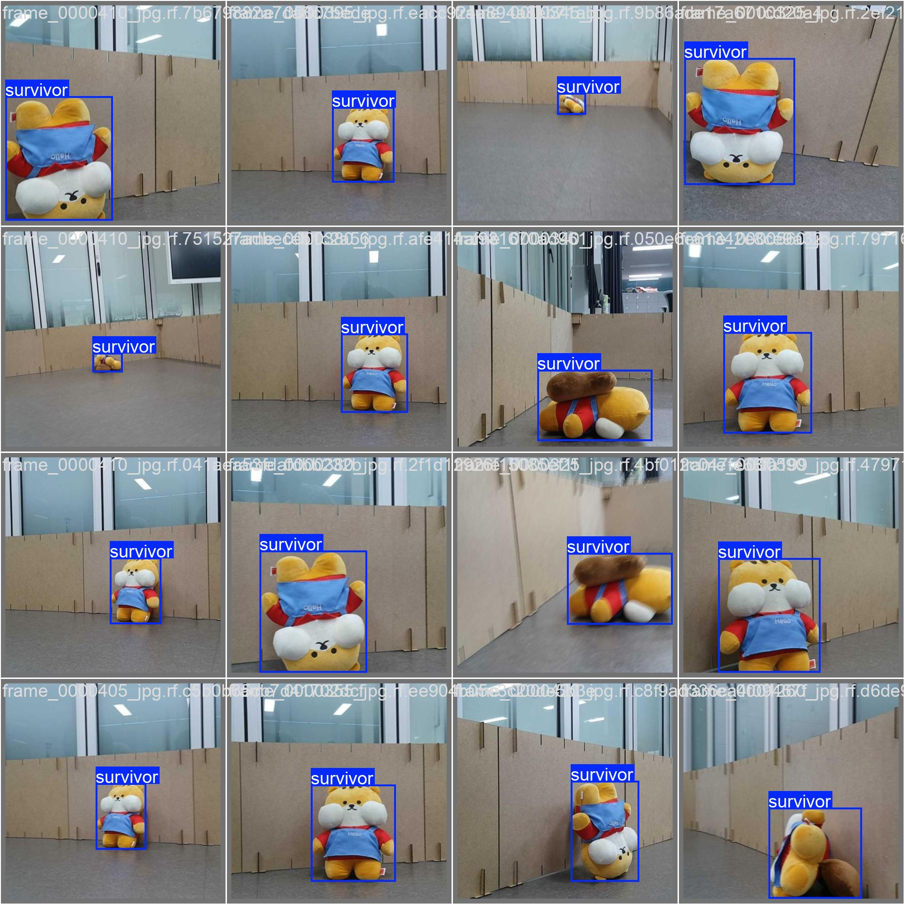 |  |

기존 기록의 해석 범위는 유지한다. test는 반복 평가된 사후 비교 자료이며, 같은 SHA256 이미지가 분할 사이에 없는 것과 촬영 세션 독립성은 별개다. 이 자료는 최종 모델의 운영 threshold 확정이나 실제 사람 오탐 해결 선언이 아니다.
