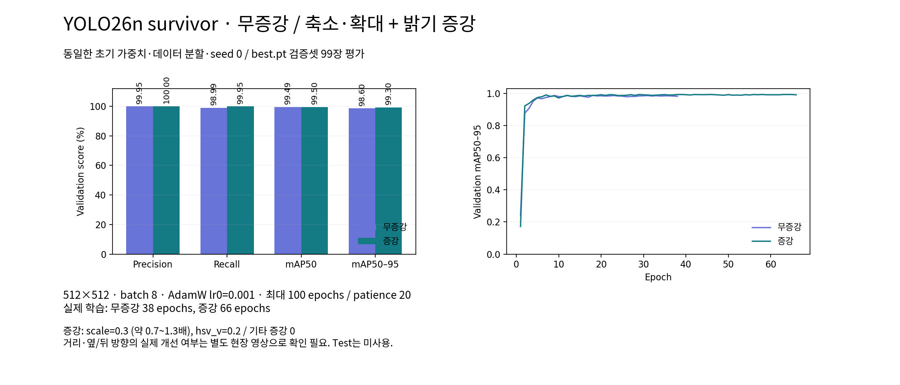

# YOLO26n survivor 무증강·증강 학습 결과

[사용자 요구, 2026-10-11] #82의 학습 계획 후속으로 두 실험과 비교 결과를 제출한다.

## 상태와 머지 보류

**머지하지 않는다.** [사용자 결정, 2026-10-11] “아직 원하는 만큼 학습 결과가 안나와서 머지는 하지 말라고 해줘”. 본 PR은 Draft로 유지하며 재학습·재시험 결과와 사용자의 보류 해제 전까지 머지하지 않는다.

## 데이터와 공통 설정

[설정, 2026-10-11] 클래스는 survivor(ID 0) 하나, 이미지 512×512 총 494장(train 346 / valid 99 / test 49). 두 실험은 같은 ZIP SHA256·초기 YOLO26n 가중치·분할·seed 0을 사용했다. 출처 해시와 best.pt 해시는 [모델 manifest](../../assets/manifest/yolo26n-survivor.json)에 기록했다. 데이터셋 이미지와 가중치 바이너리는 이 PR에 포함하지 않았다. 모델 파일은 로컬 실험 산출물에 있으며 공유 다운로드 위치는 아직 등록하지 않았다.

[설정, 2026-10-11] imgsz=512, 최대 epochs=100, patience=20, batch=8, AdamW, lr0=0.001, lrf=0.01, weight_decay=0.0005, deterministic=True, GPU device=0, AMP=True. 환경은 ultralytics 8.4.170, torch 2.14.1+cu130이다. GPU 기종·추론 FPS·종단 지연은 미측정이다.

| 실험 | 학습 증강 | 실행 epoch | CSV mAP50–95 최고 epoch |
| --- | --- | ---: | ---: |
| noaug | 학습 augmentation pipeline 비활성화 | 38 | 18 |
| scale_light | scale=0.3, hsv_v=0.2 | 66 | 46 |

[설정] scale_light는 축소·확대(약 0.7–1.3배)와 밝기 변화만 사용한다. 회전·이동·flip·mosaic·mixup·cutmix 등은 0이며 선택적 Albumentations도 제외했다. resize/letterbox/정규화는 유지한다. val/test에는 학습 증강을 적용하지 않는다. args.yaml의 augment=False만으로 무증강을 판단하면 안 된다. 실제 무증강 실험은 trainer에서 dataset.augment=False로 pipeline을 끈다.

## best.pt 검증셋 결과

[측정, 2026-10-11] 저장된 val_metrics.json의 검증셋 99장 평가 결과다. 아래 수치는 백분율로 변환했다. confidence 0.70 고정 임계값에서 측정한 precision/recall이 아니다.

| 지표 | 무증강 | scale_light | 증강 − 무증강 (%p) |
| --- | ---: | ---: | ---: |
| Precision | 99.9456% | 100.0000% | +0.0544 |
| Recall | 98.9899% | 99.9539% | +0.9640 |
| mAP50 | 99.4900% | 99.5000% | +0.0100 |
| mAP50–95 | 98.5965% | 99.3000% | +0.7035 |

무증강: [설정](yolo26n-results/yolo26n_survivor_noaug_512/args.yaml), [실험 기록](yolo26n-results/yolo26n_survivor_noaug_512/experiment.json), [지표](yolo26n-results/yolo26n_survivor_noaug_512/val_metrics.json), [epoch CSV](yolo26n-results/yolo26n_survivor_noaug_512/results.csv), [학습 곡선](yolo26n-results/yolo26n_survivor_noaug_512/results.png).

증강: [설정](yolo26n-results/yolo26n_survivor_scale_light_512/args.yaml), [실험 기록](yolo26n-results/yolo26n_survivor_scale_light_512/experiment.json), [지표](yolo26n-results/yolo26n_survivor_scale_light_512/val_metrics.json), [epoch CSV](yolo26n-results/yolo26n_survivor_scale_light_512/results.csv), [학습 곡선](yolo26n-results/yolo26n_survivor_scale_light_512/results.png).

[해석] 같은 검증셋에서는 scale_light의 recall과 mAP50–95가 높다. seed 하나의 실험이며 통계적 유의성이나 원거리 일반화를 입증하지 않는다. 같은 원 프레임 번호가 여러 split에 있어 촬영 세션별 분리 여부가 미확인이다. 높은 검증셋 점수를 현장 성능으로 확대하지 않는다. test 49장 평가는 NOT_RUN이다.

## robot5 현장 관측과 후속

[사용자 현장 관측, 2026-10-11] robot5 teleop 실시간 확인에 scale_light 모델을 선택한 후, 사용자가 “현지 평가했고 원거리일대 confidence가 70이상이 안나와서 원거리 데이터 추가후 다시 학습시켜 테스트 예정”이라고 보고했다. **원거리에서 confidence가 0.70 이상 나오지 않아 원하는 학습 결과에 도달하지 못했다.** 현장 평가 수행은 사용자 보고이며, 원 영상·로그를 이 PR에서 독립 확인하지 않았다. 거리(m), 표본 수, 실제 실행 모델 해시·추론 설정은 미확인이다. confidence는 정확도나 탐지 성공률과 같지 않다.

[예정] 원거리 데이터를 추가한 뒤 다시 학습하고 테스트한다. 기존 평가 영상과 분리한 촬영 세션으로 데이터 버전을 갱신하고, 원거리·방향·가림 조건을 기록한다. 같은 조건에서 두 모델을 비교하고 confidence 분포뿐 아니라 누락·오탐·지연도 확인한다. 재학습과 재시험은 아직 NOT_RUN이다. 이번 보고만으로 최종 모델을 채택하거나 PR을 머지하지 않는다.
