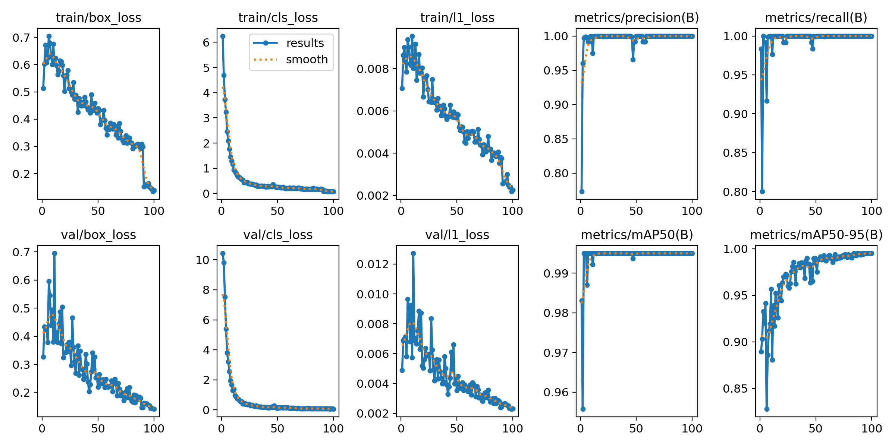
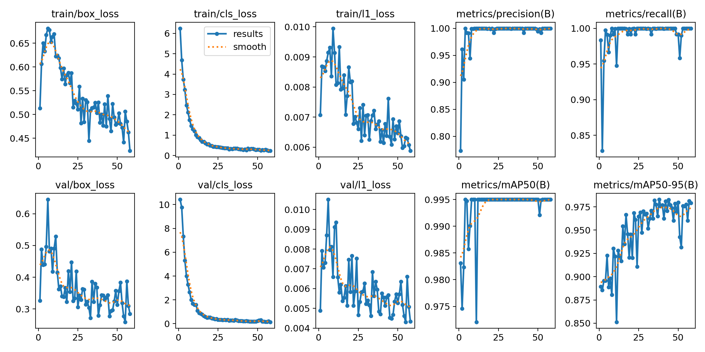
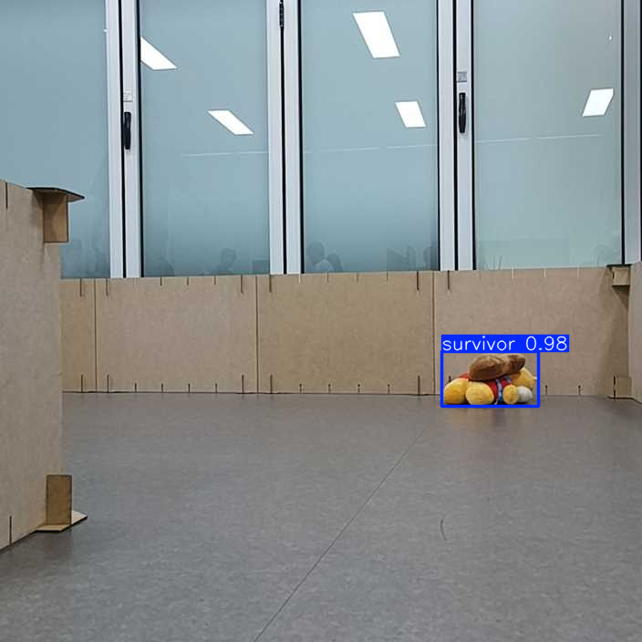

# Survivor v2: amr-mini-project YOLO26n 학습 결과

> **기록 (2026-10-11).** 학습 결과 기록이다. 여기서 고른 100 epoch best.pt 를 지금 로봇 카메라 모델로 쓴다([manifest](../../assets/manifest/yolo26n-survivor-v2.json)). 웹캠은 다른 모델이다([인식 구현 문서](implementation-perception.md) 1절).

[사용자 요구, 2026-10-11] 새 v2 ZIP을 별도 amr-mini-project의 학습 방식으로 재학습하고, 설정·결과·best.pt를 PR로 제출한다. #82 학습 계획의 후속이다. 사용자의 최대 200 epoch 재학습 요청도 기록한다.

## 제출 모델과 상태

[사용자 결정, 2026-10-11] “100epoch가 훨씬 좋은걸 확인했으니 최종으로 그걸 best.pt로 확정해서 앞으로 camera amr용의 vision용으로 쓴다고 올려줘 pr을 그리고 머지 요청을 해줘”. **100 epoch 실험의 best.pt를 최종 채택하여 앞으로 AMR 카메라 vision의 survivor 탐지에 사용한다.** 최대200 실험은 비교 기록으로 보존한다.

- [최종 best.pt](../../assets/models/best.pt)
- [모델 해시·출처 manifest](../../assets/manifest/yolo26n-survivor-v2.json)
- SHA256: `0a149876a59fabb06bd57d8d146a4938a8fe2a74e030982941c28c431a4dcb74`
- 클래스: `{0: survivor}`. 추론 입력 imgsz=640.

[사용자 결정] 기존 머지 보류는 이번 최종 채택·머지 요청으로 해제한다. 필요한 독립 검토와 CI를 확인한 뒤 머지를 요청한다. 최종 모델 채택은 실제 사람 오탐 해결을 주장하지 않으며 자동 주행·대상 접근 승인과도 별개다.

## 원본 방식과 데이터

기준은 ROKEY_P4가 아니라 [별도 amr-mini-project의 실제 YOLO26n args.yaml](https://github.com/mi1nn/amr-mini-project/blob/ee355d0b5896ea58bccac73ce1a7857f62e96024/runs/car_dummy_26n/args.yaml)이다. 현재 노트북의 SGD/freeze 튜닝은 다른 모델용이므로 실제 car_dummy_26n 기록을 적용했다. 데이터/클래스/저장 경로와 덮어쓰기 방지 설정을 바꿨으며 두 번째 실행에서는 epochs만 200으로 바꿨다.

[측정] v2 ZIP: 이미지 597장, **모두 512×512**. train 418 / val 120 / test 59. ZIP의 분할을 유지했다. 학습 imgsz=640은 이미 축소된 원본의 세부 정보를 복구하지 않는다. 촬영 세션별 분리 여부는 미확인이다. 데이터와 초기 가중치 SHA256은 manifest에 기록했다.

[정정] 먼저 ROKEY_P4 도구로 실행한 batch8/patience0 학습은 사용자 정정에 따라 중단했다. 아래 비교와 제출 best.pt에는 사용하지 않았다. 기존 512 실험도 [별도 보고](yolo26n-training-results.md)로 구분한다.

## 학습 파라미터

[설정, 2026-10-11]

| 항목 | 100 epoch 실험 | 최대 200 epoch 실험 |
| --- | --- | --- |
| 시작 모델 | COCO 사전학습 YOLO26n | 동일 |
| imgsz / batch / workers | 640 / 16 / 2 | 동일 |
| epochs / patience | 100 / 20 | 200 / 20 |
| 실제 실행 epoch | 100 | 58 (조기 종료) |
| CSV mAP50–95 최초 최고 epoch | 84 | 38 |
| 학습 wall time | 410.33초 | 238.80초 |
| optimizer | auto → AdamW | 동일 |
| 실제 초기 lr / betas | 0.002 / (0.9, 0.999) | 동일 |
| weight decay | 가중치 0.0005, bias/정규화 0 | 동일 |
| lrf / cos_lr / warmup | 0.01 / false / 3 epoch | 동일 |
| seed / deterministic / AMP | 0 / true / true | 동일 |
| cache / freeze | false / null | 동일 |
| GPU | RTX 3060 Laptop | 동일 |

optimizer auto는 args.yaml의 lr0=0.01·momentum=0.937을 무시한다. 실제 optimizer 기록을 따로 저장했다. 환경: ultralytics 8.4.170, torch 2.14.1+cu130, Python 3.12.3. CSV 최초 최고 epoch는 checkpoint 내부 best epoch를 직접 읽은 값이 아니다.

증강: hsv_h=0.015, hsv_s=0.7, hsv_v=0.4, translate=0.1, scale=0.5, fliplr=0.5, mosaic=1.0, close_mosaic=10. degrees/shear/perspective/flipud/mixup/cutmix/copy_paste=0. 기존 기본 증강을 유지했고 수동 ControlledTrainer는 사용하지 않았다.

## best.pt 평가 결과

[측정, 2026-10-11] 저장된 val_metrics.json·test_metrics.json을 백분율로 변환했다. confidence 0.70 고정 지표가 아니다.

| 실험 / split | Precision | Recall | mAP50 | mAP50–95 |
| --- | ---: | ---: | ---: | ---: |
| 100 epoch / val 120장 | 99.9637% | 100% | 99.50% | 99.5000% |
| 100 epoch / test 59장 | 99.9032% | 100% | 99.50% | 99.3847% |
| 최대 200 / val 120장 | 99.9901% | 100% | 99.50% | 98.1825% |
| 최대 200 / test 59장 | 99.9027% | 100% | 99.50% | 98.7840% |

[계산] 최신 실험은 100 epoch 대비 val mAP50–95 -1.3175%p, test -0.6008%p다. test를 반복 평가했으므로 다음 선택의 최종 성능은 새 독립 촬영 test로 확인한다.

100 epoch: [설정](yolo26n-results/survivor_yolo26n_640/args.yaml), [실제 optimizer](yolo26n-results/survivor_yolo26n_640/actual_optimizer.json), [CSV](yolo26n-results/survivor_yolo26n_640/results.csv), [val](yolo26n-results/survivor_yolo26n_640/val_metrics.json), [test](yolo26n-results/survivor_yolo26n_640/test_metrics.json).

최대 200 epoch: [설정](yolo26n-results/survivor_yolo26n_640_e200/args.yaml), [실제 optimizer](yolo26n-results/survivor_yolo26n_640_e200/actual_optimizer.json), [CSV](yolo26n-results/survivor_yolo26n_640_e200/results.csv), [val](yolo26n-results/survivor_yolo26n_640_e200/val_metrics.json), [test](yolo26n-results/survivor_yolo26n_640_e200/test_metrics.json).

## robot5 카메라 시험과 남은 문제

[측정] 최신 모델로 compressed RGB 실시간 구독, imgsz=640, GPU device0, conf=0.25를 실행했다. 카메라 원본도 흐렸고 수동 초점 r_set_man_focus=true, r_focus=134였다. 사용자 명시 승인 후 YAML의 수동 초점만 false로 바꾸고 백업·전후 해시 확인, SSH source와 TurtleBot4 서비스 재시작을 수행했다. 실제 파라미터 false, raw 영상의 선명도 개선을 확인했다. 원격 IP·로그인 정보는 게시하지 않는다. 로봇 설정 배포 파일은 이 PR 범위 밖이다.

[사용자 제공 화면, 2026-10-11] 초점 개선 후 인형 confidence 0.87, 실제 사람 confidence 0.82가 표시됐다. 단일 화면 관측이며 전체 성공률은 아니다. 인형만 대상이라는 사용자 의도에서 **사람 탐지는 오탐**이다. 화면 종료 요청에 따라 YOLO 프로세스를 종료했다.

[후속] 사람만 있는 negative 이미지와 사람·인형 동시 장면을 추가한다. survivor 박스는 인형에만 표시한다. 옷·자세·거리 다양성을 확보하고 촬영 세션 단위 분할, 별도 사람 영상에서 오탐률·인형 누락·confidence 분포를 평가한다. confidence 임계값을 높이는 것만으로 문제를 해결했다고 판단하지 않는다. 사람 negative 데이터 추가·재학습·재시험은 NOT_RUN이다. 높은 내부 지표는 현장 오탐 해결이나 운영 채택을 입증하지 않는다.

## 100 epoch 모델 현장 결과 이미지

[측정, 2026-10-11] robot5 compressed RGB 한 프레임에 100 epoch 모델 best.pt를 적용했다. imgsz=640, conf=0.25, CPU 추론이며 데스크톱 화면 스크린샷이 아닌 탐지 결과 이미지다. 인형 1개가 confidence 0.9814로 탐지됐다. 이 프레임에는 실제 사람이 없어 사람 오탐 개선 여부를 확인하지 못했다. 한 프레임 점수는 전체 원거리 성공률이 아니다.

사용 모델 SHA256: `0a149876a59fabb06bd57d8d146a4938a8fe2a74e030982941c28c431a4dcb74`. PR에 첨부한 최종 best.pt와 동일한 100 epoch 모델이다.

### 실측 거리와 근거리 confidence

[사용자 실측 보고, 2026-10-11] 위 결과 이미지에서 robot5와 인형의 거리는 **2.2m**이며, 해당 프레임 confidence는 **0.9814 (화면 0.98)**였다. 사용자는 **2.2m보다 가까운 거리에서도 관측 중 confidence가 항상 0.8 이상 표시됐다**고 보고했다. 모델은 위 100 epoch best.pt다. 근거리의 개별 거리·프레임 수·연속 로그는 제공되지 않아 정량 성공률이나 모든 조건의 보장으로 확대하지 않는다. 실제 사람 오탐 여부는 별도 평가 대상이다.

## YOLO 계열 간 비교

[측정, 2026-10-12] YOLO26n·YOLO11n·YOLOv8n의 같은 데이터·100 epoch 조건 학습 및 val/test 재평가가 완료됐다. [비교 표·그래프·원자료](yolo-model-comparison/README.md)를 첨부한다. YOLO26n의 test mAP50–95는 99.3847%, YOLO11n은 99.2593%, YOLOv8n은 99.1966%다. 단일 seed의 작은 차이를 통계적 우월성으로 확대하지 않는다. 기존 100 epoch YOLO26n 최종 채택을 유지한다.
