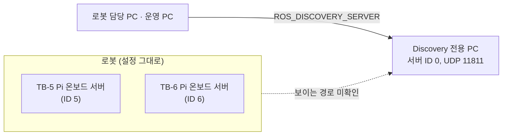

# Discovery 전용 PC 운영 안내

이 문서가 답하는 질문은 세 가지다.

1. Discovery 전용 PC 에 무엇이 떠 있고, 다른 PC 는 어떻게 붙는가
2. 서버가 살아 있는지, 로봇이 보이는지 어떻게 확인하는가
3. 로봇 토픽이 안 보일 때 무엇부터 보는가

Discovery Server 가 무엇인지와 구성안 비교는 [네트워크·Discovery Server](../design/network-discovery.md)에 있다. 여기서는 되풀이하지 않는다.

## 한눈에 (2026-10-15)

- **2026-10-15 부터 Discovery 전용 PC 의 서버로 로봇 그래프를 본다.** 재범 결정이다(원문은 [7절](#7-결정-원문)). 이 서버는 서버 ID 0, UDP 11811 이다.
- **로봇 Pi 의 Discovery 설정은 바꾸지 않았다.** 로봇 Pi 서버는 그대로 두고, 전용 PC 에 서버를 하나 더 둔 구성이다. 그런데도 두 로봇의 토픽이 이 서버로 보이는 경로(로봇 쪽에 무엇이 적혀 있는지)는 [미확인]이다.
- **서버는 서비스가 아니라 터미널에서 손으로 띄운 프로세스다.** 그 터미널을 닫거나 전용 PC 를 재부팅하면 서버가 꺼진다. 꺼진 동안 새로 뜨는 노드는 아무것도 찾지 못한다(이미 맺은 연결은 유지된다, network-discovery.md 0절 4번).
- **다른 PC 에서 로봇 토픽이 0개로 보이면 먼저 `--spin-time 10` 을 붙여 다시 본다.** 10-15 에 두 PC 가 0개로 보였던 원인이 이것이었다. 망과 서버는 정상이었다([5절](#5-문제-해결)).



## 1. 지금 떠 있는 것 (전용 PC, 2026-10-15 측정)

| 항목 | 값 | 확인 방법 |
| --- | --- | --- |
| 서버 명령 | `/usr/bin/fastdds discovery --server-id 0 --ip-address <DISCOVERY_HOST_IP> --port 11811`. 실제 서버는 자식 프로세스 `fast-discovery-server` 다 | `ps` |
| 기동 | 2026-10-15 12:33, 사용자 터미널에서 직접 실행. 출력은 그 터미널로만 나가고 로그 파일은 없다 | `ps`, `/proc/<pid>/fd` |
| 수신 | UDP `0.0.0.0:11811` | `ss -ulpn` |
| 주소 | 무선 인터페이스 하나, DHCP. 유선은 꺼져 있다 | `ip -br addr` |
| 방화벽 | `/etc/ufw/ufw.conf` 가 `ENABLED=no`(꺼짐). `ufw.service` 가 active 로 보이는 것은 켜짐을 뜻하지 않는다 | 파일 읽기 |
| 서버 바이너리 | Ubuntu `fastdds-tools` 2.11.2. ROS 쪽 Fast DDS 는 2.14.6 으로 버전이 다르다. 지금까지 이 차이로 생긴 문제는 관측되지 않았다 | [운영 PC 현황 기록](ops-host-record.md) 2026-10-10 판 |
| 붙어 있는 로봇 | 14:10 에 `/robot5` 43개, `/robot6` 43개 | [2절](#2-다른-pc-에서-붙는-법) 확인 명령 |

> [!WARNING]
> 서버는 반드시 `/usr/bin/fastdds` 로 띄운다. ROS 를 source 한 셸에서 그냥 `fastdds` 를 치면 `/opt/ros/jazzy/bin/fastdds` 가 잡히고, 이것은 `fast-discovery-server tool not found` 로 실패한다 [측정 2026-10-12].

## 2. 다른 PC 에서 붙는 법

ROS 를 source 한 터미널에서 아래 값을 쓴다. 자리 번호가 서버 ID 이므로 ID 0 서버는 첫 자리에 그대로 적는다(network-discovery.md 2절).

```sh
export RMW_IMPLEMENTATION=rmw_fastrtps_cpp   # Discovery Server 는 Fast DDS 전용
export ROS_DOMAIN_ID=6
export ROS_DISCOVERY_SERVER='<DISCOVERY_HOST_IP>:11811'
export ROS_SUPER_CLIENT=False                # 노드는 False. 목록 조회만 True 를 앞에 붙인다
ros2 daemon stop; ros2 daemon start          # 예전 목록을 버린다
```

로봇이 보이는지 확인할 때는 `--spin-time` 을 꼭 붙인다.

```sh
ROS_SUPER_CLIENT=True ros2 topic list --no-daemon --spin-time 10 | grep -c '^/robot5/'
ROS_SUPER_CLIENT=True ros2 topic list --no-daemon --spin-time 10 | grep -c '^/robot6/'
```

- `--no-daemon` 만 쓰면 기다리는 시간이 짧아서, 서버를 거친 목록이 오기 전에 명령이 끝난다. 그러면 로봇 토픽이 0개로 보인다.
- 앞에 `timeout 30` 을 붙여도 기다리는 시간은 늘지 않는다. `timeout` 은 최대 실행 시간만 정한다.
- 목록은 발견만 보여 준다. 실제로 데이터가 오는지는 `ros2 topic echo --once /robot5/battery_state` 처럼 메시지를 한 번 받아 본다. 10-15 에 다른 PC 에서 `ROS_SUPER_CLIENT` 를 False 로 두었을 때와 True 로 두었을 때 모두 전압 16.30 V 를 받았다 [측정].

## 3. 서버가 살아 있는지 확인 (전용 PC 에서, 읽기만)

```sh
ps -eo pid,lstart,args | grep '[f]ast-discovery-server'   # 프로세스와 시작 시각
ss -ulpn | grep 11811                                     # UDP 11811 을 듣는지
ROS_DOMAIN_ID=6 ROS_SUPER_CLIENT=True ROS_DISCOVERY_SERVER=127.0.0.1:11811 \
  ros2 topic list --no-daemon --spin-time 15 | grep -c '^/robot5/'
```

- 세 번째 명령이 0 이면 그 로봇이 이 서버에 등록되지 않은 것이다. 로봇이 꺼졌는지 먼저 본다([5절](#5-문제-해결)).
- 이 서버를 거쳐 보인 것인지 확인하려면 없는 주소(예: `127.0.0.1:11999`)로 같은 명령을 돌린다. 0개가 나오면 앞의 결과는 멀티캐스트가 아니라 서버를 거친 것이다 [측정 2026-10-15].
- 서버가 받지 못하고 버린 패킷 수는 아래 명령의 마지막 열(`drops`)이다. `2E23` 은 11811 의 16진수다. 값이 계속 크게 늘면 기록해 두고 재범에게 알린다(6절).

```sh
awk 'NR==1 || $2 ~ /:2E23$/' /proc/net/udp
```

## 4. 서버가 꺼졌을 때 다시 띄우기

서버가 **꺼진 것이 확인됐을 때만** 같은 ID·포트로 다시 띄운다. 같은 ID·포트로 뜨면 기존 노드가 몇 초 안에 다시 보인다(network-discovery.md 3절 H5, localhost 측정). 살아 있는 서버를 일부러 재시작하는 일은 6절 규칙을 따른다.

```sh
# 전용 PC 에서. 출력을 파일로 남겨 나중에 다른 세션도 읽을 수 있게 한다
setsid nohup /usr/bin/fastdds discovery --server-id 0 \
  --ip-address <DISCOVERY_HOST_IP> --port 11811 \
  > "<로그 폴더>/discovery-server-$(date +%Y%m%d-%H%M%S).log" 2>&1 &
```

- `--ip-address` 는 전용 PC 의 지금 주소다. DHCP 라 바뀔 수 있으니 `ip -br addr` 로 먼저 본다. 주소가 바뀌었다면 서버만 다시 띄워서는 안 되고, 모든 PC 의 `ROS_DISCOVERY_SERVER` 도 같이 바뀌어야 한다.
- 로그에 `Matching unexisting participant` 오류가 많이 찍히는 것은 짧게 떴다 꺼지는 `ros2` 명령이 남기는 것이다. 지금까지 동작에 문제를 일으킨 적은 없다 [측정 2026-10-12].
- 끌 때는 자식 `fast-discovery-server` 의 PID 를 지정한다. 래퍼(`fastdds`)만 끄면 자식이 남는다(network-discovery.md 3절 마지막 행). `pkill -f` 는 쓰지 않는다.

## 5. 문제 해결

| 증상 | 먼저 볼 것 | 2026-10-15 실제 사례 |
| --- | --- | --- |
| 다른 PC 에서 로봇 토픽이 0개. 전용 PC 에서는 보임 | `--spin-time 10` 을 붙였는가(2절) | 두 PC 가 0개로 보였다. 망·방화벽·서버를 모두 확인했지만 정상이었다. `--spin-time 10` 을 붙이자 `/robot5` 43개, `/robot6` 43개가 보였다 |
| 한 로봇만 0개 | 그 로봇이 켜져 있는가. Pi ping 이 되더라도 ROS 노드는 내려가 있을 수 있다. 로봇 Pi 서버로 직접 조회해 비교한다: `ROS_DISCOVERY_SERVER=';;;;;<TB-5 Pi>:11811'`(ID 5 자리) | 14:42 에 TB-5 가 0개였다. 원인은 TB-5 전원이 꺼진 것이었고, 재범이 다시 켜자 15:00 에 다시 보였다 |
| 방화벽이 의심됨 | 각 PC 의 `/etc/ufw/ufw.conf` 의 `ENABLED` 값(sudo 없이 읽힘). 실제 UDP 가 오가는지는 아래 시험으로 본다 | 세 PC 모두 `ENABLED=no` 였다. 작은 UDP 와 1000~60000 바이트 UDP 가 모두 오갔다(1472 바이트는 3개 중 2개 도착) |
| 다른 PC 의 SLAM·Nav2·RViz 가 같은 로봇에 붙음 | 각 PC 에서 `ps -eo pid,etime,args \| grep -E "slam_toolbox\|rviz2\|controller_server\|planner_server"`. 전용 PC 에는 이런 프로세스가 없어야 한다 | 전용 PC 에는 없었다 |
| 서버가 버린 패킷이 계속 늘어남 | 3절의 `drops` 값과 시각을 기록. 로봇이 빠질 때와 겹치는지 본다 | 14:10 81,067 → 14:59 157,286 → 15:01 157,593. 이 증가가 로봇이 빠진 원인인지는 [미확인]. TB-5 가 빠진 원인은 전원이었다 |

UDP 가 실제로 오가는지 보는 시험이다. 받는 쪽이 먼저 듣고, 보내는 쪽이 보낸다. 방향을 바꿔 한 번 더 한다.

```sh
# 받는 PC: 7499 에서 120초 동안 듣는다
python3 -c 'import socket,time
s=socket.socket(2,2); s.bind(("0.0.0.0",7499)); s.settimeout(120)
while True: d,a=s.recvfrom(65535); print(time.strftime("%T"),a,len(d))'
# 보내는 PC: 크기별로 보낸다
python3 -c 'import socket
s=socket.socket(2,2)
for n in (1000,1472,4000,16000,60000): s.sendto(b"x"*n,("<받는 PC 주소>",7499))'
```

## 6. 하지 말 것

- **로봇 Pi 의 Discovery 설정을 바꾸지 않는다.** 2026-10-10 규칙 그대로다(원문 미확인, 전달: 사용자 — 「로봇의 디스커버리 세팅은 최대한 건드리지 말라」). 로봇 쪽 값을 확인할 때도 읽기만 한다.
- **살아 있는 서버를 재시작하거나, 서비스로 등록하거나, 수신 버퍼를 바꾸는 일은 재범 승인 뒤에만 한다.** 로봇이 쉬는 시간에, 팀 [AGENTS.md](../../AGENTS.md) 6절의 설정 변경 절차(백업 → 해시 → 변경 → 해시 → 재시작 → 동작 확인 → 되돌리는 방법)로 한다. 서버를 재시작하는 동안 새로 뜨는 노드는 아무것도 찾지 못한다.
- **서버를 띄운 터미널을 닫지 않는다.** 서비스 등록 전까지는 그 터미널이 서버다.
- **전용 PC 의 셸은 기본으로 로봇 그래프에 붙는다**(`ROS_DISCOVERY_SERVER` 가 설정돼 있음). 로봇과 무관한 시험은 network-discovery.md 9절대로 `ROS_DISCOVERY_SERVER` 를 비우고, 다른 `ROS_DOMAIN_ID` 와 `ROS_AUTOMATIC_DISCOVERY_RANGE=LOCALHOST` 로 한다. 목록 조회(super client)는 그래프를 바꾸지 않아 그대로 해도 된다.

## 7. 결정 원문

- 재범(2026-10-15, 대화): 전용 서버로 오늘 전환했다. 구성 설명 원문(PC 이름은 자리 이름으로 바꿈): 「tb의 디스커버리 서버는 건드리지 않고 [전용 PC]에 디스커버리 서버가 추가되고 [로봇 담당 PC]가 이걸 구독하는 방식임」.
- 적용 범위: 이 서버로 로봇 그래프를 보는 PC 들. 로봇 Pi 설정은 범위 밖이다.
- 이전 결정과의 관계: 2026-10-13 결정은 「권고안 A 로 실습 1회 성공 뒤 전용 PC 로 옮긴다」였다(network-discovery.md 11.1). 이번 전환이 그 단계다. 다만 11.1 이 「결정 대기」로 남긴 질문(로봇이 전용 서버에 보이게 하는 방법)은 로봇 설정을 바꾸지 않은 채로 지금 두 로봇이 보인다는 측정만 있고, 그 경로는 아직 확인하지 않았다.

## 8. 남은 일

| 무엇 | 왜 | 누가 |
| --- | --- | --- |
| 두 로봇이 이 서버에 보이는 경로 확인 | 로봇 Pi 에 이 서버가 외부 서버로 이미 적혀 있는지에 따라, 이 서버가 꺼졌을 때 무엇이 끊기는지가 달라진다. 로봇에서 `/etc/turtlebot4/setup.bash` 의 `ROS_DISCOVERY_SERVER` 를 읽기만 한다 | 재범 또는 로봇 담당 |
| 서버를 사용자 서비스로 등록 | 지금은 재부팅이나 터미널 종료로 꺼진다(10-11 재부팅 때 하루 가까이 꺼진 채 방치된 적이 있다) | 웹마스터, 로봇 쉬는 시간 + 재범 승인 |
| 전용 PC 주소 예약 | DHCP 라 주소가 바뀌면 모든 PC 의 설정이 깨진다 | 재범 |
| 수신 버퍼 조정 여부 | 버린 패킷이 늘고 있다(5절). 로봇이 또 빠지면 그때 정한다 | 재범 |
| 현장 프로파일의 `hosts[].network.discovery_servers` | 실행 전 점검(`preflight_role.py`)이 셸 값과 비교한다. 지금 프로파일은 권고안 A 값이다 | 프로파일 담당 |
| 서버 바이너리 버전(2.11.2)과 ROS 쪽(2.14.6) 차이 | 문제가 생기면 먼저 볼 곳 | 문제가 생길 때 |
