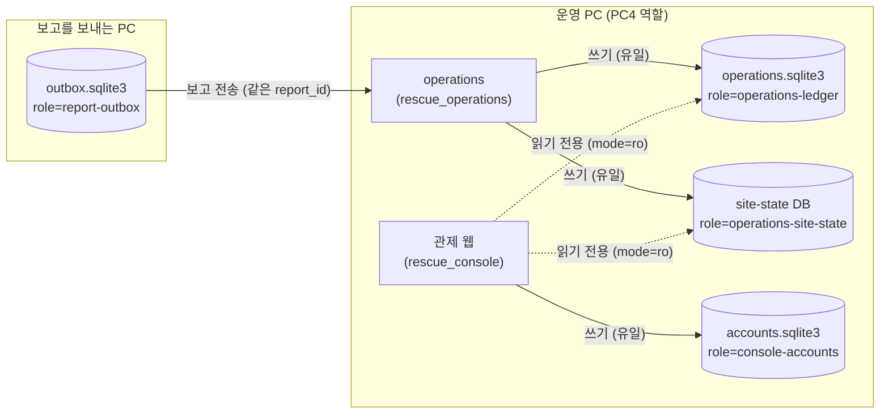
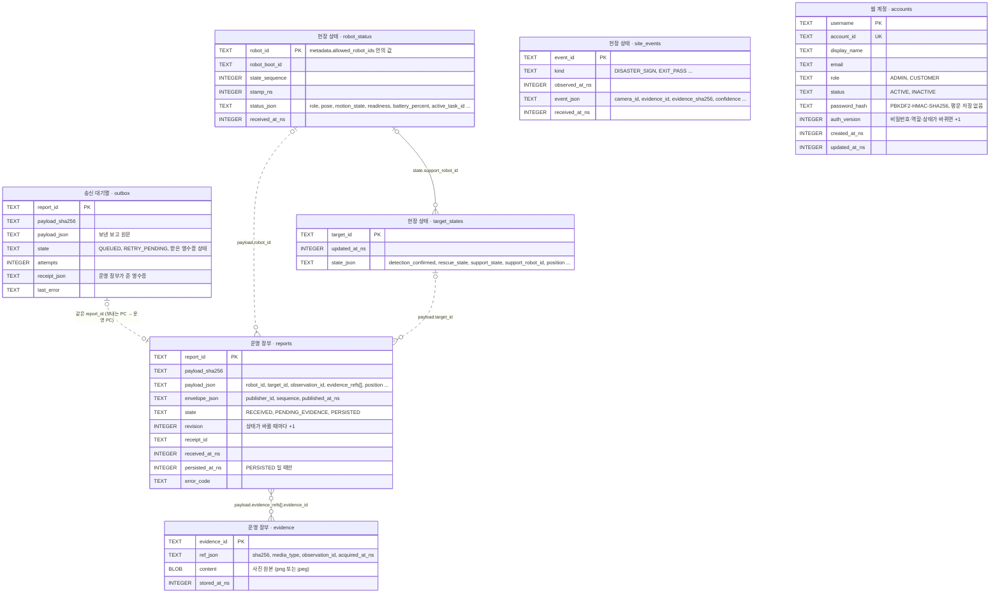

# 운영 DB 파일과 테이블 관계도 (웹마스터, 2026-10-10)

관제 웹과 operations 가 쓰는 SQLite 파일이 넷이고, 파일마다 쓰는 쪽이 하나다. 이 문서는 **어느 파일에 어떤 테이블이 있고, 테이블끼리 어떤 ID 로 이어지는지**를 그림으로 보여 준다. 표·열 정의는 [DB 스키마](../design/db-schema.md)와 아래 「기준 코드」에서 확인한다. 설명이 어긋나면 해당 커밋의 코드를 기준으로 바로잡는다. 이 문서는 관계 그림과 읽기 전용으로 여는 법을 다룬다. 스키마를 바꾸는 것은 각 담당 레인이고, 이 문서는 바뀐 뒤 따라 고친다.

- 외래 키(`FOREIGN KEY`) 제약은 **하나도 없다.** 테이블 사이 관계는 `report_id` 같은 일반 열이나 JSON 안의 ID 를 대조해 해석한다. 쓰는 코드는 ID 형식·허용 로봇·증거 참조 등을 검사하지만, 다른 DB 의 로봇·대상 상태 행이 존재하는지까지 보장하지는 않는다. DB 도구에서 관계선이 보이지 않는 이유다.
- 모든 파일에 `metadata(key, value)` 테이블이 있고, `role` 값으로 어떤 파일인지 구분한다. 다른 역할의 파일을 잘못 열면 코드가 `POLICY_MISMATCH` 로 거절한다.
- 시각 열(`*_ns`)은 전부 나노초 정수다(`int64`).

## 1. 파일과 쓰는 쪽

| 파일 | `role` | 테이블 | 쓰는 쪽 (담당 레인) | 읽는 쪽 | 운영 PC 의 현재 상태 [측정, 2026-10-10] |
| --- | --- | --- | --- | --- | --- |
| 보고 송신 대기열 | `report-outbox` | `outbox` | 보고를 보내는 PC 의 송신기 (협업·관제) | 송신기 | 오프라인 리허설이 만든 합성 파일만 있음 |
| 운영 장부 | `operations-ledger` | `reports`, `evidence` | operations (협업·관제) | 관제 웹(읽기 전용) | 오프라인 리허설 합성 데이터: 보고 2건, 증거 사진 2건 (E2) |
| 현장 상태 | `operations-site-state` | `robot_status`, `site_events`, `target_states` | operations (협업·관제) | 관제 웹(읽기 전용) | **파일 없음.** operations 가 아직 쓰지 않아 관제 웹은 예시 JSON 파일로 대신 뜬다 |
| 웹 계정 | `console-accounts` | `accounts` | 관제 웹 (관제·화면) | 관제 웹 | 관리자 1명. 저장소 밖 설정 폴더에 권한 600 으로 둠 |

- 실제 파일 경로는 운영 PC 의 로컬 설정이라 저장소에 적지 않는다([AGENTS.md](../../AGENTS.md) 9절). 네트워크 공유 폴더에 두지 않는다([implementation-operations.md](../implementation/implementation-operations.md)).
- 송신 대기열은 원래 보고를 보내는 PC 의 로컬 파일이다. 지금 운영 PC 에 있는 것은 오프라인 리허설이 한 PC 안에서 보내는 쪽과 받는 쪽을 함께 흉내 낸 결과다.

## 2. 테이블 관계

표 제목의 앞부분이 파일(1절 표의 이름)이다. 이 그림에서는 **실선은 같은 파일 안, 점선은 다른 파일 사이**의 ID 대응을 뜻한다. 외래 키나 식별 관계를 선언하는 선은 아니다. 선 이름표의 `payload.*`·`state.*` 는 JSON 열 안의 필드다. 로봇·대상 상태를 아직 받지 않았다면 보고에 ID 가 있어도 대응 상태 행은 0개일 수 있다.

읽는 법:

- **보고 → 증거 사진:** `reports.payload_json` 의 `evidence_refs[]` 가 `evidence.evidence_id` 를 가리킨다. 증거의 `ref_json.observation_id` 는 보고의 `observation_id` 또는 `confirmation_observation_id` 와 같아야 한다. `receive()` 는 먼저 `RECEIVED` 행을 커밋한다. 이후 `persist(report_id)` 가 보고에 적힌 증거 참조가 모두 저장됐는지와 장부의 증거 정책(`metadata.evidence_policy` = `OPTIONAL`·`OBSERVATION`·`CONFIRMATION`)을 확인해 `PENDING_EVIDENCE` 또는 `PERSISTED` 로 바꾼다. `OPTIONAL` 도 보고에 참조를 적었다면 해당 사진이 필요하다. 사진을 `store_evidence()` 로 저장하는 것만으로 보고 상태가 바뀌지는 않으며, 다시 `persist()` 를 호출해야 한다.
- **보내는 쪽 → 받는 쪽:** 송신 대기열의 `outbox.report_id` 와 운영 장부의 `reports.report_id` 는 같은 보고다. 파일이 다른 PC 에 있어 DB 로는 이어지지 않고, 운영 장부가 돌려준 영수증을 `outbox.receipt_json` 에 적어 짝을 맞춘다.
- **로봇·대상 → 보고:** 보고의 `robot_id`·`target_id` 가 현장 상태의 `robot_status`·`target_states` 와 같은 ID 를 쓴다. 두 테이블은 다른 파일(현장 상태 DB)에 있고, 보고 수신 시 대응 상태 행이 존재할 필요는 없다. 관제 화면은 이 ID 로 보고와 현장 상태를 대조하며, 구조 상태 4단계는 보고와 대상 상태를 합쳐 만든다([rescue_console README](../../src/rescue_console/README.md)).
- **지원 로봇:** `target_states.state_json.support_robot_id` 는 지원 상태가 `NONE` 일 때만 비어 있고, 값이 있으면 허용 로봇 ID 중 하나다.
- **현장 사건의 사진:** `site_events.event_json` 에도 `evidence_id` 가 있지만, 그 사진을 운영 장부 `evidence` 에 넣는 코드는 main 에 없다. 둘이 같은 ID 체계인지는 [미확인]이라 그림에 선을 긋지 않았다.
- **웹 계정**은 다른 테이블과 이어지지 않는다. 보고·현장 상태 쪽 DB 에는 쓰지 않는다.

## 3. 앞으로 늘어날 테이블 [제안]

[관제 웹·DB 구성 계획](../design/console-and-db-plan.md) 3절이 현장 상태 DB 스키마 1.1 에 `mission_state`, `operator_commands`, `error_log`, `map_snapshots` 를 더하는 안을 적어 두었다. 아직 코드에 없어 그림에 넣지 않았다. 스키마 PR 이 main 에 들어가면 이 문서를 같이 고친다.

## 4. 직접 열어 보기

- 운영 PC 에서 **DB Browser for SQLite** 를 **읽기 전용**으로 연다(`sqlitebrowser -R <파일>`, 메뉴로는 File → Open Database Read Only). 운영 장부와 현장 상태는 operations 만 쓰는 파일이라, 쓰기 모드로 열어 고치면 단일 쓰기 규칙이 깨진다.
- 터미널에서는 `sqlite3 -readonly "file:<파일>?mode=ro" .schema` 로 이 문서의 스키마를 다시 확인할 수 있다.
- JSON 열은 `json_extract` 로 꺼내 본다. 예: `SELECT report_id, json_extract(payload_json, '$.target_id') FROM reports;`

## 기준 코드

| 파일 | 스키마가 있는 곳 (main `8e7c784`) |
| --- | --- |
| 송신 대기열·운영 장부 | [`src/rescue_operations/rescue_operations/ledger.py`](../../src/rescue_operations/rescue_operations/ledger.py)(`CREATE TABLE`), 필드 목록은 [`schema.py`](../../src/rescue_operations/rescue_operations/schema.py) |
| 현장 상태 | [`src/rescue_operations/rescue_operations/site_state.py`](../../src/rescue_operations/rescue_operations/site_state.py)(`ROBOT_KEYS`·`TARGET_KEYS`), 현장 사건 필드는 `rescue_contracts.SiteEvent` |
| 웹 계정 | [`src/rescue_console/rescue_console/accounts.py`](../../src/rescue_console/rescue_console/accounts.py) |

확인 방법 [측정, 2026-10-10]: 운영 PC 의 실제 파일 세 개(송신 대기열·운영 장부·웹 계정)는 `sqlite3 -readonly .schema` 로, 현장 상태는 운영 PC 에 파일이 없어 임시 폴더에 `SiteStateLedger` 로 빈 DB 를 만들어 `.schema` 로 뽑았다. 보고·증거 JSON 의 필드는 합성 장부의 실제 행에서 확인했다.
