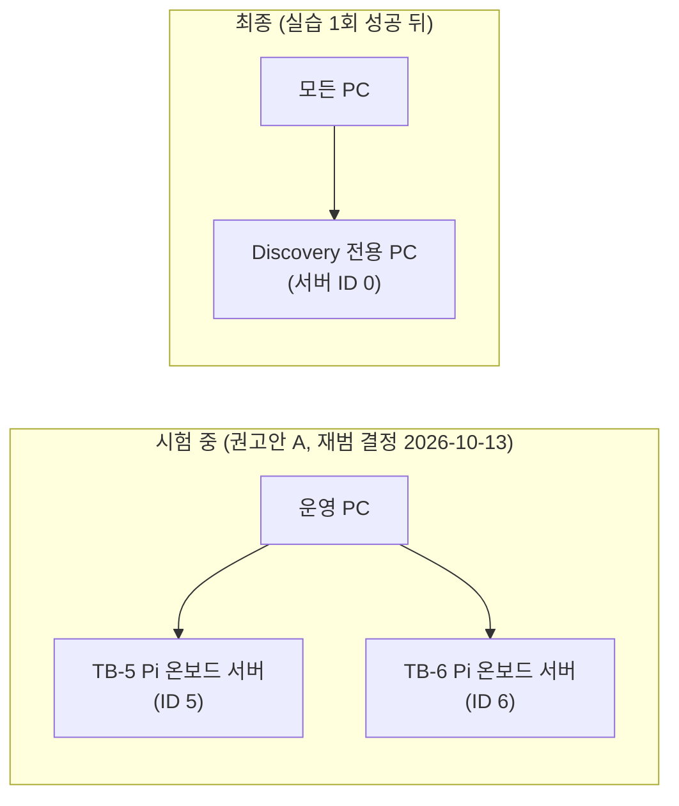

# 운영 PC 현황 기록

> [!IMPORTANT]
> **2026-10-15: Discovery 전용 PC 의 서버(ID 0)로 전환했다(재범 결정).** 로봇 Pi 설정은 그대로다. 전용 PC 에 떠 있는 것, 다른 PC 가 붙는 법, 확인·문제 해결은 [Discovery 전용 PC 운영 안내](discovery-host.md)에 있다. 아래 「한눈에 (2026-10-14)」의 Discovery 행은 전환 전 기록이다.

## 한눈에 (2026-10-14)

이 문서가 답하는 질문은 「운영 PC 가 지금 어떤 Discovery 설정으로 로봇 그래프에 붙고, 무엇이 떠 있는가」다. 운영 PC 는 운영 노드(`operations.launch.py`)와 관제 웹을 띄우는 PC 다. 2026-10-10 기록의 「운영 PC」(Discovery 중앙 서버 ID 0 을 돌리던 PC)는 지금 Discovery 전용 PC 후보다.

| 항목 | 값 | 출처 |
| --- | --- | --- |
| Discovery 결정 | 시험 중에는 권고안 A(각 PC 가 로봇 Pi 온보드 서버에 직접 붙음), 실습 1회 성공 뒤 Discovery 전용 PC 1대 | [network-discovery.md](../design/network-discovery.md) 0절·11절, 재범 결정 2026-10-13 |
| 운영 PC 의 `/etc/turtlebot4_discovery/setup.bash` | 옛 중앙 서버(ID 0) 하나만 적혀 있음. 이 값으로는 로봇 토픽이 하나도 안 보였다 | [측정 2026-10-13] |
| 운영 PC 가 로봇 그래프에 붙는 방법 | 설정 파일은 바꾸지 않고, 구독 노드를 띄우는 셸에서만 `ROS_DISCOVERY_SERVER=";;;;;<TB-5 Pi>:11811;<TB-6 Pi>:11811"`(ID 5·6 자리). 이 값으로 `/robot5`·`/robot6` 토픽이 보였다 | [측정 2026-10-13] |
| 운영 PC 가 로봇 그래프에 띄우는 것 | 구독만 하는 노드: `robot_watch`, `map_snapshot`(재범 허용 2026-10-13). 발행·서비스·액션 없음 | 관제 웹 README 「현재 상태」 |
| 운영 노드 시험 | 격리 도메인(`ROS_DOMAIN_ID` 를 따로, `ROS_AUTOMATIC_DISCOVERY_RANGE=LOCALHOST`, `ROS_DISCOVERY_SERVER` 비움)에서 `db_writer`·`report_node`·`webcam_node`·`mjpeg_relay` | [측정 2026-10-13] |
| 와이파이 | 로봇 Wi-Fi 로 옮김(재범 지시 2026-10-13). 절전은 켜져 있음(끄는 것은 재범 결정) | [측정 2026-10-13] |
| 관제 웹 | 손으로 띄운 프로세스(서비스 등록 없음). 다른 기기에서 접속할 때는 `--host` 에 배포 프로파일 값 | [측정 2026-10-13], 관제 웹 README |

- 로봇 쪽 Discovery 설정은 바꾸지 않는다(2026-10-10 규칙 그대로).
- 운영 PC 의 Discovery 설정 파일을 권고안 A 또는 전용 PC 값으로 바꾸는 일은 PC 설정 변경이다. 재범 허락을 받고, 팀 AGENTS.md 6절의 설정 변경 절차(로봇·PC 설정을 바꿀 때 백업 → 해시 → 변경 → 해시 → 재시작 → 동작 확인 → 되돌리는 방법)를 따른다. 2026-10-14 까지 바꾸지 않았다.
- 실습 1회 성공 뒤 전용 PC 로 옮기는 방법(로봇이 그 서버에 보이게 하는 방법)은 결정 대기다(network-discovery.md 11.1).

## 기록 (2026-10-10)

아래는 2026-10-10 판이다. 그때는 이 PC 가 중앙 Discovery Server(ID 0)를 돌렸다. 지금은 위 「한눈에」를 본다.

### 2026-10-10 판: 옛 운영 PC 현황 기록

운영 PC(PC4 역할: operations·web·DB, [관제 웹·DB 구성 계획](../design/console-and-db-plan.md) 2절)에 **지금 실제로 무엇이 떠 있는지**를 적는다. 이 PC 의 로컬 상태를 아는 세션이 하나(웹마스터)뿐이라 여기에 남긴다. 값은 [측정, 2026-10-10] 이고, IP·PC 이름·개인 경로는 팀 [AGENTS.md](../../AGENTS.md) 9절대로 `<OPS_HOST_IP>` 같은 자리 이름으로 바꿨다.

#### 0. 결론

1. **운영 PC 가 Fast DDS Discovery Server(서버 ID 0, UDP 11811)를 돌린다.** 두 로봇도 Discovery Server 로 설정되어 있다 — 로봇 쪽 구체 값은 [미확인](아래 3절).
2. **이 구성은 [network-discovery.md](../design/network-discovery.md) 0절의 권고안 A(로봇마다 Pi 온보드 서버, PC 는 두 서버를 목록에 적음)와 다르다.** 운영 PC 의 클라이언트 목록에는 자기 자신의 서버 하나만 있다. 어느 쪽이 팀 결정인지는 문서에 없다 [미확인].
3. **서버는 서비스가 아니라 터미널에서 손으로 띄운 프로세스다.** 그 터미널이 닫히거나 PC 가 재부팅되면 서버가 꺼지고, 새로 뜨는 노드는 아무것도 찾지 못한다(이미 맺은 연결은 유지, network-discovery.md 0절 4번). 바꾸지 않았다(2절 규칙).
4. **운영 PC 주소는 DHCP(자동)다.** 서버 주소가 IP 로 고정되어 있으므로 주소가 바뀌면 이 PC 와 로봇 쪽 설정이 함께 깨진다. 공유기 예약 여부는 [미확인].

#### 1. 측정값 (2026-10-10, 읽기 전용 조회만)

| 항목 | 값 | 확인 방법 |
| --- | --- | --- |
| 서버 프로세스 | `fastdds discovery --server-id 0 --ip-address <OPS_HOST_IP> --port 11811` (자식 `fast-discovery-server`) | `ps` |
| 기동 | 2026-10-08 19:03, 사용자 터미널에서 직접 실행(부모가 대화형 bash, 출력이 그 터미널). systemd 유닛 없음 | `ps`·`/proc/<pid>/fd`·`systemctl list-units` |
| 수신 | UDP `0.0.0.0:11811` | `ss -lunp` |
| 서버 바이너리 버전 | Ubuntu `fastdds-tools` 2.11.2 (`/usr/bin/fastdds`) | `dpkg -l` |
| ROS 쪽 Fast DDS | `ros-jazzy-fastrtps` 2.14.6, `rmw_fastrtps_cpp` 8.4.4 | `dpkg -l` |
| 클라이언트 설정 | `/etc/turtlebot4_discovery/setup.bash`(TB4 `configure_discovery.sh` 형식): `RMW_IMPLEMENTATION=rmw_fastrtps_cpp`, 대화형 터미널만 `ROS_SUPER_CLIENT=True`, `ROS_DOMAIN_ID=6`, `ROS_DISCOVERY_SERVER="<OPS_HOST_IP>:11811;"` | 파일 읽기. sha256 앞 16자 `10d36e65ce000207` |
| 셸 | 사용자 `.bashrc` 가 위 파일을 `source` 하고 `ROS_DOMAIN_ID=6` 을 한 번 더 export | 파일 읽기 |
| 주소 할당 | 무선, IPv4 method `auto`(DHCP) | `nmcli` |

- 서버 바이너리(2.11.2)와 ROS 클라이언트(2.14.6)의 Fast DDS 버전이 다르다. 지금 동작에 문제가 있다는 관측은 없다. 문제가 생기면 먼저 볼 곳으로 적어 둔다 [측정 / 영향 미확인].
- 이 PC 의 셸은 기본으로 실제 로봇 그래프에 붙는다(`ROS_DISCOVERY_SERVER` 설정됨). 로봇을 움직이지 않는 시험은 팀 AGENTS.md 6절대로 다른 `ROS_DOMAIN_ID` 와 `ROS_AUTOMATIC_DISCOVERY_RANGE=LOCALHOST` 로, 그리고 network-discovery.md 0절 5(c)대로 `ROS_DISCOVERY_SERVER` 를 비우고 한다.

#### 2. 규칙 (2026-10-10)

> [!WARNING]
> 원문 미확인 (전달: 사용자, 2026-10-10): 로봇의 Discovery Server 설정은 최대한 건드리지 않는다.

- 위 전달에 따라 **로봇 쪽 Discovery Server 설정은 바꾸지 않는다.** 운영 PC 쪽 서버 재시작·서비스 등록도 로봇 통신을 잠깐 끊으므로 같은 급으로 다룬다.
- 운영 PC 서버를 서비스로 바꾸는 작업은 **로봇이 쉬는 시간에만** 한다(사용자 지시 2026-10-10: "로봇이 쉬는 시간에 작업을 하자"). 그 전에 팀에 알리고, 팀 AGENTS.md 6절 설정 변경 절차(백업 → 해시 → 변경 → 해시 → 재시작 → 동작 확인 → 되돌리는 방법)를 따른다. 아직 하지 않았다.
- 그 작업 전까지 **서버를 띄운 터미널을 닫지 않는다.** 서버가 꺼졌으면 같은 ID·포트로 다시 띄운다(같은 명령, network-discovery.md 0절 4번: 2초 안에 기존 노드가 다시 보임 [측정, localhost 값]).

#### 3. 모르는 것

| 무엇 | 왜 필요한가 | 확인할 사람 |
| --- | --- | --- |
| 두 로봇의 Discovery Server 설정(온보드 서버 ID, 오프보드 서버로 운영 PC 를 적었는지, 도메인) | 운영 PC 서버가 꺼질 때 로봇끼리·로봇과 다른 PC 가 여전히 서로 보이는지가 여기에 달렸다 | 로봇·지도, 실기·배포 (로봇 설정을 바꾸지 않고 읽기만) |
| 이 중앙 서버 구성이 팀 결정인가, 권고안 A 로 갈 것인가 | network-discovery.md 가 A 를 권고한 채로 남아 있다. 결정 자료는 5절 비교표 | 소유자(10-12 실기 전) |
| 운영 PC 주소의 공유기 예약 | DHCP 로 바뀌면 서버 주소가 깨진다 | 사용자 |
| 다른 PC(고사양 2대 등)의 클라이언트 목록 | 같은 서버를 쓰는지 | 실기·배포 |

#### 4. 같은 PC 의 다른 프로세스 (참고)

- 관제 웹(`rescue_console`, main 그대로)이 TCP 8080 에서 뜬다. 사용자 서비스로 등록되어 재부팅 뒤에도 뜨고, 기동할 때 실행 중인 git SHA 를 로그에 남긴다. ROS 를 쓰지 않아 Discovery Server 와 무관하다. 지금 데이터는 오프라인 리허설의 합성 장부다(E2).
- 운영 장부·현장 상태 DB 는 로컬 디스크(ext4)에 둔다. 네트워크 공유 금지는 [implementation-operations.md](../implementation/implementation-operations.md) 의 운영 경로 규칙을 따른다.

#### 5. 결정 자료: 지금 구성과 권고안 A 비교 (10-12 실기 전 소유자 결정용)

- 결론: **지금 구성을 그대로 쓰면 바꿀 설정은 0건**이지만, 운영 PC 서버 하나가 꺼지면 새 발견이 모두 막히고 운영 PC 주소 예약이 꼭 필요하다. **권고안 A 로 바꾸면** 운영 PC 가 발견의 단일 장애점에서 빠지는 대신, PC 쪽 설정을 바꿔야 하고(등급 4) 로봇 주소 예약이 필요하다.
- 지금 구성은 사실상 network-discovery.md 5절의 **「A+오프보드」** 일 가능성이 있다 [추정]. 근거: Create 3 는 Pi 온보드 서버에만 붙으므로(network-discovery.md 2절 [문서]) 로봇에는 온보드 서버가 있어야 하고, 운영 PC 의 서버 ID 0 은 오프보드 자리로 읽힌다. 로봇 쪽 값을 읽기 전까지는 확정하지 않는다.

- **측정 추가 (2026-10-10, 21:49 측정 직후 운영 PC 에서 읽기 전용 조회):** 운영 PC 서버에 붙은 SUPER_CLIENT(`ros2 topic list --no-daemon`)로 `/robot5/*` 토픽 24개가 보이고, `echo --once` 로 `/robot5/battery_state` percentage 0.99, `/robot5/dock_status` is_docked True 를 받았다. 즉 **robot5 는 지금 운영 PC 서버를 거쳐 보인다.** 두 번째 로봇의 토픽은 보이지 않았다(꺼졌는지, 다른 서버에만 붙는지는 [미확인]). 발행·서비스 호출은 하지 않았다.
  - 그래서 운영 PC 서버를 내리거나 운영 PC 의 목록만 바꾸면 robot5 를 운영 PC 서버로 보던 다른 PC·세션의 새 발견이 막힐 수 있다. 권고안 A 로 갈 때는 **운영 PC 서버를 켜 둔 채** 각 PC 의 목록을 로봇 서버로 옮기고, 모두 옮긴 뒤에 서버를 끌지 정하는 순서가 안전하다 [추정].
  - 운영 PC 의 `/etc/turtlebot4_discovery/setup.bash` 는 **이 PC 에서 도는 다른 세션 전부**가 같이 읽는다(같은 사용자 `.bashrc`). 이 파일을 바꾸면 그 세션들의 그래프도 함께 바뀌므로, 바꾸는 시간을 그 세션들과 맞춰야 한다.

> [!WARNING]
> 원문 미확인 (전달: 사용자, 2026-10-10): 운영 PC 와 함께 두 로봇에도 Discovery Server 가 설정되어 있다. 로봇의 온보드 서버 ID, 오프보드 서버로 운영 PC 를 적었는지, 도메인, 네임스페이스는 읽지 않았다.

| 항목 | 지금 구성 (운영 PC 중앙 서버) | 권고안 A (로봇마다 서버) | 참고: A+오프보드 |
| --- | --- | --- | --- |
| 서버 위치 | 운영 PC 한 대. 서버 ID 0, UDP 11811 [측정]. 로봇 Pi 서버 유무는 [미확인] | 로봇 Pi 마다 온보드 서버, ID 는 로봇마다 고유. 운영 PC 에는 서버 없음 [문서] | A 의 온보드 서버 + 운영 PC 서버(오프보드) 하나 [문서] |
| 운영 PC 의 `ROS_DISCOVERY_SERVER` | `"<OPS_HOST_IP>:11811;"` (첫 자리 = ID 0) [측정] | 두 로봇 서버를 ID 자리에 맞춰 적음. 예: ID 3·6 이면 `";;;<ROBOT_A_IP>:11811;;;<ROBOT_B_IP>:11811"` [문서] | 지금과 같음: `"<OPS_HOST_IP>:11811;"` |
| 로봇 담당 PC 의 값 | [미확인] (같은 서버를 쓰는지 안 읽음) | 자기 로봇 서버만. 예: `";;;<ROBOT_A_IP>:11811"` [문서] | 운영 PC 서버 또는 자기 로봇 서버 |
| 로봇 Pi 의 값 | [미확인] | 자기 온보드 서버(TB4 기본) [문서] | 온보드 + 오프보드(운영 PC) [문서] |
| 서버가 죽었을 때 | 운영 PC 서버가 꺼지면 이 서버를 거치는 **새 노드는 아무것도 못 찾는다.** 이미 맺은 연결은 유지된다(localhost 측정 H: 꺼진 뒤 10초간 56건 계속 수신, 같은 ID·포트로 다시 띄우면 2초 안에 다시 보임). 지금은 손으로 띄운 프로세스라 터미널을 닫거나 재부팅하면 꺼진다 [측정] | 한 로봇 서버가 꺼지면 **그 로봇 쪽** 새 발견만 막히고 다른 로봇은 영향이 없다. Pi 재부팅 때 서버도 같이 내려갔다 올라온다 [문서·추정] | 운영 PC 서버가 꺼지면 로봇 사이·로봇과 PC 사이의 새 발견이 막힌다. 각 로봇 안(Pi–Create 3)은 온보드 서버로 계속 돈다 [문서] |
| 되돌리기 | 바꾸는 것이 없다. 서버가 꺼지면 같은 명령(ID 0, 포트 11811)으로 다시 띄운다 | PC 들의 `setup.bash` 백업본을 되돌리고 운영 PC 서버를 다시 띄운다. 로봇 변경이 0건이면 로봇은 되돌릴 것이 없다 | 로봇 Pi 설정을 되돌리려면 turtlebot4-setup 에서 오프보드를 지우고 Create 3 를 재부팅해야 한다 [문서] |
| 바꿔야 할 설정 | 없음. 권장: 운영 PC 서버를 사용자 서비스로 등록(재부팅 대비), 운영 PC 주소 예약 | PC 마다 `/etc/turtlebot4_discovery/setup.bash` 의 `ROS_DISCOVERY_SERVER` (운영 PC 포함). 운영 PC 의 중앙 서버를 끌지 정하기. 로봇: 온보드 서버 ID 가 이미 고유하면 0건 [미확인] | 로봇 Pi 2대의 오프보드 설정(이미 그렇다면 0건) + 운영 PC 서버 유지 |
| 등급 4 (팀 AGENTS.md 6절 절차) | 유지하면 해당 없음. 서비스 등록은 운영 PC 설정 변경이라 등급 4 | **해당.** PC 설정 변경(운영 PC 포함). 로봇은 읽기만 하고 바꾸지 않음 | **해당.** 로봇 Pi 설정 변경이 생기면 2대 |
| 주소 예약 (DHCP) | **필요.** 모든 클라이언트가 `<OPS_HOST_IP>` 를 가리키는데 운영 PC 는 DHCP 이고 임대 시간이 7200초다 [측정] | 로봇 Pi 2대 주소 예약 필요(모든 PC 가 로봇 주소를 가리킴). 운영 PC 는 발견에는 불필요(관제 웹 접속 주소로는 여전히 고정이 편함) | 운영 PC 와 로봇 Pi 2대 모두 필요 |

- 「로봇 Discovery 설정은 건드리지 않는다」(2절)와 가장 잘 맞는 것은 **지금 구성 유지** 또는 **A(로봇 변경 0건일 때)** 다. 어느 쪽이든 로봇 쪽 현재 값을 먼저 읽어야 판단이 확정된다(3절 첫 줄, 로봇·지도·실기·배포).
- 이 표를 만들면서 운영 PC 의 서버·`setup.bash`·`.bashrc` 는 바꾸지 않았다. 측정은 2026-10-10 21:49 읽기 전용 조회다(서버 PID 는 10-08 19:03 부터 같음, `setup.bash` 해시 그대로).
