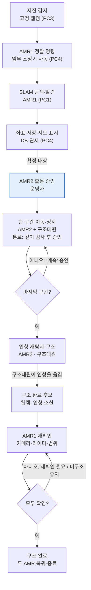

# ROKEY-7 비즈니스 요구사항 문서 (BRD)

> 작성: 팀원 세션(Claude), 2026-10-10. PM 지시(2026-10-10): "현재의 시나리오를 바탕으로 BR, SR을 작성해야 돼. 첨부한 pdf의 인덱스대로 내용 작성해줘." 목차 번호는 교육 과정이 준 BRD·SRD 양식 PDF 의 인덱스를 따른다. 근거는 [범위](scope.md), [BRD Part I v0.1](brd-part1-v0.1.md), [SDD 검토안 v0.1](../design/sdd-node-interface-spec-v0.1.md), 2026-10-09 시나리오 결정(PM 원문: "구조대원은 실제 사람, 요구조자는 인형으로 설정", "비스듬한 통로는 머리 위에 걸린 기둥이야")이다.
>
> **채택 결정이 아니다.** Phase 1 기준 문서는 여전히 [BRD Part I v0.1](brd-part1-v0.1.md) 이며, 이 문서의 채택은 Q-25 등 미결정 항목과 작전 검토 뒤에 정한다. 수치는 본문에 [초안]·[제안]·[미정] 으로 표시했다. 다이어그램 PNG 는 문서 편집기에서 내보낸 렌더링이다.
>
> 짝 문서: [SRD v0.2](srd-v0.2.md).

**프로젝트 제목:** 지진 재난 현장 대응형 실내 탐색·구조 지원 자율 이동 로봇(AMR) 시스템 (Phase 1)

**프로젝트 소유자:** ROKEY-7 팀 (대표자 미기재)

**날짜:** 2026.10.10

**버전:** 0.2 (초안 — 웹캠 1대·관리자 구간 승인 시나리오 반영)

**근거:** 저장소 docs/requirements/scope.md(RQ·Q), BRD Part I v0.1, SDD 노드·인터페이스 검토안 v0.1(PR #44), 2026-10-09 시나리오 회의 결정. 확정되지 않은 항목은 [제안] 또는 [미정]으로 표시한다.

## 1. 비즈니스 목표

AMR 2대와 고정 웹캠 1대로, 지진 직후 건물 내부에서 요구조자를 찾고 구조대원의 접근을 돕는 초동 대응 절차를 시연한다. 구조대가 위험 구역을 직접 수색하는 시간을 줄이고, 구조 우선순위 판단에 필요한 위치 정보를 진입 전에 제공하는 것이 목표다. 장기적으로는 소방·재난 대응 기관과 대형 건물 관리 주체를 위한 재난 초동 대응 보조 로봇으로 확장한다.

고정 웹캠이 영상의 흔들림으로 지진을 감지하면, AMR1이 기준 지도를 바탕으로 SLAM 탐색을 하며 변화한 장애물과 요구조자(시연에서는 인형)를 찾는다. 발견 좌표는 DB에 저장되고 관제 지도에 표시된다. 운영자가 승인하면 구급상자를 실은 AMR2가 구조대원과 함께 한 구간씩 이동한다. 구조 후에는 웹캠의 소실 후보와 AMR1의 재확인을 합쳐 구조 완료를 판정한다.

### 1.1 세부 비즈니스 목표

1. 지진 감지 → 정찰 → 발견·좌표 보고 → 구조 지원 → 완료 확인 → 복귀의 초동 대응 절차를 하나의 관제 흐름으로 운영한다.
2. 지진 전 기준 지도와 비교해 무너진 구조물로 바뀐 통로를 관제 지도에 드러낸다.
3. 요구조자의 위치를 구조대 진입 전에 지도 좌표로 확인할 수 있게 한다.
4. 로봇이 사람 곁에서 움직이는 모든 구간을 사람의 승인으로만 진행해, 구조대원의 안전을 자동화보다 우선한다.
5. 구조 완료는 서로 다른 두 근거(고정 웹캠 소실 + AMR1 현장 재확인)가 모두 맞을 때만 판정해 오판정을 막는다.
6. 사건, 좌표, 로봇 상태, 승인, 판정 근거를 DB에 남겨 대응 이력과 장애 원인을 나중에 추적할 수 있게 한다.

## 2. 프로젝트 범위

Phase 1은 단일 층 시연 환경에서 요구조자를 인형으로, 구조대원을 실제 사람으로 두고 검증한다. AMR 2대, 고정 웹캠 1대, PC 4대(PC1 AMR1 · PC2 AMR2 · PC3 웹캠 · PC4 관제·DB)를 사용한다. 여기서 ‘구조 완료’는 시연 판정이며 실제 이송을 증명하지 않는다.

Phase 1 시나리오 흐름 · 사람이 승인하는 단계 1곳(AMR2 출동, 파란 칸), 구간마다 반복 승인 1곳(‘계속’), 완료 판정 1곳. AMR1 정찰은 재난 이벤트를 검증한 뒤 임무 조정기가 자동으로 발급한다(3.1.6, 저장소 소유자 결정 2026-10-10). 그림 원본은 위 코드이고 GitHub 에서 그대로 그려진다. 결정 전 판(AMR1 출동을 운영자 명령으로 그린 것)은 [brd-v0.2-scenario-flow.png](brd-v0.2-scenario-flow.png) 로 남겨 둔다.

AMR2는 구간마다 멈춰 승인을 받고, 웹캠 소실은 후보일 뿐이며 AMR1 재확인이 모두 맞아야 구조 완료가 된다.

### 2.1 포함 범위 (In Scope)

- TurtleBot4 2대의 설정과 제어: AMR1은 정찰·재확인, AMR2는 구급상자 운반·구간 이동
- 고정 웹캠 1대: 지진 감지, 구조 지점 감시, 관제 웹 영상 제공
- AMR1의 기준 지도 기반 SLAM 탐색과, 기준 지도 대비 변화 장애물 표시
- AMR1의 RGB-D 기반 인형 인식, 지도 좌표 변환, 동일 대상 병합
- 발견 좌표의 DB 저장과 관제 지도 표시
- 운영자 승인으로만 시작하는 AMR2 출동, 구간마다 정지 후 ‘계속’ 승인으로 진행, 구조대원은 로봇을 따라 걸어서 동행
- 머리 위에 비스듬히 걸친 기둥 아래 통로의 통과 근거 제시(깊이 카메라 기반) [Q-25 결정 대기 — 기본은 ‘접근 불가’ 보고]
- AMR2 도착 후 카메라로 인형 재탐지
- 웹캠 소실 후보와 AMR1 재확인(카메라·라이다·관측 범위)을 합친 구조 완료 판정
- 두 로봇의 초기 위치 복귀와 임무 종료
- 관제 웹: 웹캠 영상, 지도, 로봇 위치·상태, 좌표와 구조 상태, 승인·정지·복귀 명령
- DB: 사건, 좌표, 로봇 상태, 승인 기록, 판정 근거, 오류 이력
- 통신 단절·상태 불명 시 안전 정지, 웹과 별개인 현장 정지 수단

### 2.2 제외 범위 (Out of Scope)

- 라이다 다리 인식 기반 구조대원 추종 **(후순위)**
- 출구 카메라 B와 출구 인원 카운트 (웹캠 1대 결정으로 제외)
- 경사 바닥 통과 (통로는 머리 위 기둥 형태만 다룬다)
- 119·소방 시스템 자동 신고
- 실제 피해 현장용 내충격·방진·방수 하드웨어와 인증
- 부상·생존 판별과 응급처치 수행
- 계단·단차·다층 이동과 엘리베이터 연동
- 얼굴인식 기반 신원 확인, 영상의 불필요한 장기 보관
- 실제 사람을 요구조자로 쓰는 시험 (실제 사람은 구조대원 역할만)
- 온도 모니터링·히트맵 **(후순위)**
- 중앙 경로 예약 기반 두 로봇 충돌·교착 복구 **(후순위)**

## 3. 기능 요구사항

로봇이 사람 곁에서 움직이는 출동·구간 이동은 운영자 승인으로만 진행하고, 구조 완료는 두 근거가 모두 맞을 때만 판정한다.

### 3.1 재난 감지 (고정 웹캠)

- 3.1.1: 고정 웹캠은 감시 구역 영상을 실시간으로 수집하고 관제 웹에 영상을 제공해야 한다.
- 3.1.2: 화면 전체가 함께 왔다 갔다 한 횟수(네 사분면이 같은 방향일 때만 셈)가 정해진 시간 안에 사전 정의한 판정 조건을 넘으면 재난 징후 이벤트를 생성해 중앙으로 보내야 한다. (방식은 2026-10-09 설계 합의·구현 PR #66, 판정·해제 값은 Q-11 미정)
- 3.1.3: 영상이 끊기거나 유효하지 않거나, 손·어둠·렌즈 막힘·카메라 앞에 선 사람 때문에 원래 장면이 보이지 않으면 재난 판정을 내리지 않고 ‘판정 불가’와 카메라 상태를 관제에 표시해야 한다. 가림은 지진 근거로 쓰지 않는다.
- 3.1.4: 동일한 재난 이벤트로 출동이 중복되지 않도록 이벤트 ID로 관리해야 한다.
- 3.1.5: 재난 이벤트의 발생 시각, 카메라 식별자, 판정 근거 영상을 DB에 기록해야 한다.
- 3.1.6: 재난 이벤트는 그 자체로 주행 명령이 아니다. 임무 조정기가 이벤트를 검증(유효 영상·시각·중복 이벤트 ID)한 뒤 AMR1 정찰 명령을 **자동으로** 발급한다. 운영자의 수동 시작은 자동 발급이 실패했을 때의 대체 수단이며, 쓰면 그 사실을 기록한다. [결정 — 저장소 소유자 결정 2026-10-10, Q-12]

### 3.2 SLAM 탐색과 변화 탐지 (AMR1)

- 3.2.1: AMR1은 임무 조정기의 정찰 명령을 받으면 기준 지도를 바탕으로 SLAM을 시작하고 자기 위치를 추정해야 한다. (기준 지도 작성 시기·방법은 Q-09·Q-15)
- 3.2.2: AMR1은 기준 지도 대비 새로 생긴 장애물(무너진 구조물)을 구분해 관제 지도에 표시해야 한다.
- 3.2.3: 지도가 생겼다는 것만으로 이동 준비 완료로 보지 않고, 지도·좌표 변환·센서가 최신일 때만 탐색 이동을 허용해야 한다.
- 3.2.4: 탐색이 끝나거나 중단되면 그 사유를 관제에 보고해야 한다.

### 3.3 요구조자 인식과 좌표 저장

- 3.3.1: AMR1은 RGB-D 영상에서 인형을 실시간으로 인식해야 한다.
- 3.3.2: 인식 위치와 깊이를 관측 시각의 로봇 자세와 결합해 지도 좌표로 변환해야 한다. 깊이나 좌표가 불확실하면 발견 사실만 남기고 접근 목표로 쓰지 않는다.
- 3.3.3: 좌표는 대상 ID, 좌표, 지도 버전, 인식 시각, 신뢰도와 함께 DB에 저장하고, 저장이 확인된 뒤 관제 지도에 표시해야 한다.
- 3.3.4: 일정 거리 이내의 반복 인식은 하나의 대상으로 병합해야 한다. (병합 거리 Q-21)
- 3.3.5: 신뢰도가 낮은 후보는 ‘미확정’으로 두고, 확정 대상만 AMR2 출동 후보가 된다.

### 3.4 구조 지원 출동 (AMR2)

- 3.4.1: AMR2는 구급상자를 실고 대기 위치에서 대기한다. 대기 중에는 위치 추정만 준비하고 움직이지 않는다.
- 3.4.2: 확정 좌표가 저장되면 시스템은 AMR2의 경로, 구간 목록, 통과 근거를 계산해 관제에 표시해야 한다.
- 3.4.3: AMR2는 운영자의 출동 승인 없이 출발하지 않는다.
- 3.4.4: AMR2는 한 번에 한 구간만 이동하고, 도착 후 실제 정지를 확인한 뒤 다음 승인을 기다린다. ‘계속’ 승인마다 새 명령으로 발급한다.
- 3.4.5: 구조대원(실제 사람)은 로봇을 따라 걸어서 동행하며, 로봇은 사람을 추종하지 않는다.
- 3.4.6: 머리 위 기둥 통로 앞에서 AMR2는 정지한 채 깊이 카메라로 ‘로봇+구급상자’ 높이·폭의 통과 공간을 검사해 근거를 관제에 보낸다. 통과는 사람이 승인하고, 깊이가 비거나 부족하면 ‘판정 불가’로 보고한다. [Q-25 결정 대기 — 기본은 ‘접근 불가’ 보고]
- 3.4.7: 경로 없음, 통과 불가, 주행 실패로 접근할 수 없으면 사유를 관제에 보고하고, 발견 사건은 유지한다.
- 3.4.8: 마지막 구간 도착 후 AMR2는 카메라로 인형을 다시 탐지해 결과를 보고한다.
- 3.4.9: 같은 대상에 중복 출동하지 않도록 대상별 지원 상태를 관리하고, 대상이 여럿이면 우선순위(초안: 거리순, Q-19)를 따른다.

### 3.5 구조 완료 판정 (고정 웹캠 + AMR1)

- 3.5.1: 시스템은 구조 대상마다 고정 웹캠의 감시 영역을 지정해야 한다. (검증된 투영 또는 운영자 선택)
- 3.5.2: 유효한 시야에서 인형이 일정 시간 연속으로 보이지 않으면 ‘구조 완료 후보’로 표시한다. 이 상태만으로 완료하지 않는다.
- 3.5.3: 가림, 영상 끊김, 시야 불확실은 ‘판정 불가(UNKNOWN)’로 두고 후보를 만들지 않는다.
- 3.5.4: 후보가 생기면 AMR1을 해당 지점으로 다시 보내고, 정지 후 카메라·라이다·관측 범위 결과를 각각 보고하게 한다.
- 3.5.5: 소실 후보, 소실 이후의 AMR1 관측, 카메라 ABSENT, 라이다 CLEAR, 관측 범위 VALID가 모두 맞을 때만 ‘구조 완료’(시연 판정)로 기록한다.
- 3.5.6: 하나라도 판정 불가이면 ‘재확인 필요’, 인형이 보이면 ‘미구조’로 되돌린다.

### 3.6 자율주행과 안전 정지

- 3.6.1: 두 AMR은 Nav2로 주행하고, 주행 중 장애물에는 라이다 기반 회피 또는 안전 정지로 대응해야 한다.
- 3.6.2: AMR2 구간 이동은 저속으로 제한한다. (초안: 일반 0.2 m/s, 통로·사람 근접 0.1 m/s [제안, 미측정])
- 3.6.3: 명령·위치·좌표 변환·명령 권한(lease)이 만료되면 새 명령을 막고, 이동 중이면 취소한 뒤 실제 정지를 확인한다. 확인하지 못하면 ‘정지 미확인’으로 관제에 표시한다.
- 3.6.4: 운영자는 관제 웹과 별개인 현장 정지 수단으로도 로봇을 멈출 수 있어야 한다. (수단 미정)
- 3.6.5: 주행 실패가 확정되면 해당 로봇을 오류 상태로 전환하고 관제에 표시한다.

### 3.7 DB와 관제 인터페이스

- 3.7.1: 관제 웹은 웹캠 영상, 지도(변화 장애물 포함), 두 AMR의 위치·상태·배터리, 대상 좌표와 구조 상태를 한 화면에 보여야 한다.
- 3.7.2: 관제 웹은 출동 승인, 구간 ‘계속’ 승인, 정지, 복귀, 임무 종료 명령을 제공한다. 명령은 API로만 전달하고, 웹은 ROS·DB에 직접 연결하지 않는다.
- 3.7.3: 구조 상태는 미확정 / 미구조 / 지원 중 / 구조 완료 후보 / 재확인 필요 / 구조 완료로 구분해 표시한다. (계약 어휘와의 대응은 Q-20)
- 3.7.4: DB는 재난 이벤트, 대상 좌표, 로봇 상태, 승인 기록(누가·언제·무엇을), 판정 근거, 오류 이력을 저장한다. 보고는 저장 확인을 받을 때까지 재전송한다.

### 3.8 임무 종료와 복귀

- 3.8.1: 구조 완료 기록이 저장되면 두 AMR은 초기 위치로 복귀한다.
- 3.8.2: 두 로봇이 정지하고 필수 보고가 저장되면 임무를 종료한다.
- 3.8.3: 운영자의 취소·복귀 요청도 같은 절차를 거친다.
- 3.8.4: 배터리가 기준치 미만인 로봇은 신규 출동에서 제외하고 관제에 경고한다. (기준치 Q-06)

## 4. 비기능 요구사항

아래 시간·속도 수치는 실측 전 초안이며 통합 시험 뒤 확정한다(Q-06·Q-23).

### 4.1 신뢰성

- 한 대의 AMR이 오류·저전력·통신 단절 상태가 돼도 다른 AMR의 상태 확인과 작업은 계속돼야 한다.
- 입력·관측이 없거나 시각·좌표가 불확실하면 동작하지 않는다. 실패를 정상값으로 채우거나 조용한 대체 동작을 두지 않고, 로그와 관제에 드러낸다.
- 웹캠·DB가 일시 장애를 일으켜도 로봇은 안전 상태를 유지하고, 복구 후 최신 임무 상태를 다시 확인해야 한다.
- 보고는 DB 저장 확인을 받을 때까지 재전송해 누락을 막는다.

### 4.2 보안

- 관제 웹은 운영 API로만 명령을 보내고, ROS·DB에 직접 연결하지 않는다. DB 기록은 운영 서버 한 곳만 한다.
- ROS 통신은 팀 전용 네트워크와 배포 프로파일의 도메인·발견 설정으로 묶는다. 도메인 ID만으로 격리된다고 가정하지 않는다.
- 다른 팀 로봇과 토픽이 섞이지 않도록 로봇별 네임스페이스를 쓰고, 로봇은 한 번에 한 사람·한 세션만 움직인다.
- 개인 경로, 호스트 이름, IP, 토큰은 문서와 저장소에 남기지 않는다.

### 4.3 확장성

- Phase 1은 AMR 2대, 고정 웹캠 1대, PC 4대를 기준으로 한다.
- 로봇·카메라 ID, 네임스페이스, 좌표계, 호스트는 코드가 아니라 배포 프로파일이 가진다. 같은 인터페이스로 로봇·카메라 수와 탐색 구역을 늘릴 수 있어야 한다.
- 재난 감지, 인식, 지도, 임무 조정, 운영·DB, 관제 웹은 각각 따로 시험·교체할 수 있어야 한다.

### 4.4 성능

- 지진 판정 조건 충족 후 5초 이내에 재난 이벤트가 중앙에 전달돼야 한다. [초안]
- 재난 이벤트 검증 후 3초 이내에 AMR1 정찰 명령이 발급돼야 한다(자동). [초안, KPI-02]
- 운영자가 AMR2 출동·‘계속’을 승인한 뒤 3초 이내에 AMR2에 명령이 전달돼야 한다. [초안 — 승인 후 시간으로 따로 잼, Q-25]
- AMR2 이동 속도는 일반 0.2 m/s, 통로·사람 근접 0.1 m/s 이하로 제한한다. [제안]
- 로봇 원본 영상(RGB·깊이)은 그 로봇 담당 PC에서만 처리하고, 중앙에는 결과와 제한된 증거만 보낸다.

### 4.5 규정 준수 (안전·개인정보)

- 사람이 지켜보지 않을 때 로봇을 움직이지 않는다. 구조대원 곁에서는 저속·구간 승인·정지 조건을 지킨다.
- 현장 정지 수단을 웹 연결에만 의존시키지 않는다.
- 로봇 설정 변경은 사용자의 명시적 승인, 백업, 변경 전후 확인, 되돌리는 방법 기록을 거친다. 로봇에 패키지를 설치하거나 업그레이드하지 않는다.
- 영상과 인식 정보는 임무에 필요한 범위로 제한하고, 얼굴 기반 신원 확인과 불필요한 장기 저장을 하지 않는다.

## 5. 종속성 및 제약조건

발표일은 2026-10-16이며, 그 전까지 아래 장비·환경이 갖춰져야 종단 간 시연이 가능하다.

### 5.1 종속성

- TurtleBot4 2대(Create 3 + Raspberry Pi 4, OAK-D Pro RGB-D, 2D LiDAR)와 AMR2의 구급상자 탑재부. 파이널 로봇 번호·설정은 Q-01.
- 구조 지점과 감시 구역이 함께 보이는 위치에 고정된 웹캠 1대.
- PC 4대(고사양 2, 중간 사양 2). 사양과 프로세스 배치는 동시 부하 측정으로 결정(Q-02).
- 지진 전 기준 지도와 그 작성 절차(Q-09·Q-15).
- 인형을 사람으로 인식하는 객체 인식 모델과 학습·검증 데이터(Q-04·Q-07).
- 시연 세트: 대기·초기 위치, 인형 배치, 머리 위에 비스듬히 걸친 기둥 통로.
- PC·로봇 간 ROS 2 네트워크와 발견 설정, 센서·로봇 데이터의 시각 동기화.
- 웹과 별개인 현장 정지 수단(미정).

### 5.2 제약조건

- 시연 환경은 실제 피해 현장과 잔해·분진·조명·통로 폭·여진에서 다르다.
- 요구조자는 인형이므로 실제 사람의 자세·움직임 인식은 검증하지 않는다.
- 지진 감지는 시연용 판정 조건(영상 흔들림)에 의존하며, 실제 지진 감지 성능을 검증하지 않는다.
- 평편한 단일 층에서만 운용한다. 계단·단차·경사 바닥은 통과하지 않는다.
- 2D 라이다는 스캔 평면 위쪽 장애물을 보지 못한다. 머리 위 기둥이 ‘라이다 평면 위, 로봇 상단 아래’에 있으면 깊이 카메라만 그것을 볼 수 있다.
- 로봇에서 RGB와 깊이를 동시에 받으면 대역폭이 부족할 수 있다. 원본 프로젝트에서 합 약 3.4 MB/s에서 RGB 지연이 1.2초까지 늘었다 [원본 기록: 측정, 2026-10-07].
- PC↔로봇 링크가 끊겼을 때 Create 3가 스스로 멈추는 시간은 아직 측정하지 않았다. 명령 감시(watchdog)는 로봇 담당 PC에서 실행한다(OPS-17).
- 고정 웹캠의 설치 각도·시야가 지진 감지와 소실 판정 모두에 영향을 주며, 구조대원이나 로봇이 인형을 가릴 수 있다.
- LiDAR SLAM은 특징이 적은 공간에서 지도·위치 오차가 커지고, 이는 대상 좌표 오차로 이어진다.
- 배터리 용량이 탐색 시간을 제한한다.
- 사업화에는 내충격·방진 하드웨어, 안전 인증, 현장별 통합 비용 검토가 추가로 필요하다.

## 6. 위험 및 완화조치

가장 큰 위험은 사람 곁에서 움직이는 AMR2의 충돌과, 가림으로 인한 구조 완료 오판정이다.

| 위험 | 영향 | 완화조치 |
| --- | --- | --- |
| 머리 위 기둥이 라이다 사각지대에 있음 | AMR2·구급상자 충돌 | 정지 상태 깊이 검사 → 사람 승인 → 0.1 m/s 통과. 깊이 부족은 ‘판정 불가’. 이동 중 깊이 감시는 없으므로 구간을 짧게 둔다 |
| 구조대원(실제 사람)과 로봇 접촉 | 부상 | 구간 단위 승인, 저속 제한, 라이다 전방 정지, 웹과 별개인 현장 정지 수단 |
| 웹캠 가림으로 ‘사라짐’ 오감지 | 구조 완료 오판정 | 소실은 후보까지만. 가림·끊김은 판정 불가. AMR1 재확인이 모두 맞아야 완료 |
| 라이다가 누운 인형을 못 봄 | 재확인 오판정 | 카메라 탐지·관측 범위와 함께 보고. 인형을 둔 채 재확인하는 반대 시험으로 검증 |
| 지진 오감지·미감지 | 불필요한 출동, 출동 지연 | 판정 조건(화면 전체 왕복 횟수) 사전 정의, 가림·영상 무효는 ‘판정 불가’. AMR1은 자동 출동하므로 오출동하면 관제에서 정지·복귀시키고, AMR2는 운영자 승인 없이 출발하지 않음 |
| 인형 오인식(미탐·오탐) | 위치 누락, 불필요한 출동 | 모델 사전 시험, 저신뢰 후보는 ‘미확정’ |
| 동일 대상 중복 저장 | 중복 출동 | 거리 기준 병합, 대상별 지원 상태 관리 |
| SLAM 오차·두 지도의 좌표 불일치 | AMR2 도착 위치 불일치 | 좌표에 지도 버전을 함께 저장, 허용 도착 반경 사전 정의(Q-21) |
| 통신 단절·명령 권한 만료 | 로봇 폭주, 상태 불일치 | 새 명령 차단 → 취소 → 실제 정지 확인, 못 하면 ‘정지 미확인’. Create 3 자체 정지 시간 실측 |
| RGB·깊이 대역폭 부족 | 인식·판정 지연 | 원본 영상은 로봇 담당 PC에서만 구독, 통로 판정은 정지 후 몇 프레임만 캡처 |
| 배터리 부족 | 탐색·지원 중단 | 기준치 미만 로봇은 신규 출동 제외, 관제 경고 |
| 미결정 항목(Q-25 등)이 발표 전에 닫히지 않음 | 구현·시험 범위 흔들림 | 기본값(통로는 접근 불가 보고)으로 먼저 구현하고 결정 시 확장 |

## 7. 수락 기준

아래를 모두 만족하고 종단 간 시나리오가 합의한 횟수만큼 완료되면 Phase 1을 수락한다. 시간·반복 횟수는 초안이며 통합 시험 뒤 확정한다.

- 지진 판정 조건 충족 후 5초 이내(초안)에 재난 이벤트가 관제에 표시되고, 동일 이벤트로 출동이 중복되지 않는다.
- 영상이 끊기거나 무효하거나 웹캠을 가리면 재난 판정이 나오지 않고 ‘판정 불가’와 카메라 상태가 표시된다.
- 재난 이벤트가 검증되면 운영자 조작 없이 3초 이내(초안)에 AMR1 정찰 명령이 발급된다. 자동 발급이 실패하면 관제의 수동 시작으로 대신하고 그 사실이 기록된다.
- AMR1이 기준 지도 기반 SLAM으로 탐색하고, 작성 중인 지도·변화 장애물·로봇 위치가 관제에 표시된다.
- AMR1이 인형을 인식해 지도 좌표로 DB에 저장하고, 반복 인식은 하나로 병합된다. (좌표 허용 오차는 시험 전 확정)
- AMR2는 운영자 승인 없이 출발하지 않고, 매 구간 끝에서 실제 정지 후 ‘계속’ 승인을 기다린다. 승인 없는 이동은 0회다.
- 머리 위 기둥 통로에서 ‘라이다 평면 이하 / 라이다 평면 위·로봇 상단 아래 / 로봇 상단보다 높음’ 세 높이를 시험해, 가운데 높이에서 ‘통과 불가’ 또는 ‘판정 불가’가 나온다. [Q-25 결정 대기]
- 마지막 구간 도착 후 AMR2가 인형을 다시 탐지해 보고하고, 접근할 수 없으면 사유가 관제에 표시된다.
- 웹캠에서 인형이 사라지면 ‘구조 완료 후보’만 표시되고, 웹캠을 가렸을 때는 ‘판정 불가’가 된다.
- AMR1 재확인에서 카메라 ABSENT·라이다 CLEAR·관측 범위 VALID가 모두 맞을 때만 ‘구조 완료’가 된다. 인형을 둔 채 재확인하면 ‘미구조’가 유지된다.
- 관제 웹에서 웹캠 영상, 지도, 두 AMR의 위치·상태·배터리, 좌표와 구조 상태를 확인하고 승인·정지·복귀·종료 명령을 수행할 수 있다.
- 통신을 끊으면 이동 중인 로봇이 멈추고, 정지를 확인하지 못하면 ‘정지 미확인’이 표시된다. 현장 정지 수단은 웹이 꺼져 있어도 동작한다.
- 사건, 좌표, 로봇 상태, 승인 기록, 판정 근거, 오류 이력이 DB에 저장되고 조회된다.
- 구조 완료 뒤 두 AMR이 초기 위치로 복귀하고 임무가 종료된다.
- 사람 추종, 온도 히트맵, 중앙 경로 예약은 Phase 1 수락 범위에서 제외한다. **(후순위)**
