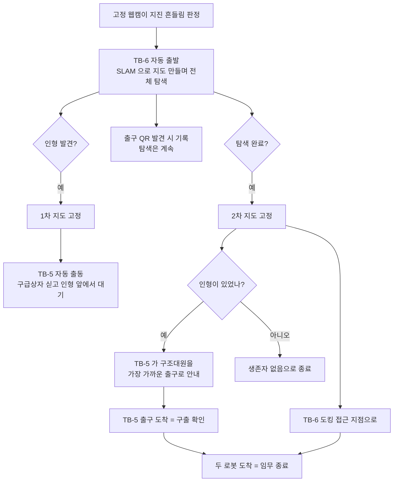

# 사업 요구 정의서 (BRD) v0.3

> 2026-10-14 판. [v0.2](brd-v0.2.md)(2026-10-11)는 운영자 출동 버튼, 지진 전 기준 지도, TB-5 의 사람 다리 추종, 웹캠 소실 + TB-6 재확인으로 완료 판정을 전제로 했다. 지금 시나리오와 맞지 않아 이 판으로 다시 썼다. 목차 번호는 교육 과정 BRD 양식을 따른다. 짝 문서는 SRD v0.3(`docs/requirements/srd-v0.3.md`, #277)이다. 이름과 약어는 용어집(`docs/glossary.md`, #273)을, 단계별 흐름과 결정 출처는 [scope.md 「지금 시나리오」](scope.md)를 따른다.

**프로젝트:** 지진 재난 현장 대응형 실내 탐색·구조 지원 자율 이동 로봇 시스템 (Phase 1)

**발표일:** 2026-10-16

## 1. 비즈니스 목표

지진 직후 건물 안에서 로봇 2대가 먼저 들어가 요구조자를 찾고, 구조대원을 요구조자와 출구까지 안내하는 초동 대응을 시연한다. 구조대가 위험 구역을 직접 수색하는 시간을 줄이는 것이 목적이다. 시연에서 요구조자는 인형이고, 구조대원은 실제 사람이 맡는다.

### 1.1 세부 목표

1. 지진 감지부터 탐색, 발견, 구조 안내, 출구 도착까지를 사람의 버튼 조작 없이 하나의 흐름으로 이어 간다.
2. 지도가 없는 건물에서 탐색 로봇(TB-6)이 지도를 만들고, 구조 로봇(TB-5)이 같은 지도를 쓴다.
3. 요구조자의 위치를 구조대가 들어가기 전에 지도 좌표로 알려 준다.
4. 구조 로봇이 구조대원보다 앞서 가며 길을 안내하고, 낮은 구조물 아래처럼 위험한 곳에서는 스스로 멈춘다.
5. 출구가 여러 개면 요구조자에게서 가장 가까운 출구로 안내한다.
6. 사건, 좌표, 로봇 상태, 판정 근거를 DB 에 남겨 나중에 대응 과정을 추적할 수 있게 한다.

## 2. 프로젝트 범위

Phase 1 은 평평한 단일 층 시연장에서 검증한다. 장비는 로봇 2대(TB-6, TB-5), 고정 웹캠 1대, PC(운영 PC, 로봇 담당 PC, 최종 구성의 Discovery 서버 PC)다. 「구출 완료」는 시연 판정이며 실제 구조의 성공을 뜻하지 않는다.

### 2.1 포함 범위

| 기능 | 내용 |
| --- | --- |
| 지진 감지 | 고정 웹캠 영상 전체의 흔들림으로 지진을 판정한다 |
| 자동 탐색 | TB-6 가 지도 전체를 탐색 경계(frontier) 순서로 돈다 |
| 요구조자 발견 | TB-6 카메라로 인형을 찾아 지도 좌표를 저장한다 |
| 출구 발견 | TB-6 가 출구 QR 을 읽어 출구를 여러 개 기록한다 |
| 지도 공유 | TB-6 지도를 두 번 고정해 TB-5 도 같은 지도로 위치를 잡는다 |
| 구조 안내 | TB-5 가 인형 앞까지 가고, 탐색이 끝나면 구조대원을 가장 가까운 출구로 이끈다 |
| 통로·터널 판단 | 머리 위 여유 46 cm 미만이면 멈춘다. 떠 있는 구조물 앞에서는 속도를 줄이고 높이를 재서 지나갈지 정한다 |
| 교통 관제 | 두 로봇이 마주치면 TB-5 가 먼저 가고 TB-6 가 비켜선다 |
| 관제 | 웹에서 지도, 두 로봇, 인형·출구·터널, 웹캠과 로봇 카메라 영상, 멈춘 이유를 본다 |
| 기록 | 사건, 좌표, 상태, 판정 근거, 오류를 DB 에 남긴다 |

### 2.2 제외 범위

| 제외 | 이유 |
| --- | --- |
| 사람을 들거나 옮기는 물리적 구조 | 로봇 능력 밖이다 |
| 사람 다리 추종 | 2026-10-13 결정으로 TB-5 가 앞서고 사람이 따라가는 방식으로 바꿨다(RQ-12) |
| TB-6 의 현장 재확인으로 구출 판정 | 2026-10-13 결정으로 TB-5 출구 도착을 구출 확인으로 쓴다(Q-10) |
| 지진 전 기준 지도 | 2026-10-13 결정으로 TB-6 SLAM 지도만 쓴다(Q-29 ⑦) |
| 후진 | 원형 로봇이라 제자리 회전과 전진으로 비켜선다. 뒤쪽에는 카메라가 없다 |
| 계단·경사·여러 층 | 평평한 단일 층만 쓴다 |
| 얼굴 신원 확인 | 개인정보 보호 |

## 3. 기능 요구사항

| 번호 | 요구 | 판정 기준 |
| --- | --- | --- |
| FR-01 | 웹캠 흔들림으로 지진을 판정하고, 가림·끊김은 판정 불가로 둔다 | 흔들면 재난, 가리면 판정 불가 |
| FR-02 | 지진 판정만으로 TB-6 탐색을 시작한다 | 버튼 없이 출발 |
| FR-03 | TB-6 는 갈 곳이 없을 때까지 탐색 경계를 돈다 | 탐색 완료 또는 시간 초과를 남김 |
| FR-04 | 인형을 찾으면 지도 좌표와 근거를 DB 에 저장하고 저장 확인을 받는다 | 저장 확인 뒤에만 다음 단계 |
| FR-05 | 출구 QR 은 정해 둔 글자와 정확히 같을 때만 출구로 기록한다 | 다른 QR 은 무시 |
| FR-06 | 인형 확정 뒤 지도를 고정하고 TB-5 가 바로 인형 앞으로 간다 | 운영자 승인 없이 출동 |
| FR-07 | 탐색이 끝나면 지도를 다시 고정하고, TB-5 는 멈춘 채 위치를 다시 맞춘다 | 고정은 두 번까지 |
| FR-08 | TB-5 는 지도 위 경로가 가장 짧은 출구로 간다. QR 출구가 없으면 출발 자리로 간다 | 출구 선택 근거를 남김 |
| FR-09 | 탐색이 끝났는데 인형이 없으면 TB-5 는 출발하지 않는다 | 생존자 없음으로 종료 |
| FR-10 | 머리 위 여유 46 cm 미만이거나 판정 불가이면 멈추고 보고한다 | 두 로봇 같은 기준 |
| FR-11 | 떠 있는 구조물 앞에서 속도를 줄이고, 높이를 재서 판정 영상에 지나갈 공간을 칠한다 | 초록 통과 가능, 빨강 통과 불가, 회색 판정 불가 |
| FR-12 | 두 로봇이 마주치면 TB-5 가 먼저 가고 TB-6 가 비켜선다. 너무 가까우면 새 명령을 막는다 | 이유 코드를 관제에 표시 |
| FR-13 | 관제 웹에서 지도, 로봇 상태, 인형·출구·터널, 영상, 멈춘 이유를 본다 | 1초 간격 갱신 |
| FR-14 | TB-5 출구 도착을 구출 확인으로, 두 로봇 도착을 임무 종료로 기록한다 | MISSION_FINISHED |

## 4. 비기능 요구사항

### 4.1 신뢰성
- 입력이 없거나 시각·좌표·지도 판이 맞지 않으면 움직이지 않고 이유를 남긴다. 실패를 정상값으로 채우지 않는다.
- 보고는 DB 저장 확인을 받을 때까지 다시 보낸다.
- 한 로봇에 문제가 생겨도 다른 로봇의 상태는 계속 보인다.

### 4.2 보안
- 관제 웹은 운영 PC 의 API 로만 명령을 보낸다. ROS 와 DB 에 직접 쓰지 않는다.
- 로봇은 네임스페이스로 나눈다. Discovery Server 에서는 도메인 ID 로 나뉘지 않는다.
- PC 이름, IP, 토큰은 저장소에 쓰지 않는다.

### 4.3 확장성
- 로봇·카메라 ID, 네임스페이스, 호스트는 배포 프로파일과 현장 파일이 정한다. 코드에 고정하지 않는다.
- 판정 로직은 ROS 없이 시험할 수 있게 나눠 둔다.

### 4.4 성능

| 번호 | 목표 | 상태 |
| --- | --- | --- |
| KPI-01 | 지진 판정 → TB-6 출발 명령 5초 이내 | 초안, NOT_RUN |
| KPI-02 | 인형 확정 → TB-5 출동 명령 (저장 확인·지도 고정 포함) | 시간 미정, NOT_RUN |
| KPI-03 | 인형 탐지 성공률 | 목표 미정(Q-04), NOT_RUN |
| KPI-04 | 주행 속도 상한 0.3 m/s, 터널 앞 0.3 배 | [설정] |

### 4.5 안전·개인정보
- 사람이 지켜보지 않을 때 로봇을 움직이지 않는다.
- 현장 정지는 관제 웹과 따로 있다.
- 로봇 설정 변경은 재범의 명시적 승인과 백업·확인·되돌리기 기록을 거친다.
- 영상은 판정 근거 구간만 남기고 얼굴로 신원을 확인하지 않는다.

## 5. 종속성 및 제약조건

### 5.1 종속성
- TurtleBot4 2대(Create 3, Raspberry Pi 4, OAK-D, 2D 라이다)와 TB-5 의 구급상자 탑재부.
- 고정 웹캠 1대, 운영 PC 와 로봇 담당 PC, 인형 탐지 모델(`assets/manifest/`).
- 시연장: 출발 자리 표시, 인형, 출구 QR, 머리 위 구조물(터널).
- TB-5 출발값 측정(시험 회차에서 한 번).

### 5.2 제약조건
- 2D 라이다는 바닥에서 0.23 m 높이만 본다 [측정, TB-5]. 그 위 0.23~0.46 m 구조물은 깊이 카메라로만 본다.
- 시연장은 실제 재난 현장과 잔해·조명·통로 폭이 다르다.
- 요구조자가 인형이므로 실제 사람의 자세 인식은 검증하지 않는다.
- SLAM 은 특징이 적은 공간에서 오차가 커지고, 이 오차는 인형 좌표 오차로 이어진다.
- 배터리가 탐색 시간을 제한한다. 탐색 시간 한도는 600 s 다 [설정].

## 6. 위험 및 완화조치

| 위험 | 영향 | 완화 |
| --- | --- | --- |
| 낮은 구조물이 라이다 사각지대에 있음 | TB-5·구급상자 충돌 | 깊이 카메라로 46 cm 기준 정지, 앞에서 감속 후 높이 판정 |
| 높이 기준점 오차 | 지나갈 수 있는 터널에서 멈춤 | TB-6 바닥 높이가 0 근처인지 실기에서 먼저 확인(#254) |
| 구조대원과 로봇 접촉 | 부상 | TB-5 가 앞서 가고 후진하지 않음, 속도 상한, 현장 정지 |
| 두 로봇이 좁은 길에서 마주침 | 교착, 충돌 | 교통 관제(TB-5 우선, TB-6 비켜서기, 최소 간격) |
| 웹캠 가림 | 지진 오판 | 가림·끊김은 판정 불가 |
| 인형 오탐·미탐 | 잘못된 출동, 생존자 놓침 | 확정 조건(신뢰도·연속 확인), 저장 확인 뒤에만 출동 |
| 지도가 바뀌어 좌표가 어긋남 | TB-5 가 엉뚱한 곳에 감 | 지도 판 번호로 좌표를 관리하고 고정 때 새 판으로 옮김 |
| 통신 단절 | 로봇 폭주 | 감시 노드가 속도 명령을 끊고, 정지를 확인하지 못하면 「정지 미확인」 |
| 목표마다 사람이 arm 해야 함 | 자동 탐색이 끊김 | 재범 결정 대기(이슈 #233) |

## 7. 수락 기준

아래를 모두 만족하면 Phase 1 을 수락한다. 2026-10-14 기준 실기는 모두 NOT_RUN 이다.

- 웹캠을 흔들면 버튼 없이 TB-6 가 출발하고, 가리면 출발하지 않는다.
- TB-6 가 지도 전체를 돌고 탐색 완료를 남긴다. 관제 웹에 실시간 지도가 보인다.
- 인형을 찾으면 저장 확인 뒤 1차 지도 고정이 일어나고 TB-5 가 인형 앞으로 간다.
- 탐색이 끝나면 2차 고정 뒤 TB-5 가 가장 가까운 출구로 간다. 출구 선택 근거가 남는다.
- 인형이 없는 회차는 TB-5 가 출발하지 않고 생존자 없음으로 끝난다.
- 46 cm 미만 터널에서는 멈추고, 46 cm 이상 터널에서는 초록으로 표시한 뒤 지나간다.
- 두 로봇이 마주치면 TB-5 가 먼저 가고 TB-6 가 비켜선다.
- 통신을 끊으면 로봇이 멈추고, 현장 정지는 관제 웹을 꺼도 동작한다.
- 사건, 좌표, 상태, 판정 근거, 오류가 DB 에 저장되고 관제에서 조회된다.
- 두 로봇이 도착하면 임무 종료가 기록된다.
