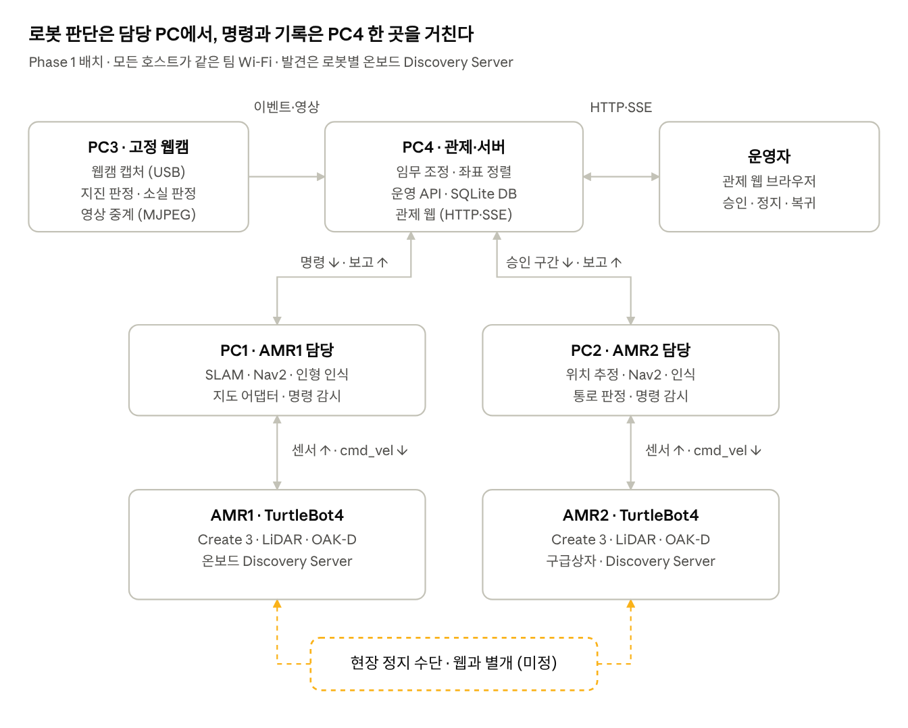

# ROKEY-7 시스템 요구사항 문서 (SRD)

> 작성: 팀원 세션(Claude), 2026-10-10. PM 지시(2026-10-10): "현재의 시나리오를 바탕으로 BR, SR을 작성해야 돼. 첨부한 pdf의 인덱스대로 내용 작성해줘." 목차 번호는 교육 과정이 준 BRD·SRD 양식 PDF 의 인덱스를 따른다. 근거는 [범위](scope.md), [BRD Part I v0.1](brd-part1-v0.1.md), [SDD 검토안 v0.1](../design/sdd-node-interface-spec-v0.1.md), 2026-10-09 시나리오 결정(PM 원문: "구조대원은 실제 사람, 요구조자는 인형으로 설정", "비스듬한 통로는 머리 위에 걸린 기둥이야")이다.
>
> **채택 결정이 아니다.** Phase 1 기준 문서는 여전히 [BRD Part I v0.1](brd-part1-v0.1.md) 이며, 이 문서의 채택은 Q-25 등 미결정 항목과 작전 검토 뒤에 정한다. 수치는 본문에 [초안]·[제안]·[미정] 으로 표시했다. 다이어그램 PNG 는 문서 편집기에서 내보낸 렌더링이다.
>
> 짝 문서: [BRD v0.2](brd-v0.2.md).

**프로젝트 제목:** 지진 재난 현장 대응형 실내 탐색·구조 지원 자율 이동 로봇(AMR) 시스템 (Phase 1)

**버전:** 0.2 (초안)

**날짜:** 2026.10.10

**근거:** ROKEY-7 BRD v0.2, 저장소 docs/requirements/scope.md, docs/design/architecture.md, docs/design/contracts.md, SDD 노드·인터페이스 검토안 v0.1. 측정되지 않은 수치는 [초안]·[미정]으로 표시한다.

## 1. 소개

이 SRD는 BRD v0.2의 지진 재난 수색·구조 지원 시나리오를 구현하기 위한 하드웨어, 소프트웨어, 네트워크, 통합 요구사항을 정의한다. 대상은 2026-10-16 발표의 Phase 1 시연이다. 노드와 토픽·서비스·액션의 상세는 SDD 검토안 v0.1을 따르고, 이 문서는 그 위의 시스템 수준 조건만 다룬다.

## 2. 시스템 개요

고정 웹캠이 지진을 감지하면, PC4의 임무 조정기가 AMR1(PC1)에 정찰을, 운영자 승인 뒤 AMR2(PC2)에 구간 이동을 맡긴다. SLAM·Nav2·인식은 각 로봇 담당 PC에서 돌고, 로봇 Pi에는 센서·구동 드라이버만 둔다. 관제 웹은 운영 API로만 명령을 보내고, DB 기록은 운영 서버 한 곳만 한다.

Phase 1 호스트 배치와 연결 · PC 4대, AMR 2대, 현장 정지

로봇 원본 센서 데이터는 담당 PC까지만 가고, PC4에는 결과와 상태만 올라간다. 점선의 현장 정지는 관제 웹을 거치지 않는 별도 경로다.

| 호스트 | 맡는 일 | 주요 구성 요소 |
| --- | --- | --- |
| PC1 | AMR1 정찰·재확인 | SLAM(slam_toolbox), Nav2, 인형 인식, 지도 어댑터, 실행 어댑터, 명령 감시 |
| PC2 | AMR2 구급상자·구간 이동 | 위치 추정, Nav2, 인형 재탐지, 통로 통과 판정, 실행 어댑터, 명령 감시 |
| PC3 | 고정 웹캠 | 영상 캡처, 지진 판정, 소실 판정, 영상 중계 |
| PC4 | 관제·서버 | 임무 조정, 좌표 정렬, 운영 API, DB·증거 저장, 관제 웹 |
| AMR1·AMR2 (Pi) | 센서·구동 | Create 3 구동, 2D LiDAR, OAK-D, 고정 TF, 온보드 Discovery Server |

명령 감시(watchdog)는 로봇 담당 PC에서 실행한다(OPS-17). PC↔로봇 연결이 끊길 때의 마지막 정지는 Create 3 자체 정지에 기대며, 이 시간은 실측 대상이다.

## 3. 하드웨어 및 OS 요구사항

AMR은 TurtleBot4 2대, PC는 Ubuntu 24.04 4대로 구성하고, 실제 장비 번호·사양은 Q-01·Q-02에서 확정한다.

### 3.1 PC (4대)

- **운영 체제:** Ubuntu 24.04 LTS [강의 제약; 원본 프로젝트 PC는 24.04.5로 측정]
- **구성:** 고사양 2대는 PC1·PC2(SLAM·Nav2·인식), 중간 사양 2대는 PC3·PC4(웹캠·관제) [제안 — 동시 부하 측정 후 확정, Q-02]
- **GPU:** 인형 인식을 돌리는 PC에 NVIDIA GPU. 원본 프로젝트 PC는 RTX 4070 Laptop이었다 [원본 기록: 측정]
- **네트워크:** 로봇과 같은 팀 전용 Wi-Fi에 접속
- **카메라:** PC3에 USB 웹캠 1대

### 3.2 AMR 장치 (TurtleBot4 기반, 2대)

- **하드웨어:** iRobot Create 3 구동부 + Raspberry Pi 4 [원본 기록: 측정]
- **운영 체제:** Ubuntu 24.04 + ROS 2 Jazzy (TurtleBot4 기본 이미지, turtlebot4_setup 1.0.4 이상)
- **카메라:** OAK-D Pro RGB-D (전방) [원본 기록: 측정]
- **센서:** 2D LiDAR RPLIDAR A1M8 [강의], Create 3 범퍼·낙하 센서
- **탑재물(AMR2):** 구급상자 탑재부. 탑재 후 높이·폭을 실측해 통로 판정 상자 크기에 반영한다
- **도킹:** 도킹 중 power_saver: True(기본값)에서 카메라·LiDAR가 꺼진다 [원본 기록: 측정, 2026-10-01]. 언도킹 뒤 센서 준비를 다시 확인한다
- **배터리:** 종단 간 시나리오 1회와 여유를 버티는 잔량. 출동 제외 기준치는 Q-06
- **변경 금지:** 로봇에 패키지를 설치·업그레이드하지 않고, 설정 변경은 사용자 승인 절차를 거친다

### 3.3 고정 웹캠 (1대)

- 구조 지점(인형)과 지진 감시 구역이 한 화면에 들어오는 위치에 고정한다.
- 시연 중 각도가 바뀌지 않도록 고정하고, 바뀌면 감시 영역을 다시 지정한다.
- 해상도·프레임 속도는 지진 판정 예비 시험으로 정한다 [미정].

## 4. 소프트웨어 요구사항

PC는 ROS 2 Jazzy 위에서 프로젝트 패키지와 표준 Nav2·SLAM을 돌리고, 로봇에는 TurtleBot4 기본 드라이버만 둔다.

### 4.1 PC 소프트웨어 패키지

- **ROS 2 Jazzy:** 로봇 제어와 통신의 기반. RMW는 rmw_fastrtps_cpp(Fast DDS 2.14.x, 한 PC에서 측정)
- **Python 3.10 ~ 3.12:** 판단 로직은 표준 라이브러리만으로 동작하고 ROS 없이 시험한다
- **slam_toolbox:** AMR1의 기준 지도 기반 SLAM, AMR2의 위치 추정 (두 지도의 정렬 방식은 Q-03·Q-09)
- **Nav2:** 경로 계획, 경로 추종, 속도 평활화, 충돌 감시(collision_monitor — 적용 여부 검증 필요)
- **OpenCV:** 웹캠 영상 입력, 감시 영역 소실 판정. 지진 판정(화면 전체 왕복 횟수, 블록 ZNCC)의 판정 코어는 순수 Python이다(#66)
- **객체 탐지:** YOLO 계열 탐지기로 인형 인식. 모델·가중치·데이터 출처는 미정(Q-04·Q-07)이며 출처·해시를 assets/manifest/에 기록한다
- **SQLite3:** 운영 장부와 증거 기록 (PC4)
- **관제 웹:** HTTP API, SSE 상태 스트림, MJPEG 영상. 웹 프레임워크는 미정

| 프로젝트 패키지 | 역할 | 실행 PC |
| --- | --- | --- |
| rescue_contracts | 공통 값·오류·시각·수락 계약 | 전체 |
| rescue_robot | Nav2 목표·취소·도킹 발행(유일한 발행자), 준비 상태 판정 | PC1, PC2 |
| rescue_mapping | 지도 상태, 관측의 지도 좌표 변환, 좌표 정렬 | PC1, PC2, PC4 |
| rescue_perception | 인형 탐지, 깊이·센서 좌표 관측, 통로 판정, 웹캠 판정 | PC1, PC2, PC3 |
| rescue_coordination | 임무 조정, 승인·구간 관리, 완료 판정 | PC4 |
| rescue_operations | 운영 API, DB 장부, 저장 확인 | PC4 |
| rescue_console | 관제 웹 화면 (읽기 전용 골격 구현, 명령 미연결 — #37) | PC4 |
| rescue_bringup | 배포 프로파일 읽기, launch | 전체 |

### 4.2 AMR 소프트웨어 패키지

- **TurtleBot4 기본 이미지(ROS 2 Jazzy):** Create 3 구동(odom·cmd_vel·도킹), LiDAR 드라이버, OAK-D 드라이버, 고정 TF
- **온보드 Discovery Server:** 로봇마다 고유 서버 ID
- **프로젝트 코드는 로봇에 설치하지 않는다.** SLAM·Nav2·인식은 모두 로봇 담당 PC에서 실행한다.

## 5. 네트워크 요구사항

모든 호스트는 팀 전용 Wi-Fi 하나에 묶고, ROS 발견은 Fast DDS Discovery Server로 한다. 지금 현장은 운영 PC(PC4)가 중앙 서버를 돌리고 있으며 [측정, 2026-10-10, #49], 로봇마다 Pi 서버를 두는 권고안 A와 어느 쪽으로 갈지는 로봇 쪽 설정을 확인한 뒤 정한다(5.1).

### 5.1 AMR 및 서버 연결성

- **무선 네트워크:** PC 4대와 로봇 Pi 2대가 같은 서브넷의 팀 전용 Wi-Fi를 쓴다. 대역·채널은 현장에서 정한다 [미정]
- **발견 방식:** 로봇별 온보드 Discovery Server(서버 ID 고유)를 권고안 A로 둔다 [제안]. PC는 ROS_DISCOVERY_SERVER에 두 서버를 모두 적고, 조회 도구는 SUPER_CLIENT로 띄운다. 현장 구성은 운영 PC 기록(#49, 운영 PC가 서버 ID 0을 실행)을 참조하고, 로봇 쪽 설정을 확인한 뒤 확정한다 [미확인]
- **로봇 구분:** 로봇별 네임스페이스를 배포 프로파일이 정한다. 도메인 ID는 Discovery Server에서 격리 수단이 아니다 [측정, 로컬]
- **서버 장애:** 서버가 죽어도 이미 연결된 노드는 통신을 이어가고, 새로 뜨는 노드만 발견하지 못한다 [측정, 로컬]. 재시작한 노드는 서버 복구 전까지 준비 안 됨으로 표시한다
- **백업 연결:** 두지 않는다. 통신이 끊기면 로봇은 안전 정지한다

### 5.2 데이터 전송 및 보안

- **영상 대역:** 로봇 RGB·깊이는 담당 PC만 구독한다. 원본 프로젝트에서 RGB+깊이 합 3.41 MB/s에서 RGB 지연이 1244 ms였다 [원본 기록: 측정, 2026-10-07]. 동시 스트림 예산은 실측으로 정한다
- **제어 지연:** 정지 상태 평균 RTT 9.2 ms [원본 기록: 측정, 2026-10-01]. 주행·영상 중 지연은 따로 잰다
- **웹·파일 전송:** 관제 웹↔운영 API는 HTTP·SSE, 웹캠 영상은 MJPEG, 증거·지도 파일은 sha256을 붙인 HTTP로 올린다
- **접근 경계:** 웹은 ROS·DB에 직접 연결하지 않는다. 서버 주소를 아는 다른 PC는 도메인과 무관하게 붙을 수 있으므로, 팀 장비만 접속한다
- **보안:** Wi-Fi 암호화 방식은 교육장 AP 설정을 따른다 [미확인]. 운영 API 인증은 미정이며, IP·토큰은 저장소에 기록하지 않는다

## 6. 기능 요구사항

모든 판단은 측정 시각이 붙은 최신 데이터로만 하고, 데이터가 없거나 낡으면 ‘판정 불가’를 돌려준다.

### 6.1 실시간 데이터 처리

- **지진 판정(PC3):** 웹캠 프레임에 취득 시각을 붙이고, 화면 전체가 같은 방향으로 움직였는지 블록 매칭(ZNCC, 네 사분면 일치)으로 본다. 시간 창 안의 방향 전환(왕복) 횟수가 기준 이상인 상태가 유지 시간 동안 이어지면 재난 징후 이벤트를 발행한다. 손·어두움·렌즈 막힘·카메라 앞에 선 사람처럼 원래 장면이 가려지면 ‘판정 불가’(UNKNOWN)로 두고, 영상이 끊기거나 무효하면 판정하지 않는다. 기준값은 Q-11에서 정하며 기본값이 없다(#33 설계 v3, 구현 #66).
- **인형 인식·좌표 변환(PC1·PC2):** RGB에서 인형을 탐지하고, 탐지 영역의 유효 깊이 중앙값을 CameraInfo로 역투영한 뒤 관측 시각의 TF로 지도 좌표에 옮긴다. 깊이가 없으면 발견 사실만 남기고 위치는 미확정으로 둔다.
- **통로 통과 판정(PC2):** AMR2가 멈춘 상태에서 깊이 프레임 몇 장을 받아 중앙값을 내고, 로봇 기준 3D 점으로 바꾼다. ‘로봇+구급상자’ 폭·높이에 여유를 더한 상자를 전방 경로에 놓고, 그 안의 점 수와 유효 깊이 비율로 통과 가능 / 통과 불가 / 판정 불가를 낸다. 같은 상자를 RGB 영상에 그려 운영자에게 보여 주고, 최종 통과는 운영자가 승인한다. [Q-25 결정 대기]
- **임무 조정(PC4):** 재난 이벤트를 이벤트 ID로 중복 제거하고, 명령마다 세대 번호와 명령 권한(lease)을 붙인다. AMR2는 구간 하나씩만 발급하고, 실제 정지와 결과를 확인한 뒤 다음 승인을 기다린다.
- **완료 판정(PC3·PC4·PC1):** PC3는 지정된 감시 영역에서 연속 소실을 ‘구조 완료 후보’로, 가림·끊김을 UNKNOWN으로 보낸다. UNKNOWN이면 관제 웹이 영상과 함께 알리고, 운영자가 재확인을 지시할 수 있다(`REQUEST_RECHECK`, Q-26). PC4는 AMR1 재관측의 카메라·라이다·관측 범위 결과를 받아, 소실(또는 지시) 이후 관측인지 확인한 뒤 완료를 기록한다.
- **정지 처리:** 명령 권한·상태·TF가 만료되면 새 명령을 막고, 이동 중이면 취소 후 실제 정지를 관측한다. 관측하지 못하면 STOP_UNCONFIRMED를 보고한다.

### 6.2 저장 및 보관

- **데이터 로그 기록:** 재난 이벤트(시각·카메라·근거 영상), 대상 좌표(지도 버전·관측 시각·신뢰도), 로봇 상태, 운영자 승인(누가·언제·무엇을), 통로 판정 근거, 완료 판정 근거, 오류, 로봇의 대상 도착 시각
- **저장 확인:** 운영 서버가 DB 커밋 후 ‘저장됨(PERSISTED)’을 돌려줄 때까지 보고를 재전송한다. 명령 수락, 완료, 저장은 서로 다른 상태로 구분한다
- **실행 기록:** 노드는 기동할 때 git SHA, 모델 해시, 실제 적용 설정을 로그에 남기고, 실패 경로에도 로그를 남긴다
- **보관:** 시연과 결과 분석에 필요한 기간만 보관한다. 영상은 판정 근거 구간만 남기고, 보관 기간은 미정이다

## 7. 비기능 요구사항

### 7.1 성능

시간 목표 2개와 속도 제한만 초안이 있고, 나머지는 통합 시험에서 잰 뒤 정한다. 원본 프로젝트의 수치는 참고로만 쓰고 합격값으로 승계하지 않는다.

| 항목 | 목표 | 상태 |
| --- | --- | --- |
| 지진 판정 → 관제에 재난 이벤트 표시 | 5초 이내 | 초안 (Q-23) |
| 재난 이벤트 검증 → AMR1 정찰 명령 (자동) | 3초 이내 | 초안, KPI-02 |
| 운영자 승인 → AMR2 명령 전달 | 3초 이내 | 초안, 승인 후 시간으로 따로 잼 (Q-25) |
| AMR2 이동 속도 | 일반 0.2 m/s, 통로·사람 근접 0.1 m/s 이하 | 제안, 미측정 |
| 통신 단절 후 로봇 정지까지 시간 | 실측 후 결정 | Create 3 문서의 0.5초는 미검증 (TR-11·T-05) |
| 관제 웹 상태 갱신 지연 | 실측 후 결정 | 미정 |
| 웹캠 처리 프레임 속도 | 지진 판정 예비 시험 후 결정 | 미정 |
| 로봇 RGB+깊이 동시 수신 대역 | 실측 후 예산 확정 | 원본 3.41 MB/s에서 RGB 1244 ms 지연 [원본 기록: 측정] |
| 지도 갱신 주기 | 실측 후 결정 | 미정 |

## 8. 준수 요구사항

구조대원 역할을 실제 사람이 맡으므로, 운영 안전 규칙을 기능보다 우선한다.

- **데이터 보호:** 얼굴 기반 신원 확인을 하지 않고, 영상은 판정 근거 구간만 남긴다. 저장소와 문서에 개인 경로, 호스트 이름, IP, 토큰을 쓰지 않는다.
- **조작 주체:** 로봇은 한 번에 한 사람·한 세션만 움직이고, 언도킹·도킹·이동·카메라 재시작 전후에 팀에 알린다. 다른 팀 로봇은 쓰지 않는다.
- **감시 아래 이동:** 사람이 지켜보지 않을 때 로봇을 움직이지 않는다. 로봇을 움직이지 않는 시험은 로봇 도메인과 겹치지 않는 설정과 ROS_AUTOMATIC_DISCOVERY_RANGE=LOCALHOST로 한다.
- **현장 정지:** 관제 웹과 별개인 현장 정지 수단을 둔다(수단 미정).
- **설정 변경:** 로봇 설정 변경은 사용자의 명시적 승인 → 백업 → 변경 전 해시 확인 → 변경 → 변경 후 해시 확인 → 재시작 → 동작 확인 → 되돌리는 방법 기록 순서로 한다. 로봇에 패키지를 설치·업그레이드하지 않는다.
- **프로세스 종료:** 이름을 정확히 지정하거나 PID로 끄고, 넓게 잡는 종료 명령을 쓰지 않는다.
- **하루 마감:** 로봇을 도킹하고 전원을 끈다.

## 9. 수락 기준

PC 4대와 AMR 2대를 동시에 띄운 상태에서 아래를 모두 만족하면 수락한다. 실행하지 않은 시험은 ‘미실행’으로 기록하며 통과로 보지 않는다.

### 9.1 시스템 성능

- 지진 판정 후 5초 이내(초안)에 재난 이벤트가 관제에 표시되고, 같은 이벤트로 출동이 중복되지 않는다.
- 재난 이벤트 검증 후 3초 이내(초안)에 AMR1이 정찰 명령을 수락한다(운영자 조작 없음).
- 운영자 승인 후 3초 이내(초안)에 AMR2가 명령을 수락한다.
- 웹캠 영상을 끊거나 가리면 재난 판정·소실 후보가 나오지 않고 카메라 상태가 표시된다.
- 로봇 원본 영상은 담당 PC만 구독하고, 측정한 대역에서 인식 지연이 허용 범위 안에 있다. (허용 범위는 실측 후 확정)

### 9.2 Navigation SLAM

- AMR1이 기준 지도 기반 SLAM으로 탐색하고, 지도·변화 장애물·로봇 위치가 관제에 표시된다.
- 인형 좌표가 시험 전 정한 허용 오차 안에 있고, AMR2는 허용 도착 반경 안에 선다. (두 수치 모두 Q-21)
- 지도가 생겼다는 것만으로 이동을 허용하지 않고, 지도·TF·센서가 최신일 때만 이동한다.
- 주행 중 장애물에 Nav2 회피 또는 안전 정지가 수행되고, 최종 실패 시 오류 상태가 관제에 반영된다.

### 9.3 관제 명령 조작

원본 양식의 ‘Teleop 키 조작’ 항목을 이 시스템의 운영자 명령으로 바꾼다. 이 시스템은 수동 원격 조종을 쓰지 않는다.

- AMR2 출동 승인, 구간 ‘계속’, 정지, 복귀, 임무 종료, AMR1 수동 시작(자동 발급 실패 시 대체)이 운영 API로 전달되고 결과가 관제에 표시된다.
- 승인 없이 AMR2가 움직인 횟수는 0이다.
- 같은 명령을 두 번 보내도 한 번만 실행된다.
- 정지 명령 뒤 로봇의 실제 정지가 관측되며, 관측하지 못하면 ‘정지 미확인’이 표시된다.

### 9.4 통합 테스트

- PC 4대와 AMR 2대가 동시에 돌 때 두 로봇의 센서·TF·명령·취소·정지가 서로 섞이지 않는다.
- 지진 감지 → AMR1 정찰·발견 → 좌표 저장 → AMR2 승인·구간 이동 → 인형 재탐지 → 소실 후보(판정 불가면 운영자 판단) → AMR1 재확인 → 구조 완료 → 복귀의 종단 간 시나리오가 합의한 횟수만큼 완료된다. (횟수 미정)
- 사건, 좌표, 상태, 승인, 판정 근거, 오류가 DB에 저장되고 관제에서 조회된다.

### 9.5 안전 및 보안

- 시험 환경에서 사람·장애물과의 충돌이 한 번도 없다.
- 머리 위 기둥을 ‘라이다 평면 이하 / 라이다 평면 위·로봇 상단 아래 / 로봇 상단보다 높음’ 세 높이로 시험해, 가운데 높이에서 통과 불가 또는 판정 불가가 나온다. [Q-25 결정 대기]
- 통신을 끊으면 이동 중인 로봇이 멈추거나 ‘정지 미확인’이 표시된다.
- 현장 정지 수단이 관제 웹을 꺼도 동작한다.
- 다른 팀 로봇의 토픽이 우리 그래프에 섞이지 않는다.

### 9.6 최종 목표 달성

- 종단 간 시나리오가 합의한 성공률 이상으로 완료된다. (성공률 미정)
- 구조 완료 오판정은 0회다. 인형을 둔 채 재확인하면 ‘미구조’, 웹캠을 가리면 ‘판정 불가’가 나오는 반대 시험을 통과한다.
- 인형 탐지 성공률이 합의한 목표 이상이다. (목표·평가 데이터는 Q-04)
