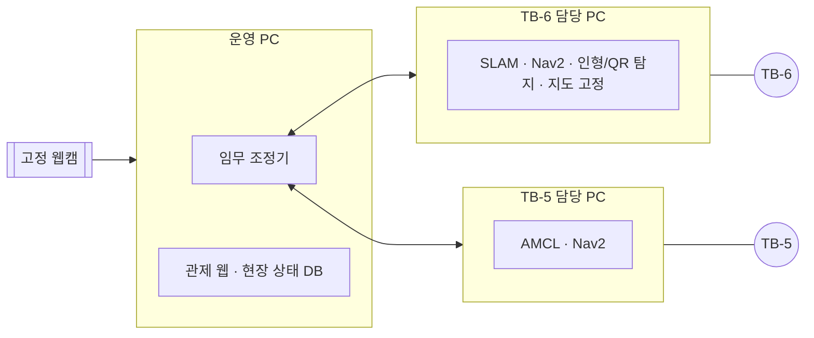

# 시스템 요구 정의서 (SRD) v0.3

> 2026-10-14 판. [v0.2](srd-v0.2.md)(2026-10-10)는 운영자 출동 버튼, TB-5 의 사람 다리 추종, TB-6 재확인, 웹캠 전용 PC 를 전제로 했다. 지금 시나리오와 맞지 않아 이 판으로 다시 썼다. 목차 번호는 교육 과정 SRD 양식을 따른다. 이름과 약어는 용어집(`docs/glossary.md`, #273)을, 흐름은 [scope.md 「지금 시나리오」](scope.md)를, 프로그램 배치는 [시스템 구조](../design/architecture.md)를 따른다. 값은 [현장 파일](../../config/field/search_area.field.json) 한 곳에 있고 이 문서는 그 값을 옮겨 적기만 한다.

**프로젝트:** 지진 재난 현장 대응형 실내 탐색·구조 지원 자율 이동 로봇 시스템 (Phase 1, 2026-10-16 발표)

## 1. 소개

이 문서는 사업 요구 정의서(BRD)의 시나리오를 구현하는 데 필요한 장비, 소프트웨어, 네트워크, 기능·성능·안전 요구를 정한다. 노드와 토픽의 자세한 연결은 시스템 설계서(SDD)와 [시스템 구조](../design/architecture.md)에 있다.

## 2. 시스템 개요

고정 웹캠이 지진 흔들림을 판정하면 TB-6 가 바로 탐색을 시작한다. TB-6 는 SLAM 으로 지도를 만들며 지도 전체를 돌고, 인형과 출구 QR 을 찾는다. 인형을 찾으면 지도를 한 번 고정하고 TB-5 가 구급상자를 싣고 인형 앞까지 간다. 탐색이 끝나면 지도를 다시 고정하고, TB-5 가 사람을 가장 가까운 출구로 이끈다. TB-6 는 도킹 접근 지점으로 돌아간다.

| 장비 | 맡는 일 |
| --- | --- |
| 운영 PC | 웹캠 판정, 임무 조정, 현장 상태 DB, 보고 저장, 영상 중계, 관제 웹 |
| TB-6 담당 PC | TB-6 의 SLAM(2차 고정 뒤 AMCL), Nav2, 통로·터널 판정, 인형·QR 탐지, 지도 고정 |
| TB-5 담당 PC | TB-5 의 고정 지도 위치 추정(AMCL), Nav2, 통로·터널 판정 |
| Discovery 서버 PC | 최종 구성에서 ROS 2 발견 서버만 맡는다 |
| TB-6, TB-5 (각 Raspberry Pi) | Create 3 구동, 라이다, OAK-D 카메라, 기본 TF. 프로젝트 코드는 로봇에 설치하지 않는다 |

시험 중에는 TB-6 담당 PC 와 TB-5 담당 PC 를 한 PC 에서 돌리기도 한다.

## 3. 하드웨어 및 OS 요구사항

### 3.1 PC

- 운영 체제: Ubuntu 24.04 LTS, ROS 2 Jazzy [강의 제약].
- 인형 탐지를 돌리는 TB-6 담당 PC 에는 NVIDIA GPU 가 있어야 한다.
- 운영 PC 에 USB 웹캠 1대를 꽂는다. 관제 웹에서 장치를 바꿀 수 있다(#257).
- 한글 글꼴(Noto Sans CJK)이 터널 판정 영상을 만드는 PC 에 있어야 한다. 확인 명령: `fc-list :lang=ko`.

### 3.2 로봇 (TurtleBot4, 2대)

- Create 3 구동부, Raspberry Pi 4, OAK-D 카메라(앞), 2D 라이다 [문서].
- 라이다 높이는 바닥에서 0.23 m 다 [측정, TB-5 줄자, 2026-10-13]. TB-6 는 같은 모델로 본다 [추정].
- TB-5 는 구급상자를 싣는다. 실은 상태의 높이로 통로 기준 46 cm 를 정했다(scope Q-25).
- 도킹 중에는 카메라와 라이다가 꺼질 수 있어서, 도킹을 푼 뒤 센서 준비를 다시 확인한다 [원본 기록: 측정, 2026-10-01].
- 로봇에 패키지를 설치하거나 업그레이드하지 않는다. 로봇 설정 변경은 등급 4 절차를 따른다(팀 규칙 4·5절).

### 3.3 고정 웹캠 (1대)

- 지진 흔들림을 볼 수 있는 자리에 고정한다. 각도가 바뀌면 감시 영역을 다시 지정한다.

## 4. 소프트웨어 요구사항

### 4.1 PC 소프트웨어

| 구성 요소 | 쓰는 곳 | 비고 |
| --- | --- | --- |
| ROS 2 Jazzy, Fast DDS | 모든 PC | 발견은 Discovery Server(5절) |
| slam_toolbox | TB-6 담당 PC | 탐색 중에만 |
| Nav2 (AMCL, collision_monitor 포함) | 로봇 담당 PC | 복구 동작에서 후진 제외(#267) |
| depth_image_proc | 로봇 담당 PC | 깊이 영상 → 점구름(통로·터널 판정) |
| YOLO 인형 탐지 모델 | TB-6 담당 PC, 웹캠 판정 | 모델과 해시는 `assets/manifest/` 에 기록 |
| OpenCV | 웹캠 판정, QR 읽기 | |
| SQLite | 운영 PC | 현장 상태 DB(스키마 1.4), 보고 저장 DB, 관제 웹 계정 DB |
| Flask | 운영 PC | 관제 웹. ROS 노드가 아니다 |

| 프로젝트 패키지 | 하는 일 | 실행하는 PC |
| --- | --- | --- |
| rescue_interfaces | ROS 메시지·서비스·액션 정의 | 모든 PC |
| rescue_contracts | ROS 없이 쓰는 공통 규칙(오류, ID, 지도 해시, 탐색 경계·격자 경로) | 모든 PC |
| rescue_mapping | 좌표 변환과 지도 판 검사 | 로봇 담당 PC |
| rescue_perception | 웹캠 판정, 인형·QR 탐지, 터널 판정, 영상 중계 | 운영 PC, 로봇 담당 PC |
| rescue_robot | 실행기, 감시 노드, 지도 고정, 고정 지도 중계 | 로봇 담당 PC |
| rescue_coordination | 임무 조정기(교통 관제 포함) | 운영 PC |
| rescue_operations | 현장 상태 DB 기록과 명령 API, 보고 저장, 실시간 지도 파일, 로봇 직접 관측 | 운영 PC |
| rescue_console | 관제 웹 | 운영 PC |
| rescue_bringup | launch 파일, 프로파일·현장 파일 검사 | 모든 PC |

### 4.2 로봇 소프트웨어

- TurtleBot4 기본 이미지(ROS 2 Jazzy)만 쓴다. 구동, 라이다, OAK-D 드라이버, 기본 TF, 로봇 안의 Discovery Server 가 들어 있다.
- SLAM, Nav2, 인식은 모두 로봇 담당 PC 에서 돌린다.

## 5. 네트워크 요구사항

### 5.1 연결과 발견

- 모든 PC 와 두 로봇은 팀 전용 Wi-Fi 하나에 묶는다.
- 시험 중에는 각 PC 가 두 로봇의 Pi Discovery Server 를 둘 다 적는다(권고안 A). 한 번의 실습이 성공하면 Discovery 서버 PC 로 바꾼다. 로봇이 그 서버에 붙는 방법은 아직 정하지 않았다([network-discovery.md](../design/network-discovery.md)).
- Discovery Server 에서는 도메인 ID 로 로봇을 나눌 수 없다 [측정, 로컬]. 로봇은 네임스페이스(`/robot6`, `/robot5`)로 나눈다.
- 서버가 꺼져도 이미 연결된 노드는 계속 통신하고, 새로 뜨는 노드만 상대를 찾지 못한다 [측정, 로컬].

### 5.2 데이터 전송

- 로봇의 RGB·깊이 원본은 그 로봇 담당 PC 만 구독한다. 운영 PC 에는 판정 결과와 작은 미리보기 영상만 보낸다.
- 깊이 영상은 압축(compressedDepth)으로 받는다. TB-5 에서 원본 5.1~5.5 Hz, 압축 6.9~9.2 Hz 였다 [측정, 2026-10-13].
- 관제 웹은 ROS 와 직접 연결하지 않는다. 현장 상태 DB 를 읽고, 명령은 운영 PC 의 HTTP API 로 보낸다.
- PC 이름, IP, 토큰은 저장소에 쓰지 않는다.

## 6. 기능 요구사항

판단은 측정 시각이 붙은 최신 데이터로만 한다. 데이터가 없거나 오래됐으면 판정 불가로 두고 움직이지 않는다.

### 6.1 실시간 처리

| 기능 | 요구 | 맡는 곳 |
| --- | --- | --- |
| 지진 판정 | 웹캠 화면 전체가 같은 방향으로 왕복하는 횟수로 지진 흔들림을 판정한다. 가림·어두움·끊김은 지진이 아니라 판정 불가로 둔다 | webcam_node |
| 자동 탐색 시작 | 지진 판정만으로 TB-6 탐색을 시작한다. 운영자 버튼은 없다 | 임무 조정기 |
| 지도 전체 탐색 | TB-6 는 가장 가까운 탐색 경계로 간다. 빈 지도 확인이 3번 이어지면 탐색 완료, 600 s 를 넘으면 시간 초과다 [설정] | 임무 조정기 |
| 인형 탐지와 위치 | RGB 에서 인형을 찾고, 깊이와 촬영 시각의 TF 로 지도 좌표를 낸다. 깊이가 없으면 위치는 미확정이다 | amr_target, target_locator |
| 출구 QR | 허용 목록과 글자가 정확히 같은 QR 만 출구로 등록한다. 여러 개를 등록하고 탐색을 계속한다 | amr_target, exit_locator |
| 보고와 저장 확인 | 인형 보고는 DB 저장 확인(PERSISTED)을 받아야 다음 단계로 간다 | 임무 조정기, report_node |
| 지도 고정 | 인형 확정 때와 탐색 완료 때 두 번 고정한다. 세 번째는 거절한다 | map_freeze |
| TB-5 자동 출동 | 1차 고정 뒤 인형 앞 0.8 m 접근 지점으로 간다 [설정] | 임무 조정기 |
| 출구 선택 | 2차 고정 지도에서 인형으로부터 격자 경로가 가장 짧은 출구로 간다. QR 출구가 없으면 TB-5 출발 자리로 간다 | 임무 조정기 |
| 끝 | TB-5 출구 도착이 구출 확인이다. 두 로봇이 다 도착하면 임무 종료(MISSION_FINISHED). 인형이 없으면 생존자 없음(NO_SURVIVOR_FOUND) | 임무 조정기 |
| 통로 판정 | 머리 위 여유 0.46 m 미만이면 멈춘다. 깊이 점 5개 이상, 앞 0.4~1.0 m [설정] | Nav2 collision_monitor |
| 터널 판정 | 라이다 위에 떠 있는 구조물 앞에서 0.3 배로 줄이고, 높이를 재서 통과 가능·불가·판정 불가를 낸다. 판정 영상에 지나갈 공간을 칠한다 | overhead_passage |
| 교통 관제 | TB-5 가 우선이다. TB-6 는 TB-5 길에서 비키고, 두 로봇이 최소 간격보다 가까우면 새 명령을 막는다 | 임무 조정기 (#272) |
| 관제 | 지도, 두 로봇 상태, 인형·출구·터널, 웹캠과 로봇 카메라 영상, 이유 코드를 보인다 | 관제 웹 |

### 6.2 저장

- 현장 상태 DB 에 사건, 임무 상태, 대상·출구 좌표, 로봇 상태·위치, 터널 판정을 기록한다.
- 보고는 별도 DB 에 저장하고 저장 확인을 돌려준다. 명령 수락, 임무 완료, 저장 완료를 서로 다른 상태로 다룬다.
- 노드는 기동할 때 git SHA, 모델 해시, 실제 적용 설정을 로그에 남긴다.

## 7. 비기능 요구사항

| 항목 | 목표 | 상태 |
| --- | --- | --- |
| 지진 판정 → 관제 표시 | 5초 이내 | 초안 (Q-23), NOT_RUN |
| 인형 확정 → TB-5 출동 명령 | 저장 확인과 지도 고정 시간을 포함해 잰다 | 미정, NOT_RUN |
| 주행 속도 상한 | 0.3 m/s, 1.2 rad/s | [설정] 감시 노드 한도 |
| 터널 앞 감속 | 0.3 배 | [설정] |
| 터널 판정 확정 | 약 0.7 s (0.2 s × 3 프레임) | [측정, 합성 시험] |
| 통신 단절 뒤 정지 시간 | 실측 후 결정 | NOT_RUN |
| 웹 상태 갱신 | 1초 폴링 | [설정] |

## 8. 준수 요구사항

사람이 TB-5 를 따라가므로 안전 규칙이 기능보다 우선한다.

- 얼굴로 신원을 확인하지 않는다. 영상은 판정 근거 구간만 남긴다.
- 로봇은 한 번에 한 사람·한 세션만 움직인다. 사람이 지켜보지 않을 때 움직이지 않는다.
- 로봇을 움직이지 않는 시험은 도메인 10 이상과 `ROS_AUTOMATIC_DISCOVERY_RANGE=LOCALHOST` 로 한다.
- 현장 정지는 관제 웹과 따로 있다(`scripts/field/stop_robot.sh`, 그래도 움직이면 사람이 든다).
- 후진하지 않는다. 원형 로봇이라 제자리 회전과 전진으로 비켜선다.
- 프로세스는 PID 나 정확한 이름으로 끈다.
- 하루를 마치면 도킹하고 전원을 끈다.

## 9. 수락 기준

실행하지 않은 시험은 NOT_RUN 으로 적고 통과로 보지 않는다. 2026-10-14 기준 전부 NOT_RUN 이다(가짜 로봇 ROS 통합 시험 3회만 있음: [리허설 기록](../evidence/rehearsal-2026-10-13-record.md)).

### 9.1 시스템 성능
- 웹캠을 흔들면 5초 안에 관제에 재난이 표시되고 TB-6 가 출발한다. 같은 사건으로 탐색이 두 번 시작되지 않는다.
- 웹캠을 가리거나 끊으면 지진 판정이 나오지 않고 카메라 상태가 표시된다.

### 9.2 탐색과 지도
- TB-6 가 지도 전체를 돌고 탐색 완료를 낸다. 관제 웹에 실시간 지도가 보인다.
- 지도 고정이 두 번 일어나고, TB-5 가 두 번 모두 고정 지도에서 위치를 잡는다.
- 인형 좌표와 TB-5 도착 위치가 시험 전에 정한 허용 오차 안이다(Q-21).

### 9.3 관제와 명령
- 관제 웹에 두 로봇 상태, 인형, 출구, 터널, 이유 코드가 보인다.
- 같은 명령을 두 번 보내도 한 번만 실행된다.
- 정지 명령 뒤 실제 정지가 관측된다. 관측하지 못하면 「정지 미확인」이 표시된다.

### 9.4 통합 시험
- 지진 → 탐색 → 인형 → 1차 고정 → TB-5 출동 → 탐색 완료 → 2차 고정 → 출구 → 임무 종료를 한 회차로 끝낸다. 인형이 없는 회차는 생존자 없음으로 끝난다.
- 두 로봇의 센서, TF, 명령이 서로 섞이지 않는다.

### 9.5 안전
- 사람·장애물과 한 번도 부딪치지 않는다.
- 머리 위 구조물 높이를 46 cm 미만, 근처, 이상으로 바꿔 가며 시험한다. 미만에서는 멈추고, 이상에서는 초록으로 표시한 뒤 지나간다.
- 통신을 끊으면 움직이던 로봇이 멈추거나 「정지 미확인」이 표시된다.
- 현장 정지가 관제 웹을 꺼도 동작한다.

### 9.6 최종 목표
- 위 시나리오를 합의한 횟수만큼 성공한다(횟수 미정).
- 인형이 있는데 「생존자 없음」, 인형이 없는데 출동하는 오판이 0회다.
